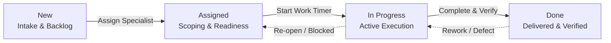

# CURQ Documentation

Comprehensive technical and operational documentation for the CURQ business suite. Built with [Sphinx](https://www.sphinx-doc.org/), [MyST Parser](https://myst-parser.readthedocs.io/) (Markdown), [Diátaxis Framework](https://diataxis.fr/), and [`sphinx-multiversion`](https://holzhaus.github.io/sphinx-multiversion/master/).

---

## Table of Contents

1. [Prerequisites](#1-prerequisites)
2. [Quick Start & Environment Setup](#2-quick-start--environment-setup)
3. [Documentation Architecture (Diátaxis Framework)](#3-documentation-architecture-diátaxis-framework)
4. [Adding a New Module](#4-adding-a-new-module)
5. [Authoring & Quality Guidelines](#5-authoring--quality-guidelines)
   * [5.1 Prerequisites Formatting](#51-prerequisites-formatting)
   * [5.2 Settings and Fields Standard](#52-settings-and-fields-standard)
   * [5.3 Cross-Referencing](#53-cross-referencing)
   * [5.4 Related Documentation Rules](#54-related-documentation-rules)
   * [5.5 Flowcharts & Mermaid Diagrams](#55-flowcharts--mermaid-diagrams)
6. [Local Preview & Build Commands](#6-local-preview--build-commands)
7. [Multi-Version Documentation & Git Tagging](#7-multi-version-documentation--git-tagging)
8. [Docker & Production Deployment](#8-docker--production-deployment)
9. [Project Directory Layout](#9-project-directory-layout)

---

## 1. Prerequisites

Before getting started, ensure you have the following installed on your machine:

* **Python**: `3.12+`
* **Git**: `2.30+`
* **Make**: GNU Make utility

---

## 2. Quick Start & Environment Setup

### 1. Clone the Repository
```bash
git clone https://github.com/ManfredNelvin-Dev/curq-documentation.git
cd curq-documentation
```

### 2. Create and Activate a Virtual Environment
```bash
python3 -m venv .venv
source .venv/bin/activate
```

### 3. Install Required Dependencies
```bash
pip install --upgrade pip
pip install -r requirements.txt
```

---

## 3. Documentation Architecture (Diátaxis Framework)

All module documentation in CURQ adheres strictly to the **Diátaxis Documentation Framework**, systematically organizing technical knowledge into four distinct cognitive quadrants:

```text
docs/<ModuleName>/
├── getting-started/          # 1. Tutorials: Learning-oriented walkthroughs
│   ├── 01-....md
│   └── 02-....md
├── task-guides/              # 2. How-To: Goal-oriented practical procedures
│   ├── 01-....md
│   ├── 02-....md
│   └── ...
├── settings-and-fields/      # 3. Reference: Information-oriented data dictionaries
│   ├── 01-....md
│   └── ...
├── core-concepts/            # 4. Explanation: Understanding-oriented architecture & workflows
│   ├── 01-....md
│   └── 02-....md
├── media/                    # Screenshots and imagery referenced in guides
└── faq.md                    # Frequently asked questions for the module
```

### Purpose of Each Category

| Category | Diátaxis Role | Purpose & Content |
| :--- | :--- | :--- |
| **`getting-started/`** | **Tutorials** | Hands-on, step-by-step beginner guides taking a user through their first complete workflow (e.g. logging a first ticket or processing a first sale). |
| **`task-guides/`** | **How-To Guides** | Problem-focused procedural instructions for specific business operations (e.g. configuring stage escalation, issuing refunds, merging contacts). |
| **`settings-and-fields/`** | **Reference** | Strict data dictionaries containing tables of UI fields, types, options, validation rules, and configuration parameters. **No imagery.** |
| **`core-concepts/`** | **Explanation** | Deep-dive theoretical guides explaining state progression, business logic, routing engines, SLA timers, and cross-module ERP linkages. |
| **`faq.md`** | **FAQ** | Direct, concise answers to common user questions, troubleshooting scenarios, and operational edge-cases. |

---

## 4. Adding a New Module

Follow these steps whenever adding a new CURQ module (for example: **Inventory**):

### 4.1 Register the Module in `module_registry.py`
Add an entry to `MODULE_REGISTRY` in `module_registry.py`:

```python
MODULE_REGISTRY: Dict[str, Dict[str, str]] = {
    # Existing modules...
    'Inventory': {
        'display_name': 'Inventory',
        'icon': 'inventory-icon.png',
        'description': 'Stock & Warehouse Management',
        'sidebar_key': 'inventory',
    },
}
```

* **`folder_name` (Key)**: Must exactly match the directory name created in `docs/` (case-sensitive).
* **`display_name`**: Label displayed on landing page cards and sidebar navigation.
* **`icon`**: Icon filename located in `_static/images/`.
* **`description`**: Sub-heading displayed under the module title on the landing page.
* **`sidebar_key`**: URL parameter key used for active sidebar highlights (e.g., `?module=inventory`).

### 4.2 Add the Module Icon
Place the icon image into the static images directory:
```text
_static/images/inventory-icon.png
```
*(Recommended format: PNG, 64x64 or 128x128 pixels with a transparent background).*

### 4.3 Create the Diátaxis Directory Structure
Create the required subdirectories:

```bash
mkdir -p docs/Inventory/getting-started \
         docs/Inventory/task-guides \
         docs/Inventory/settings-and-fields \
         docs/Inventory/core-concepts \
         docs/Inventory/media
```

### 4.4 Create the Core Files
Populate each subdirectory with numbered Markdown files (`01-`, `02-`) to establish deterministic sidebar ordering:
* `docs/Inventory/getting-started/01-receive-your-first-shipment.md`
* `docs/Inventory/task-guides/01-manage-warehouses-and-locations.md`
* `docs/Inventory/settings-and-fields/01-inventory-operation-field-definitions.md`
* `docs/Inventory/core-concepts/01-understanding-double-entry-inventory.md`
* `docs/Inventory/faq.md`

---

## 5. Authoring & Quality Guidelines

To maintain documentation consistency and professional quality across all modules, adhere to the following standards:

### 5.1 Prerequisites Formatting
Every **Getting Started** and **Task Guide** must open with a standardized blockquote prerequisite block immediately after the introductory paragraph. Do not use numbered lists or `## Prerequisites` headings.

```markdown
> **Prerequisites**
> * Active user account with **Helpdesk / User** or **Administrator** rights.
> * At least one operational **Support Team** configured with inbound email routing.
```

### 5.2 Settings and Fields Standard
Documents inside `settings-and-fields/` function strictly as technical **Data Dictionaries**:
* **No Screenshots**: Do not include UI screenshots in `settings-and-fields/`. The page must remain a fast, referenceable dictionary.
* **Markdown Tables**: Define fields in structured tables specifying field name, type, UI tab/section, description, and required/default values:

```markdown
| Field Name | Type | UI Tab / Section | Description | Required |
| :--- | :--- | :--- | :--- | :--- |
| **Team Name** | Text | General Information | Unique identifier for the support queue. | Yes |
| **Email Alias** | Text | Communication | Inbound email prefix (e.g., `support@`). | No |
| **Assignment Method** | Selection | Routing Rules | Method for dispatch (`Manual`, `Random`, `Balanced`). | Yes (Default: `Manual`) |
```

### 5.3 Cross-Referencing
* Whenever a **Getting Started** guide or **Task Guide** walks through form inputs, insert an inline callout directing the user to the corresponding `settings-and-fields` reference for granular definitions:
  ```markdown
  > **Tip:** For comprehensive definitions of all stage settings, automation toggles, and email templates, refer to [Helpdesk Team Field Definitions](../settings-and-fields/02-helpdesk-team-field-definitions.md).
  ```

### 5.4 Related Documentation Rules
Every document must end with a `## Related Documentation` section following these rules:
* **Quantity**: Exactly **4 to 5 links** maximum per file.
* **Integrity**: Zero broken relative links (`../path/to/file.md`).
* **No FAQ Links**: **Do not include links to `faq.md` in `## Related Documentation`.** (The FAQ is already persistently visible and pinned at the bottom of the module sidebar).

### 5.5 Flowcharts & Mermaid Diagrams
All architectural diagrams in `core-concepts/` are rendered dynamically using **Mermaid 11.12.1**. Follow these rules to ensure diagrams render reliably and look polished:
1. **Prefer `flowchart LR` or `flowchart TD`**: Clean horizontal pipelines (`LR`) are preferred for lifecycles, SLA timers, and cross-module integrations.
2. **Avoid Subgraph Clutter**: Do not use deeply nested or stacked `subgraph` containers. They create bloated boxes with awkward borders that curve lines unnecessarily.
3. **Always Quote Edge Labels**: Enclose edge labels in double quotes (e.g., `-->|"Assign Specialist"|`). Unquoted special characters (such as `&`, `(`, `)`, `/`) will trigger a Mermaid syntax error.
4. **No HTML / Markdown in Node Declarations**: Never place `<i>`, `<b>`, or `**bold**` inside Mermaid node strings. Use `<br/>` for line breaks and plain text.
5. **No `stateDiagram-v2` with Bullseyes**: Avoid `stateDiagram-v2` with start/end dots (`[*]`). Use modern `flowchart LR` pills with clear stage labels.

**Example of a Clean Lifecycle Diagram:**


---

## 6. Local Preview & Build Commands

Build automation is managed through the project `Makefile`:

### Live Preview Server (Instant Auto-Reload)
Run the auto-building dev server while writing:
```bash
make livehtml
```
*(Runs `sphinx-autobuild . _build/html --port 8000 --host 0.0.0.0`)*

Open **[http://localhost:8000](http://localhost:8000)** in your browser. Whenever you edit and save any `.md` file, the browser automatically rebuilds and refreshes the page.

### Clean Full Rebuild
To force Sphinx to re-read all 247+ documents, clear cache, and rebuild from scratch:
```bash
.venv/bin/sphinx-build -b html -a -E . _build/html
```

### Clean Build Output
To delete all generated HTML artifacts:
```bash
make clean
```

---

## 7. Multi-Version Documentation & Git Tagging

`sphinx-multiversion` compiles documentation directly from your **Git commit tags** and **branches**.

### Tag Naming Convention
The whitelist in `conf.py` (`smv_tag_whitelist = r"^v?\d+(\.\d+)*$"`) automatically detects version tags such as:
* `0.1`, `0.2`, `0.3`, `0.4`
* `1.0`, `18.0`

### Step-by-Step: Tagging a Version Commit

#### 1. Commit your changes
```bash
git add .
git commit -m "docs: release 18.0 documentation updates"
```

#### 2. Tag the commit
```bash
git tag 18.0
```

#### 3. Push the tag to GitHub
```bash
git push origin 18.0
```

### Building Multi-Version Documentation Locally
To generate all version folders (`_build/html/18.0/`, `_build/html/0.4/`, etc.):
```bash
make multiversion
```

This will:
1. Discover all matching Git tags and the `main` branch.
2. Build each version into an isolated subfolder inside `_build/html/`.
3. Overlay current working-tree changes into the active version directory.
4. Generate the root redirect (`_build/html/index.html`) targeting the latest default version (`18.0`).

---

## 8. Docker & Production Deployment

To serve the documentation in production using the multi-stage Docker build:

### 1. Build and Run Container
```bash
docker compose up -d --build
```

### 2. Access the Documentation
The container builds the full multi-version site and serves it via Nginx:
* **URL**: `http://localhost:8080`
* **Health Check**: Port `8080` (mapped to internal Nginx port `8000`).

### 3. Stop Container
```bash
docker compose down
```

---

## 9. Project Directory Layout

```text
curq-documentation/
├── _ext/                     # Custom Sphinx extensions
│   ├── git_metadata.py       # Git commit date extractor for page timestamps
│   ├── modules_context.py    # Auto-discovery for Diátaxis module structure
│   └── whats_new.py          # Release notes and changelog generator
├── _static/                  # Static assets
│   ├── css/
│   │   ├── style.css         # Main theme layout, landing & typography
│   │   └── sidebar.css       # Navigation sidebar & responsive drawer styles
│   ├── js/
│   │   └── main.js           # Client interactions, search modal & version selector
│   └── images/               # Module icons, brand logos, and graphics
├── _templates/               # Jinja2 HTML templates
│   ├── docs_sidebar.html     # Diátaxis category tree sidebar
│   ├── landing.html          # Documentation home portal
│   ├── layout.html           # Base layout template
│   ├── search_modal.html     # Full-text client search overlay
│   ├── support.html          # Support ticket submission page
│   └── whats_new.html        # Version release notes feed
├── docs/                     # Documentation content organized by module
│   ├── Accounting/           # Financials, Invoicing & Bank Reconciliation
│   ├── Articles/             # System Administration & Global Security
│   ├── Calendar/             # Schedules & Meeting Management
│   ├── Contacts/             # Customer & Vendor Directory
│   ├── CRM/                  # Lead Pipelines & Opportunities
│   ├── Dashboards/           # Reporting & Analytics Spreadsheets
│   ├── Discuss/              # Internal Team Channels & Chat
│   ├── Email Marketing/      # Campaigns & Mailing Lists
│   ├── Helpdesk/             # Tickets, Support Teams & SLA Escalations
│   ├── Project/              # Agile Sprints, Task Kanban & Timesheet Costing
│   ├── Purchase/             # Procurement, 3-Way Matching & Vendor Bills
│   ├── Sales/                # Quotations, Sales Orders & Invoicing
│   ├── Timeoff/              # Leave Requests & Accrual Allocations
│   ├── Timesheet/            # Labor Tracking & Session Timers
│   └── Website/              # Web Pages, eCommerce & Customer Portal
├── conf.py                   # Sphinx, MyST & Mermaid configuration
├── module_registry.py        # Central module catalog metadata & icons
├── Makefile                  # Build commands (livehtml, multiversion, prod, clean)
├── requirements.txt          # Python library dependencies
├── Dockerfile                # Multi-stage production Nginx container
└── docker-compose.yml        # Docker service definitions
```
