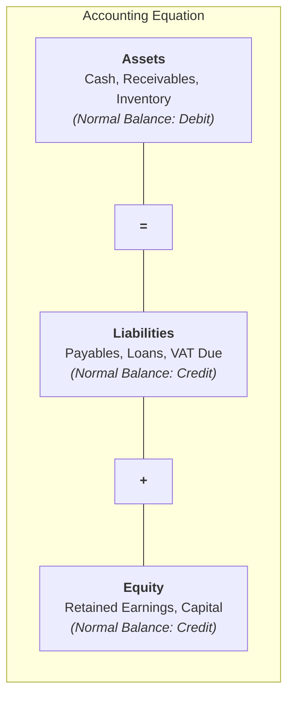
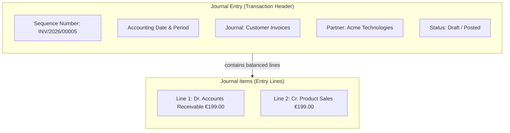
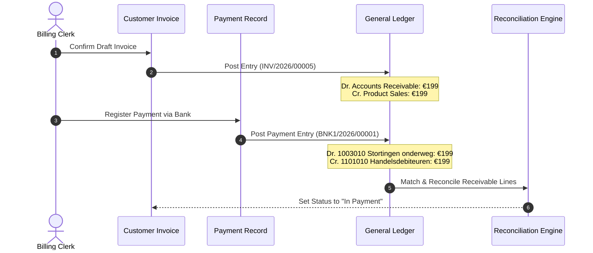
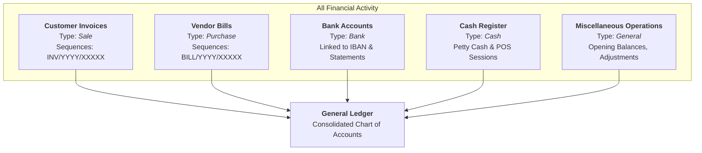
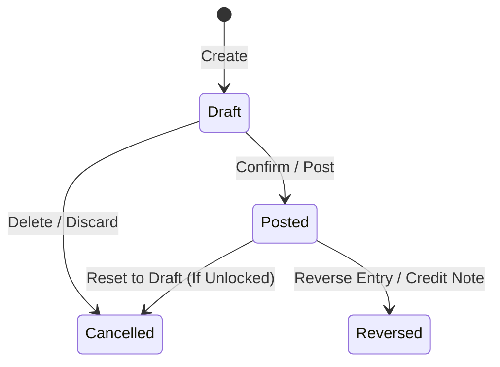

# Understanding Double-Entry Bookkeeping and Journal Architecture

This document explains the foundational accounting mechanics, data models, and ledger integrity principles governing CURQ Accounting.

---

### The Fundamental Law: Double-Entry Equilibrium

CURQ Accounting is built strictly on the centuries-old standard of **double-entry bookkeeping**. Every single financial event recorded in the system must affect at least two accounts, and the total value debited must exactly equal the total value credited:

$$\sum \text{Debits} = \sum \text{Credits}$$

This equilibrium ensures the fundamental accounting equation is continuously preserved in real time:

$$\text{Assets} = \text{Liabilities} + \text{Equity}$$

#### Understanding Debits and Credits in CURQ
In common language, "debit" and "credit" are often confused with bank card terminology. In double-entry accounting and inside CURQ:

| Account Type | Debit ($\text{Dr}$) Impact | Credit ($\text{Cr}$) Impact | Normal Balance |
| :--- | :--- | :--- | :--- |
| **Asset** *(e.g., Bank, Accounts Receivable, Inventory)* | **Increases** $(+)$ | **Decreases** $(-)$ | Debit |
| **Expense** *(e.g., Rent, Utilities, Cost of Goods Sold)* | **Increases** $(+)$ | **Decreases** $(-)$ | Debit |
| **Liability** *(e.g., Accounts Payable, VAT Payable)* | **Decreases** $(-)$ | **Increases** $(+)$ | Credit |
| **Equity** *(e.g., Capital, Retained Earnings)* | **Decreases** $(-)$ | **Increases** $(+)$ | Credit |
| **Income / Revenue** *(e.g., Product Sales, Service Income)* | **Decreases** $(-)$ | **Increases** $(+)$ | Credit |

> **Important:** A transaction cannot be saved or validated in CURQ if its debits do not equal its credits. If an unbalanced transaction is attempted, the system rejects the entry with a validation error (`The journal entry must be balanced`).

---

### The CURQ Ledger Structure

In CURQ, financial records are organized in a two-tier hierarchy: **Journal Entries** (transaction headers) and **Journal Items** (individual debit and credit lines).

#### 1. The Journal Entry (Transaction Header)
The Journal Entry is the parent record. It stores the commercial and operational header details:
* **Identification**: The unique sequence number *(e.g., `INV/2026/00005` or `BNK1/2026/00012`)*.
* **Context**: Document date, accounting period, partner (customer/vendor), and currency.
* **Journal**: The specific operational ledger where this entry belongs *(e.g., `Customer Invoices`, `Bank`)*.
* **Status**: Controls whether the entry is an exploratory `Draft`, an official `Posted` record, or `Cancelled`.

Every customer invoice, supplier bill, manual adjustment, or bank transaction exists as a Journal Entry.

#### 2. The Journal Items (Ledger Lines)
Journal Items are the individual debit and credit lines within the entry. They represent the actual financial entries written into the General Ledger. Each line specifies:
* **Account**: The specific general ledger account *(e.g., `1101010 Handelsdebiteuren nominaal` or `8001010 Netto-omzet`)*.
* **Debit / Credit**: The numerical monetary value in company currency and foreign transaction currency.
* **Partner**: The contact associated with the specific balance (used for accounts receivable and payable tracking).
* **Reconciliation Link**: Links corresponding debit and credit items together when an open invoice is settled by a payment.

---

### Transaction Flow: From Invoicing to Payment

To observe this model in practice, consider the standard sales cycle completed in [**Process Your First Customer Invoice and Payment**](../getting-started/01-process-your-first-customer-invoice-and-payment.md). A client purchases `€ 199.00` worth of goods and subsequently settles via bank transfer:

#### Stage 1: Invoice Validation
When the invoice is confirmed, CURQ generates the first balanced entry:

| Line # | Account | Partner | Debit ($\text{Dr}$) | Credit ($\text{Cr}$) | Net Impact |
| :--- | :--- | :--- | :--- | :--- | :--- |
| 1 | `1101010 Handelsdebiteuren nominaal` | Acme Technologies | `€ 199.00` | `€ 0.00` | Asset increase (Receivable owed) |
| 2 | `8001010 Netto-omzet uit leveringen...` | Acme Technologies | `€ 0.00` | `€ 199.00` | Revenue increase (Earned income) |
| **Total** | | | **`€ 199.00`** | **`€ 199.00`** | **Balanced** |

#### Stage 2: Payment Registration
When payment is received in the bank, the receivable must be cleared and replaced with cash/bank liquidity:

| Line # | Account | Partner | Debit ($\text{Dr}$) | Credit ($\text{Cr}$) | Net Impact |
| :--- | :--- | :--- | :--- | :--- | :--- |
| 1 | `1003010 Stortingen onderweg (Kruisposten)` | Acme Technologies | `€ 199.00` | `€ 0.00` | Temporary liquidity transit clearing |
| 2 | `1101010 Handelsdebiteuren nominaal` | Acme Technologies | `€ 0.00` | `€ 199.00` | Asset decrease (Debt cleared) |
| **Total** | | | **`€ 199.00`** | **`€ 199.00`** | **Balanced** |

#### Stage 3: Automatic Reconciliation
Notice line 1 from the Invoice (`Debit € 199.00` to `1101010 Handelsdebiteuren`) and line 2 from the Payment (`Credit € 199.00` to `1101010 Handelsdebiteuren`). 

CURQ's reconciliation engine links these two opposing journal items together. Because the open receivable balance for the customer reaches `€ 0.00`, the invoice automatically updates its status badge to **In Payment**.

---

### Journal Architecture: Purpose-Driven Segregation

Rather than dumping every transaction into a single, chaotic ledger, CURQ segregates financial activity across distinct **Journals**. Each journal represents a specific operational source of transactions:

#### The 5 Journal Types in CURQ

1. **Customer Invoices (`Sale`)**:
   * Exclusively records sales invoices and customer credit notes.
   * Automatically debits the default debtor/receivable account.
2. **Vendor Bills (`Purchase`)**:
   * Exclusively records supplier invoices and vendor refunds.
   * Automatically credits the default creditor/payable account.
3. **Bank (`Bank`)**:
   * Dedicated to electronic bank accounts, credit cards, or payment acquirers (e.g., Stripe, Mollie, PayPal).
   * Paired with a dedicated GL asset account and suspense accounts for automated statement matching.
4. **Cash (`Cash`)**:
   * Handles physical currency transactions, point-of-sale cash registers, and petty cash boxes.
5. **Miscellaneous & Specialized General Journals (`General`)**:
   * Used for non-commercial adjustments, periodic provisions, and statutory settlements. In CURQ, the general journal is segregated into dedicated operational sub-ledgers with distinct sequence numbering to prevent co-mingling of audit trails:
     * **Miscellaneous Operations** (`MISC/`): General year-end closing entries and opening balance imports.
     * **Accruals** (`ACCR/`): Period-end revenue and expense matching accruals and deferred spreading provisions.
     * **Depreciations** (`DEPR/`): Automated monthly fixed asset amortization write-downs.
     * **Exchange Difference** (`EXCH/`): Realized multi-currency gains and losses from payment matching.
     * **Foreign Currency Revaluation** (`FCR/`): Month-end unrealized exchange rate adjustments for foreign currency accounts.
     * **Wages** (`WAG/`): Monthly payroll summary entries isolating employee remuneration from general ledgers.
     * **Inventory Valuation** (`STJ/`): Perpetual inventory receipts, delivery adjustments, and periodic shrinkage write-offs.
     * **Taxes** (`TAX/`): Quarterly VAT clearing vouchers, small business scheme (KOR) settlements, and statutory payments.

#### Why Segregate by Journal?
* **Gapless Sequential Numbering**: Legal compliance in jurisdictions worldwide requires separate, strictly gapless, chronological prefixes for sales invoices (`INV/2026/00001`) versus vendor bills (`BILL/2026/00001`).
* **Granular Access Control**: Operational teams (e.g., Sales or Purchasing) can enter source documents in their respective journals without gaining access to payroll, bank statements, or miscellaneous ledger adjustments.
* **Targeted Reporting**: Enables rapid filtering of journals during audits without scanning millions of unrelated general ledger lines.

---

### State Progression & Ledger Immutability

CURQ protects audit trails and statutory records by enforcing strict state progression on journal entries:

#### 1. Draft State (`Draft`)
* The document is editable. Lines, quantities, taxes, and accounts can be freely modified or deleted.
* A draft entry has **zero impact** on general ledger reports, trial balances, or tax declarations.
* The sequence identifier is provisional *(e.g., `Draft Invoice *0005`)*.

#### 2. Posted State (`Posted`)
* The entry is formally confirmed and legally recognized.
* CURQ assigns a permanent, sequential reference number according to the journal's configuration sequence.
* Balanced debit and credit journal items immediately reflect in balance sheets, P&L reports, and tax grids.
* **Audit Locking**: By default, posted entries cannot be altered. In regulated accounting environments, modifying a posted entry is strictly forbidden.

#### Correcting Errors on Posted Entries: Reversal vs. Editing
To fix an error on a posted entry:
* **Reversal (Best Practice / Statutory Requirement)**: Instead of modifying or deleting historical data, CURQ generates a **Reversal Entry** or Credit Note that mirrors the original debits and credits in reverse. This preserves a complete, unalterable audit trail for auditors and tax authorities.
* **Reset to Draft**: In development or unconstrained environments where journal settings permit canceling entries, a posted record can be unposted, corrected, and re-validated.

---

### Related Documentation

* [Process Your First Customer Invoice and Payment](../getting-started/01-process-your-first-customer-invoice-and-payment.md)
* [Create Manual Journal Entries](../task-guides/05-create-manual-journal-entries.md)
* [Customer Invoice and Vendor Bill Field Definitions](../settings-and-fields/01-customer-invoice-and-vendor-bill-field-definitions.md)
* [Understanding the Invoice and Bill Lifecycle](./02-understanding-the-invoice-and-bill-lifecycle.md)
