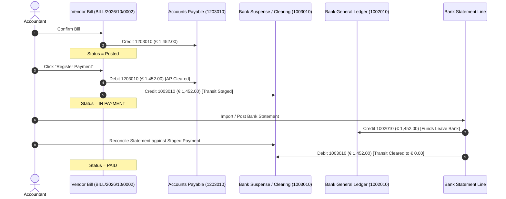
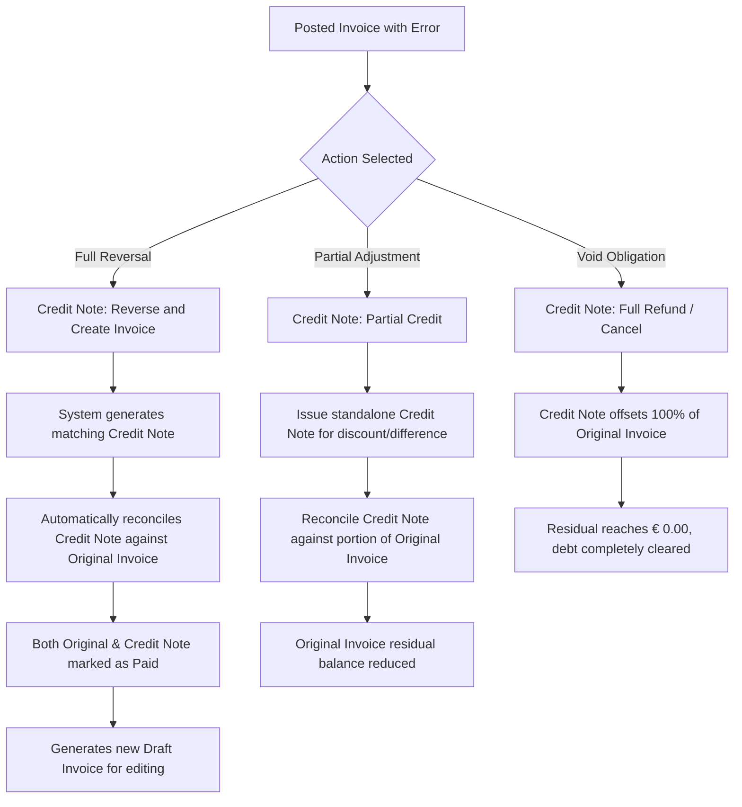

# Understanding the Invoice and Bill Lifecycle

This document explains the underlying accounting state machine, transaction locking rules, two-step payment clearing mechanics, and corrective adjustment lifecycles for customer invoices and vendor bills in CURQ Accounting.

---

## 1. Core State Machine Architecture

Customer invoices and vendor bills move through an immutable finite state machine designed to enforce legal compliance, gapless audit sequencing, and double-entry general ledger integrity.

```{mermaid}
flowchart LR
    Draft["`**Draft**
    Provisional · Editable`"]
    Posted["`**Posted**
    Validated & Locked`"]
    InPayment["`**In Payment**
    Suspense Clearing`"]
    Paid["`**Paid**
    Reconciled (Residual = 0)`"]
    Cancelled["`**Cancelled**
    Voided Document`"]
    CreditNote["`**Credit Note**
    Corrective Adjustment`"]

    Draft -->|Validate & Confirm| Posted
    Posted -->|Register Payment| InPayment
    InPayment -->|Bank Statement Match| Paid
    Posted -->|Direct Match| Paid

    Draft -.->|Cancel| Cancelled
    Posted -.->|Issue Refund| CreditNote
```

---

## 2. Lifecycle State Definitions

### 2.1 Draft
* **Accounting Status**: Provisional document. No debits or credits are posted to the general ledger, and no account balances are affected.
* **Sequence Identifier**: The document holds a temporary internal identifier *(e.g., `Draft Bill` or `Draft Invoice`)*. No official statutory sequence number *(such as `INV/2026/0001` or `BILL/2026/10/0002`)* is consumed.
* **Permissions**: Complete editability. Users can modify line items, quantities, pricing, tax classifications, analytic tags, or delete the record entirely without leaving an audit gap.

### 2.2 Posted
* **Accounting Status**: Legally validated transaction. CURQ automatically generates and locks balanced journal items in the general ledger:
  * **Customer Invoice**: Debits Accounts Receivable (`1101010 Handelsdebiteuren nominaal`) and credits Revenue (`8001010`) plus VAT Payable (`1205010`).
  * **Vendor Bill**: Debits Asset/Expense accounts (`0215010` or `7001010`) plus Reclaimable VAT (`1102010`) and credits Accounts Payable (`1203010 Handelscrediteuren nominaal`).
* **Sequence Identifier**: A permanent, gapless sequence number is assigned according to the journal's configured prefix and year *(e.g., `INV/2026/10/0001`)*.
* **Immutability**: Core accounting fields *(amounts, accounts, partner, taxes, and accounting dates)* are permanently locked to preserve legal compliance with tax authority audit standards.

### 2.3 In Payment
* **Accounting Status**: Staged payment execution. The invoice or bill is linked to a registered payment voucher, but the transaction has not yet been reconciled against an official bank statement.
* **Receivable / Payable Offset**: The trade balance (`1101010` or `1203010`) is marked as provisionally settled and offset against a **Bank Suspense / Clearing Account** *(e.g., `1003010 Stortingen onderweg`)*.
* **Operational Purpose**: Prevents duplicate payments by alerting accounts payable/receivable clerks that a bank transfer, check, or SEPA order has already been issued for this document.

### 2.4 Paid
* **Accounting Status**: Fully settled and closed. The transaction has completed the full accounting cycle:
  1. The legal invoice/bill was posted.
  2. The registered payment voucher was cleared against an imported bank statement line *(CAMT.053, OFX, or manual bank statement)*.
  3. The `Residual Amount` on the trade account reaches exactly `€ 0.00`.
* **Locking**: The invoice is archived in closed status and cannot be cancelled or altered unless the bank reconciliation is explicitly broken.

### 2.5 Cancelled
* **Accounting Status**: Voided transaction. The journal entry lines are reversed or suppressed, ensuring zero balance sheet and P&L impact.
* **Audit Trail**: Unlike a deleted draft, a cancelled posted record retains its assigned sequence number in the database with a `Cancelled` status marker to satisfy auditors that no invoices were erased from the numbering sequence.

---

## 3. Two-Step Payment Clearing Mechanics

One of the most frequent points of confusion in double-entry bookkeeping is the distinction between **`In Payment`** and **`Paid`**. CURQ uses a rigorous **two-step clearing mechanism** to separate operational payment initiation from legal banking settlement.



### 3.1 Step 1: Payment Registration (Operational Clearance)
When you click **Register Payment** on a posted invoice or bill:
1. CURQ creates an operational payment record.
2. The payment debits Accounts Payable (clearing the supplier debt) and credits the transit account:
   * **Debit**: `1203010 Handelscrediteuren nominaal` (`€ 1,452.00`)
   * **Credit**: `1003010 Stortingen onderweg` *(Bank Suspense / Clearing Account)* (`€ 1,452.00`)
3. The invoice status updates to **`In Payment`**.
4. The general bank ledger (`1002010 Rekening-courant bank`) is **not touched yet** because funds have not officially cleared the financial institution.

### 3.2 Step 2: Bank Statement Reconciliation (Financial Clearance)
When your company imports its official electronic bank statement:
1. The bank statement line records the definitive withdrawal of funds from the financial institution:
   * **Credit**: `1002010 Rekening-courant bank` (`€ 1,452.00`)
2. Using the **Bank Reconciliation Widget**, the accountant matches the bank statement line against the staged transit payment.
3. CURQ posts the offsetting clearing entry:
   * **Debit**: `1003010 Stortingen onderweg` (`€ 1,452.00`)
4. The transit balance on `1003010` returns cleanly to **`€ 0.00`**.
5. CURQ updates the invoice status banner from **`In Payment`** to **`Paid`**.

---

## 4. Partial Payments and Residual Balances

Business transactions often involve installments, split payments, or partial disputes. CURQ maintains continuous mathematical tracking through the **Residual Balance** metric:

$$\textbf{Residual Balance} = \textbf{Total Invoiced Amount} - \sum \textbf{Reconciled Payments}$$

* **Execution Flow**:
  1. An invoice is issued for `€ 1,000.00`. Residual balance is `€ 1,000.00`.
  2. The customer transfers an initial installment of `€ 400.00`.
  3. The payment is reconciled against the invoice:
     * `€ 400.00` of the Accounts Receivable line is matched.
     * The `Residual Balance` is recalculated to **`€ 600.00`**.
  4. The invoice displays a prominent blue **Partial Payment** banner detailing:
     * Amount Paid: `€ 400.00` on date.
     * Amount Due: `€ 600.00`.
  5. In the **Aged Partner Balance** report, only the remaining `€ 600.00` is aged into overdue buckets.
  6. When the final `€ 600.00` payment clears, the residual balance reaches `€ 0.00`, and CURQ marks the document as **`Paid`**.

---

## 5. Corrective Lifecycles: Reversals, Credit Notes, and Refunds

Tax legislation strictly prohibits modifying or erasing posted invoices. To adjust or cancel a posted document, you must execute a formal accounting correction.



### 5.1 Policy 1: Full Refund (Cancel and Close)
* Used when an invoice was issued in error or the transaction was cancelled entirely.
* CURQ generates a credit note for 100% of the invoice amount, posts it to the general ledger, and automatically reconciles it against the parent invoice.
* Both documents achieve a residual balance of `€ 0.00` and are archived in **`Paid`** status.

### 5.2 Policy 2: Reverse and Create Draft
* Used when an invoice contains typos, incorrect tax codes, or wrong unit rates that require correction.
* CURQ generates and posts a full credit note to neutralize the original invoice, then immediately creates a new duplicate **Draft Invoice** pre-populated with the original lines.
* The accountant fixes the error on the draft and posts the new invoice under the next sequence number.

### 5.3 Policy 3: Partial Credit Note (Price Concession / Return)
* Used when goods are damaged, items are returned, or a post-sale rebate is granted.
* The accountant creates a partial credit note *(e.g., `€ 150.00` against a `€ 1,000.00` invoice)*.
* Reconciling the credit note against the invoice reduces the open customer debt to `€ 850.00`.

---

## 6. Fiscal Lock Dates & Immutability Rules

To safeguard financial reports from retroactive tampering after tax returns (*BTW-aangifte*) and annual audits have been filed, CURQ implements **Fiscal Lock Dates**:

1. **Tax Lock Date (*Blokkeerdatum voor btw-aangifte*)**:
   * Set after submitting the monthly or quarterly VAT return to the Dutch tax office (*Belastingdienst*).
   * Prevents any user from posting, editing, or cancelling invoices or bills with an accounting date falling on or before the tax lock date.
2. **All Users Lock Date (*Blokkeerdatum voor alle gebruikers*)**:
   * Set after the external financial auditor signs off on the annual accounts.
   * Hard-locks the entire general ledger for that fiscal year. No journal entries, adjustments, or reversals can be posted to the locked period under any circumstances.

> **Important:** If a vendor bill arrives late for a period that is already tax-locked, the **Accounting Date** must be set to the first day of the open fiscal period, while the **Bill Date** preserves the supplier's legal issuance date.

---

## Related Documentation

* [Create and Validate Customer Invoices](../task-guides/01-create-and-validate-customer-invoices.md)
* [Create and Process Vendor Bills](../task-guides/02-create-and-process-vendor-bills.md)
* [Register and Reconcile Payments](../task-guides/03-register-and-reconcile-payments.md)
* [Customer Invoice and Vendor Bill Field Definitions](../settings-and-fields/01-customer-invoice-and-vendor-bill-field-definitions.md)
