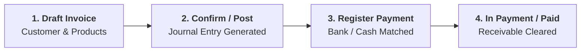
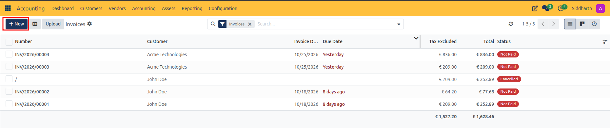
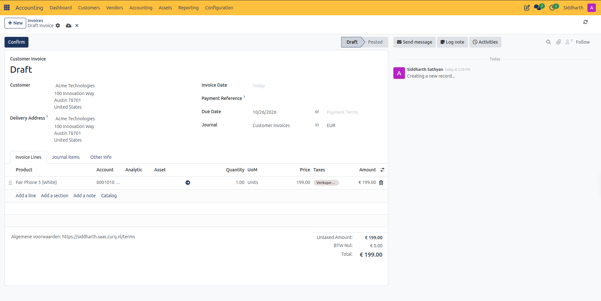
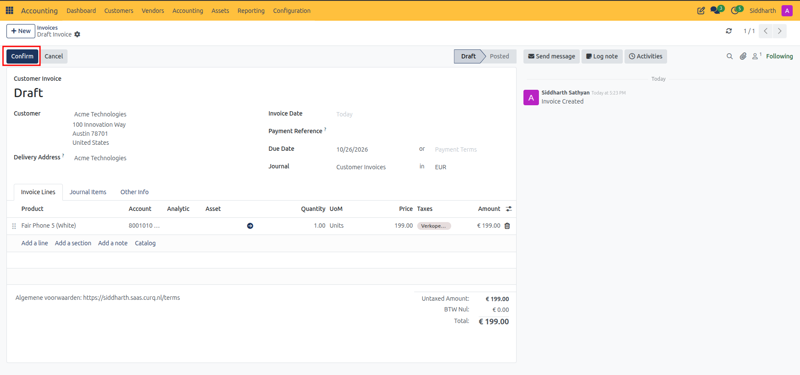
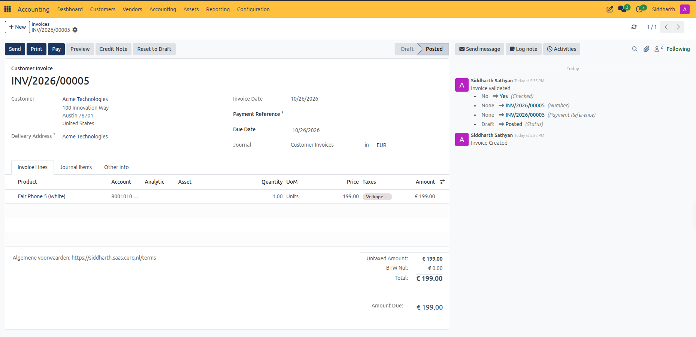
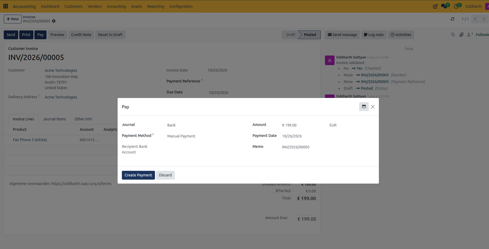
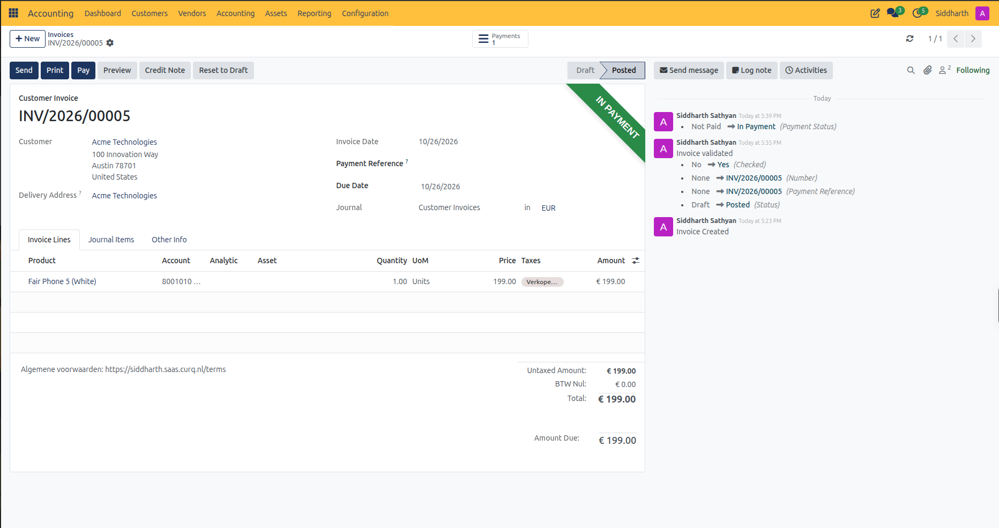

# Overview & Process Your First Customer Invoice to Payment

Welcome to CURQ Accounting. The **Accounting** application serves as the financial backbone of your enterprise, providing real-time double-entry bookkeeping, automated receivables and payables tracking, bank reconciliation, and statutory financial reporting.

In this tutorial, you will build a clear mental model of how CURQ handles the core invoicing workflow and complete a hands-on exercise to create a draft customer invoice, validate and post it to the general ledger, register customer payment, and verify the resulting balance in 4 quick steps.

> **Prerequisites**
> * Active user account with **Accounting / User** rights.
> * Configured Chart of Accounts and partner records in **Contacts**.

---

## 1. Hands-On Exercise: From Invoice to Settlement

### 1.1 Scenario Overview

Your company delivers merchandise to a corporate client, **Acme Technologies**:
* **Customer**: `Acme Technologies`
* **Line Item**: `Fair Phone 5 (White)`
* **Quantity**: `1.00 Units`
* **Unit Price**: `€ 199.00`
* **Applicable Tax**: `0% VAT (BTW Nul)`

---

### 1.2 Create a Draft Customer Invoice

1. Open the **Accounting** app from your main CURQ dashboard.
2. In the top navigation menu, select **Customers > Invoices**.
3. In the upper-left action bar, click **+ New**.

   

4. In the **Customer** field, select `Acme Technologies`.
   * CURQ automatically populates the customer's billing address (`100 Innovation Way, Austin 78701, United States`).
5. In the **Invoice Date** field, select today's date.
   * Notice that CURQ automatically sets the **Due Date**.
6. Leave the **Journal** set to the default `Customer Invoices`.

> **Note:** At this stage, the document is in **Draft** state. It has received a draft tracking identifier, but **no journal entry has been posted** to your general ledger yet.

---

### 1.3 Add Invoice Lines and Verify Automatic Tax Computation

1. Under the **Invoice Lines** tab, click **Add a line**.
2. In the **Product** column, select `Fair Phone 5 (White)`.
3. Verify the **Quantity** is `1.00` and the **Price** is `199.00`.

   

4. Inspect the financial summary block at the bottom right of the form:
   * **Untaxed Amount**: `€ 199.00`
   * **BTW Nul**: `€ 0.00`
   * **Total**: `€ 199.00`
5. Click the **Journal Items** tab next to Invoice Lines.
   * CURQ displays the pre-calculated financial lines that will be posted once confirmed: a debit to Accounts Receivable (`€ 199.00`) and a credit to Product Sales Revenue (`€ 199.00`).

---

### 1.4 Confirm and Post the Invoice

When your invoice details are verified:

1. Click the **Confirm** button in the upper-left action bar.

   

2. Observe the state transformation:
   * The status indicator in the top right advances from **Draft** to **Posted**.
   * CURQ allocates a permanent, chronological sequence number to the invoice *(e.g., `INV/2026/00005`)*.
   * The balanced debits and credits are now officially recorded in your General Ledger.
3. In the document chatter stream on the right, CURQ creates an audit entry recording who validated the invoice and when.

   

---

### 1.5 Register Customer Payment

When the customer pays via bank transfer or cash:

1. On the posted invoice screen, click the **Pay** button in the top action bar.
2. A payment registration modal opens:
   * **Journal**: Select `Bank`.
   * **Payment Method**: Keep `Manual Payment`.
   * **Amount**: Leave the full amount (`€ 199.00`).
   * **Payment Date**: Keep today's date.
   * **Memo**: Automatically references the invoice number `INV/2026/00005`.
3. Click **Create Payment**.

   

4. Observe the updated invoice status:
   * A green ribbon reading **In Payment** appears in the upper right corner.
   * A **Payments** smart button appears at the top showing `1` linked payment transaction.

   

> **Tip:** For granular parameter descriptions and data dictionary field specifications, refer to [Customer Invoice, Vendor Bill, and Credit Note Field Definitions](../settings-and-fields/01-customer-invoice-and-vendor-bill-field-definitions.md).

---

## 2. What You Accomplished

In this tutorial, you completed a full financial cycle:
* Created an initial customer invoice draft without risking premature ledger postings.
* Relied on automated tax calculation and fiscal date derivation.
* Posted the official journal entry into the General Ledger with a permanent sequence number.
* Recorded incoming customer payment and cleared the outstanding receivable balance.

---

## Related Documentation

* [Create and Validate Customer Invoices](../task-guides/01-create-and-validate-customer-invoices.md)
* [Register and Reconcile Payments](../task-guides/03-register-and-reconcile-payments.md)
* [Customer Invoice and Vendor Bill Field Definitions](../settings-and-fields/01-customer-invoice-and-vendor-bill-field-definitions.md)
* [Understanding the Invoice and Bill Lifecycle](../core-concepts/02-understanding-the-invoice-and-bill-lifecycle.md)
