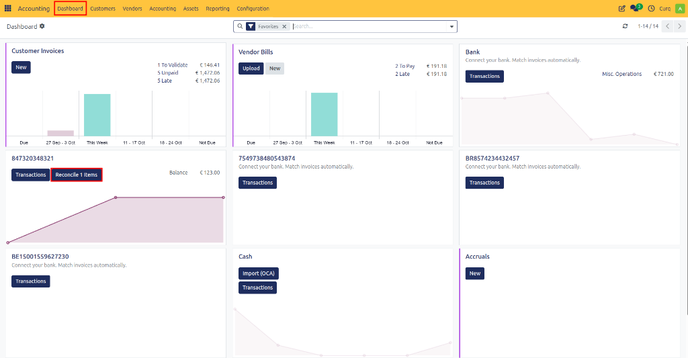
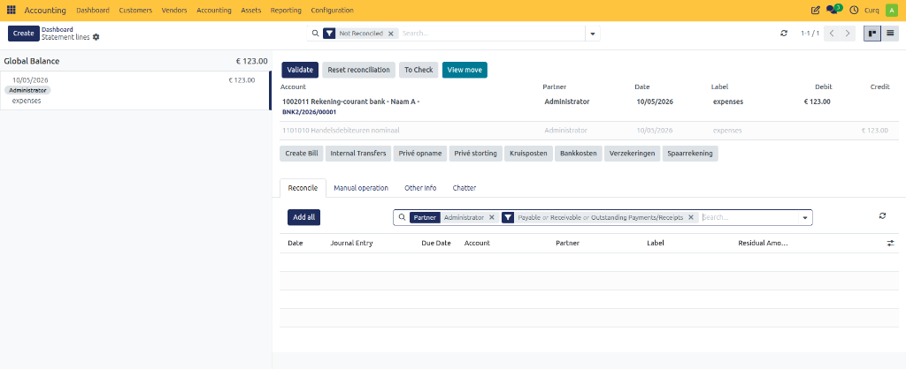
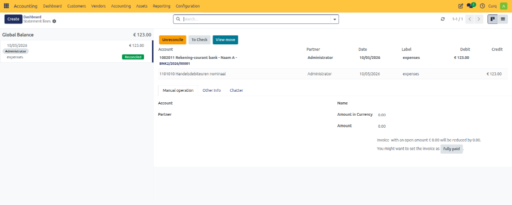
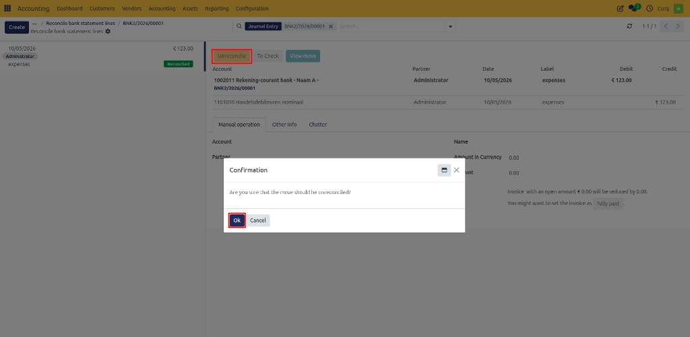
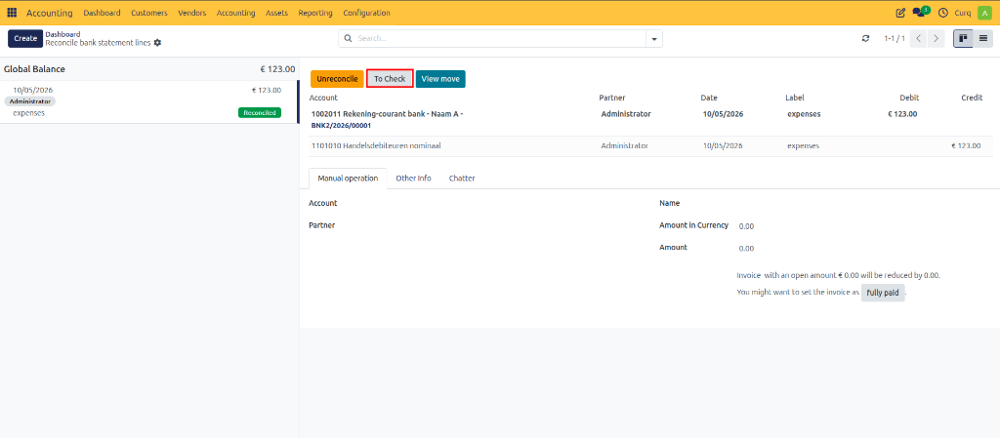

# Bank Reconciliation

Bank reconciliation is the process of matching bank transactions with records in your accounting system, such as customer invoices, supplier invoices, and payments. This process is essential for maintaining accurate financial records and helps reduce errors, detect discrepancies, and improve cash flow management.

CURQ uses Reconciliation Models to help automate this process. These models can automatically identify and match bank transactions with the corresponding accounting entries, significantly reducing manual work and improving accuracy.

---

## General

From the Accounting Dashboard, you can monitor bank transactions through the available bank journal tiles. CURQ indicates when there are transactions waiting to be reconciled.

For automatic synchronization of bank transactions, CURQ recommends using the MyPonto integration, which imports transactions directly from your banking environment.

In addition to automatic synchronization, bank statements can also be imported manually using the following formats:
- CAMT.053.001.02
- CAMT.054.001.02
- CSV
- XLS/XLSX

To access bank transactions, open the relevant bank journal from the dashboard and select **Transactions** or **Reconcile Items**, depending on the journal configuration.

CURQ displays all transaction lines that are ready for reconciliation. By default, only unreconciled lines are shown, but you can remove the search filter to display previously reconciled transactions as well.

If a transaction was reconciled incorrectly, you should first remove the reconciliation before processing the transaction again.

When a transaction line is selected, it becomes highlighted. This indicates that the line is active and available for further actions such as selecting invoices, assigning ledger accounts, applying VAT codes, or using reconciliation models.

---

## Reconciliation Models

Reconciliation Models allow CURQ to automatically suggest or validate transaction matches based on predefined criteria such as:
- Payment references
- Invoice numbers
- Customer or supplier names
- Bank transaction descriptions
- Fixed ledger accounts
- Amount tolerances

You can configure reconciliation models through:
**Invoicing → Configuration → Reconciliation Models**

These models help automate repetitive reconciliation tasks and reduce manual processing.

---

## Reconciliation Scenarios

### Reconcile a Fully Paid Invoice
When the transaction line contains the correct customer or supplier, the payment amount exactly matches an outstanding invoice, and the invoice number is included in the transaction description, CURQ automatically suggests the correct invoice.

To reconcile the transaction:
1. Select the bank transaction.
2. Review the suggested invoice.
3. Confirm the reconciliation.

If reconciliation models have been configured appropriately, CURQ may automatically validate the match without manual intervention.

### Reconcile Overpayments and Underpayments
Payment amounts do not always exactly match invoice amounts. CURQ supports several scenarios.

#### Scenario 1: Partial Payment
If a customer pays less than the invoice amount, CURQ automatically applies the payment against the outstanding invoice balance.

The remaining balance can:
- Remain open for future payment.
- Be written off to another ledger account.

To write off the remaining amount:
1. Reconcile the payment against the invoice.
2. Assign the remaining difference to a write-off account manually or through a reconciliation model.
3. Confirm the reconciliation.

#### Scenario 2: Small Payment Differences
Customers occasionally pay slightly more or less than the invoice amount due to rounding differences or bank charges.

To automate these situations:
1. Configure a tolerance amount in the reconciliation model.
2. Specify a write-off ledger account.
3. Save the reconciliation model.

CURQ can then automatically reconcile the invoice and post the remaining difference to the configured account.

#### Scenario 3: One Payment for Multiple Invoices
A customer may pay multiple invoices in a single bank transaction.

To reconcile:
1. Select the transaction line.
2. Search for the first invoice.
3. Add the invoice to the reconciliation.
4. Search for additional invoices.
5. Add all invoices included in the payment.
6. Validate the reconciliation.

The payment amount will be distributed across the selected invoices.

---

### Reconcile a Payment Without an Invoice
Sometimes a bank transaction does not have a corresponding customer or supplier invoice.

Examples include:
- Office expenses
- Bank charges
- Insurance payments
- Miscellaneous income

To reconcile:
1. Select the transaction line.
2. Open the **Manual Operation** tab.
3. Select the appropriate general ledger account.
4. Enter a description if required.
5. Validate the reconciliation.

---

### Reconcile a Payment Without an Invoice Including VAT
A transaction may need to be recorded directly against an expense account while including VAT.

To process the transaction:
1. Select the appropriate expense account.
2. Select the correct VAT code.
3. Enter the amount.
4. Validate the reconciliation.

CURQ automatically calculates the VAT amount and creates the required accounting entries.
The VAT amount will automatically be included in the appropriate VAT return.

---

### Reconcile an Internal Transfer
Internal transfers occur when money is transferred between two bank accounts managed within CURQ.

Examples:
- Transfer from Current Account to Savings Account.
- Transfer between bank accounts in different currencies.

To reconcile an internal transfer:
1. Import or create the transaction in both bank journals.
2. Select the transaction line.
3. Click **Internal Transfer**.
4. Select the destination bank account.
5. Validate the reconciliation.

CURQ automatically creates the corresponding accounting entries and links both sides of the transfer.

---

### Reconcile a SEPA Payment Batch
When using SEPA Credit Transfer functionality, multiple supplier invoices can be paid through a single payment order.

After the bank transaction appears:
1. Select the transaction line.
2. Search for the corresponding payment order entry or outstanding payment transaction.
3. Select the matching entry.
4. Confirm the reconciliation.

CURQ automatically clears the interim account and completes the reconciliation process.

---

## Undo a Reconciliation
If a reconciliation was completed incorrectly, it can be reversed.

To undo a reconciliation:
1. Open the reconciled transaction.
2. Click **Unreconcile** (or Undo Reconciliation, depending on the configuration).
3. Confirm the action.

The transaction returns to an unreconciled state and can be processed again.

---

## Mark a Transaction for Review
If a transaction requires additional verification, you can mark it as **To Check**.

This flag makes the transaction visible throughout the accounting system and indicates that additional review is required before final approval.

To use this feature:
1. Select the transaction.
2. Click **To Check**.
3. Review the transaction later.
4. Remove the flag once verification has been completed.

