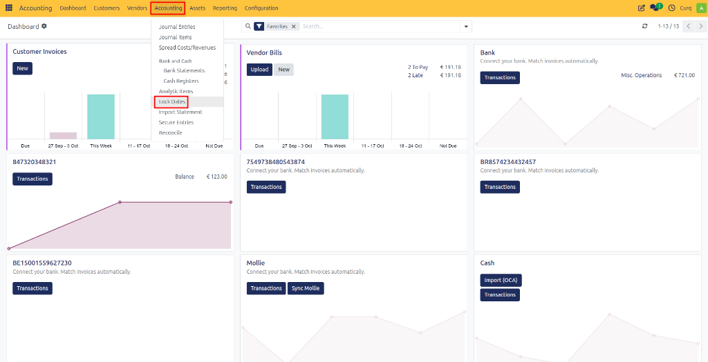
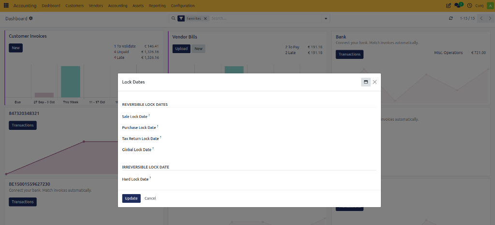

# Year-End Closing

The year-end closing is an important accounting process that finalizes all financial activities at the end of a financial year. During this process, financial records are reviewed, reconciled, and finalized to ensure accurate reporting and compliance with legal and tax requirements.

Typical year-end activities include:

- Reviewing and reconciling financial records.
- Recording depreciation and impairment adjustments.
- Evaluating provisions and reserves.
- Processing outstanding invoices and payments.
- Verifying inventory balances.
- Preparing financial statements such as the Balance Sheet and Profit & Loss Statement.
- Preparing VAT and tax declarations.
- Archiving financial records and supporting documentation.

The year-end closing not only fulfills statutory obligations but also provides valuable insight into the company's financial performance and supports planning for the upcoming financial year.

---

## Date-Based Accounting

CURQ accounting is based on transaction dates. Every accounting entry is assigned a specific date, which determines the accounting period in which the transaction appears.

By default, CURQ uses standard calendar-based periods:

- Monthly periods
- Quarterly periods
- Financial years

These periods are used throughout reporting and financial analysis. If your organization uses a non-standard financial year, additional configuration may be required.

For more information about accounting periods, refer to the **Date Ranges** documentation.

---

## Year-End Closing Checklist

A proper year-end closing typically includes the following activities:

### Depreciation and Impairment

Review company assets and record all required depreciation and impairment adjustments.

### Provisions and Reserves

Evaluate and update provisions for:

- Doubtful debtors
- Warranty obligations
- Future liabilities
- Other reserves and provisions

### Inventory Verification

Verify inventory balances and perform stock counts where applicable.

### Outstanding Transactions

Review and process:

- Outstanding customer invoices
- Outstanding supplier invoices
- Open payments
- Other pending transactions

### Financial Statements

Prepare and review:

- Balance Sheet
- Profit & Loss Statement
- Cash Flow Statement (if applicable)

### VAT and Tax Obligations

Ensure all VAT returns and tax obligations have been completed correctly.

### Documentation and Archiving

Archive reports, supporting documents, and accounting records according to legal requirements.

### Financial Evaluation and Planning

Review financial performance and use the results to support planning and decision-making for the next financial year.

> The exact year-end closing activities may vary depending on local regulations, company policies, and accounting practices.

---

# Steps for Year-End Closing in CURQ

To perform a proper year-end closing in CURQ, complete the following steps.

## 1. Reconcile Financial Accounts

Reconcile all financial accounts, including:

- Bank accounts
- Credit card accounts
- Suspense accounts
- Clearing accounts
- Other financial accounts

Verify that the balances in the general ledger match the balances maintained by the financial institutions.

---

## 2. Review Invoices and Payments

Review all outstanding customer and supplier transactions.

- Process invoices that have not yet been posted.
- Reconcile outstanding payments.
- Verify that all expected payments have been received or completed.
- Resolve any remaining open items.

---

## 3. Verify Inventory

Ensure that:

- All incoming and outgoing stock movements have been processed.
- Inventory counts are accurate.
- Inventory valuation matches the actual stock on hand.

---

## 4. Process Depreciation and Deferred Entries

Record and review:

- Depreciation entries
- Amortization entries
- Deferred expenses
- Deferred revenues

Ensure all required adjustment entries have been posted before closing the year.

---

## 5. Process Employee Expenses and Claims

Review all approved expense claims and verify that they have been:

- Posted to the accounting records.
- Paid where required.

---

## 6. Submit VAT Returns

Before closing the financial year, ensure that:

- All required VAT returns have been prepared.
- VAT declarations have been submitted.
- Any VAT corrections have been processed.
- VAT obligations have been fulfilled.

---

## 7. Update Lock Dates

After completing VAT reporting, update the accounting lock dates to prevent further modifications to closed periods.

**Navigation:**

`Accounting → Lock Dates`

Configure the appropriate lock dates:

| Field | Description |
|---|---|
| **Sale Lock Date** | Prevents users from creating, modifying, validating, or cancelling customer invoices and related sales transactions dated on or before the selected date. |
| **Purchase Lock Date** | Prevents users from creating, modifying, validating, or cancelling vendor bills and related purchase transactions dated on or before the selected date. |
| **Tax Return Lock Date** | Locks all VAT-related accounting entries up to the selected date. This ensures that transactions included in submitted VAT returns cannot be changed, helping maintain the integrity of tax declarations. |
| **Global Lock Date** | Prevents users from creating or modifying any accounting entries dated on or before the selected date. This lock applies to all journals and accounting transactions. |
| **Hard Lock Date** | Permanently locks all accounting entries dated on or before the selected date. Entries before this date cannot be modified, even by users with administrative privileges. This lock is typically used after completing the year-end closing process. |

**Important:** The Hard Lock Date should only be set once all accounting records, tax declarations, and financial statements have been finalized, as changes before this date will no longer be possible.

---

## 8. Review Balance Sheet and Profit & Loss Reports

Before closing the financial year, review the financial results using the available reporting tools.

**Navigation:**

`Accounting → Reporting → MIS Reports`

Review:

- Balance Sheet
- Profit & Loss Statement
- Financial performance
- Assets and liabilities
- Income and expenses

A detailed explanation of MIS Reports is available in the MIS Reporting documentation.

---

## 9. Record Correction Entries

After reviewing the accounting records, the accountant or auditor may identify corrections that need to be made.

These corrections are typically recorded using:

- Journal entries
- Adjustment entries
- Reclassification entries

Ensure all corrections have been completed before finalizing the financial year.

---

## 10. Transfer the Annual Profit or Loss

Once the accounts have been reviewed and finalized:

1. Calculate the annual profit or loss.
2. Create a journal entry to transfer the result to the appropriate equity account.

This formally closes the income and expense accounts for the financial year.

---

## 11. Final Financial Year Lock

After all year-end activities have been completed:

1. Update the final lock date.
2. Prevent users from posting transactions before the closing date.

This officially closes the financial year and ensures that historical accounting data remains unchanged.

---

## Result

After completing the year-end closing process:

- All financial records have been reviewed and reconciled.
- VAT obligations have been fulfilled.
- Financial statements have been finalized.
- Profit or loss has been transferred appropriately.
- Historical accounting periods have been locked.
- The accounting system is ready for the new financial year.

A properly executed year-end closing ensures accurate financial reporting, regulatory compliance, and a reliable foundation for future financial planning.
