# Create and Validate Customer Invoices

Generate customer invoices, structure billing lines with sections and notes, verify automated tax computations, post records to the general ledger, deliver commercial documents to clients, and issue credit notes in CURQ Accounting.

> **Prerequisites**
> * Ensure client contact profiles are established in [**Contacts**](../../Contacts/task-guides/01-create-and-manage-contacts.md) with valid billing addresses and tax identification numbers.
> * Verify that products and services are configured with appropriate sales accounts and default tax rules.
> * Check that an active **Customer Invoices** journal exists in your accounting configuration with an assigned sequence prefix.

---

## 1. Create and Validate Customer Invoices

### 1.1 Create a Draft Invoice and Specify Customer Information

1. Open the **Accounting** application from your main dashboard.
2. In the top navigation bar, select **Customers > Invoices**.
3. In the upper-left action bar, click **+ New**.

   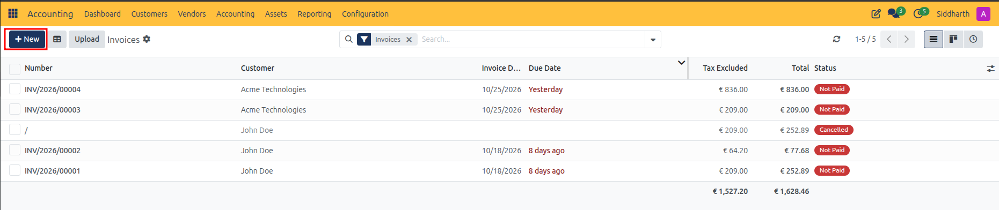

4. In the **Customer** field, select an existing contact *(e.g., `Acme Technologies`)* or type a new name to create a record on the fly.
5. Review the automatically populated address fields:
   * **Customer / Billing Address**: The legal entity and address displayed on the commercial invoice.
   * **Delivery Address**: The physical site where goods or services were delivered.
6. Specify invoice scheduling dates:
   * **Invoice Date**: The official legal date of the invoice. This date determines the fiscal period in which revenue and tax obligations are recognized.
   * **Due Date / Payment Terms**: Choose a predefined payment term *(e.g., `Immediate Payment`, `15 Days`, `30 Days`)* or manually enter a specific due date.
7. Verify the **Journal** is set to `Customer Invoices` and the transaction **Currency** is correct *(e.g., `EUR`)*.

> **Note:** In the Draft state, the invoice receives a provisional tracking identifier. No debits or credits are posted to your general ledger, and no sequence number is consumed.

---

### 1.2 Configure Invoice Lines, Sections, and Tax Treatments

1. Select the **Invoice Lines** tab and click **Add a line**.
2. In the **Product** column, select the merchandise or service being billed *(e.g., `Fair Phone 5 (White)`)*.
   * CURQ automatically loads the product description, default income account *(e.g., `8001010 Product Sales`)*, unit price, and applicable taxes.
3. In the **Quantity** column, enter the quantity delivered.
4. Verify the **Price** unit rate. Modify the amount manually if custom pricing applies to this transaction.

   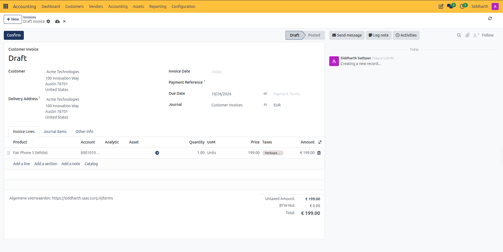

5. Organize complex invoices with structural grouping lines:
   * Click **Add a section** to insert bold category headings *(e.g., `Hardware Components` or `Consulting Services`)*.
   * Click **Add a note** to append customer-facing remarks, terms, or bank payment instructions.
   * Use the drag handle on the left of each row to reorder lines as needed.
6. Review automated tax computation in the summary card at the bottom right:
   * **Untaxed Amount**: The net taxable sum of all product lines.
   * **Taxes / VAT**: Calculated automatically based on the customer's fiscal position and destination address *(e.g., `BTW Nul € 0.00` for non-EU exports)*.
   * **Total**: The gross receivable amount owed by the client.
7. Select the **Journal Items** tab to review the pre-calculated financial ledger entries (debits to Accounts Receivable and credits to Product Revenue) before posting:

   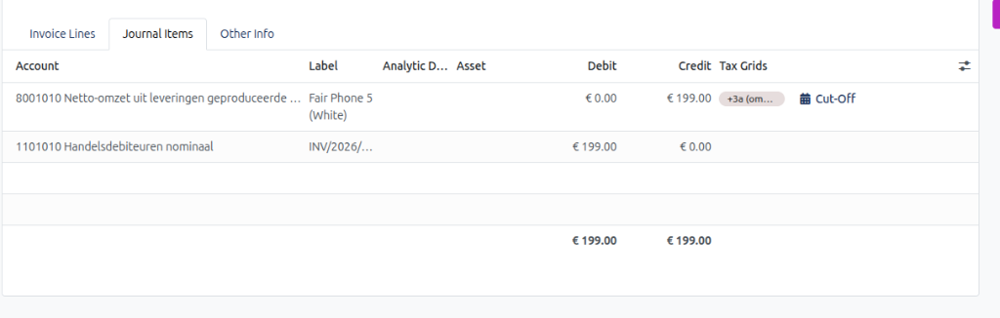

8. Select the **Other Info** tab to verify commercial payment terms, fiscal position mapping, and bank account details:

   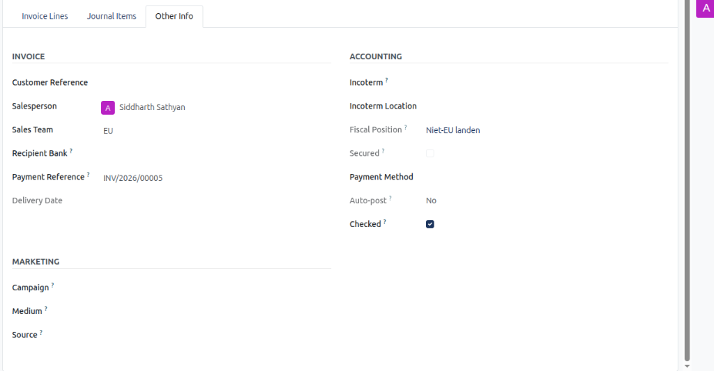

> **Note:** For exhaustive field definitions across all form tabs, see [**Customer Invoice and Vendor Bill Field Definitions**](../settings-and-fields/01-customer-invoice-and-vendor-bill-field-definitions.md).

---

### 1.3 Validate and Post the Invoice

Once all invoice lines, quantities, and financial values are confirmed:

1. Click the **Confirm** button in the upper-left action bar.

   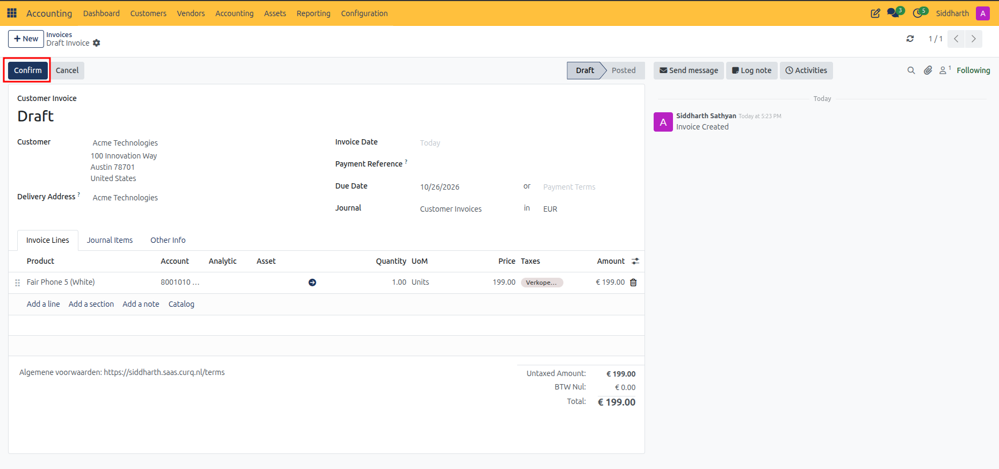

2. Observe the state transformation:
   * The status ribbon in the upper right advances from **Draft** to **Posted**.
   * CURQ consumes the next sequential number in chronological order *(e.g., `INV/2026/00005`)*.
   * The general ledger entry is officially posted: debiting **Accounts Receivable (Debiteuren)** and crediting **Product Sales** and applicable tax accounts.
3. In the right-hand chatter stream, CURQ creates an audit entry recording the validator's name, the assigned sequence number, and the validation timestamp.

   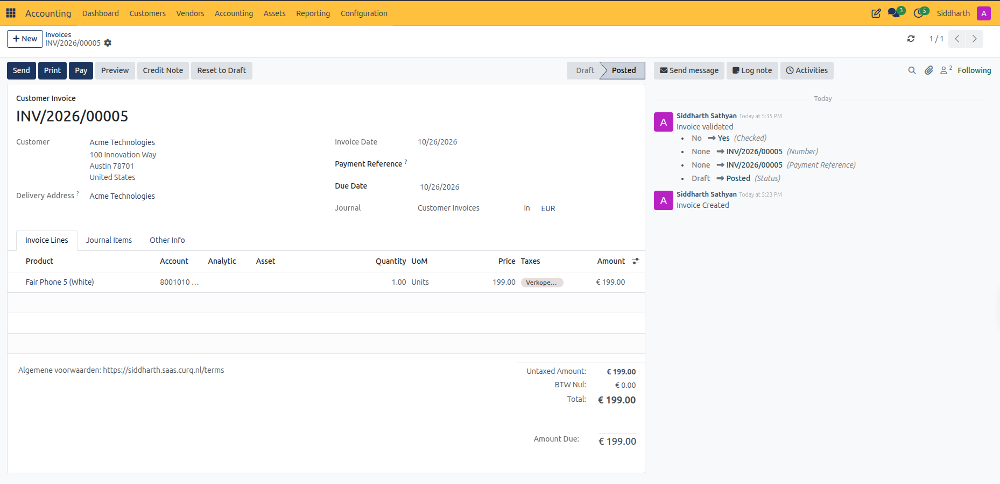

---

### 1.4 Deliver Invoices to Customers

After posting, transmit the document to the customer using the built-in delivery channels:

1. In the upper-left action bar of the posted invoice, click **Send**.
2. CURQ opens the **Print & Send** dialog:
   * **Delivery Options**: Verify **by Email** is checked. Select **Download** if you also wish to save the PDF locally, or **by Post** if mail integration is enabled.
   * **Recipient (To)**: Automatically pre-fills the customer's registered email address *(e.g., `Acme Technologies <info@acmetech.com>`)*.
   * **Subject & Body**: Loads the default `Send Invoice` email template with invoice details, amount due, and due date.
   * **Attachments**: Automatically generates and attaches the formal invoice PDF *(e.g., `INV_2026_00005.pdf`)*.

   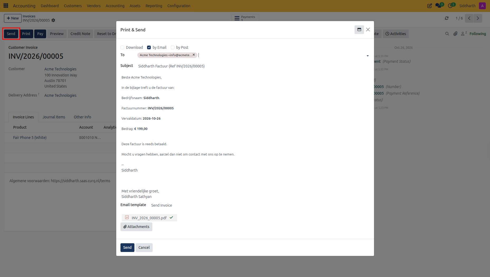

3. Click **Send** to dispatch the email. The sent message and attached PDF are permanently logged in the document chatter.
4. *(Alternative)* To print without emailing, click **Print** in the top action bar. To view the invoice from the client's perspective, click **Preview** to launch the customer web portal.

---

## 2. Send Overdue Invoice Reminders

When customer invoices pass their maturity due date without full settlement:

1. Navigate to **Accounting > Customers > Overdue Invoice Remind** *(or open any overdue invoice and click **Send an overdue reminder** in the header banner)*.
2. In the **Overdue Invoice Remind** wizard dialog:
   * **Filters**:
     * **Customers**: Optionally select designated customer accounts to evaluate, or leave blank to evaluate all debtors with outstanding balances.
     * **Salesman**: Optionally filter by assigned internal sales representative.
   * **Options**:
     * **Contact to Remind**: Select the debtor contact point *(defaults to `Last Reminder`)*.
     * **Wizard Interface**: Select `One by One` to inspect and customize each dunning notice draft sequentially before sending, or batch mode.
     * **Trigger Delay**: Specify the grace period in days following invoice maturity *(e.g., `0` days)*.
     * **Minimum Delay Since Last Reminder**: Minimum days required between sequential reminder notices *(e.g., `5` days)*.
   * **Payments Up-to-Date?**:
     * Review the verification table listing recent transactions on `Bank` and `Cash` journals. Confirm that all statement feeds are fully reconciled so customers who have already paid do not receive erroneous notices.

   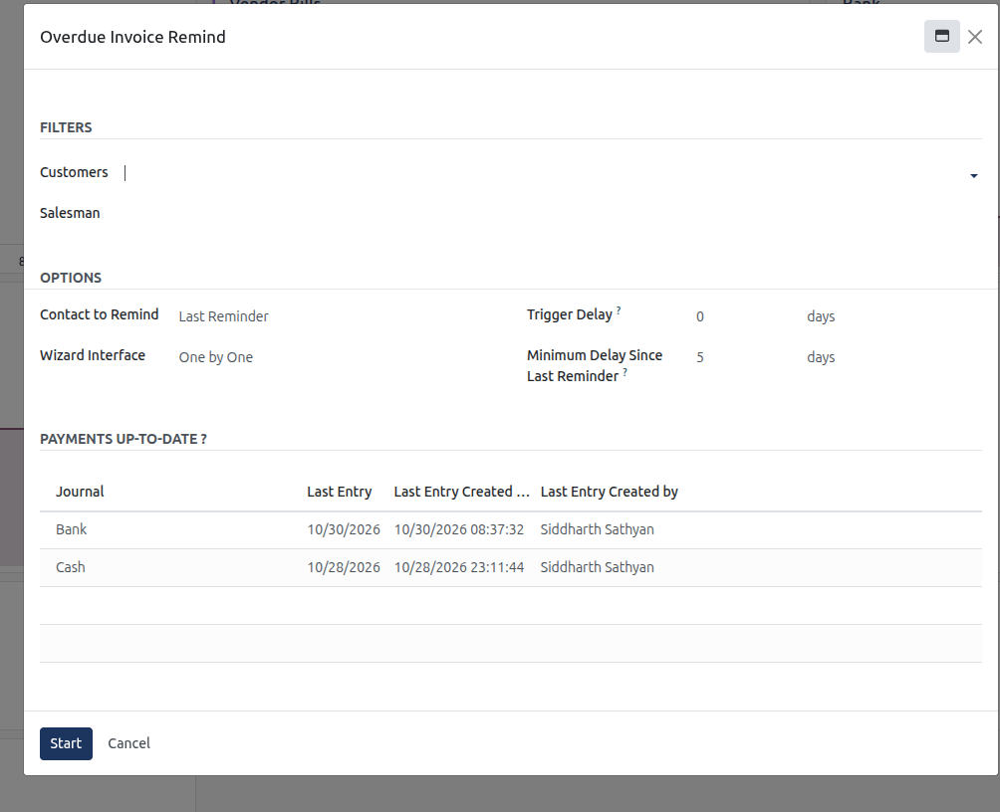

3. Click the dark blue **Start** button in the lower-left corner:
   * CURQ opens the **Overdue Invoice Step** review modal *(in `One by One` mode)*, aggregating all open overdue invoices for the recipient debtor:

   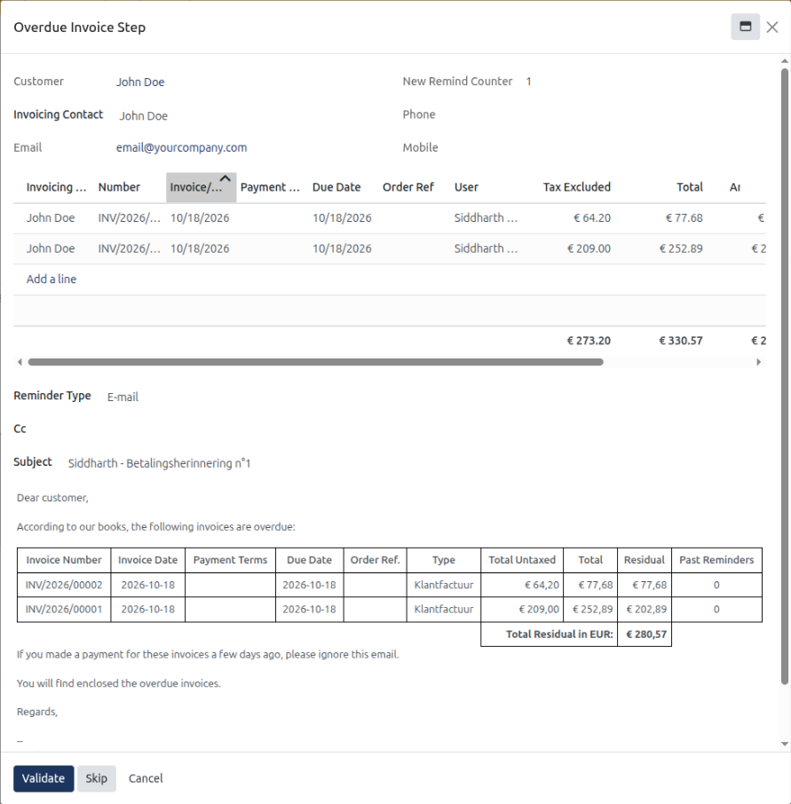

   * **Customer & Contact**: Confirms debtor name, invoicing contact, phone, mobile, and destination email address *(e.g., `email@yourcompany.com`)*.
   * **New Remind Counter**: Displays the current escalation reminder counter *(e.g., `1` for first notice, `2` for formal dunning)*.
   * **Overdue Invoices Table**: Lists all qualifying overdue invoices *(e.g., `INV/2026/00001` and `INV/2026/00002`)* with invoice dates, due dates, tax-excluded amounts, totals, and residual debt. Additional invoices can be included using **Add a line**.
   * **Reminder Type & Email Preview**: Displays the transmission channel *(e.g., `E-mail`)*, `Cc` recipient field, editable subject line *(e.g., `Payment Reminder n°1`)*, and rich text body embedding the itemized overdue debt table.
4. Execute the appropriate action button:
   * **Validate**: Sends the customized reminder email with attached invoice PDFs to the debtor and advances to the next customer in the queue.
   * **Skip**: Bypasses the current customer without sending a reminder or incrementing their remind counter, moving to the next debtor.
   * **Cancel**: Exits the reminder wizard immediately.
5. In the chatter of the overdue invoice, CURQ logs the sent reminder email, and the **Overdue Reminder** tab updates with the reminder count and execution date.

---

## 3. Issue Credit Notes and Process Reversals

If an invoice contains errors or merchandise is returned after posting:

1. Open the posted invoice *(e.g., `INV/2026/00005`)*.
2. Click **Credit Note** in the top action bar.

   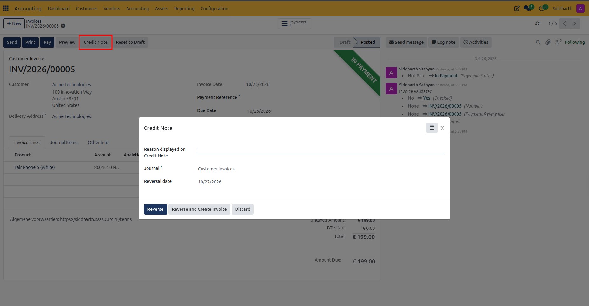

3. In the **Credit Note** dialog, complete the reversal details:
   * **Reason displayed on Credit Note**: Enter the business justification *(e.g., `Billing adjustment for defective merchandise`)*.
   * **Journal**: Ensure `Customer Invoices` is selected.
   * **Reversal date**: Select the date when the credit note should register in financial reporting.
4. Choose the appropriate action button:
   * **Reverse**: Generates a confirmed credit note that mirrors and cancels the original financial entry.
   * **Reverse and Create Invoice**: Reverses the current invoice and immediately opens a new editable draft invoice pre-filled with the original line items for quick correction and re-validation.
   * **Discard**: Cancels the operation without altering the invoice.

> For comprehensive workflows on creating standalone credit notes from **Customers > Credit Notes**, allocating credit balances, and issuing monetary refunds, see [**Issue and Manage Customer Credit Notes**](./09-issue-and-manage-customer-credit-notes.md).

---

## 4. Audit Customers and Product Master Data

Accountants can review customer receivables profiles and catalog tax assignments directly from the **Customers** dropdown:

1. **Customers Master Directory (`Customers > Customers`)**:
   * Navigate to **Customers > Customers**.
   * CURQ displays the customer directory filtered by active **Customer Invoices**:

   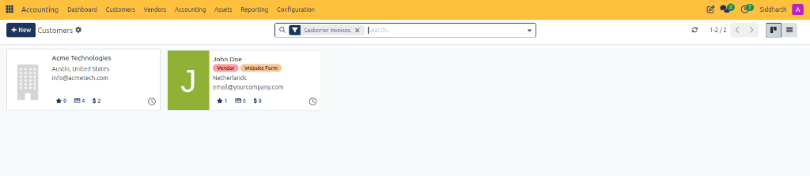

   * Each customer card displays real-time commercial indicators:
     * Open sales orders, delivery slips, and customer invoice counts.
     * Total lifetime billed invoiced value *(e.g., `Acme Technologies: $ 2`)*.
     * Click any customer card to review their general ledger receivable balance, payment terms, and assigned bank accounts.

2. **Product Catalog & Sales Tax Presets (`Customers > Products`)**:
   * Navigate to **Customers > Products**.
   * CURQ displays the commercial product ledger in list view:

   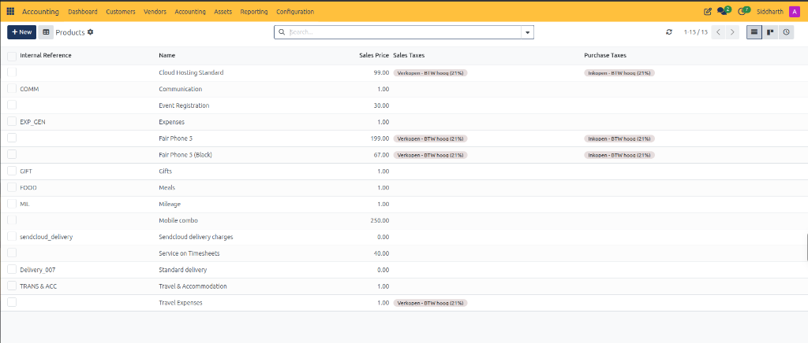

   * The catalog list presents pre-configured billing parameters:
     * **Internal Reference**: SKU code *(e.g., `COMM`, `EXP_GEN`, `GIFT`, `FOOD`, `MIL`)*.
     * **Name**: Commercial description of the product or service.
     * **Sales Price**: Default unit price billed on customer invoices.
     * **Sales Taxes**: Default statutory VAT rule applied during invoicing *(e.g., `Verkopen - BTW hoog (21%)`)*.
     * **Purchase Taxes**: Cross-mapped procurement VAT rule *(e.g., `Inkopen - BTW hoog (21%)`)*.

---

## Edge Cases & Recovery Steps

* **Modifying an Invoice in Draft State**: If an error is spotted before clicking Confirm, edit quantities, accounts, or pricing directly on the form. A draft invoice can be cancelled or deleted without affecting financial reporting or sequence numbering.
* **Modifying an Invoice After Posting**: Once confirmed, statutory rules prevent direct edits to amounts, accounts, or quantities. To correct a posted invoice, click **Credit Note** to reverse the incorrect entry, then issue a corrected replacement invoice.
* **Customer Dispute on Partial Quantities**: Do not delete the original invoice. Issue a partial credit note specifically for the disputed items or quantity difference, keeping the undisputed portion open for payment.
* **Tax Mismatch Due to Wrong Fiscal Position**: If tax rates calculate incorrectly, check the customer's country and tax ID in their contact record. On draft invoices, select the correct **Fiscal Position** under the **Other Info** tab to re-trigger automatic tax remapping. To verify or adapt statutory fiscal position tax mappings, navigate to **Accounting > Configuration > Fiscal Positions**:

  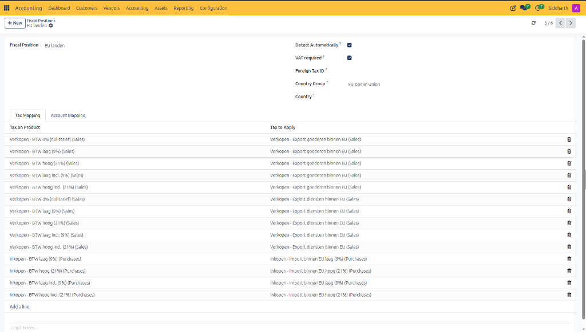
  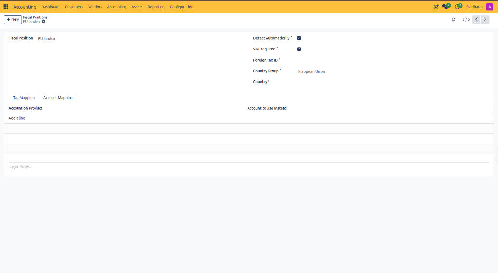

  > For complete fiscal position configuration specifications, see [**Fiscal Positions Field Definitions**](../settings-and-fields/02-chart-of-accounts-and-taxes-field-definitions.md#fiscal-positions-field-definitions).

---

## Related Documentation

* [Register and Reconcile Payments](./03-register-and-reconcile-payments.md)
* [Issue and Manage Customer Credit Notes](./09-issue-and-manage-customer-credit-notes.md)
* [Customer Invoice and Vendor Bill Field Definitions](../settings-and-fields/01-customer-invoice-and-vendor-bill-field-definitions.md)
* [Understanding the Invoice and Bill Lifecycle](../core-concepts/02-understanding-the-invoice-and-bill-lifecycle.md)
