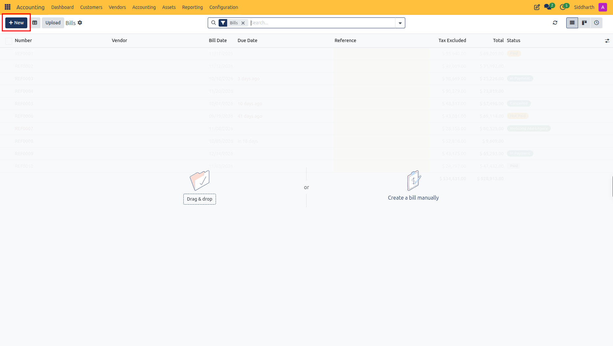
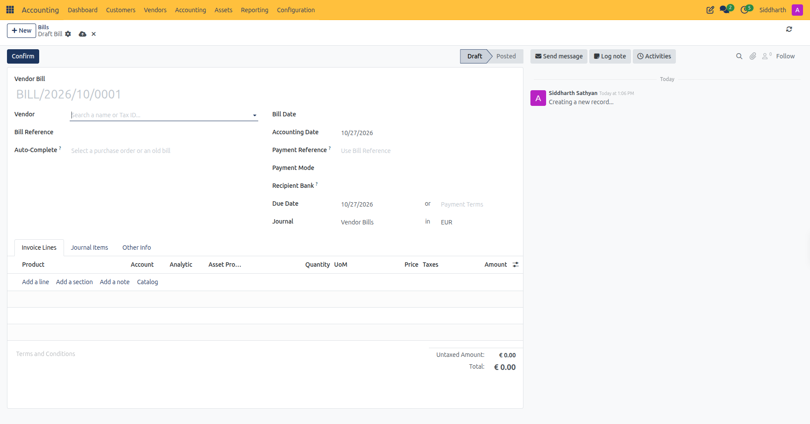
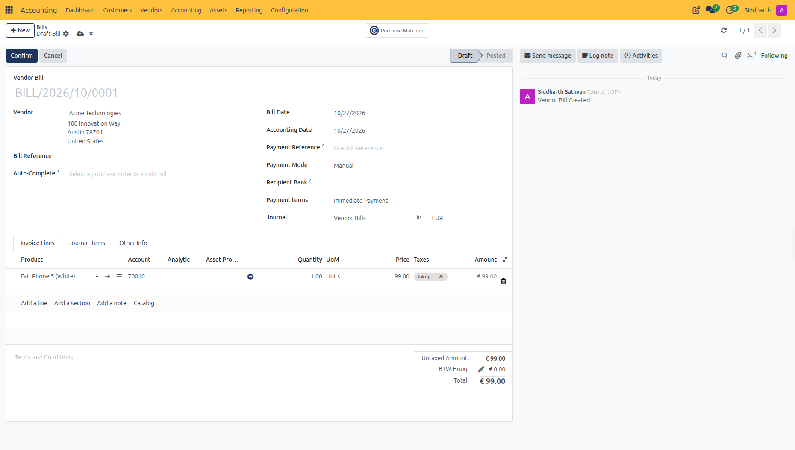
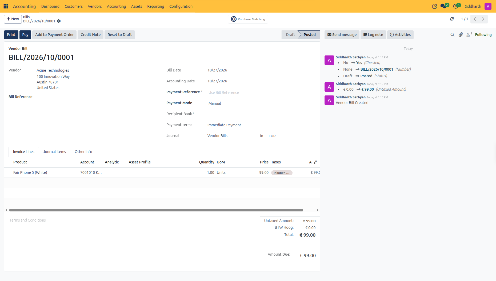
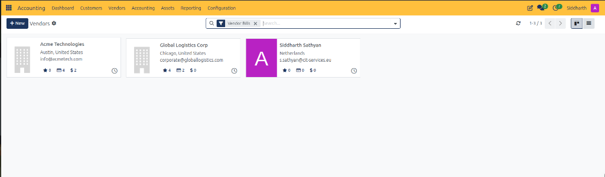
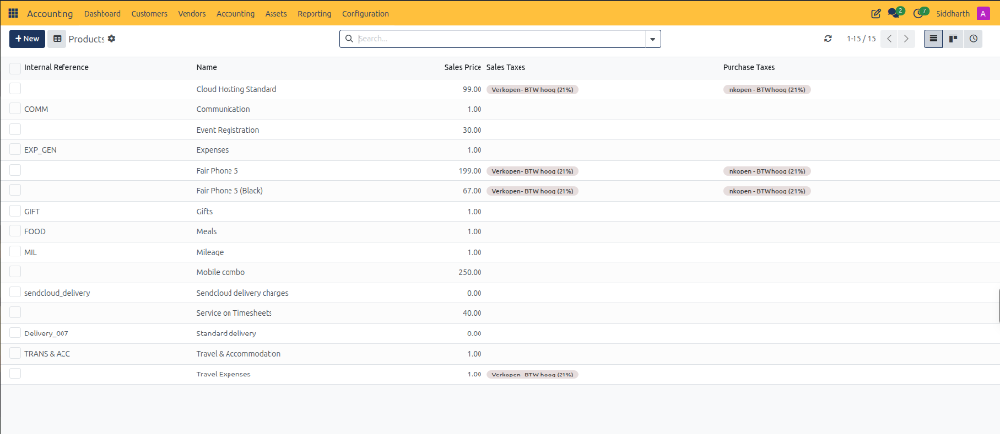

# Create and Process Vendor Bills

Record supplier invoices, configure expense allocations and tax grids, verify external bill numbers, post payables to the general ledger, and process vendor refunds in CURQ Accounting.

> **Prerequisites**
> * Ensure vendor contact profiles are registered in [**Contacts**](../../Contacts/task-guides/01-create-and-manage-contacts.md) with verified tax IDs and bank accounts for outgoing payments.
> * Verify that general ledger expense accounts and input tax codes are configured in your chart of accounts.
> * Check that an active **Vendor Bills** journal exists with an assigned sequential prefix *(e.g., `BILL`)*.

---

## 1. Create and Validate Vendor Bills

### 1.1 Create a Draft Vendor Bill and Select Supplier

1. Open the **Accounting** application from your main dashboard.
2. In the top navigation bar, select **Vendors > Bills**.
3. In the upper-left action bar, click **+ New**.

   

4. In the **Vendor** field, select the supplier issuing the bill *(e.g., `Azure Interior` or `Office Supplies BV`)* by typing their name or Tax ID.
   * CURQ automatically loads the supplier's default payment terms, registered recipient bank account, and transaction currency.
5. In the **Bill Reference** field, enter the vendor's invoice number exactly as printed on their document *(e.g., `INV-SUP-9821`)*.
6. *(Optional)* Use the **Auto-Complete** field to link an existing approved purchase order or copy lines from a previous bill from this supplier.
7. Note that the **Payment Reference** automatically defaults to use the Bill Reference for remittance tracking.

   

---

### 1.2 Configure Bill Lines, Expense Accounts, and VAT Grids

1. Under the **Invoice Lines** tab, click **Add a line**.
2. Select a purchased item using one of two methods:
   * **Product-Driven**: In the **Product** column, select a registered catalog item *(e.g., `Fair Phone 5 (White)`)*. CURQ automatically retrieves the product description, default purchase expense account *(e.g., `70010...` Inkoopwaarde van de omzet)*, unit cost, and standard purchase taxes.
   * **Direct General Ledger Expense**: If purchasing non-catalog items or services, leave **Product** empty. Enter a clear description in the **Label** column and select the appropriate general ledger expense account manually.
3. In the **Quantity** column, enter the quantity billed *(e.g., `1.00 Units`)*.
4. In the **Price** column, verify or update the untaxed unit cost according to the supplier's bill *(e.g., `99.00`)*.
5. In the **Taxes** column, verify the applied VAT code *(e.g., `Inkoop BTW` or `21% VAT`)*.
6. *(Optional)* Allocate the line to an **Analytic** cost center or link an **Asset Profile** for capital equipment depreciation.
7. Organize complex bills with structural lines:
   * Click **Add a section** to insert grouping headers.
   * Click **Add a note** to attach internal notes or contract clauses.
8. Inspect the financial summary block at the bottom right of the form:
   * **Untaxed Amount**: `€ 99.00`.
   * **Total**: `€ 99.00`.

   

> **Note:** For exhaustive descriptions of all line columns and general ledger booking rules, see [**Customer Invoice and Vendor Bill Field Definitions**](../settings-and-fields/01-customer-invoice-and-vendor-bill-field-definitions.md).

---

### 1.3 Specify Bill Dates, Accounting Dates, and Payment Terms

1. In the **Bill Date** field, select the legal issuance date printed on the supplier's document.
2. Review the **Accounting Date**:
   * Under standard operations, the Accounting Date defaults to the current date *(e.g., `10/27/2026`)*.
   * If the supplier's bill date falls within a closed or locked financial period, keep the current open date in **Accounting Date**. This posts the expense and tax liability in the current open period while preserving the vendor's legal document date.
3. In the **Due Date / Payment Terms** field, verify the settlement deadline:
   * Select a predefined term *(e.g., `30 Days` or `Immediate Payment`)* to compute the deadline automatically, or manually specify the exact due date.
4. In the **Recipient Bank** field, verify the supplier's destination bank account for electronic bank transfers or SEPA payment processing.

---

### 1.4 Validate and Post the Vendor Bill

When all lines, amounts, and tax values match the supplier's invoice:

1. Click the **Confirm** button in the upper-left action bar.
2. Observe the state transformation:
   * The status ribbon in the upper right advances from **Draft** to **Posted**.
   * CURQ allocates the next permanent, chronological sequence identifier *(e.g., `BILL/2026/10/0001`)*.
   * The double-entry booking is committed to the General Ledger: debiting the **Expense** and **Input VAT** accounts and crediting **Accounts Payable (Handelscrediteuren)**.
   * Action buttons update to show post-validation options: **Print**, **Pay**, **Add to Payment Order**, **Credit Note**, and **Reset to Draft**.
3. In the right-hand chatter stream, CURQ logs the validation event, assigned sequence number, and audit timestamp.

   

---

## 2. Process Vendor Refunds and Debit Notes

If you return goods, receive a billing discount, or obtain a supplier credit note:

1. Open the posted vendor bill *(e.g., `BILL/2026/10/0001`)*.
2. Click **Credit Note** in the top action bar.
3. In the **Credit Note** dialog, complete the reversal parameters:
   * **Reason displayed on Credit Note**: Enter the business justification *(e.g., `Return of damaged inventory items`)*.
   * **Journal**: Ensure `Vendor Bills` is selected.
   * **Reversal date**: Select the date when the refund should take effect in accounting reports.
4. Click **Reverse** (to create a standalone vendor refund) or **Reverse and Create Invoice** (to reverse and generate an editable replacement bill).
5. On the generated refund document, adjust lines and quantities to reflect the exact credit amount and click **Confirm**.

---

## 3. Audit Vendors and Procurement Products

Accountants can manage supplier liability profiles and procurement tax codes directly from the **Vendors** dropdown:

1. **Vendors Master Directory (`Vendors > Vendors`)**:
   * Navigate to **Vendors > Vendors**.
   * CURQ displays the supplier directory automatically filtered by active **Vendor Bills**:

   

   * Each vendor card summarizes procurement metrics:
     * Open purchase orders, vendor bill counts, and total invoiced obligations *(e.g., `Acme Technologies: $ 2`)*.
     * Click any vendor card to inspect their Accounts Payable control account, bank account numbers, payment terms, and 1099/statutory withholding flags.

2. **Purchasing Product Catalog (`Vendors > Products`)**:
   * Navigate to **Vendors > Products**.
   * CURQ displays the purchasing product master list:

   

   * The catalog list presents default procurement parameters:
     * **Internal Reference**: Vendor catalog SKU code *(e.g., `COMM`, `EXP_GEN`, `GIFT`, `FOOD`, `MIL`)*.
     * **Name**: Supplier item or service description.
     * **Sales Price**: Commercial list price.
     * **Sales Taxes**: Cross-mapped sales VAT rule *(e.g., `Verkopen - BTW hoog (21%)`)*.
     * **Purchase Taxes**: Default input VAT deducted on vendor bills *(e.g., `Inkopen - BTW hoog (21%)`)*.

---

## 4. Edge Cases & Recovery Steps

* **Duplicate Bill Detection**: If you enter a vendor bill with a **Vendor** and **Payment Reference** identical to an existing posted record, CURQ displays a duplicate warning banner to prevent accidental double-payment of supplier invoices.
* **Supplier Invoice Received in a Closed Period**: Never modify closed books. Set the **Bill Date** to the date printed on the vendor's invoice, and set the **Accounting Date** to the first day of the current, unlocked accounting period.
* **Pricing Mismatch Against Purchase Order**: If the vendor bills an amount higher than the approved purchase order, do not confirm the bill immediately. Place the document on hold by checking **Checked ?** as unchecked, or contact the supplier to request a revised invoice before posting.
* **Correcting a Posted Vendor Bill**: Posted bills cannot be edited directly due to audit regulations. Click **Credit Note** to reverse the incorrect bill entirely, then record a new draft bill with the correct line allocations.

---

## Related Documentation

* [Register and Reconcile Payments](./03-register-and-reconcile-payments.md)
* [Manage SEPA Vendor Payment Orders](./13-manage-sepa-vendor-payment-orders.md)
* [Customer Invoice and Vendor Bill Field Definitions](../settings-and-fields/01-customer-invoice-and-vendor-bill-field-definitions.md)
* [Manage Supplier Contracts and Recurring Purchase Invoicing](./15-manage-supplier-contracts-and-purchase-invoicing.md)
