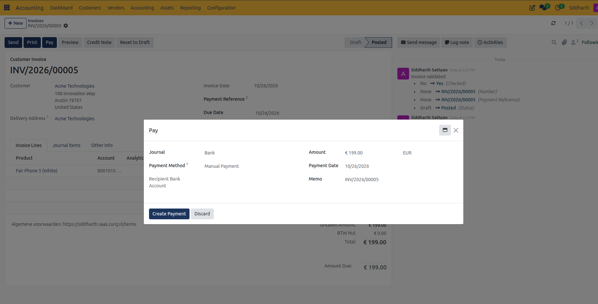
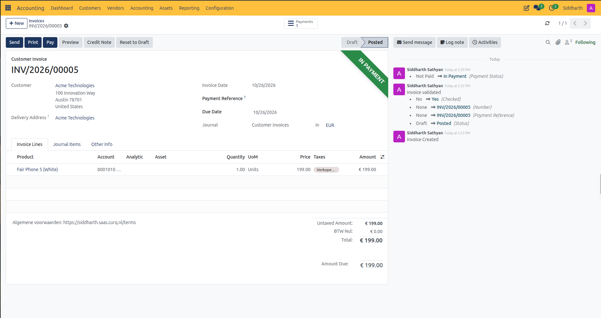
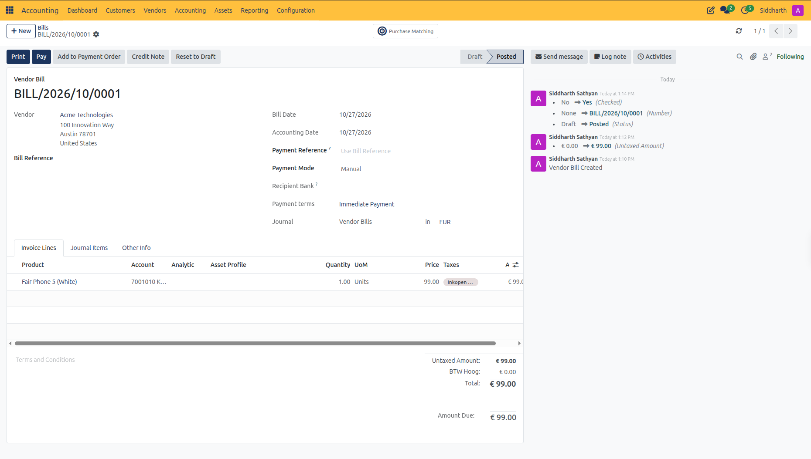
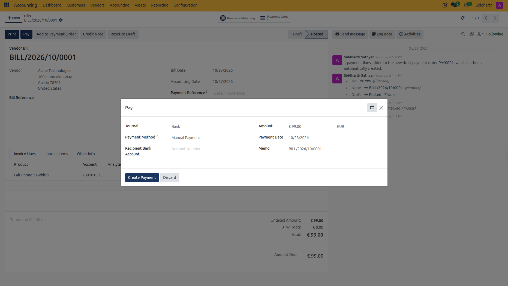
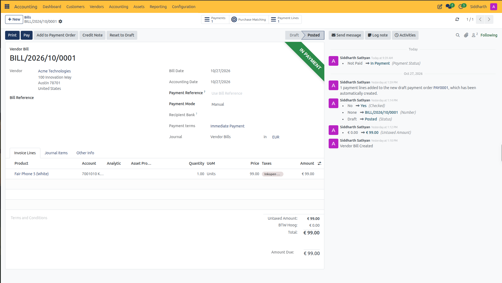
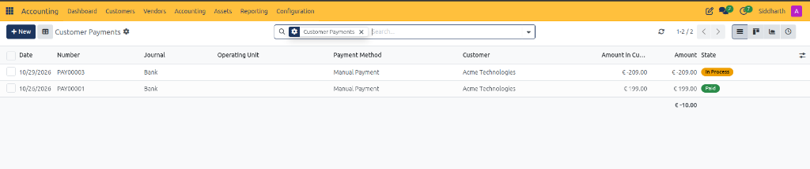
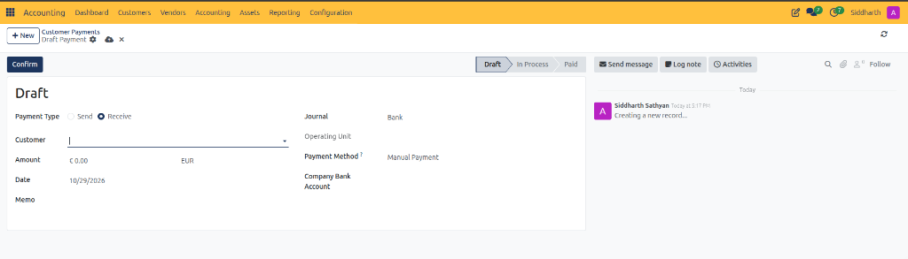

# Register and Reconcile Payments

Record incoming customer receipts, execute outgoing supplier disbursements, process batch SEPA payment orders, allocate advance payments, and understand the transition from "In Payment" to "Paid" in CURQ Accounting.

> **Prerequisites**
> * Validate the corresponding customer invoices in [**Create and Validate Customer Invoices**](./01-create-and-validate-customer-invoices.md) or vendor bills in [**Create and Process Vendor Bills**](./02-create-and-process-vendor-bills.md).
> * Verify that bank and cash journals *(e.g., `Bank`, `Cash`)* are configured with active accounts in your chart of accounts.
> * For electronic vendor disbursements, verify that the vendor profile contains a valid IBAN/BIC in [**Contacts**](../../Contacts/task-guides/01-create-and-manage-contacts.md).

---

### Task 1: Register an Incoming Customer Payment Directly from an Invoice

When a customer pays an invoice by wire transfer, cash, or credit card:

1. Open the posted invoice in **Customers > Invoices** *(e.g., `INV/2026/00005`)*.
2. In the upper-left action bar, click **Pay**.
3. In the **Pay** dialog, review and configure the payment details:
   * **Journal**: Select the bank or cash journal receiving the funds *(e.g., `Bank`)*.
   * **Payment Method**: Select the payment mechanism *(e.g., `Manual Payment`)*.
   * **Recipient Bank Account**: Your company bank account receiving the deposit.
   * **Amount**: Defaults to the full invoice balance *(e.g., `€ 199.00`)*. Adjust this amount if recording a partial payment.
   * **Payment Date**: Specify the date funds arrived in your bank account *(e.g., `10/26/2026`)*.
   * **Memo**: Automatically populated with the invoice number *(e.g., `INV/2026/00005`)* for audit traceability.

   

4. Click **Create Payment**.
5. Observe the document updates:
   * A green **IN PAYMENT** banner appears in the upper right of the invoice.
   * A **Payments** smart button appears at the top right of the form linking to the registered payment entry.
   * In the right-hand chatter stream, an audit log records the transition: `Payment Status: Not Paid -> In Payment`.

   

---

### Task 2: Register an Outgoing Vendor Bill Payment Directly from a Bill

When paying an individual supplier invoice via direct bank transfer or manual disbursement:

1. Open the posted vendor bill in **Vendors > Bills** *(e.g., `BILL/2026/10/0001`)*.
2. In the upper-left action bar, click **Pay**.

   

3. In the **Pay** dialog, configure the outgoing disbursement parameters:
   * **Journal**: Select the disbursement account *(e.g., `Bank`)*.
   * **Payment Method**: Select `Manual Payment` (for transfers entered directly in your banking app) or `SEPA Credit Transfer` (for automated electronic banking).
   * **Recipient Bank Account**: Confirm the supplier's verified destination IBAN or account number.
   * **Amount**: Defaults to the total open bill amount *(e.g., `€ 99.00`)*. If issuing an installment, enter the partial amount.
   * **Payment Date**: Select the date the transfer is scheduled or executed *(e.g., `10/28/2026`)*.
   * **Memo**: Pre-filled with the vendor bill number or supplier reference *(e.g., `BILL/2026/10/0001`)*.

   

4. Click **Create Payment**.
5. Observe the document updates:
   * A green **IN PAYMENT** banner appears in the upper right corner of the bill.
   * A **Payments** smart button appears in the header linking directly to the generated disbursement record.
   * In the right-hand chatter stream, an audit log records the transition: `Payment Status: Not Paid -> In Payment`.

   

---

### Task 3: Execute Batch Vendor Payments Using Payment Orders (SEPA)

When managing high-volume accounts payable, processing bills individually is inefficient. CURQ allows you to aggregate multiple vendor bills into a single SEPA payment run *(detailed in [**Manage SEPA Vendor Payment Orders**](./13-manage-sepa-vendor-payment-orders.md))*:

1. Navigate to **Vendors > Payment Orders**.
2. Click **+ New** to initialize a batch order with **Payment Type** set to `Outbound`.
3. In the header, select your electronic **Payment Mode** and **Bank Journal** *(e.g., `Bank`)*.
4. Populate transactions by clicking **Create Payment Lines from Journal Items** or selecting open bills from **Vendors > Bills > Action > Add to Payment Order**.
5. Verify that each line has an assigned **Communication** reference and recipient bank account.
6. Click **Confirm Payments**, then click **Generate Payment File** to compile the standardized ISO 20022 XML credit transfer file (`pain.001`).
7. Upload the file to your commercial banking portal and click **File Successfully Uploaded**. All bundled bills update to **In Payment** pending bank statement reconciliation.

---

### Task 4: Record Standalone Payments and Advance Prepayments

If a customer makes an advance deposit before an invoice is issued, or when reviewing direct payment movements:

1. Navigate to **Customers > Payments** (or **Vendors > Payments** for supplier disbursements):

   

   * The list view displays all recorded inbound receipts and outbound refunds, including **Date**, system **Number** *(e.g., `PAY00001` or `PAY00003`)*, **Journal**, **Payment Method**, **Customer**, **Amount**, and **State** *(e.g., yellow **In Process** or green **Paid**)*.
2. In the top action bar, click the dark blue **+ New** button.
3. CURQ opens the standalone payment creation form in **Draft** state:

   

4. Fill in the transaction parameters:
   * Keep **Payment Type** set to `Receive` for customer receipts (or `Send` for customer refunds).
   * In **Customer**, select the business partner *(e.g., `Acme Technologies`)*.
   * In **Amount**, enter the received sum *(e.g., `199.00`)*.
   * Confirm the transaction **Date** and target **Journal** *(e.g., `Bank`)*.
   * Add an optional tracking note in **Memo** *(e.g., `Advance deposit for Q4 contract`)*.
5. In the upper action bar, click **Confirm**.
6. CURQ advances the payment from **Draft** to **In Process**:
   * Posts an accounting move debiting the bank transitory clearing account (`1002017 Outstanding Receipts`) and crediting customer receivables (`1101010 Handelsdebiteuren nominaal`).
   * The payment remains in the **In Process** state as an open unallocated credit on the customer's balance, ready for matching against future invoices or for clearing upon bank statement reconciliation.

> For complete field descriptions, list view columns, and payment state lifecycles, see [**Payment, Bank, and Journal Entry Field Definitions**](../settings-and-fields/04-payment-bank-and-journal-entry-field-definitions.md).

---

### Task 5: Match Outstanding Credits and Advance Payments to Open Invoices

When an invoice or bill is validated for a partner who has existing advance payments or credit notes:

1. Open the posted customer invoice or vendor bill.
2. Scroll to the bottom of the form below the financial summary block.
3. CURQ automatically detects available open payments and displays the **Outstanding Credits** (for invoices) or **Outstanding Debits** (for bills) section:
   * Displays the payment date, reference memo, and unallocated amount.
4. Click **Add** next to the relevant outstanding line.
5. The payment is immediately reconciled against the document:
   * The open amount is deducted from the document balance.
   * If the credit covers the full amount, the document advances directly to **In Payment**.
   * If the credit is partial, the **Amount Due** updates to reflect the remaining unpaid balance.

---

### Task 6: Understand the "In Payment" vs "Paid" Lifecycle

CURQ uses a two-stage payment verification lifecycle to ensure compliance with financial accounting standards:

| Status | Financial Meaning | System State | Trigger to Advance |
| :--- | :--- | :--- | :--- |
| **In Payment** | The payment transaction has been initiated and recorded internally in CURQ. Funds are held in a transitory clearing account *(e.g., Outstanding Receipts or Outstanding Payments)*. | The invoice or bill is considered settled operationally. Payment buttons are disabled and the partner balance reflects the disbursement. | Importing and reconciling the official bank statement. |
| **Paid** | The bank transaction has cleared. The transitory clearing line has been matched against the actual bank journal line. | The final double-entry leg is complete: the clearing account is zeroed out and the true bank balance is adjusted. | Bank reconciliation confirmed. |

> **Note:** To clear the transitory clearing account and transition a customer invoice or vendor bill from **In Payment** to **Paid**, follow the bank statement matching steps in [**Import and Reconcile Bank Statements**](./04-import-and-reconcile-bank-statements.md).

---

### Edge Cases & Recovery Steps

* **Partial Customer Payments**: If a customer pays less than the total invoice value, enter the received amount in the **Pay** dialog. CURQ leaves the invoice in **Posted** status with an **IN PAYMENT** indicator, while displaying the remaining unpaid balance in **Amount Due**.
* **Bounced or Rejected Payments**: If an electronic transfer fails after registration, open the invoice or bill, click the **Payments** smart button, open the payment record, and click **Unreconcile** or **Reset to Draft**. The invoice immediately reverts to unpaid status with its full balance due.
* **Customer Overpayments**: If a customer pays more than the invoice amount, register the payment for the exact amount received. The excess amount remains as an outstanding credit on the customer's account, which can be applied to future invoices or refunded via a manual payment.
* **Foreign Currency Exchange Differences**: When paying an invoice in a currency different from your company's base currency, CURQ computes exchange rate variations automatically during bank statement reconciliation and posts the gain or loss to the configured foreign exchange accounts.

---

### Related Documentation

* [Import and Reconcile Bank Statements](./04-import-and-reconcile-bank-statements.md)
* [Manage SEPA Vendor Payment Orders](./13-manage-sepa-vendor-payment-orders.md)
* [Create and Validate Customer Invoices](./01-create-and-validate-customer-invoices.md)
* [Payment, Bank, and Journal Entry Field Definitions](../settings-and-fields/04-payment-bank-and-journal-entry-field-definitions.md)
