# Import and Reconcile Bank Statements

Import electronic bank statements, register manual bank transaction lines, match statement transactions against open customer invoices, vendor bills, and transit payments, and finalize the transition from "In Payment" to "Paid" in CURQ Accounting.

---

### Prerequisites

* Verify that your bank account is configured with an active journal *(e.g., `Bank`)* in your Chart of Accounts.
* Verify that corresponding customer invoices in [**Create and Validate Customer Invoices**](./01-create-and-validate-customer-invoices.md) or vendor bills in [**Create and Process Vendor Bills**](./02-create-and-process-vendor-bills.md) are confirmed and in **Posted** or **In Payment** status.
* If using automated bank synchronization *(e.g., MyPonto or direct banking feeds)*, ensure your financial institution connection is active and authorized.

---

### Task 1: Import Bank Statements Electronically (CAMT, CSV, OFX)

When receiving electronic statement files from your banking institution:

1. Navigate to **Accounting > Dashboard** (or navigate to **Accounting > Accounting > Import Statement** from the top navigation bar).
2. If navigating from the dashboard, locate the **Bank** journal card and click **Import (OCA)**.
3. Both entry points open the statement upload wizard:

   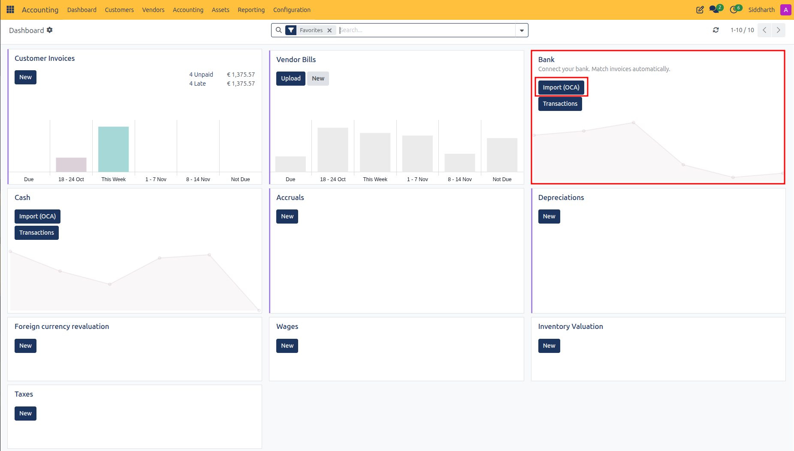

4. In the **Import Bank Statement File** dialog:
   * View the supported formats: **CAMT**, **zipped CAMT**, or select an existing mapping under **TXT/CSV/XLSX mapping**.
   * Click **Upload your file** and select the electronic bank statement file from your workstation.

   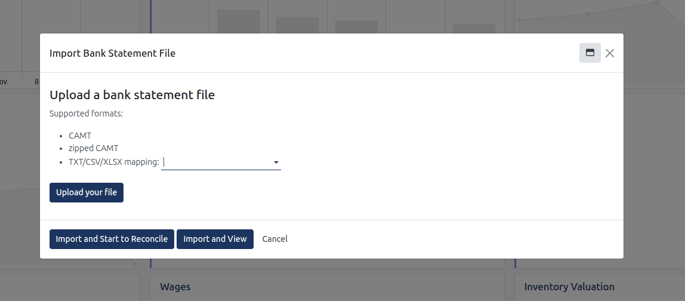

5. Click **Import and Start to Reconcile** (to import and launch the reconciliation widget immediately) or **Import and View** (to inspect imported statement records in list view).
6. CURQ parses the statement lines, records transaction dates, labels, amounts, and partner bank accounts, and displays the count of lines ready for reconciliation directly on the Bank dashboard card.

---

### Task 2: Enter Bank Transactions Manually

If electronic statement files are unavailable or you need to record individual bank adjustments directly:

1. Navigate to **Accounting > Dashboard**.
2. On the **Bank** card, click **Transactions**.

   

3. In the **Reconcile bank statement lines** interface, click **Create** in the upper-left action bar.

   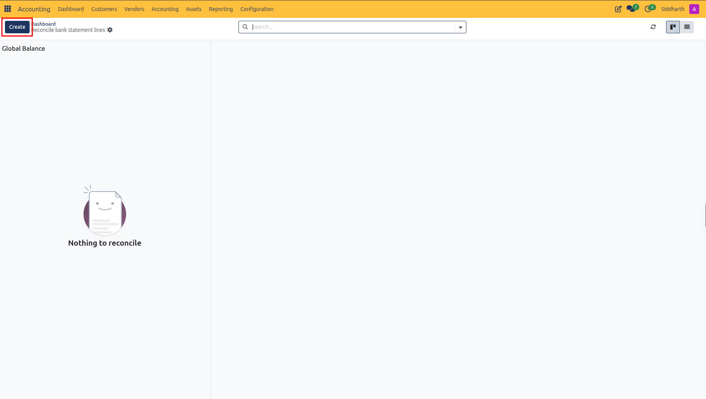

4. In the **Add Bank Statement Line** dialog, configure the transaction fields:
   * **Date**: The execution date recorded on your bank statement *(e.g., `10/28/2026`)*.
   * **Label**: Enter a descriptive memo or structured payment reference *(e.g., `Wire transfer from Acme Technologies` or `Monthly bank maintenance fee`)*.
   * **Partner**: Select the associated customer or vendor if identified.
   * **Amount**: Enter the transaction value in your journal currency. Use **positive values** for customer receipts *(e.g., `199.00`)* and **negative values** for outgoing supplier disbursements or bank fees *(e.g., `-99.00`)*.
   * **Foreign Currency / Amount in Currency**: Configure if recording a payment executed in a secondary currency.
   * **Statement**: Optionally link this line to an existing parent bank statement batch.

   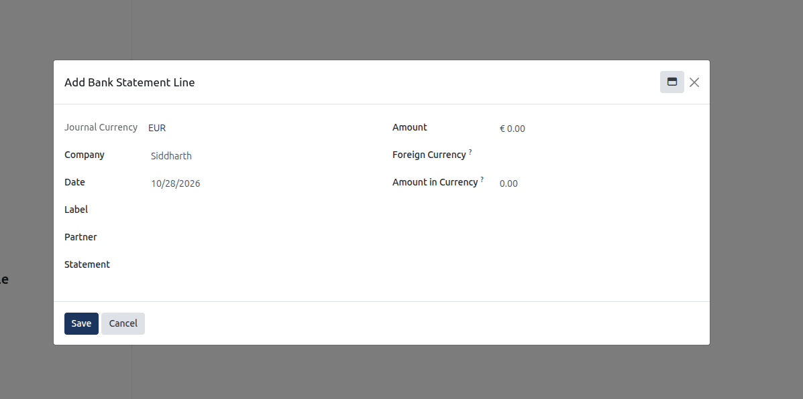

5. Click **Save**. The line is staged in the reconciliation widget and ready for matching.

---

### Task 3: Reconcile Bank Lines to Transition Documents from "In Payment" to "Paid"

When payments have already been registered via the **Pay** button on invoices or vendor bills, funds sit in a transitory clearing account *(Outstanding Receipts or Outstanding Payments)* in **In Payment** status. Reconciling matches the actual bank movement against that clearing entry to officially close the transaction:

1. Navigate to **Accounting > Dashboard**.
2. On your **Bank** journal card, click **Reconcile X Items** *(e.g., **Reconcile 1 Items**)*.

   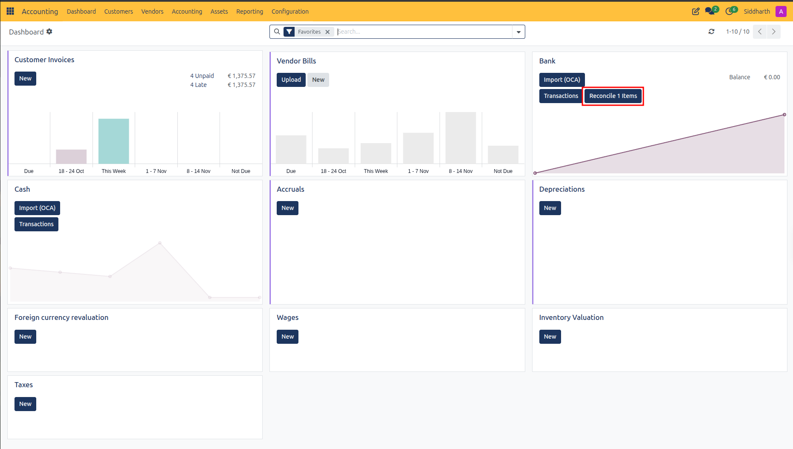

3. The reconciliation interface displays two primary panels:
   * **Left Panel**: The imported or entered bank statement lines *(e.g., `10/28/2026 - Acme Technologies - Fairphone Payment - $ 199.00`)*.
   * **Right Panel**: Matching ledger propositions identified by CURQ, along with open payable and receivable items for the selected partner *(e.g., `BILL/2026/10/0001`, `INV/2026/00005`)*.
4. Select the bank statement transaction line on the left.
5. In the open items list under the **Reconcile** tab, select invoice **`INV/2026/00005`**:
   * The invoice moves into the upper counterpart pane under `1101010 Handelsdebiteuren nominaal` with a balanced credit of `€ 199.00`.
   * The dark blue **Validate** button activates in the top action bar.

   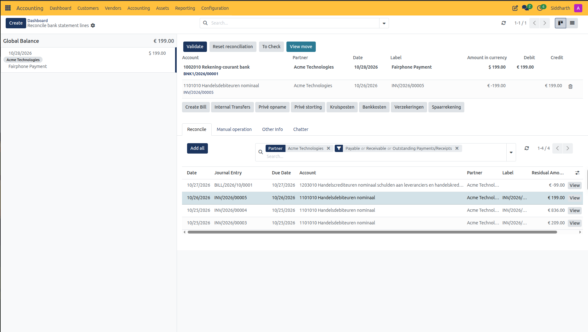

6. Click **Validate**.
7. **Observe the result**:
   * In the reconciliation interface, the statement line updates with a green **Reconciled** badge in the left panel.
   * Action buttons appear in the upper action bar: **Unreconcile** (to reverse the match if needed), **To Check** (to flag for auditor review), and **View move** (to inspect the generated journal entry).
   * The transitory clearing balance is cleared and offset against the bank account *(e.g., `1002010 Rekening-courant bank`)*, assigning a sequence number *(e.g., `BNK1/2026/00001`)*.

   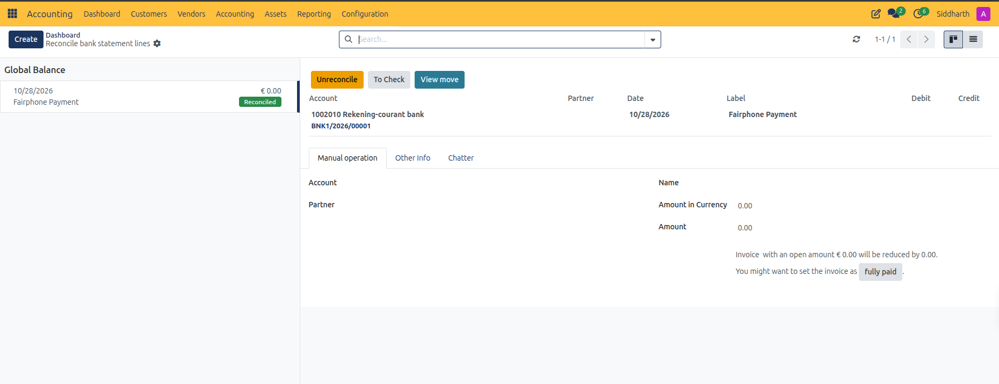

   * Open the customer invoice *(e.g., `INV/2026/00005`)* in **Customers > Invoices** and refresh the page. The green **IN PAYMENT** banner is replaced by the green **PAID** ribbon, the **Amount Due** recalculates to `€ 0.00`, and the chatter log records the event: `Payment Status: In Payment -> Paid`.

   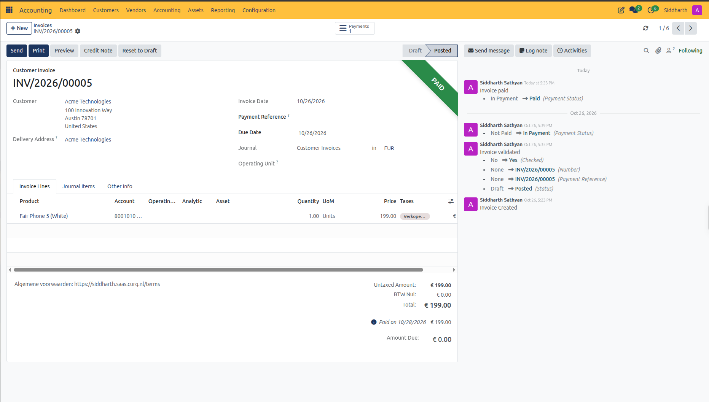

---

### Task 4: Match Bank Statement Lines Directly Without Prior Payment

If you do not register payments in advance via the **Pay** button and prefer to settle invoices directly upon bank statement arrival:

1. Create or import the incoming bank transaction line *(e.g., `€ 209.00` from `Acme Technologies`)*.

   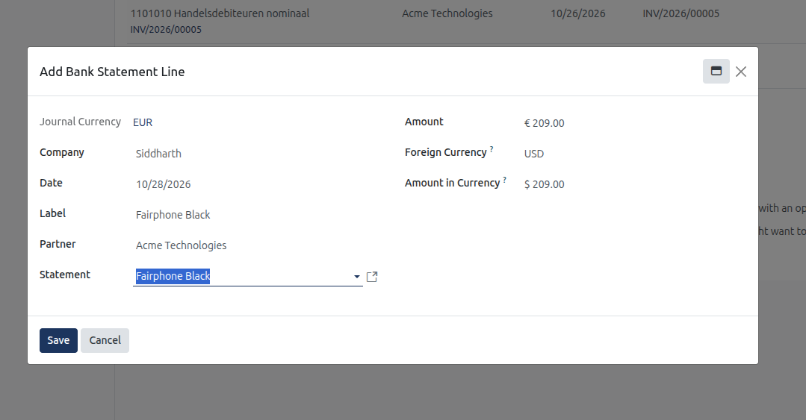

2. Open the reconciliation interface from **Accounting > Dashboard > Bank > Reconcile Items** (or via **Transactions**).
3. Select the unreconciled bank transaction line on the left *(e.g., `Fairphone Black - $ 209.00`)*.
4. Under the **Reconcile** tab, CURQ displays matching open customer invoices or vendor bills for the selected partner.
5. Select the matching open invoice *(e.g., `INV/2026/00003`)*:
   * The invoice line is added to the counterpart proposition under `1101010 Handelsdebiteuren nominaal` with a balanced credit of `€ 209.00`.
   * The balance difference resolves to `€ 0.00`.

   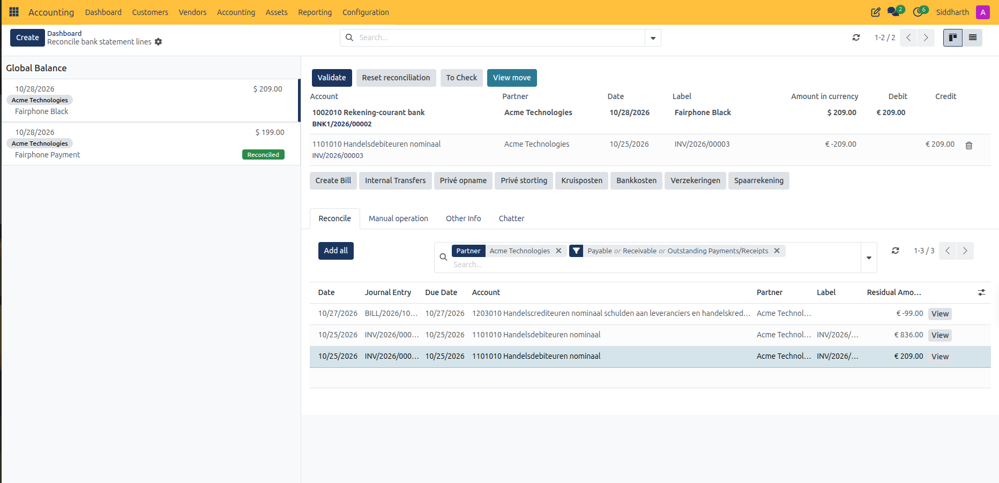

6. Click **Validate**.
7. **Observe the result**:
   * Open the customer invoice *(e.g., `INV/2026/00003`)* under **Customers > Invoices**.
   * The invoice displays the green **PAID** ribbon directly, with **Amount Due** reduced to `€ 0.00`.
   * In the chatter history, notice the transition: `Payment Status: Not Paid -> Paid`, confirming that the invoice was settled directly by the bank statement without passing through the transitory "In Payment" stage.

   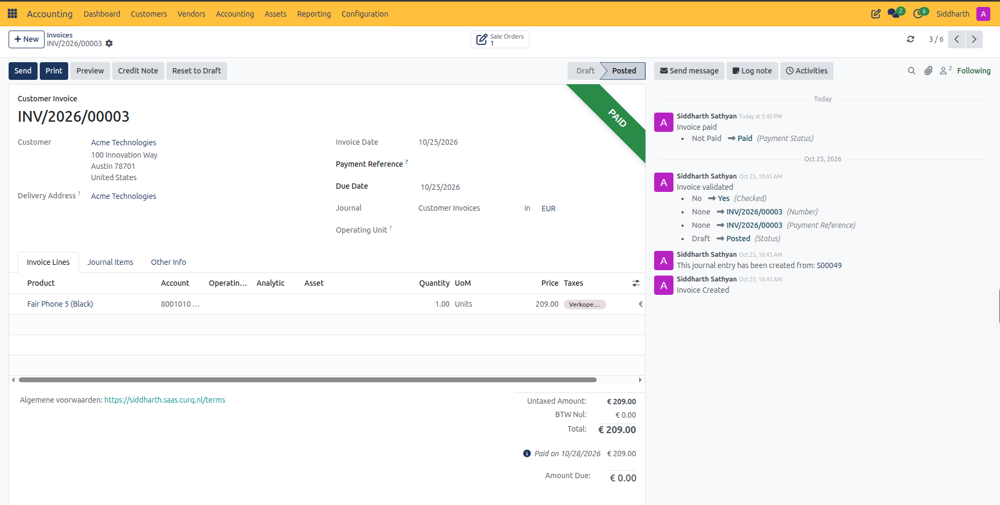

---

### Task 5: Reconcile Direct Expenses and Bank Fees Without Invoices

For operational expenses that do not generate vendor bills *(such as monthly bank maintenance fees, interest charges, or direct debit subscriptions)*:

1. In the bank journal, create or import the negative fee transaction line *(e.g., `-€ 15.00` for monthly account maintenance, leaving Partner and Statement blank)*.

   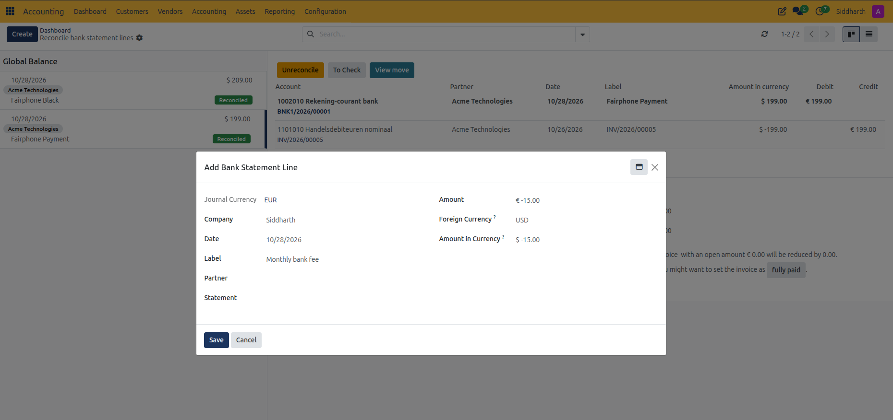

2. In the reconciliation interface, select the debit transaction line on the left *(e.g., `Monthly bank fee - € 15.00`)*.
3. Allocate the expense using one of two methods:
   * **Preset Button (Recommended)**: Click the **Bankkosten** preset button above the tabs. CURQ instantly populates the counterpart line allocating the debit of `€ 15.00` directly to the bank charges expense account `4210040 Bankkosten`.
   * **Manual Operation**: In the right panel, select the **Manual Operations** tab. In the **Account** field, select `4210040 Bankkosten` (or another appropriate general ledger expense account). Confirm or adjust the line label and taxes.
4. Confirm that the balance difference equals zero.

   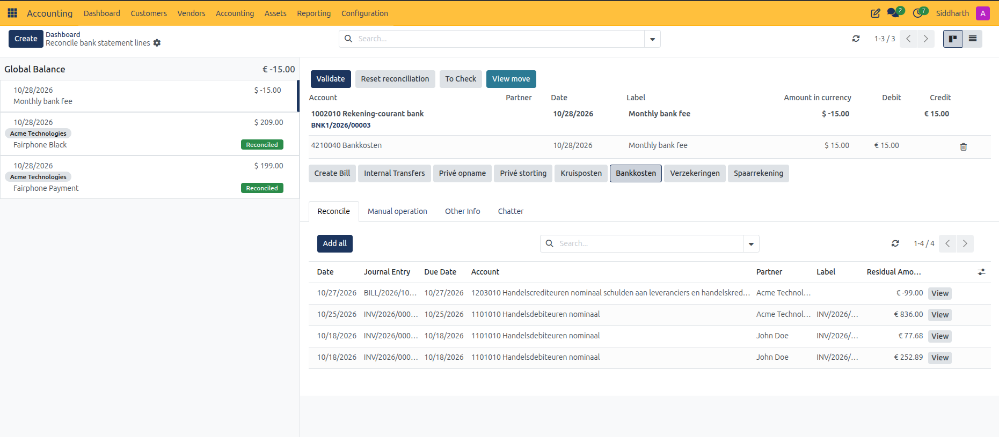

5. Click **Validate**.
6. **Observe the result**:
   * The statement line updates with a green **Reconciled** badge in the left panel.
   * Action buttons appear in the top action bar: **Unreconcile** (to reverse the entry), **To Check** (to flag for review), and **View move** (to inspect the posted journal entry `BNK1/2026/00003`).
   * When all pending bank statement lines are cleared, CURQ displays the completion illustration: *Well done! Everything has been reconciled*.

   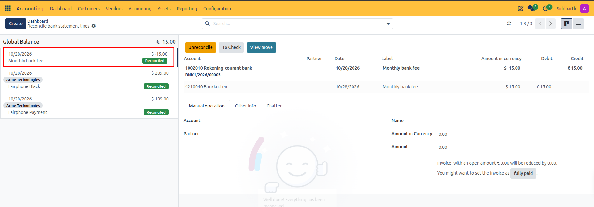

   * Click **View move** to inspect the underlying journal entry *(e.g., `BNK1/2026/00003`)*. The chatter audit trail confirms CURQ cleared the temporary bank suspense item and posted a direct debit of `€ 15.00` to `4210040 Bankkosten` offset by a credit of `€ 15.00` to `1002010 Rekening-courant bank`.

   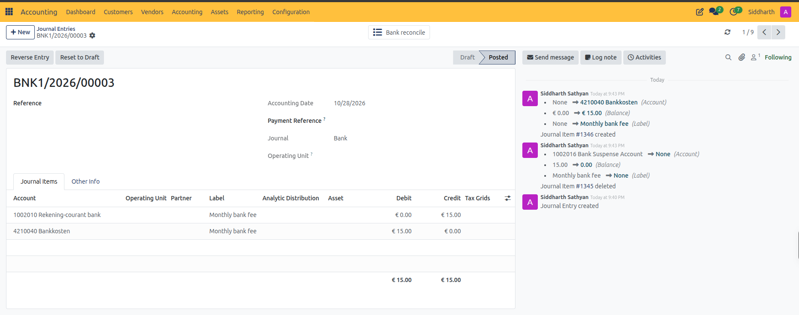

---

### Task 6: Reconcile Internal Transfers Between Company Accounts

When transferring liquidity between two accounts managed within CURQ *(such as transferring funds from your Bank account to your Cash register, or between checking and savings accounts)*:

#### Phase 1: Reconcile the Outgoing Transaction on the Source Account

1. In the source account *(e.g., Bank)*, create or import the outgoing transfer line *(e.g., `-€ 50.00` with label `Transfer to Cash`)*.

   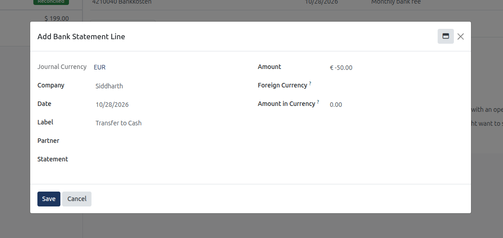

2. Open the reconciliation interface for the source journal and select the outgoing transaction line on the left.
3. Click the **Kruisposten** *(or **Internal Transfers**)* preset button above the tabs.
   * CURQ automatically creates the counterpart line allocating the debit of `€ 50.00` to the transit clearing account `1003010 Stortingen onderweg`.
   * The balance difference resolves to `€ 0.00`.

   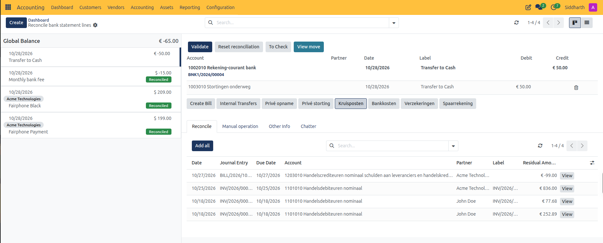

4. Click **Validate**. The source bank balance is reduced and the funds are parked in the transit clearing account.

#### Phase 2: Reconcile the Incoming Transaction on the Destination Account

1. In the destination journal *(e.g., Cash)*, open or create the cash register *(e.g., `CSH/2026/0001`)*:
   * **Starting Balance**: `€ 0.00`
   * **Ending Balance**: `€ 50.00`
   * **Add a line**: Date `10/28/2026`, Label `Cash received from Bank`, Amount `€ 50.00`.
   * Click **Save**.

   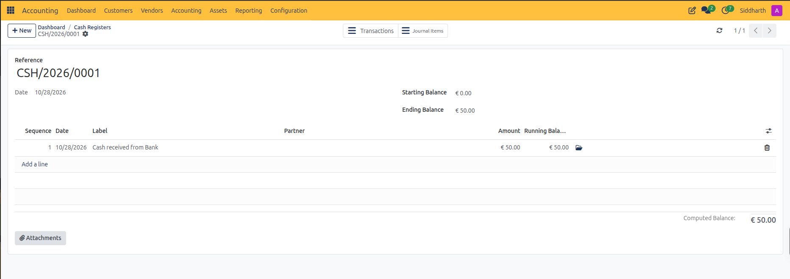

2. Open the destination journal reconciliation screen *(via the **Transactions** stat button on the register or **Accounting > Dashboard > Cash > Reconcile Items**)*.
3. Select the incoming `€ 50.00` transaction on the left.
4. Under the **Reconcile** tab, CURQ automatically detects the open counterpart entry waiting in `1003010 Stortingen onderweg` *(created by Bank entry `BNK1/2026/00004`)*.
5. Select the counterpart line:
   * The counterpart row for `1003010 Stortingen onderweg` is credited `€ 50.00`, offsetting the `€ 50.00` debit on `1001010 Kas`.
   * The balance difference resolves to `€ 0.00`.

   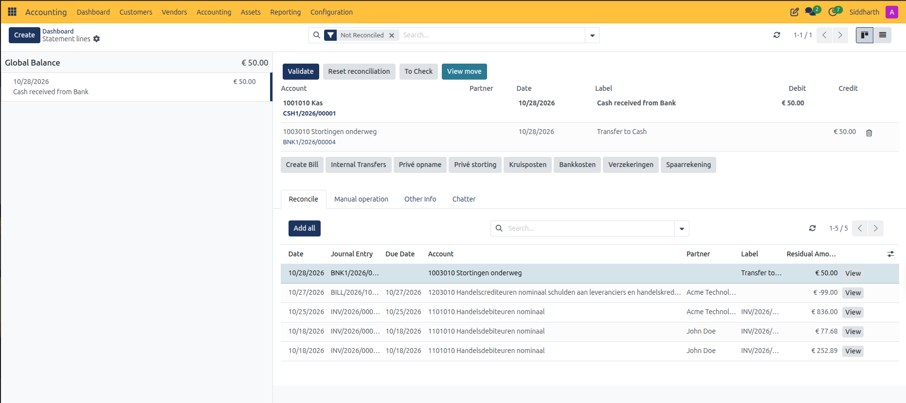

6. Click **Validate**. The destination account balance increases and the transit clearing account returns to zero, completing the inter-account transfer loop.

---

### Edge Cases & Recovery Steps

* **Partial Bank Reconciliation**: If a customer wire transfer covers only part of an open invoice, select the invoice in the reconciliation interface. CURQ applies the statement amount against the invoice and prompts you to choose whether to keep the remainder open as **Partial Payment** or post the difference to a designated write-off account.
* **Payment Difference Due to Bank Surcharges**: If an international wire incurs an intermediary bank charge resulting in a slight discrepancy *(e.g., invoice is `€ 100.00` but bank statement shows `€ 95.00`)*, select the invoice and use the **Manual Operations** tab to allocate the `€ 5.00` difference directly to `Bank Charges`.
* **Reversing an Erroneous Reconciliation**: If a transaction was reconciled against the wrong invoice or partner, open **Accounting > Dashboard**, click the three dots on the Bank card, and select **Transactions**. Filter by **Reconciled**, open the target transaction line, and click **Unreconcile**. The transaction returns to unreconciled status and the linked invoice reverts to **In Payment** or **Posted**.
* **Marking Questionable Lines as "To Check"**: If an unexpected deposit or withdrawal appears without identification, select the transaction line in the reconciliation interface and click **To Check**. This flags the entry across reports and dashboards for senior auditor review without stopping other reconciliations.

---

### Related Documentation

* [Register and Reconcile Payments](./03-register-and-reconcile-payments.md)
* [Payment, Bank, and Journal Entry Field Definitions](../settings-and-fields/04-payment-bank-and-journal-entry-field-definitions.md)
* [Create and Validate Customer Invoices](./01-create-and-validate-customer-invoices.md)
* [Create and Process Vendor Bills](./02-create-and-process-vendor-bills.md)
