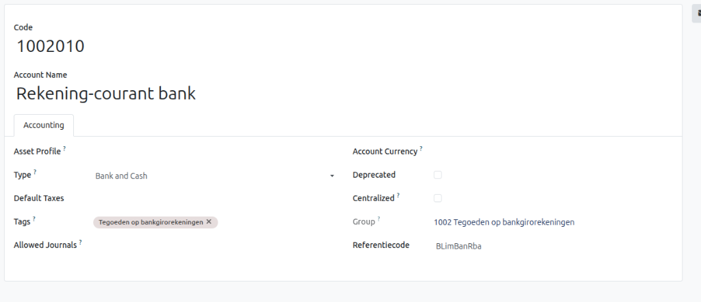
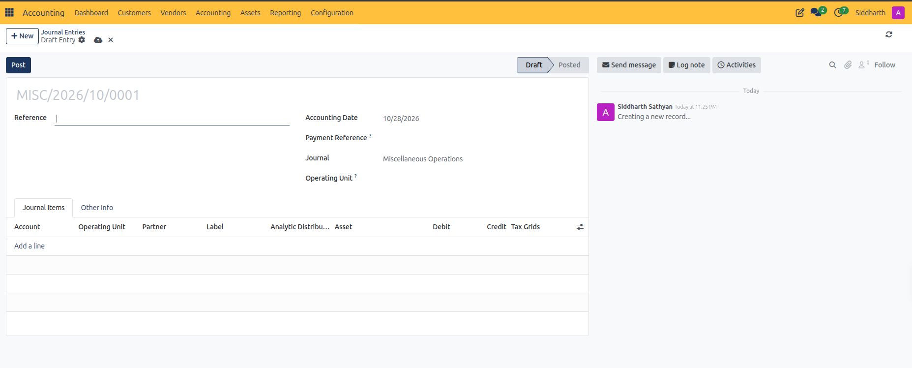
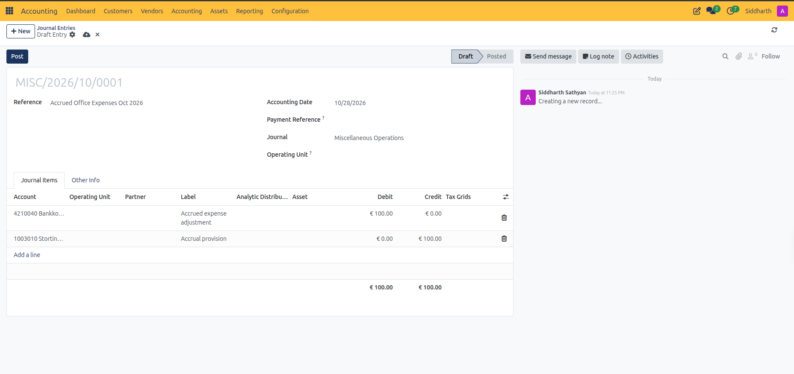
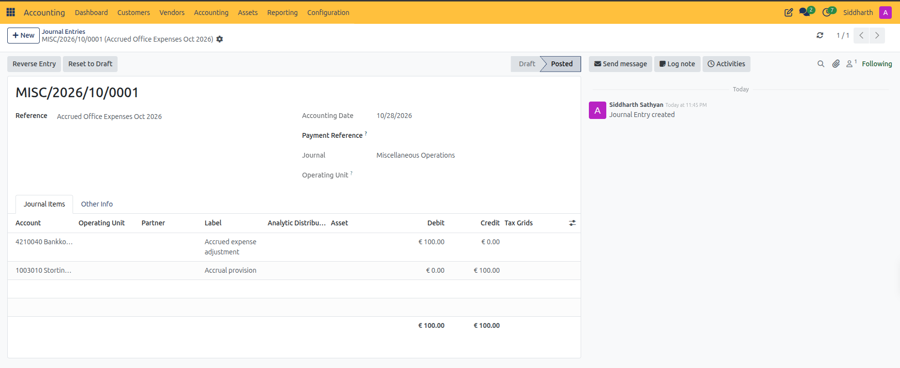
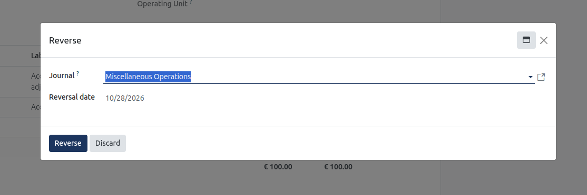
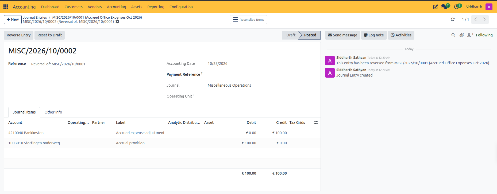
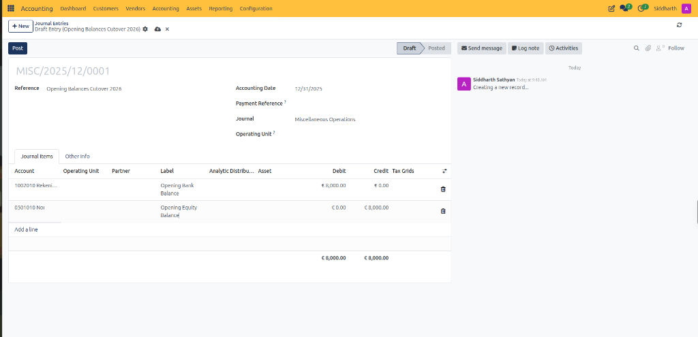
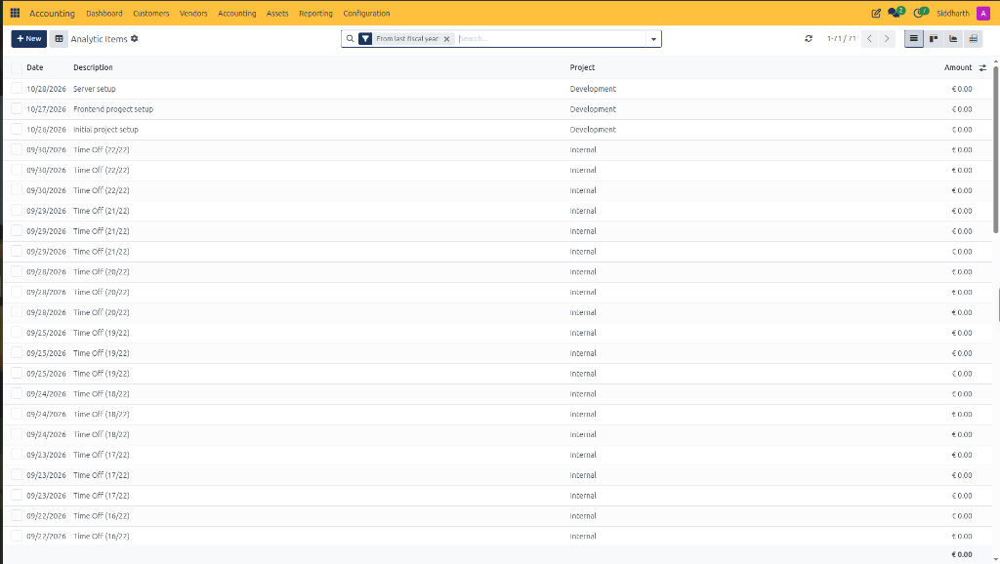
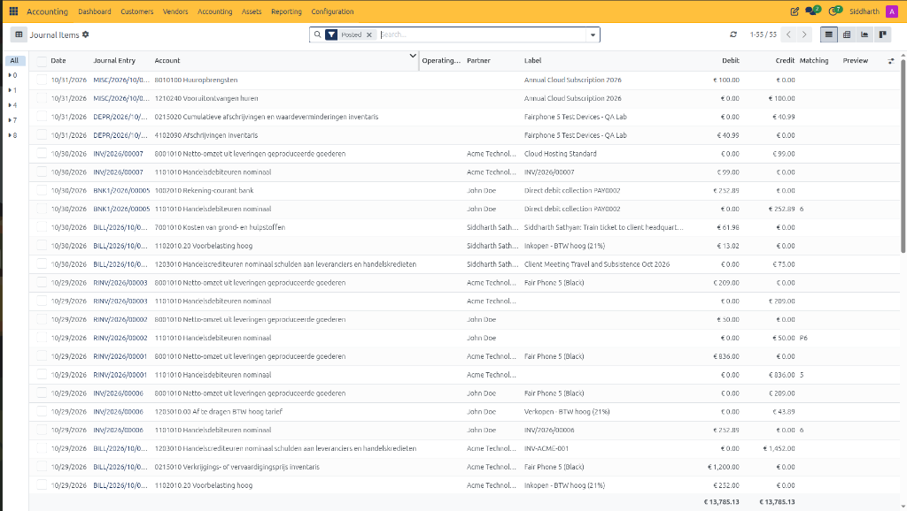

# Create and Manage Manual Journal Entries

Record non-operational transactions, adjust general ledger balances, set up initial opening balances, manage month-end accruals, and reverse adjusting entries in CURQ Accounting.

> **Prerequisites**
> * Ensure your user role has **Accounting / Officer** or **Administrator** permissions.
> * Verify that your Chart of Accounts is configured with active general ledger accounts under **Accounting > Configuration > Chart of Accounts**:
>
>   
>
>   > For complete Chart of Accounts field and RGS classification definitions, see [**Chart of Accounts Field Definitions**](../settings-and-fields/02-chart-of-accounts-and-taxes-field-definitions.md#chart-of-accounts-field-definitions).
> * Ensure a **Miscellaneous Operations** journal *(or dedicated adjusting journal)* is configured in **Configuration > Journals**.
> * Confirm that the target accounting period is not blocked by a fiscal lock date.

---

### Task 1: Create a Draft Journal Entry

Use a manual journal entry when recording transactions that do not originate from customer invoices, vendor bills, or bank statement lines *(such as payroll journals, depreciation adjustments, tax settlement entries, or cost corrections)*.

1. Open the **Accounting** application.
2. In the top navigation bar, select **Accounting > Accounting > Journal Entries**.
3. In the upper-left action bar, click **+ New**.

   
4. In the journal entry header, configure the administrative parameters:
   * **Reference**: Enter a concise, descriptive title identifying the business purpose *(e.g., `Monthly Depreciation - Oct 2026` or `Accrued Audit Fees Q4`)*.
   * **Accounting Date**: Select the legal effective date of the entry. This date determines which fiscal month, quarter, and tax period the entry impacts.
   * **Journal**: Select the appropriate journal *(typically `Miscellaneous Operations`)*.
   * **Operating Unit**: *(If enabled)* Select the branch or division responsible for the entry.

> **Note:** In the **Draft** state, the journal entry has not posted to the general ledger, does not affect financial reports, and consumes no permanent sequence number.

---

### Task 2: Add Balanced Journal Items (Debits and Credits)

Under double-entry bookkeeping rules, every journal entry must balance: the total value of all debit lines must equal the total value of all credit lines.

1. Select the **Journal Items** tab.
2. Click **Add a line** to enter the first side of the transaction *(e.g., an expense or asset debit)*:
   * **Account**: Select the general ledger account *(e.g., `4200000 Office Rent`)*.
   * **Partner**: Select a contact if the line affects customer receivables (`1101010`) or vendor payables (`1203010`). For standard income or expense allocations, this can remain blank.
   * **Label**: Enter an explanatory memo describing the specific line item.
   * **Analytic Distribution**: *(Optional)* Assign a percentage of the amount to cost centers or analytic projects for managerial accounting.
   * **Debit**: Enter the debit amount.
3. Click **Add a line** to enter the offsetting side of the transaction *(e.g., a liability or accrual credit)*:
   * **Account**: Select the counterpart general ledger account *(e.g., `1400000 Accrued Liabilities`)*.
   * **Label**: Enter the counterpart description.
   * **Credit**: Enter the credit amount matching the debit.
4. Verify the totals row at the bottom of the table:
   * The total **Debit** column must match the total **Credit** column exactly.
   * If there is an imbalance, CURQ displays a difference and prevents posting.

---

### Task 3: Post the Journal Entry to the General Ledger

1. Review all lines, accounts, and dates for accuracy.
2. In the upper action bar, click **Post**.
3. **Observe the result**:
   * The status changes from **Draft** to **Posted**.
   * CURQ assigns a sequential, permanent reference number *(e.g., `MISC/2026/10/0001`)*.
   * The debit and credit amounts immediately update the general ledger, balance sheet, and profit & loss reports.
   * Action buttons appear in the upper action bar: **Reverse Entry** and **Reset to Draft**.

   

---

### Task 4: Reverse a Journal Entry (Accruals and Adjustments)

Reversals are standard practice for temporary month-end accruals *(e.g., estimating an unbilled utility expense at month-end and reversing it on the first day of the following month)* or correcting posted accounting errors.

1. Open the posted journal entry you wish to reverse under **Accounting > Accounting > Journal Entries**.
2. In the upper-left action bar, click **Reverse Entry**.
3. In the **Reverse** dialog, configure the reversal parameters:
   * **Journal**: Select the journal for the reversal *(defaults to `Miscellaneous Operations`)*.
   * **Reversal date**: Choose the legal date for the offsetting entry *(e.g., today's date for an immediate error correction, or `11/01/2026` for a next-month accrual reversal)*.

   
4. Click **Reverse** *(or **Reverse and View**)*:
   * CURQ generates an exact opposite journal entry *(e.g., `MISC/2026/10/0002`)*, swapping all debits to credits and credits to debits *(crediting `4210040 Bankkosten` for `€ 100.00` and debiting `1003010 Stortingen onderweg` for `€ 100.00`)*.
   * The chatter audit trail records: `This entry has been reversed from MISC/2026/10/0001 (Accrued Office Expenses Oct 2026)`.
   * The reversed entry is posted immediately, neutralizing the financial effect in the designated period.

   

---

### Task 5: Record Opening Balances During System Migration

When transitioning to CURQ from a legacy accounting system, record historical asset, liability, and equity balances as of your cutover date:

1. In the top navigation bar, select **Accounting > Accounting > Journal Entries**.
2. Click **+ New**.
3. Configure the opening voucher header:
   * **Reference**: `Opening Balances Cutover 2026`
   * **Accounting Date**: Set to the final day of your prior accounting period *(e.g., `12/31/2025` or the day immediately prior to your go-live date)*.
   * **Journal**: `Miscellaneous Operations`.
4. On the **Journal Items** tab, enter your trial balance lines:
   * **Asset Accounts**: Enter opening balances in the **Debit** column *(e.g., `1002010 Rekening-courant bank` for `€ 8,000.00`)*.
   * **Liability Accounts**: Enter opening balances in the **Credit** column *(e.g., bank loans, trade payables, tax obligations)*.
   * **Equity & Retained Earnings**: Enter accumulated capital and prior earnings in the **Credit** column *(e.g., `0501010 Normale aandelen aandelenkapitaal` for `€ 8,000.00`)*.
5. If migrating open customer invoices or vendor bills individually, post individual invoices and bills with their original amounts, or offset the total receivables and payables against a migration clearing account.
6. Confirm that Total Debits equal Total Credits *(both `€ 8,000.00`)*.

   

7. Click **Post**.

---

### Task 6: Audit and Manage Analytic Items

Analytic items represent the managerial accounting ledger in CURQ. Unlike statutory journal items that post strictly to balanced general ledger accounts, analytic items track operational revenues and project costs across projects, departments, and cost centers.

1. In the top navigation bar, select **Accounting > Accounting > Analytic Items**.
2. Review the analytical ledger showing project and department postings:

   

3. Understand the analytical item columns:
   * **Date**: Effective operational or posting date of the transaction.
   * **Description**: Originating transaction label *(e.g., `Server setup`, `Frontend project setup`, or timesheet allocations)*.
   * **Project**: Designated analytical account or project cost center *(e.g., `Development` or `Internal`)*.
   * **Amount**: Financial impact allocated to the analytical project *(positive for revenue or neutral balance, negative for project expenses)*.
4. Filter and analyze data:
   * Use default search filters such as **From last fiscal year** or group by **Project** to aggregate profitability.
   * Switch to the **Pivot View** (grid icon in top-right) to analyze costs by month and project matrix.
   * Switch to the **Graph View** (bar chart icon) to visualize expenditure trends.
5. Direct analytical adjustments:
   * To record an internal analytical cost reallocation without creating a statutory general ledger move, click **+ New**, specify the date, project, description, and amount, and save the item.

---

### Task 7: Audit the Global Journal Items Ledger

While the Journal Entries view displays balanced accounting vouchers, the **Journal Items** registry presents a global, line-level ledger of all individual debit and credit movements across every journal:

1. In the top navigation bar, select **Accounting > Accounting > Journal Items**.
2. Review the global transaction ledger:

   

3. Understand key journal item columns:
   * **Date**: Accounting date on which the move was posted *(e.g., `10/31/2026`)*.
   * **Journal Entry**: Originating accounting voucher reference *(e.g., `INV/2026/00007`, `BILL/2026/10/0003`, `DEPR/2026/10/0001`)*.
   * **Account**: Specific general ledger account impacted *(e.g., `8010100`, `1101010`, `7001010`)*.
   * **Operating Unit**: Branch or operational business division responsible for the transaction.
   * **Partner**: Associated customer, vendor, or employee.
   * **Label**: Description of the line transaction.
   * **Debit / Credit**: Monetary figures allocated to the account.
   * **Matching**: Reconciliation tracking code *(e.g., `P6`, `5`)* indicating whether the line has been matched against an offsetting entry.
4. Verify overall equilibrium:
   * The footer confirms that total debits equal total credits across all filtered lines *(e.g., `€ 13,785.13` equal `€ 13,785.13`)*.

---

### Task 8: Lock and Secure Entries with Cryptographic Hash Chaining

For statutory compliance and tamper-evident audit trails, CURQ enables cryptographic hash chaining to permanently lock posted entries:

1. In the top navigation bar, select **Accounting > Accounting > Secure Entries**.
2. Review the parameter dialog:

   

3. Configure the immutability cutoff:
   * **Secure entries up to**: Enter the calendar cutoff date *(e.g., `12/30/2025`)*.
   * *Notice*: Securing entries computes SHA-256 hash chains across all posted entries up to this date inclusive, rendering them permanently uneditable and immutable to satisfy legal anti-fraud regulations.
4. Click **Secure Entries** to execute the cryptographic lock, or click **Discard** to cancel.

---

### Edge Cases & Recovery Steps

* **Modifying a Posted Journal Entry**: If an error is discovered on a posted entry before the fiscal period is locked, open the entry and click **Reset to Draft**. Make the required line adjustments, verify that debits still equal credits, and click **Post**.
* **Fiscal Lock Date Prevents Editing**: If an entry falls inside a locked period, CURQ prevents both **Reset to Draft** and direct edits *(see [**Manage Lock Dates and Fiscal Year-End Closing**](./12-manage-lock-dates-and-fiscal-year-end-closing.md))*. Do not modify the historical period; instead, use **Reverse Entry** or create a new adjusting entry in the current open fiscal period.
* **Posting to Accounts Receivable or Payable Without a Partner**: CURQ requires a **Partner** on every line affecting receivable (`1101010`) or payable (`1203010`) accounts. If omitted, the general ledger will balance, but aged partner balance reports and reconciliation widgets will show unallocated partner balances.
* **Foreign Currency Journal Entries**: When recording entries involving foreign currencies, ensure the company currency Debit/Credit amounts reflect the accurate converted rate while the **Amount in Currency** field stores the nominal foreign currency figure.

---

### Related Documentation

* [Manage Lock Dates and Fiscal Year-End Closing](./12-manage-lock-dates-and-fiscal-year-end-closing.md)
* [Generate Financial Reports and Trial Balance](./07-generate-financial-reports-and-trial-balance.md)
* [Payment, Bank, and Journal Entry Field Definitions](../settings-and-fields/04-payment-bank-and-journal-entry-field-definitions.md)
* [Understanding Double-Entry Bookkeeping and Journals](../core-concepts/01-understanding-double-entry-bookkeeping-and-journals.md)
