# Manage Fixed Assets and Depreciation

Configure asset profiles, register capital assets manually or automatically from vendor bills, calculate depreciation schedules, post periodic depreciation journal entries, and process asset disposals in CURQ Accounting.

---

### Overview

Fixed assets *(such as machinery, vehicles, office furniture, and IT equipment)* represent long-term capital investments that provide economic value across multiple accounting years. Under standard accounting principles, the cost of these assets is not expensed entirely on the purchase date; instead, it is allocated across the asset's useful operational life through periodic **depreciation**.

In CURQ Accounting, the asset management workflow automates this accounting cycle:
* **Asset Profiles**: Define preconfigured depreciation rules, useful life terms, and general ledger accounts.
* **Depreciation Boards**: Calculate exact periodic depreciation amounts, residual book values, and posting schedules.
* **Automated Accounting**: Generate and post periodic journal entries debiting depreciation expense and crediting accumulated depreciation.
* **Disposal & Sales**: Process retirement, write-offs, or sales of assets with automated capital gain or loss recognition.

> **Prerequisites**
> * User permissions for **Accounting / Adviser** or **Accounting / Billing**.
> * Capital asset balance sheet accounts and depreciation expense accounts established in your Chart of Accounts.
> * A designated journal for asset depreciation *(typically `Miscellaneous Operations` or a dedicated `Depreciation Journal`)*.

---

### Task 1: Configure an Asset Profile

Asset profiles serve as templates that standardize depreciation parameters and general ledger accounts across asset categories.

1. In the top navigation bar, select **Accounting > Configuration > Asset Profiles** *(under the **Assets** section of the configuration menu)*.

   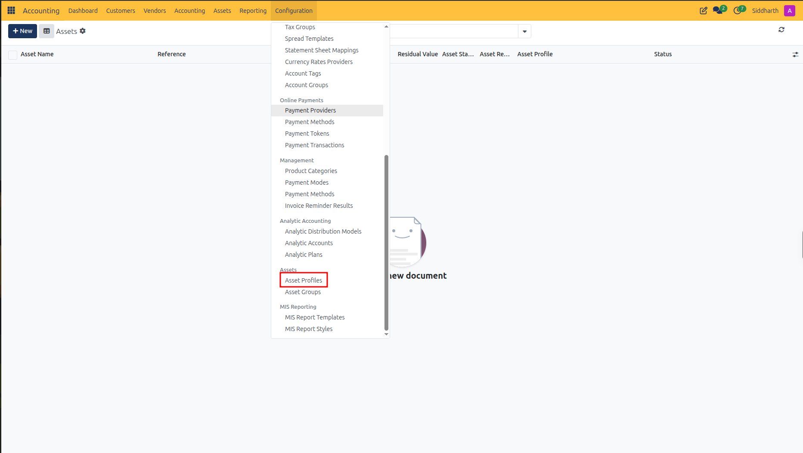

2. Review the list of preconfigured profiles *(such as `Inventaris`, `Machines en installaties`, or `Transportmiddelen`)*, or click **+ New** to create a custom profile.

   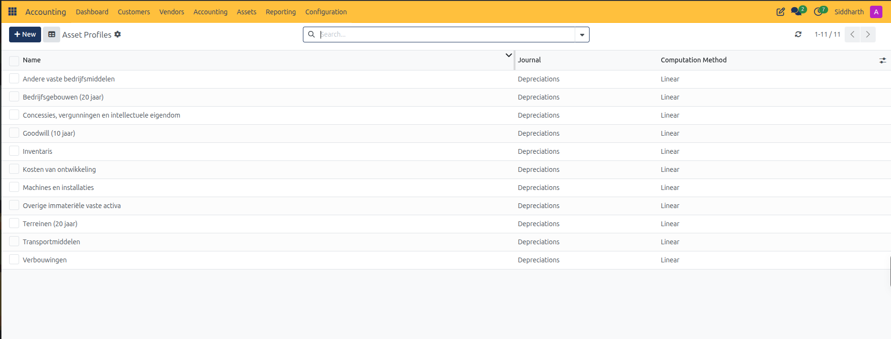

3. Open an existing profile *(such as `Inventaris`)* or click **+ New** to configure profile parameters:
   * **Name**: Descriptive asset category *(e.g., `Inventaris`)*.
   * **Asset Groups**: Link to an asset classification group *(e.g., `02 Materiële vaste activa`)*.
   * **Journal**: Dedicated depreciation journal *(e.g., `Depreciations`)*.
   * **Accounting Accounts**:
     * **Asset Account**: Capital acquisition account *(e.g., `0215010 Verkrijgings- of vervaardigingsprijs inventaris`)*.
     * **Depreciation Account**: Accumulated depreciation balance sheet contra-account *(e.g., `0215020 Cumulatieve afschrijvingen en waardeverminderingen inventaris`)*.
     * **Depr. Expense Account**: P&L depreciation expense account *(e.g., `4102090 Afschrijvingen inventaris`)*.
   * **Depreciation Dates**:
     * **Time Method**: Select **Number of Years or end date**.
     * **Number of Years**: Useful life span *(e.g., `5` years)*.
     * **Period Length**: Select calculation interval *(e.g., `Month`)*.
   * **Depreciation Method**:
     * **Computation Method**: Select **Linear** *(or Declining Balance)*.
     * **Prorata Temporis**: Enable this checkbox so that the first month's depreciation is calculated proportionally from the asset's in-service start date.

   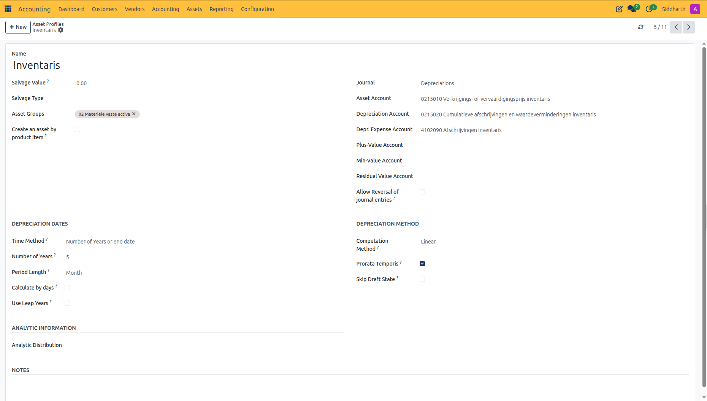

4. Click **Save** *(or return to the profile list)*.

---

### Task 2: Register a Capital Asset Manually

When entering existing assets during migration or recording capital investments not created directly from invoices:

1. In the top navigation bar, select **Accounting > Assets > Assets**.
2. Click **+ New**.
3. In the asset header:
   * **Asset Name**: Enter the legal title or identifier *(e.g., `Fairphone 5 Test Devices - QA Lab`)*.
   * **Reference**: Enter an internal inventory tag, serial number, or barcode *(e.g., `AST-FP5-2026-01`)*.
4. Under the **General** tab:
   * **Asset Profile**: Select your preconfigured profile *(e.g., `Inventaris`)*. CURQ automatically imports account mappings, depreciation methods, and period lengths.
   * **Purchase Value**: Enter the net purchase price excluding deductible VAT *(e.g., `€ 2,400.00`)*.
   * **Asset Start Date**: Select the date the asset is placed into service *(e.g., `10/01/2026`)*.
   * **Partner**: Select the vendor who supplied the asset *(e.g., `Fairphone B.V.`)*.

   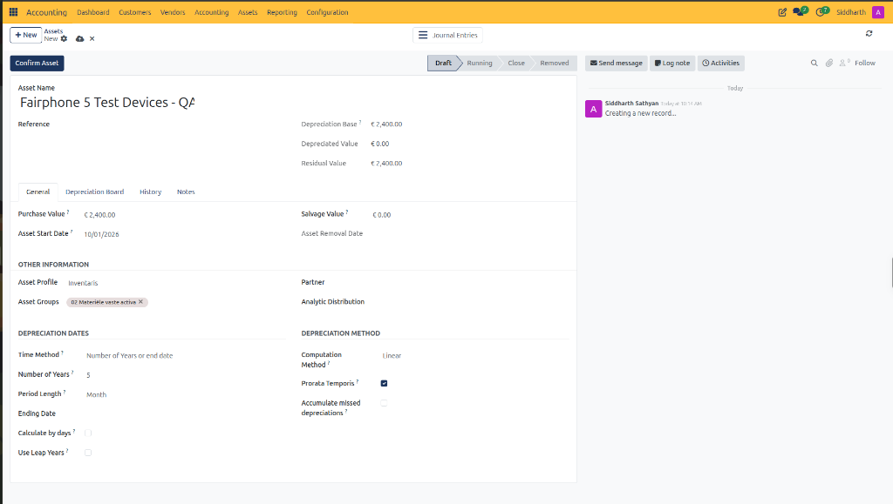

5. Review the imported calculation parameters under **Depreciation Dates** and **Depreciation Method**:
   * Confirm **Period Length** is set to `Month` and **Number of Years** is set to `5`.
   * Confirm **Prorata Temporis** is active.
6. Click the **Depreciation Board** tab and click **% Compute**:
   * CURQ calculates the complete 5-year amortization schedule *(61 total rows: 1 initial base row and 60 monthly instalments)*.
   * Notice that the first month's depreciation on `10/31/2026` is computed as `€ 40.99` due to prorata day weighting (31 days in October), followed by standard `€ 40.00` monthly instalments.
   * Verify the schedule columns: **Type**, **Date**, **Days**, **Amount Already Depreciated**, **Amount**, and **Next Period Depreciation**.

   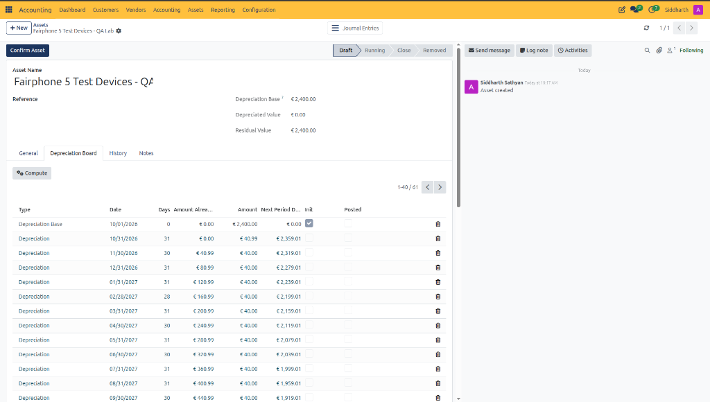

---

### Task 3: Confirm and Activate the Asset

Generating the depreciation board keeps the asset in **Draft** status, allowing adjustments prior to general ledger posting.

1. Review the generated lines on the **Depreciation Board**.
2. If necessary, manually adjust individual line dates or amounts to reflect historical depreciation already recorded in a prior accounting system.
3. In the top action bar, click **Confirm Asset**:
   * The status changes from **Draft** to **Running**.
   * The draft deletion icons disappear, and a **Create Move** action button appears on each unposted scheduled line.
   * New header controls appear: **Set to Draft** *(to revert and recalculate if needed)* and **Remove** *(to dispose of or sell the asset)*.

   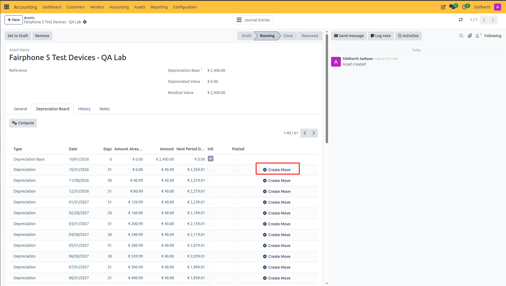

---

### Task 4: Post Periodic Depreciation Journal Entries

Depreciation amounts on active assets must be posted to the General Ledger at the end of each accounting period *(month-end or year-end)*.

#### Method A: Batch Posting Across All Active Assets
1. In the top navigation bar, select **Assets > Compute Assets**.

   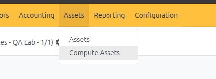

2. In the **Compute Assets** pop-up dialog:
   * **Date**: Set the cutoff date *(e.g., `10/31/2026` for October month-end)*.

   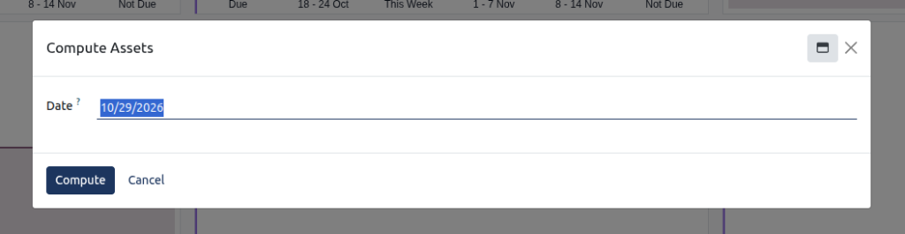

3. Click **Compute**:
   * CURQ evaluates all assets in **Running** status.
   * Generates and posts general ledger journal vouchers for all unposted depreciation lines falling on or before the selected cutoff date.
   * Posts:
     * **Debit**: `4102090 Afschrijvingen inventaris` *(P&L Depreciation Expense)*
     * **Credit**: `0215020 Cumulatieve afschrijvingen en waardeverminderingen inventaris` *(Balance Sheet Contra-Asset)*

   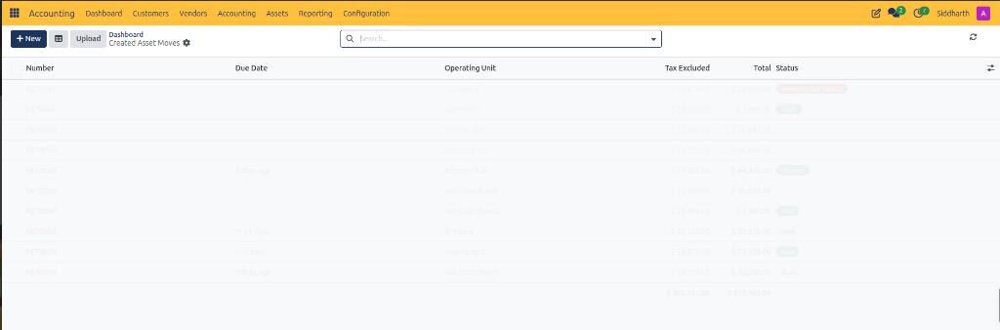

#### Method B: Posting Individual Asset Lines Directly
1. Open the active asset in **Accounting > Assets > Assets**.
2. On the **Depreciation Board** tab, locate the target period row *(e.g., the first line dated `10/31/2026` for `€ 40.99`)*.
3. Click the **Create Move** button on that row:
   * CURQ generates and posts the journal voucher immediately.
   * The **Posted** checkbox for that line becomes checked.
   * The header financial figures update automatically: **Depreciated Value** increases to `€ 40.99` and **Residual Value** decreases to `€ 2,359.01`.
   * The line actions update to provide **View Move** *(to inspect the general ledger voucher)* and **Delete/Reverse Move** *(to unwind the entry if posted in error)*.

   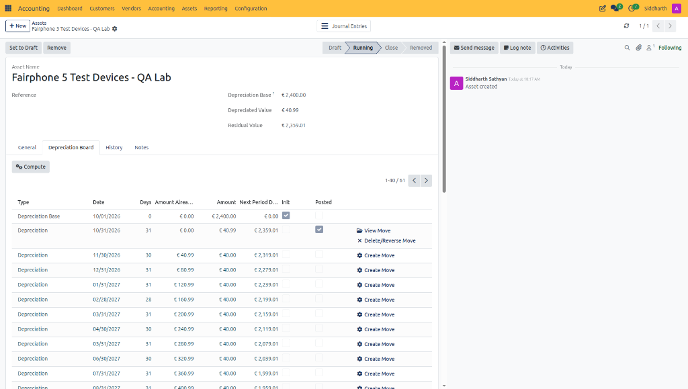

4. Click **View Move** on the posted row *(or click the **Journal Entries** stat button in the header)* to review the balanced debit/credit voucher in the general ledger:
   * **Sequence Number**: Officially assigned as `DEPR/2026/10/0001` under the `Depreciations` journal.
   * **Accounting Date**: `10/31/2026`.
   * **Lines**:
     * **Debit**: `4102090 Afschrijvingen inventaris` for `€ 40.99` *(operational P&L expense)*.
     * **Credit**: `0215020 Cumulatieve afschrijvingen en waardeverminderingen inventaris` for `€ 40.99` *(balance sheet contra-asset reducing asset book value)*.
   * **Audit Link**: A stat button **Asset(s): 1** links directly back to the parent asset record.

   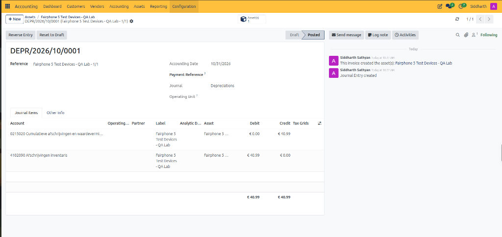

5. Return to **Assets > Assets** to confirm that the asset register displays the updated amortized figures:
   * **Depreciation Base**: `€ 2,400.00`
   * **Depreciated Value**: `€ 40.99`
   * **Residual Value**: `€ 2,359.01`

   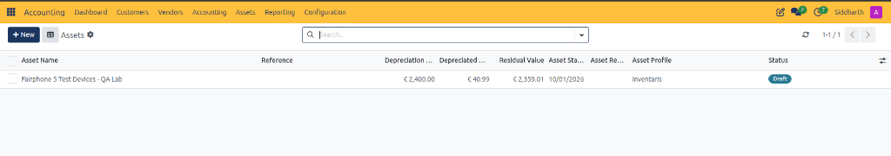

---

### Task 5: Automatically Generate Assets from Vendor Bills

CURQ can eliminate manual data entry by automatically generating capital asset draft records when vendor bills are confirmed.

1. Configure your Chart of Accounts:
   * Navigate to **Accounting > Configuration > Chart of Accounts**.
   * Open your asset balance sheet account *(e.g., `0215010 Verkrijgings- of vervaardigingsprijs inventaris`)*.
   * Verify that **Asset Profile** is set to `Inventaris`.
2. Create and validate a vendor bill:
   * Navigate to **Accounting > Vendors > Bills > + New**.
   * Select the **Vendor** *(e.g., `Acme Technologies`)*.
   * Enter the **Bill Reference** *(e.g., `INV-ACME-001`)* and set the **Bill Date** *(e.g., `10/29/2026`)*.
   * Under the **Invoice Lines** tab, select the **Product** *(e.g., `Fair Phone 5 (Black)`)*.
   * Verify the balance sheet **Account** is set to `0215010 Verkrijgings- of vervaardigingsprijs inventaris`.
   * CURQ automatically populates the **Asset Profile** (`Asset Pro...`) column with `Inventaris`.
   * Set the purchase **Price** *(e.g., `1,200.00`)*.

   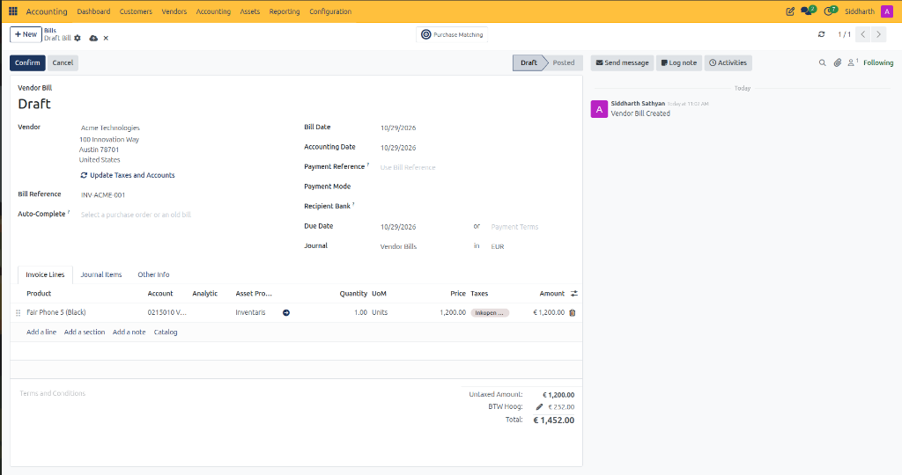

   * Click **Confirm**:
     * The bill transitions to **Posted** and is assigned a sequence number *(e.g., `BILL/2026/10/0002`)*.
     * CURQ automatically creates a linked capital asset record and logs the creation in the chatter *(e.g., `This invoice created the asset(s): BILL/2026/10/0002 - Fair Phone 5 (Black)`)*.
     * A smart button **Asset(s): 1** appears in the top-right header.

   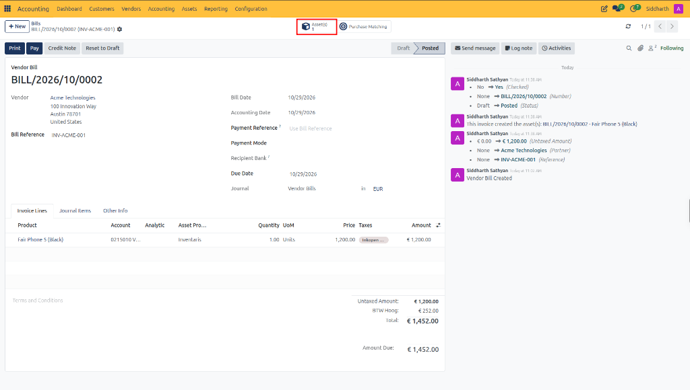

3. View and activate the generated asset:
   * In the top-right stat button row of the vendor bill, click **Asset(s)** *(or navigate to **Accounting > Assets > Assets**)*.
   * Open the newly created asset record *(e.g., `Fair Phone 5 (Black)`)*.
   * Review the pre-populated asset properties inherited from the bill line and asset profile:
     * **Asset Name**: `Fair Phone 5 (Black)`.
     * **Reference**: `BILL/2026/10/0002`.
     * **Depreciation Base / Purchase Value**: `€ 1,200.00`.
     * **Asset Start Date**: `10/29/2026`.
     * **Asset Profile**: `Inventaris`.
     * **Partner**: `Acme Technologies`.
     * **Depreciation Method**: `5` Years, `Linear`, with `Prorata Temporis` enabled.

   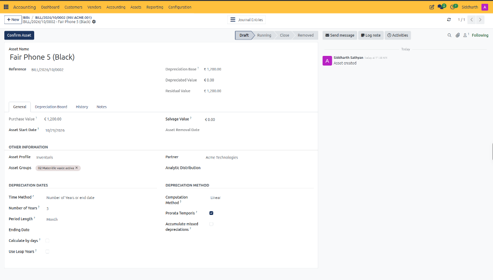

   * *(Optional)* Click the **Depreciation Board** tab to review the pre-computed monthly amortization schedule.
   * Click **Confirm Asset** in the top action bar:
     * The asset transitions from **Draft** to **Running**.
     * The record is officially entered into the asset register, enabling periodic depreciation runs and activating the **Set to Draft** and **Remove** management actions.

   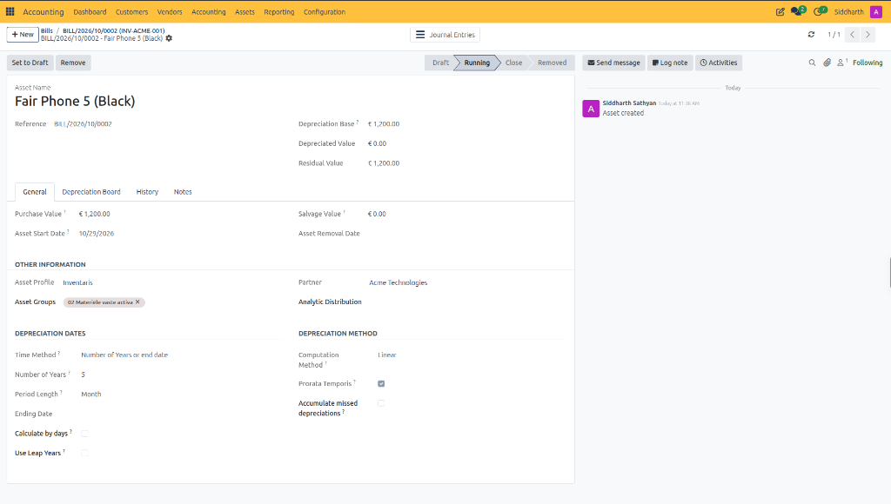

---

### Task 6: Sell or Dispose of an Asset

When an asset is retired due to obsolescence, theft, damage, or sale:

1. Open the active asset in **Accounting > Assets > Assets**.
2. Click **Remove** in the top action bar.
3. In the **Generate Asset Removal entries** dialog:
   * **Asset Removal Date**: Enter the date the asset left service *(defaults to current date, e.g., `10/29/2026`)*.
   * **Force accounting date**: Specify an explicit general ledger date if overriding the removal date *(optional)*.
   * **Sale Value**:
     * For scrap, write-offs, or retirements with zero recovery: leave `0.00`.
     * For asset sales: enter the negotiated gross selling amount *(e.g., `€ 500.00`)*.
   * **Removal Entry Policy**: Select **Gain/Loss on Sale** *(or Residual Value)*.
   * **Plus-Value Account / Min-Value Account**: Select the general ledger accounts for capital gain or loss on disposal *(if not pre-set on the asset profile)*.

   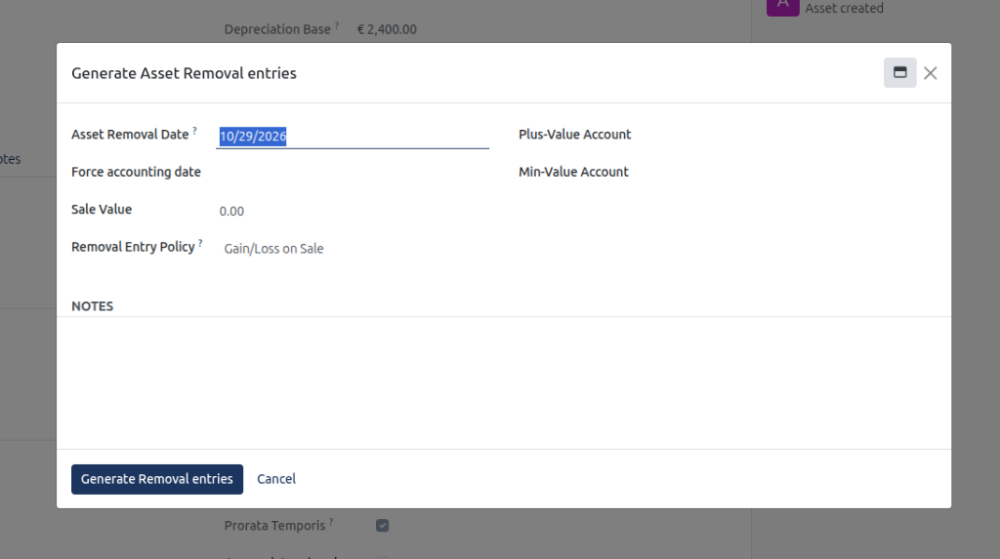

4. Click **Generate Removal entries**:
   * CURQ creates a closing journal voucher:
     * Removes the original purchase cost from the asset account.
     * Reverses the cumulative balance in accumulated depreciation.
     * Posts net difference to **Loss on Disposal** *(Expense)* or **Gain on Disposal** *(Income)*.
   * The asset status transitions from **Running** to **Removed**.

---

### Task 7: Generate and Audit the Financial Assets Report

To produce an audit-ready financial statement of capital assets, acquisition costs, and accumulated depreciation:

1. Navigate to **Accounting > Reporting > Financial Assets report**.
2. In the **Financial Assets report** dialog:
   * **Asset Group**: Select the target asset profile or leave default *(e.g., `01 Immateriële vaste activa` or `Inventaris`)*.
   * **Start Date**: Enter the beginning date of the fiscal audit period *(e.g., `10/01/2026`)*.
   * **End Date**: Enter the closing date of the fiscal audit period *(e.g., `10/30/2026`)*.
   * **Include draft assets**: Leave unchecked to report only officially confirmed, active capital assets *(enable only if projecting future depreciation for unconfirmed assets)*.

   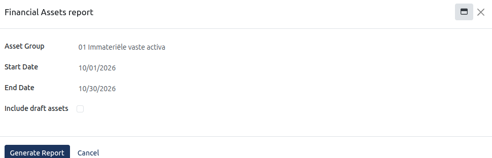

3. Click **Generate Report**:
   * CURQ compiles the capital asset register, detailing initial acquisition costs, depreciation posted during the period, accumulated depreciation to date, and net book residual value.

---

### Edge Cases & Recovery Steps

* **Modifying an Active Asset**: Once an asset is in **Running** status, core purchase value and start date fields are locked. To modify depreciation terms, click **Modify Depreciation** *(or **Reset to Draft** if permitted by fiscal lock date rules)*, adjust calculation variables, and re-compute the schedule.
* **Fiscal Lock Date Prevents Depreciation Posting**: If a periodic batch compute falls inside a locked fiscal period, CURQ will reject posting. You must either advance the compute date to an open period or have an authorized accounting administrator temporarily adjust the fiscal lock date.
* **Negative or Discrepant Residual Values**: If an asset's salvage value exceeds its net acquisition value, the calculation engine will fail. Ensure salvage values are set equal to or lower than purchase costs.
* **Reversing Erroneous Asset Disposals**: If an asset was removed by mistake, locate the disposal journal entry in **Accounting > Accounting > Journal Entries**, click **Reverse Entry**, and re-open the asset record.

---

### Related Documentation

* [Create and Process Vendor Bills](./02-create-and-process-vendor-bills.md)
* [Create Manual Journal Entries](./05-create-manual-journal-entries.md)
* [Customer Invoice and Vendor Bill Field Definitions](../settings-and-fields/01-customer-invoice-and-vendor-bill-field-definitions.md)
* [Understanding Double-Entry Bookkeeping and Journals](../core-concepts/01-understanding-double-entry-bookkeeping-and-journals.md)
