# Generate Financial Reports and Trial Balance

Generate, filter, analyze, and export core financial statements, including the Profit and Loss (P&L) Statement, Balance Sheet, Trial Balance, General Ledger, and Aged Partner Balances, in CURQ Accounting.

---

### Prerequisites

* Ensure regular journal entries, customer invoices, vendor bills, and bank statements are posted and reconciled in your general ledger.
* Verify your Chart of Accounts hierarchy is properly configured with assigned account types *(Asset, Liability, Equity, Income, Expense)*.
* Confirm periodic adjustments *(such as depreciation entries from [Manage Fixed Assets and Depreciation](./06-manage-fixed-assets-and-depreciation.md) and accruals from [Create Manual Journal Entries](./05-create-manual-journal-entries.md))* are posted for the target reporting period.
* Check that your user account has **Billing Administrator** or **Accountant** access rights in CURQ.

---

### Task 1: Generate and Analyze the Profit and Loss (P&L) Statement

The Profit and Loss report *(Income Statement)* evaluates your business profitability by calculating total revenues against operational costs and expenses across a specified time horizon.

1. Open the **Accounting** application from your main dashboard.
2. In the top navigation bar, select **Reporting > MIS Reports**.
3. In the upper-left action bar, click **+ New**.

   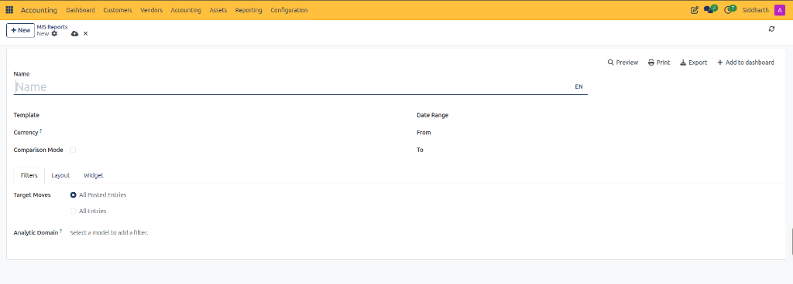

4. In the **Template** field, select **`NL RGS Profit Loss`**.

   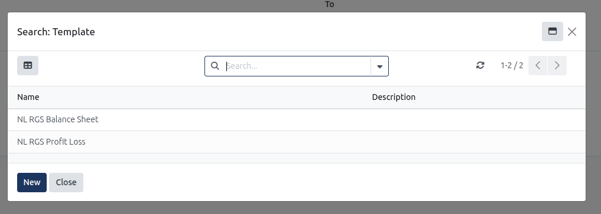

5. Configure the report parameters:
   * **Name**: Enter a clear descriptive title *(e.g., `P&L October 2026` or `Profit and Loss 2026`)*.
   * **From / To**: Specify the reporting boundaries *(e.g., `10/01/2026` to `10/31/2026`)*.
   * **Target Moves**: Ensure **All Posted Entries** is selected under the **Filters** tab to evaluate only validated legal records.
   * **Comparison Mode**: *(Optional)* Enable this checkbox to compare against a prior financial period or budget.

   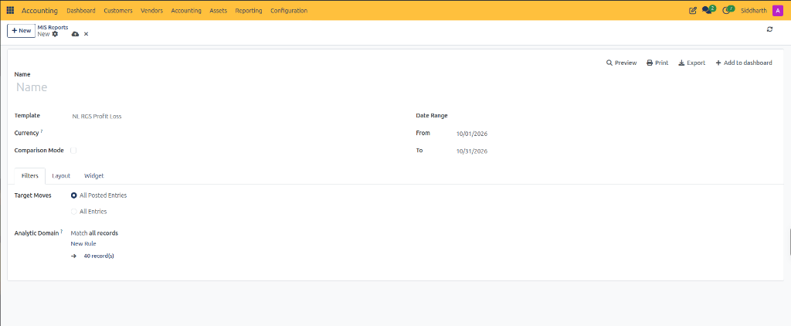
6. In the top-right action bar, click **Preview** to render the statement on screen *(or click **Print** for a PDF and **Export** for XLSX)*.

   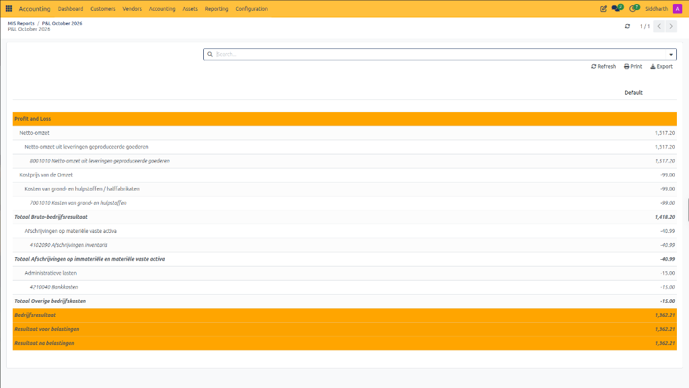

7. Analyze the core financial lines:
   * **Netto-omzet (Net Revenue)**: Gross sales revenue posted to income accounts *(e.g., `8001010 Netto-omzet uit leveringen geproduceerde goederen` for `€ 1,517.20`)*.
   * **Kostprijs van de Omzet (COGS)**: Direct merchandise acquisition costs *(e.g., `7001010 Kosten van grond- en hulpstoffen` for `-€ 99.00`)*.
   * **Totaal Bruto-bedrijfsresultaat (Gross Operating Profit)**: Total revenue minus procurement cost *(computed at `€ 1,418.20`)*.
   * **Afschrijvingen op materiële vaste activa (Depreciation)**: Monthly amortization charge *(e.g., `4102090 Afschrijvingen inventaris` for `-€ 40.99` from voucher `DEPR/2026/10/0001`)*.
   * **Administratieve lasten (Operating Overhead)**: Banking charges and general administrative expenses *(e.g., `4210040 Bankkosten` for `-€ 15.00`)*.
   * **Bedrijfsresultaat / Resultaat na belastingen (Net Operating Profit)**: The final bottom-line earnings for the period *(computed at `€ 1,362.21`)*.
8. *(Optional)* Click **+ Add to dashboard** in the top action bar to pin this live reporting widget directly onto your main Accounting dashboard.

> **Note:** To trace any figure directly back to source documents, click on the individual ledger account row *(e.g., `4102090`)* to unfold the underlying journal entries.

---

### Task 2: Generate and Review the Balance Sheet

The Balance Sheet provides a cumulative snapshot of your company's financial position at a single point in time, verifying that total assets equal total liabilities and owner equity.

1. In the top navigation bar, select **Reporting > MIS Reports**.
2. In the upper-left action bar, click **+ New**.
3. In the **Template** field, select **`NL RGS Balance Sheet`**.
4. Configure the balance cutoff parameters:
   * **Name**: Enter a descriptive title *(e.g., `Balance Sheet October 2026` or `Balans per 31-10-2026`)*.
   * **To**: Enter the cutoff date *(e.g., `10/31/2026`)*. Leave **From** blank or set to `01/01/2026` *(because the Balance Sheet is cumulative from company inception, all historical postings up to the cutoff date are aggregated)*.
   * **Target Moves**: Select **All Posted Entries** under the **Filters** tab.

   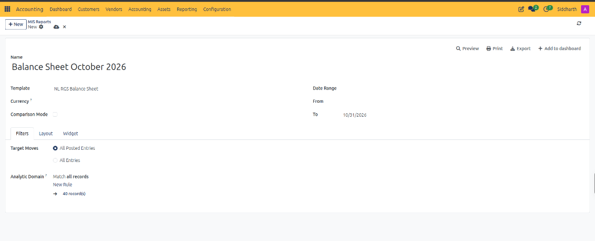

5. In the top-right action bar, click **Preview** to render the balance sheet on screen *(or click **Print** for PDF and **Export** for XLSX)*.

   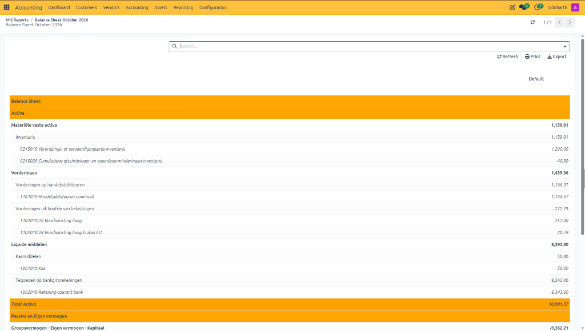

6. Inspect the fundamental accounting sections:
   * **Materiële vaste activa (Fixed Assets)**: Total capitalized assets net of cumulative amortizations *(computed at `€ 1,159.01`)*:
     * `0215010 Verkrijgings- of vervaardigingsprijs inventaris`: `€ 1,200.00` gross acquisition cost.
     * `0215020 Cumulatieve afschrijvingen en waardeverminderingen inventaris`: `-€ 40.99` contra-asset amortization.
   * **Vorderingen (Receivables)**: Total outstanding short-term claims *(computed at `€ 1,439.36`)*:
     * `1101010 Handelsdebiteuren nominaal`: `€ 1,166.57` in open customer invoices.
     * `1102010.20 Voorbelasting hoog`: `€ 252.00` reclaimable purchase VAT from vendor bills.
     * `1102010.28 Voorbelasting hoog buiten EU`: `€ 20.79`.
   * **Liquide middelen (Liquid Assets)**: Cash and bank liquidity *(computed at `€ 8,393.00`)*:
     * `1001010 Kas`: `€ 50.00` in petty cash.
     * `1002010 Rekening-courant bank`: `€ 8,343.00` in operating bank accounts *(reflecting the € 8,000 opening migration balance plus customer collections minus bank charges)*.
   * **Totaal Activa (Total Assets)**: Sum of fixed assets, receivables, and liquid funds:
     $$\text{Total Activa} = € 1,159.01 + € 1,439.36 + € 8,393.00 = \mathbf{€ 10,991.37}$$
   * **Passiva en Eigen vermogen (Liabilities and Equity)**:
     * `Groepsvermogen - Eigen vermogen - Kapitaal`: `-€ 9,362.21` *(representing `€ 8,000.00` in common share capital `0501010` plus `€ 1,362.21` in current-year net operating profit transferred dynamically from the P&L)*.
     * Remaining liabilities balance out accounts payable and tax obligations to maintain mathematical equilibrium.

> **Important:** In Dutch RGS double-entry presentations, credit balances *(Equity and Liabilities)* appear with opposite sign convention to reflect credit polarity against debit assets, perfectly balancing $\text{Total Activa} = \text{Total Passiva}$.

---

### Task 3: Run the Trial Balance to Verify Ledger Equilibrium

The Trial Balance *(Proef- en saldibalans)* lists every general ledger account that contains an opening balance or transaction activity during the selected period. It is the primary tool used by auditors to verify that total debits strictly equal total credits.

1. In the top navigation bar, select **Reporting > Trial Balance** *(under the **OCA accounting reports** section)*.

   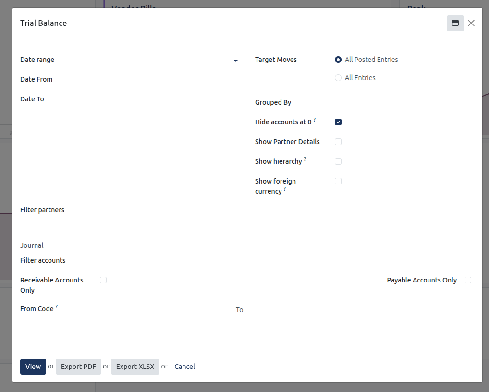

2. In the report setup dialog, configure the extraction criteria:
   * **Date Range**: Select `Y 2026` *(or specify **Date From** `01/01/2026` to **Date To** `10/31/2026`)*.
   * **Target Moves**: Select **All Posted Entries**.
   * **Hide accounts at 0**: Enable this checkbox to suppress dormant ledger accounts with zero activity.
   * **Show hierarchy**: Enable this checkbox to group accounts by Dutch RGS classification *(e.g., `0215 Inventaris`, `1002 Tegoeden op bankgirorekeningen`, `1101 Handelsdebiteuren`)*.

   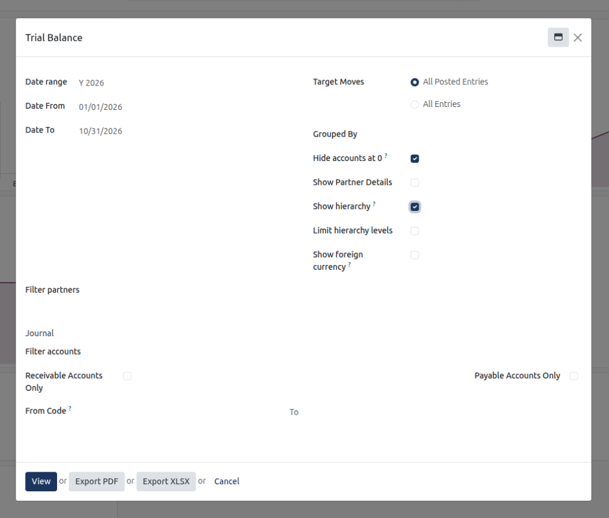

3. In the lower-left corner of the dialog, click the blue **View** button *(or click **Export PDF** / **Export XLSX** to generate downloadable files)*.

   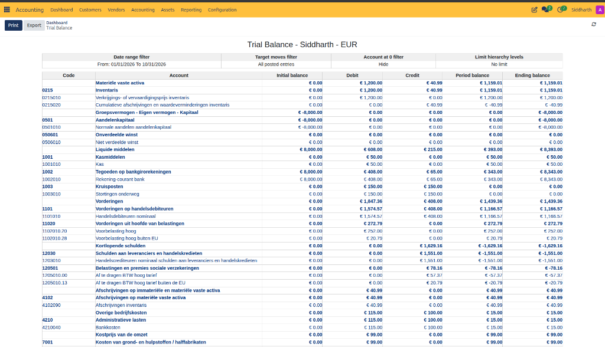

4. Analyze the ledger account movement columns:
   * **Initial balance**: Historical balance brought forward before the start date *(e.g., `1002010 Rekening-courant bank` carries `€ 8,000.00` and `0501010 Normale aandelen` carries `-€ 8,000.00` from the system opening migration entry)*.
   * **Debit**: Total debit movement posted across the period *(e.g., `€ 1,200.00` in `0215010 Inventaris` for hardware additions)*.
   * **Credit**: Total credit movement posted across the period *(e.g., `€ 40.99` in `0215020 Cumulatieve afschrijvingen` for accumulated depreciation)*.
   * **Period balance**: Net movement for the selected interval ($\text{Debit} - \text{Credit}$).
   * **Ending balance**: Cumulative closing balance as of the cutoff date ($\text{Initial balance} + \text{Period balance}$).
5. Verify key operational reconciliation rows:
   * **Cash and Bank Liquidity**: `1002010 Rekening-courant bank` shows an ending balance of `€ 8,343.00`, and `1001010 Kas` shows `€ 50.00`.
   * **Clearing Accounts**: Internal transfer transit account `1003010 Stortingen onderweg` shows Debit `€ 150.00` and Credit `€ 150.00` with an ending balance of `€ 0.00`, confirming complete clearing.
   * **Open Customer Debt**: `1101010 Handelsdebiteuren nominaal` shows an outstanding balance of `€ 1,166.57`.
   * **Open Supplier Liabilities**: `1203010 Handelscrediteuren nominaal` shows an outstanding liability of `-€ 1,551.00`.
6. Inspect the grand total row at the bottom of the table:
   * Confirm that **Total Debits** strictly equal **Total Credits**.
   * When total debits and credits balance, double-entry equilibrium across the general ledger is verified.

---

### Task 4: Drill Down into Detailed Transactions Using the General Ledger

When reviewing ledger accounts or preparing for external audit inquiries, the General Ledger report reveals every individual journal entry line that contributed to an account balance.

1. In the top navigation bar, select **Reporting > General Ledger** *(under the **OCA accounting reports** section)*.
2. In the setup dialog, configure your extraction parameters:
   * **Date From / Date To**: Set boundaries covering the target audit period *(e.g., `01/01/2026` to `10/30/2026`)*.
   * **Grouped By**: Select grouping hierarchy *(e.g., `Partners` to aggregate transactions by debtor/creditor, or standard account sequence)*.
   * **Activate centralization**: Check to summarize dense journal activity into periodic summary lines.
   * **Target Moves**: Select **All Posted Entries** *(or **All Entries** to include draft bookings)*.
   * **Show foreign currency / Show Analytic Account**: Check to display multicurrency valuations and operational cost-center tags.
   * **Filter accounts / Filter partners**: Use the filter tabs to isolate specific sub-ledgers *(e.g., `Receivable Accounts Only` or `Payable Accounts Only`)* or specific counterparties *(e.g., `Acme Technologies`)*.

   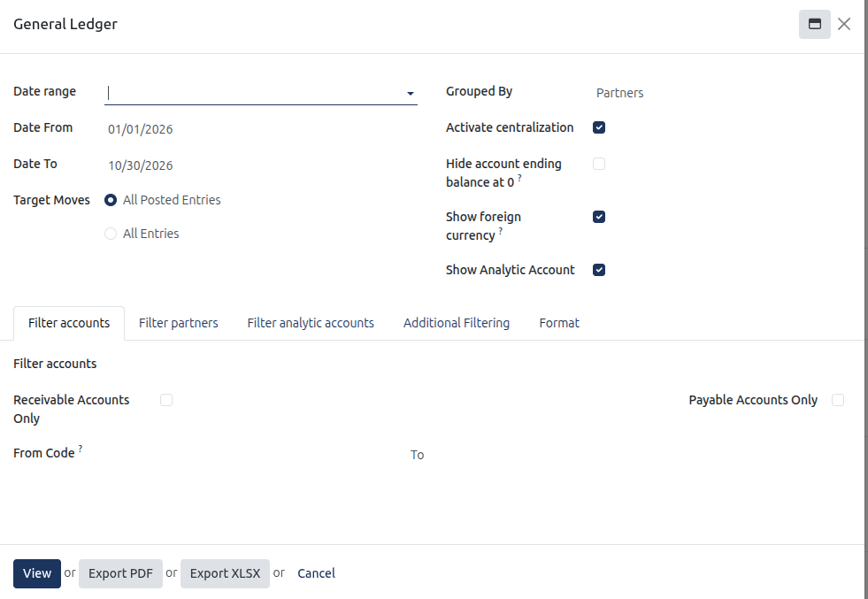

3. In the lower-left corner of the dialog, click the blue **View** button *(or click **Export PDF** / **Export XLSX**)*.

   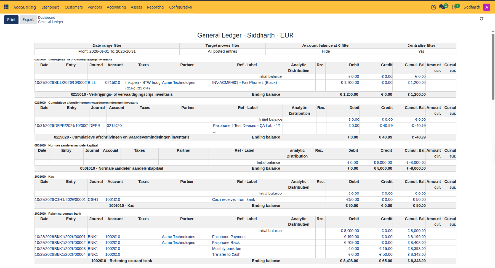

   Unfold individual accounts to audit transactions, debit/credit totals, and running cumulative balances:

   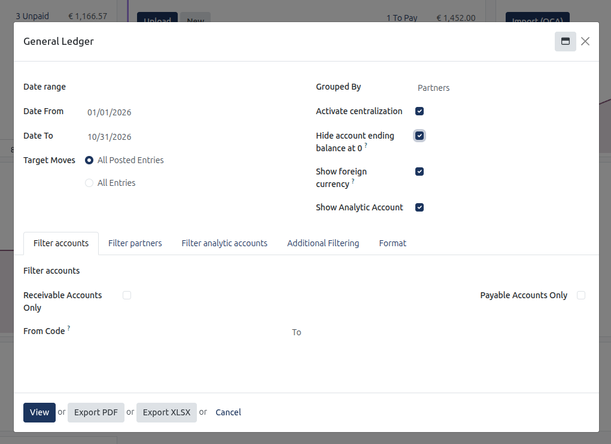

   > For detailed specifications of all report parameters and column definitions, see [OCA General Ledger Report Wizard Field Definitions](../settings-and-fields/05-fixed-assets-and-financial-reports-field-definitions.md#oca-general-ledger-report-setup-wizard-fields).

4. Analyze the detailed transaction lines for each ledger account:
   * **`0215010 Verkrijgings- of vervaardigingsprijs inventaris`**:
     * Lists voucher `BILL/2026/10/0002` posted on `10/29/2026` for partner `Acme Technologies` (`INV-ACME-001 - Fair Phone 5 (Black)`), posting a debit of `€ 1,200.00` to establish the fixed asset acquisition cost.
   * **`0215020 Cumulatieve afschrijvingen en waardeverminderingen inventaris`**:
     * Lists voucher `DEPR/2026/10/0001` posted on `10/31/2026` for `Fairphone 5 Test Devices - QA Lab`, posting a credit of `€ 40.99` to record the October depreciation charge.
   * **`0501010 Normale aandelen aandelenkapitaal`**:
     * Shows the opening migration balance of `-€ 8,000.00` in common share capital.
   * **`1001010 Kas`**:
     * Lists voucher `CSH1/2026/00001` posted on `10/28/2026` (`Cash received from Bank`), posting a debit of `€ 50.00`.
   * **`1002010 Rekening-courant bank`**:
     * Shows opening balance of `€ 8,000.00`.
     * Chronologically tracks customer invoice receipts (`BNK1/2026/00001` for `+€ 199.00` and `BNK1/2026/00002` for `+€ 209.00`), monthly bank service fees (`BNK1/2026/00003` for `-€ 15.00`), and cash replenishment (`BNK1/2026/00004` for `-€ 50.00`), arriving at the final running balance of `€ 8,343.00`.
5. Click on any entry hyperlink *(e.g., `BILL/2026/10/0002` or `DEPR/2026/10/0001`)* to open the originating source voucher directly.

---

### Task 5: Monitor Overdue Balances with Aged Partner Balance

The Aged Partner Balance report categorizes unpaid customer invoices *(Aged Receivables)* and outstanding supplier bills *(Aged Payables)* into standardized aging buckets to assist with credit control and liquidity planning.

1. In the top navigation bar, select **Reporting > Aged Partner Balance** *(under the **OCA accounting reports** section)*.
2. Configure aging parameters:
   * **Date At**: Select the cutoff evaluation date *(e.g., `10/29/2026` or `10/31/2026`)*. All overdue days are calculated relative to this date.
   * **Target Moves**: Select **All Posted Entries**.
   * **Filter accounts / Account Type**:
     * Select `1101010 Handelsdebiteuren nominaal` *(or check **Receivable Accounts Only**)* to evaluate customer receivables.
     * Select `1203010 Handelscrediteuren nominaal` *(or check **Payable Accounts Only**)* to evaluate vendor liabilities.
   * **Show Move Line Details**: **Check this box** to expand individual open invoices and bills with their due dates and remaining balances.

   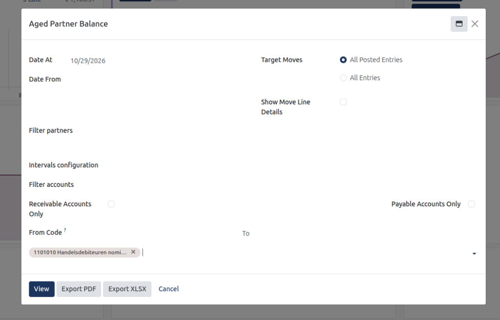

3. In the lower-left corner of the dialog, click the blue **View** button *(or click **Export PDF** / **Export XLSX**)*.

   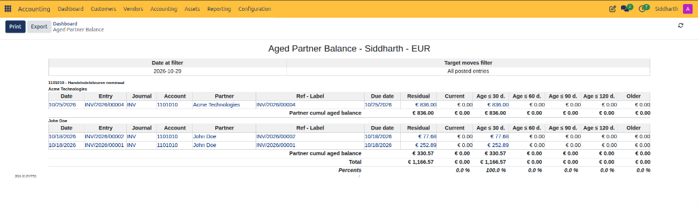

4. Review customer exposure and aging brackets:
   * **Partner: `Acme Technologies`**:
     * Open Invoice: `INV/2026/00004`
     * Due Date: `10/25/2026`
     * Residual Balance: `€ 836.00`
     * Aging Classification: Placed in the **`Age <= 30 d.`** column *(4 days overdue)*.
   * **Partner: `John Doe`**:
     * Open Invoice `INV/2026/00002` (Due `10/18/2026`): `€ 77.68` residual in `Age <= 30 d.`.
     * Open Invoice `INV/2026/00001` (Due `10/18/2026`): `€ 252.89` residual in `Age <= 30 d.`.
     * Cumulative Partner Balance: `€ 330.57`.
   * **Total Accounts Receivable Exposure**:
     * **`Total`**: `€ 1,166.57` (100.0% within the `Age <= 30 d.` bracket, with `€ 0.00` in older delinquency buckets).
     * This total reconciles exactly against the `1101010` balance on the Trial Balance and Balance Sheet.

---

### Task 6: Audit Statutory Journals with the Journal Ledger (OCA)

The Journal Ledger *(Journalenboek)* compiles a chronological register of all transactions organized by individual accounting journals *(Sales, Purchases, Bank, Cash, and Miscellaneous Operations)*:

1. In the top navigation bar, select **Reporting > OCA accounting reports > Journal Ledger** *(or **Reporting > Journal Ledger**)*.
2. In the setup wizard dialog, configure the journal audit parameters:

   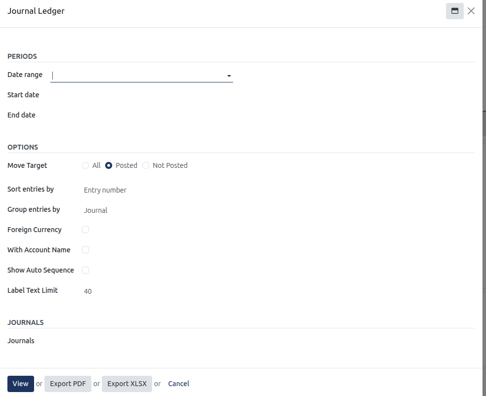

   * **Periods**:
     * **Date range**: Select a preset reporting timeframe or leave blank for custom bounds.
     * **Start date / End date**: Specify the exact accounting dates evaluated *(e.g., `01/01/2026` to `10/30/2026`)*.
   * **Options**:
     * **Move Target**: Restrict results by status: `Posted` *(default for audited legal reporting)*, `All`, or `Not Posted`.
     * **Sort entries by**: Order records by `Entry number` *(chronological sequential voucher numbering)* or date.
     * **Group entries by**: Organize transactions by `Journal` *(standard practice)* or period.
     * **Foreign Currency**: Enable to display transaction values in their original currency.
     * **With Account Name**: Enable to print full account descriptive titles alongside ledger codes.
     * **Show Auto Sequence**: Displays automated system-assigned sequence keys.
     * **Label Text Limit**: Adjust label truncation threshold *(defaults to `40` characters)*.
   * **Journals**:
     * Select specific sub-ledgers *(e.g., `Customer Invoices`, `Vendor Bills`, or `Bank`)* or leave blank to evaluate all active journals.
3. In the lower-left action bar, click **View** to render the interactive on-screen report *(or click **Export PDF** / **Export XLSX**)*.

---

### Task 7: Audit Outstanding Receivables and Payables with Open Items (OCA)

The Open Items *(Openstaande posten)* report isolates all unreconciled journal items across receivable and payable control accounts, providing a clear list of unsettled invoices, vendor bills, and transit entries:

1. In the top navigation bar, select **Reporting > OCA accounting reports > Open Items**.
2. In the setup wizard dialog, configure the open items extraction parameters:

   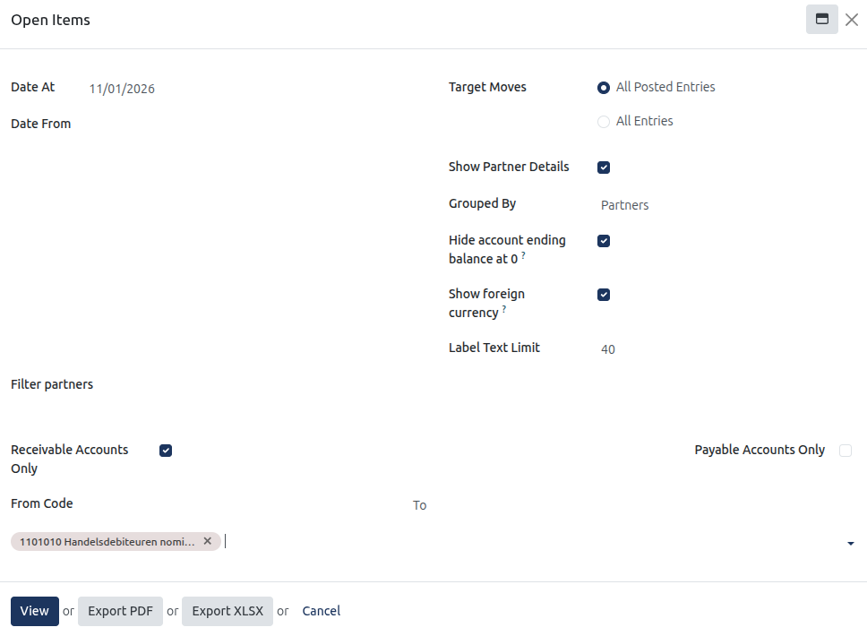

   * **Date At**: Enter the evaluation cutoff date *(defaults to current date, e.g., `11/01/2026`)*. All transactions unreconciled as of this date are evaluated.
   * **Date From**: Leave blank to capture all historical unsettled items from inception, or enter a beginning date to restrict items to a specific vintage.
   * **Target Moves**: Keep **All Posted Entries** selected to exclude unconfirmed draft entries.
   * **Show Partner Details**: Check this box to display the debtor/creditor partner name on each item row.
   * **Grouped By**: Set to `Partners` to group open items by individual customer or vendor.
   * **Hide account ending balance at 0**: Check to omit accounts that have zero net unsettled balance.
   * **Show foreign currency**: Check to view amounts denominated in non-base currencies.
   * **Filter partners**: Optional filter to restrict output to a specific debtor or creditor *(e.g., `Acme Technologies`)*. Leave blank to audit all partners.
   * **Receivable Accounts Only / Payable Accounts Only**:
     * Check **Receivable Accounts Only** to inspect open customer invoices *(Account `1101010 Handelsdebiteuren`)*.
     * Check **Payable Accounts Only** to inspect open vendor bills *(Account `1203010 Handelscrediteuren`)*.
3. In the lower-left action bar, click **View** to render the interactive on-screen statement *(or click **Export PDF** / **Export XLSX**)*:

   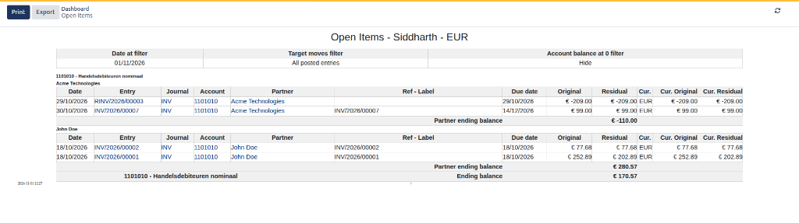

4. Analyze the itemized open balances:
   * **Header Verification**: Confirms `Date at filter` *(e.g., `01/11/2026`)*, `Target moves filter: All posted entries`, and zero-balance suppression.
   * **Control Account Grouping**: Gathers all open lines under the designated control account *(e.g., `1101010 Handelsdebiteuren nominaal`)*.
   * **Partner Group: `Acme Technologies`**:
     * Credit note `RINV/2026/00003` (Dated `29/10/2026`): Open residual credit of `-€ 209.00`.
     * Recurring invoice `INV/2026/00007` (Dated `30/10/2026`, Due `14/12/2026`): Open residual debit of `€ 99.00`.
     * **Partner Ending Balance**: Net credit balance of `-€ 110.00` awaiting payment matching or refund reconciliation.
   * **Partner Group: `John Doe`**:
     * Customer invoice `INV/2026/00002` (Due `18/10/2026`): Open residual balance of `€ 77.68`.
     * Customer invoice `INV/2026/00001` (Due `18/10/2026`): Open residual balance of `€ 252.89`.
     * **Partner Ending Balance**: Net outstanding receivable exposure of `€ 280.57`.
   * **Control Account Ending Balance**:
     * Aggregates the combined residual positions across all debtors, reaching a net ending receivable balance of `€ 170.57`.

---

### Task 8: Export Financial Statements to PDF and XLSX

Financial statements can be extracted for external statutory filings, bank financing reviews, board presentations, or detailed analytical modeling.

1. Open any financial report *(Profit and Loss, Balance Sheet, Trial Balance, General Ledger, Aged Partner Balance, Journal Ledger, or Open Items)* and configure your required date filters.
2. In the top action bar of the report, choose your export action:
   * **Print**:
     * Generates a formal, printable PDF document formatted with your company header, legal name, tax registration number, page numbering, and clean subtotal lines.
     * Best suited for distribution to executive boards, commercial lenders, and tax consultants.
   * **Export**:
     * Generates an unformatted Excel spreadsheet (`.xlsx`) preserving raw numeric figures, formulas, and tabular structures.
     * Best suited for financial controllers performing variance analysis, pivot modeling, or importing data into external business intelligence (BI) systems.
3. Save the downloaded file to your local document management repository or share directly with your audit team.

---

### Task 9: Audit and Retrieve Historical Statements via Last Reports Generated

CURQ automatically archives every compiled MIS report instance, providing financial controllers with a complete historical audit trail of management and statutory statements:

1. In the top navigation bar, select **Accounting > Reporting > MIS Reporting > Last Reports Generated** *(or **Reporting > Last Reports Generated**)*.
2. CURQ displays the archive register:

   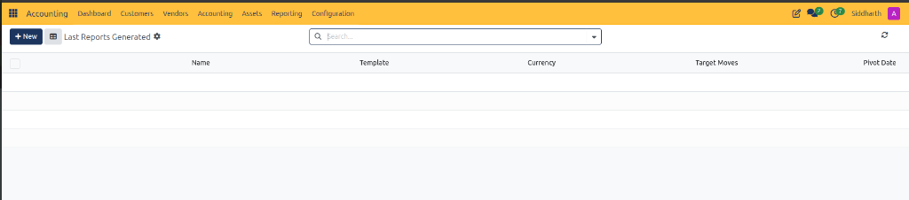

   * **Name**: The custom identifier assigned to each generated statement.
   * **Template**: The architectural reporting model evaluated *(e.g., `NL RGS Profit Loss`, `NL RGS Balance Sheet`)*.
   * **Currency**: The accounting currency of the run *(e.g., `EUR`)*.
   * **Target Moves**: Posting status filter applied during generation *(e.g., `All Posted Entries`)*.
   * **Pivot Date**: Base evaluation date anchoring comparative periods.

3. To create a new statement instance from the archive, click **+ New**:

   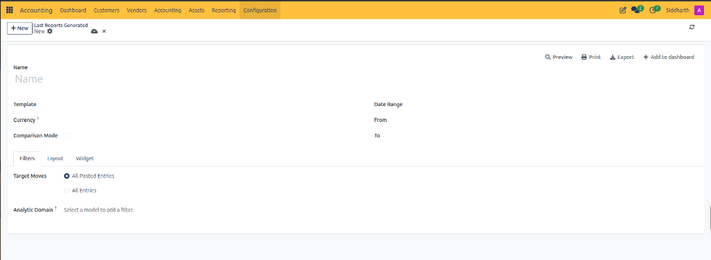

4. Configure the primary statement parameters:
   * **Name**: Enter an identifying title for the report run *(e.g., `P&L October 2026`)*.
   * **Template**: Select the underlying financial template *(e.g., `NL RGS Profit Loss` or `NL RGS Balance Sheet`)*.
   * **Date Range (`From` / `To`)**: Define the accounting period boundaries *(e.g., `10/01/2026` to `10/31/2026`)*.
   * **Currency**: Defaults to company base currency (`EUR`).
   * **Comparison Mode**: Enable this checkbox to compare against prior months, previous fiscal years, or operating budgets.
   * **Target Moves**: Keep selected on **All Posted Entries** *(recommended)* to include only legally validated records, or select **All Entries** to include provisional draft vouchers.

   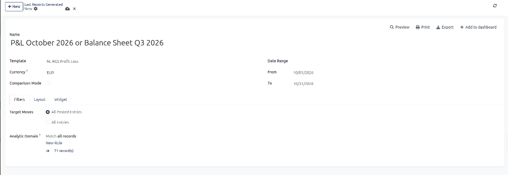

5. Select the **Layout** tab to adjust document presentation options:

   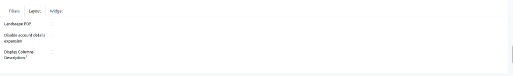

   * **Landscape PDF**: Formats exported PDF files into horizontal orientation, ensuring broad multi-column statements fit without wrapping or truncation.
   * **Disable account details expansion**: Prevents viewers from unfolding individual general ledger account lines, restricting report outputs to summary KPI totals.
   * **Display Columns Description**: Prints descriptive sub-titles beneath header columns for enhanced reader clarity.

6. Select the **Widget** tab to configure dashboard card behavior:

   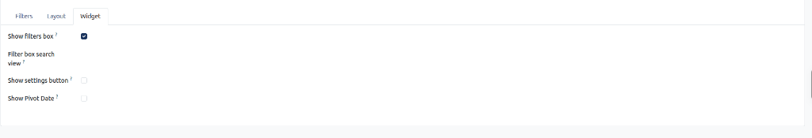

   * **Show filters box**: Displays interactive search and filter controls directly above the report card on the Accounting Dashboard *(enabled by default)*.
   * **Filter box search view**: Links a specific search view definition to provide custom dimensional filters on the dashboard card.
   * **Show settings button**: Exposes a configuration gear icon on the dashboard widget card for rapid parameter adjustments.
   * **Show Pivot Date**: Exposes the pivot evaluation date selector on the dashboard widget.

7. Execute report output actions:
   * Click the Save icon *(cloud icon next to New)* to commit the report configuration.
   * In the top-right toolbar, click **Preview** to render the statement interactively on screen:

     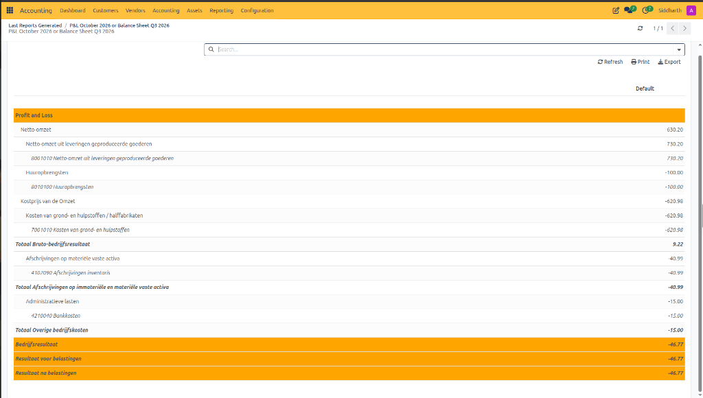

   * Analyze the live financial statement lines:
     * **Netto-omzet (Net Revenue)**: Total net sales turnover of `€ 630.20`, comprising goods revenue (`8001010 Netto-omzet uit leveringen geproduceerde goederen` for `€ 730.20`) offset by deferred revenue amortization (`8010100 Huuropbrengsten` for `-€ 100.00`).
     * **Kostprijs van de Omzet (COGS)**: Direct merchandise costs of `-€ 620.98` (`7001010 Kosten van grond- en hulpstoffen`).
     * **Totaal Bruto-bedrijfsresultaat (Gross Operating Profit)**: Evaluated at `€ 9.22`.
     * **Afschrijvingen op materiële vaste activa (Depreciation)**: Periodic asset amortization of `-€ 40.99` (`4102090 Afschrijvingen inventaris`).
     * **Administratieve lasten (Overhead)**: Operational banking charges of `-€ 15.00` (`4210040 Bankkosten`).
     * **Bedrijfsresultaat / Resultaat na belastingen (Net Operating Result)**: Bottom-line operational profit and loss for the period computed at `-€ 46.77`.
   * Click **Print** to download a formal PDF document.
   * Click **Export** to download an editable Excel spreadsheet (`.xlsx`).
   * Click **+ Add to dashboard** to pin this report directly to your Accounting Dashboard as a real-time financial monitor.

---

### Edge Cases & Discrepancy Troubleshooting

* **Discrepancy Between Trial Balance and Aged Partner Balance**:
  * **Cause:** A manual journal entry was posted directly to an Accounts Receivable (`1101010 Handelsdebiteuren nominaal`) or Accounts Payable (`1203010 Handelscrediteuren nominaal`) control account without assigning a **Partner**, or without reconciling open items.
  * **Resolution:** Never post direct unlinked manual entries to control accounts. Always record customer/vendor transactions through commercial invoices, bills, or link the explicit Partner on manual entries.
* **Profit and Loss Does Not Match Balance Sheet Current Year Earnings**:
  * **Cause:** The P&L and Balance Sheet were generated using conflicting date ranges or different **Target Moves** settings *(e.g., P&L included Draft entries while Balance Sheet was restricted to Posted)*.
  * **Resolution:** Align date parameters and ensure both reports use **All Posted Entries**.
* **Account Balance Appears with Inverted Sign**:
  * **Cause:** Normal debit accounts *(Assets, Expenses)* show negative numbers if credit movements exceed debits, indicating unexpected credit notes, refunds, or misclassified manual postings.
  * **Resolution:** Open the General Ledger for that account, filter by Credit transactions, and identify the inverted entry.
* **Unposted Depreciation or Accruals Distorting Period Results**:
  * **Cause:** Month-end asset depreciation was computed but not validated, or recurring prepaid expense adjustments were omitted.
  * **Resolution:** Run **Assets > Compute Assets** as documented in [Manage Fixed Assets and Depreciation](./06-manage-fixed-assets-and-depreciation.md) before locking the reporting period.

---

### Related Documentation

* [Process Your First Customer Invoice and Payment](../getting-started/01-process-your-first-customer-invoice-and-payment.md)
* [Create and Validate Customer Invoices](./01-create-and-validate-customer-invoices.md)
* [Create and Process Vendor Bills](./02-create-and-process-vendor-bills.md)
* [Import and Reconcile Bank Statements](./04-import-and-reconcile-bank-statements.md)
* [Create Manual Journal Entries](./05-create-manual-journal-entries.md)
* [Manage Fixed Assets and Depreciation](./06-manage-fixed-assets-and-depreciation.md)
* [Manage Lock Dates and Fiscal Year-End Closing](./12-manage-lock-dates-and-fiscal-year-end-closing.md)
* [Understanding Double-Entry Bookkeeping and Journals](../core-concepts/01-understanding-double-entry-bookkeeping-and-journals.md)
