# File Statutory VAT Returns and ICP Declaration

Generate periodic Dutch VAT returns (*Omzetbelasting / BTW-aangifte*), audit statutory tax boxes (Rubrieken 1 t/m 5), drill down into underlying invoices, incorporate late-posted transactions, generate EU Intra-Community Transactions (*ICP-opgave*), and finalize tax periods in CURQ Accounting.

---

### Prerequisites

* Ensure all customer invoices and vendor bills for the reporting period are posted to the general ledger with assigned tax grids *(e.g., `+1a`, `+3a`, `5b`)* mapped in **Accounting > Configuration > Taxes**:

  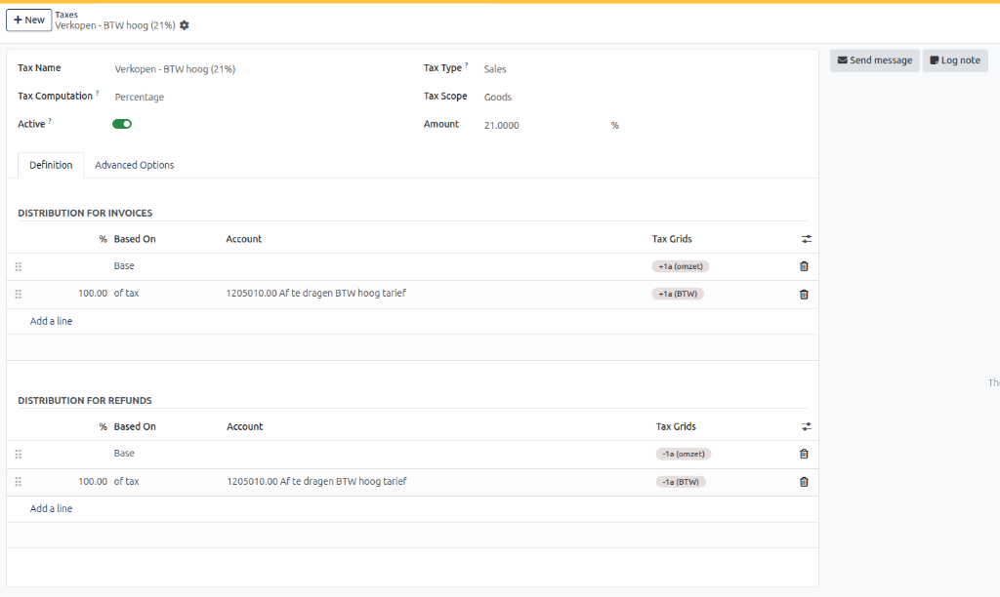
  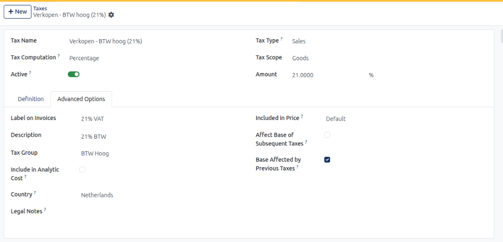

  > For complete tax computation algorithms and tax grid mapping specifications, see [**Tax Configuration Field Definitions**](../settings-and-fields/02-chart-of-accounts-and-taxes-field-definitions.md#tax-configuration-field-definitions).
* Confirm that foreign EU business customers have verified VAT identification numbers in [**Contacts**](../../Contacts/task-guides/01-create-and-manage-contacts.md).
* Verify your user account has **Billing Administrator** or **Accountant** access rights in CURQ.

---

### Task 1: Initialize a New Period VAT Return (NL BTW Statement)

1. Open the **Accounting** application from your main dashboard.
2. In the top navigation bar, select **Reporting > NL BTW Statement**.

   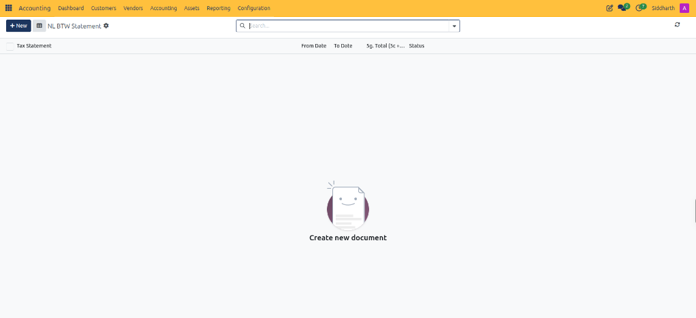

3. In the upper-left action bar, click the blue **+ New** button.

   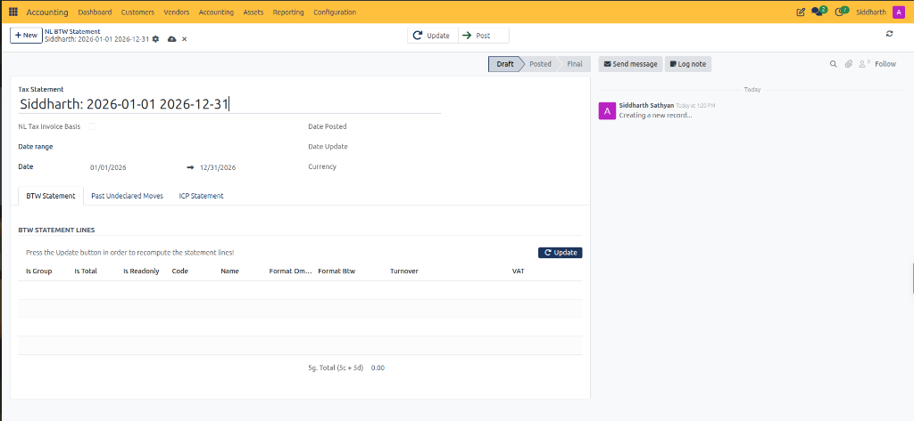

4. Configure the statement header fields:
   * **Tax Statement Title**: CURQ auto-populates the name based on company and dates *(e.g., `Company Name: 2026-01-01 2026-12-31`)*.
   * **NL Tax Invoice Basis**: Checkbox to enforce the Dutch statutory invoice accounting rule (*factuurstelsel*), calculating taxes by invoice date.
   * **Date range / Date**: The reporting interval. Leaving the default full-year boundaries (`01/01/2026` to `12/31/2026`) or selecting a specific quarter/month.
   * **Currency**: Transaction currency (`EUR`).
5. Notice that the document begins in the **Draft** lifecycle state.

---

### Task 2: Compute Statement Lines and Populate Statutory Tax Boxes

1. Under the **BTW Statement** tab, click the blue **Update** button *(located inside the table or on the top action bar)*.

   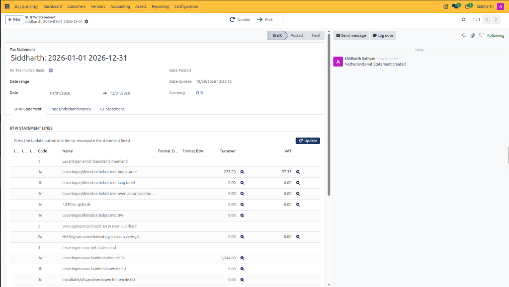

2. CURQ evaluates all posted moves and allocates figures into official Dutch Tax and Customs Administration (*Belastingdienst*) declaration boxes:
   * **Rubriek 1: Leveringen en/of diensten binnenland (Domestic Supplies)**:
     * **`1a Leveringen/diensten belast met hoog tarief`**: Reflects domestic high VAT rate sales. In our live records, shows **Turnover** = `€ 273.20` and **VAT** = `€ 57.37`.
     * **`1b` / `1c` / `1d` / `1e`**: Low rate (9%), other rates, private use adjustments, and zero-rated domestic sales.
   * **Rubriek 2: Verleggingsregelingen (Domestic Reverse Charge)**:
     * **`2a`**: Domestic transactions where tax liability is shifted to the buyer.
   * **Rubriek 3: Leveringen naar het buitenland (Outbound Cross-Border Supplies)**:
     * **`3a Leveringen naar landen buiten de EU`**: Non-EU export sales (0% VAT). In our live records, shows **Turnover** = `€ 1,244.00`.
     * **`3b`**: Intra-Community Deliveries (ICL) to VAT-registered buyers in other EU member states.
     * **`3c`**: Distance sales and installation services within the EU.

3. Scroll down in the table to review acquisitions and final tax settlement:

   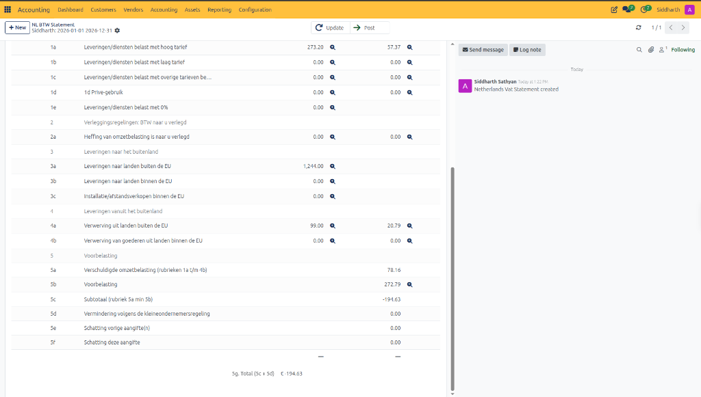

   * **Rubriek 4: Prestaties vanuit het buitenland (Inbound Acquisitions)**:
     * **`4a Verwerving uit landen buiten de EU`**: Non-EU vendor purchases subject to import reverse charge (**Turnover** = `€ 99.00`, **VAT** = `€ 20.79`).
     * **`4b`**: Intra-Community Acquisitions (ICA) from EU member states.
   * **Rubriek 5: Eindberekening (Final Tax Calculation)**:
     * **`5a Verschuldigde omzetbelasting`**: Total output VAT payable across rubrieken `1a` through `4b` (`€ 57.37 + € 20.79 = € 78.16`).
     * **`5b Voorbelasting`**: Input VAT paid on vendor bills and operational costs deductible against output tax (`€ 272.79`).
     * **`5c Subtotaal`**: Net balance before small business adjustments: $\text{5a} - \text{5b} = € 78.16 - € 272.79 = \mathbf{-€ 194.63}$.
     * **`5d`**: Small business scheme (*KOR*) deduction.
     * **`5g Total (5c + 5d)`**: Final net monetary settlement (**`-€ 194.63`**). A negative figure confirms a statutory refund claim from the Belastingdienst.

---

### Task 3: Audit Line Details via Transaction Drill-Down

Before submitting returns to the tax office, verify the individual journal items contributing to any box:

1. Locate any populated tax row *(e.g., `1a Leveringen/diensten belast met hoog tarief`)*.
2. Click the small **magnifying glass icon** next to the Turnover or VAT figure.

   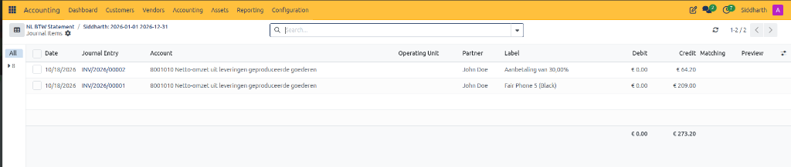

3. CURQ opens the underlying **Journal Items** table:
   * `INV/2026/00001` (`John Doe`): `Fair Phone 5 (Black)` credited to `8001010` = `€ 209.00`.
   * `INV/2026/00002` (`John Doe`): `Aanbetaling van 30,00%` credited to `8001010` = `€ 64.20`.
   * **Total Credit Movement**: Strictly equals the `1a` Turnover of **`€ 273.20`**.
4. In the top breadcrumb navigation bar, click the statement name to return to the form.

---

### Task 4: Handle Late-Posted Historical Transactions

When vendor bills or sales invoices belonging to an earlier, already closed tax period are recorded late, Dutch tax law allows declaring them in the subsequent regular VAT return if the net annual tax correction does not exceed **€ 1,000**.

1. In the open statement, click the **Past Undeclared Moves** tab.

   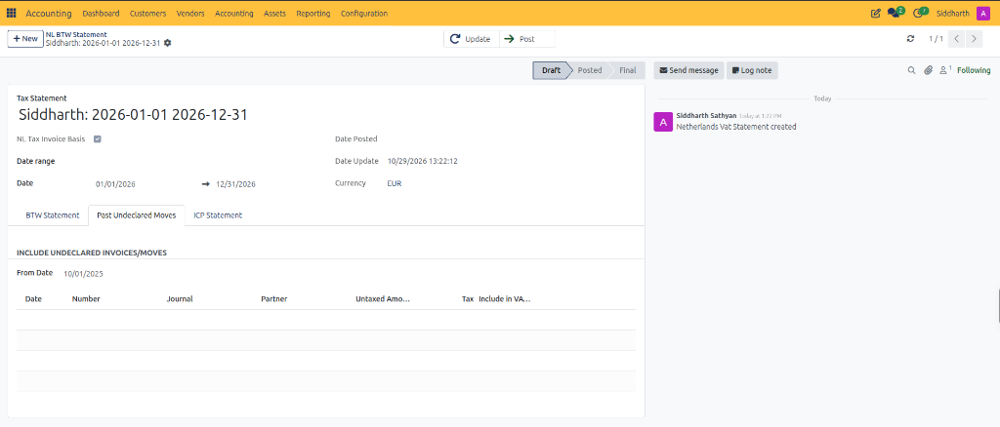

2. In the **From Date** field, select the historical scan date *(e.g., `10/01/2025`)*.
3. CURQ queries all moves posted after the prior period was closed that carry prior transaction dates.
4. Review columns: `Date`, `Number`, `Journal`, `Partner`, `Untaxed Amount`, `Tax`.
5. Check **Include in VAT** on eligible rows, then return to the **BTW Statement** tab and click **Update** to absorb them into the current declaration.

---

### Task 5: Review and Validate the EU ICP Declaration

Companies delivering goods or providing B2B services to clients in other EU member states must submit an **Intra-Community Transactions Declaration** (*Opgaaf intracommunautaire prestaties - ICP*).

1. Click the **ICP Statement** tab.

   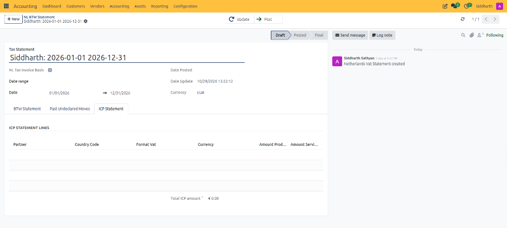

2. Review the cross-border lines:
   * **Partner**: Corporate name of the EU customer.
   * **Country Code**: 2-letter member state ISO code *(e.g., `BE`, `DE`, `FR`)*.
   * **Format Vat**: European VAT identification number.
   * **Amount Products**: Net goods turnover delivered under intra-community rules *(matching Rubriek `3b`)*.
   * **Amount Services**: Net cross-border professional services turnover *(matching Rubriek `3b`)*.
3. Confirm the **Total ICP amount** matches the total intra-community revenue reported in the main statement.

---

### Task 6: Post, Export, and Finalize the Tax Return

1. In the top action bar, click the **Post** button.

   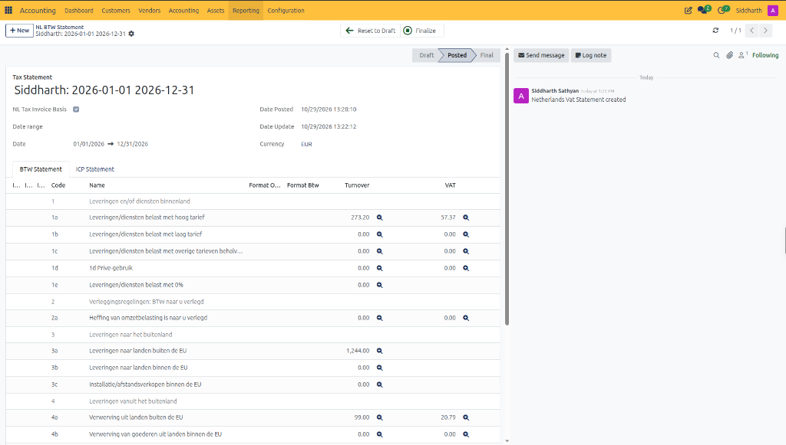

   * The document advances from **Draft** to **Posted**.
   * CURQ records the **Date Posted** timestamp (`10/29/2026 13:28:10`).
   * The **Past Undeclared Moves** tab is permanently locked.

2. Generate official statutory files:
   * Click the **gear icon** next to the title and hover over **Print**:

   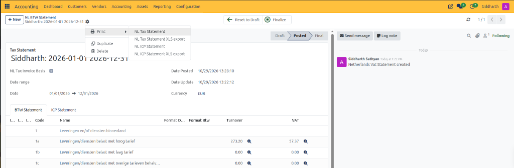

   * **`NL Tax Statement`**: Statutory VAT summary PDF for corporate records.
   * **`NL Tax Statement XLS export`**: Comprehensive multi-tab spreadsheet detailing all statutory boxes and transaction references for external auditor verification.
   * **`NL ICP Statement`**: Official EU Sales Listing PDF summary.
   * **`NL ICP Statement XLS export`**: ICP spreadsheet export for digital tax portal uploading.

3. Log in to the **Belastingdienst Zakelijk Portal** (or file through standard Digipoort tax accounting software) and enter the figures from boxes `1a` through `5g` and the ICP statement.
4. After receiving confirmation from the tax authority, return to CURQ and click the green **Finalize** button in the top action bar:
   * The statement transitions to **Final** status.
   * The accounting tax period is permanently closed and protected against unauthorized retroactive modifications.
5. In the top navigation bar, select **Accounting > Lock Dates** and advance the **Tax Return Lock Date** to the final date of the declared period to prevent any subsequent transactions from impacting filed tax boxes *(see [**Manage Lock Dates and Fiscal Year-End Closing**](./12-manage-lock-dates-and-fiscal-year-end-closing.md))*.

---

### Related Documentation

* [Statutory Tax Statement and ICP Field Definitions](../settings-and-fields/03-statutory-tax-statement-and-icp-field-definitions.md)
* [Chart of Accounts, Taxes, and Journals Field Definitions](../settings-and-fields/02-chart-of-accounts-and-taxes-field-definitions.md)
* [Export Statutory Tax Auditfiles (XAF 3.2)](./16-export-statutory-tax-auditfiles.md)
* [Manage Lock Dates and Fiscal Year-End Closing](./12-manage-lock-dates-and-fiscal-year-end-closing.md)
