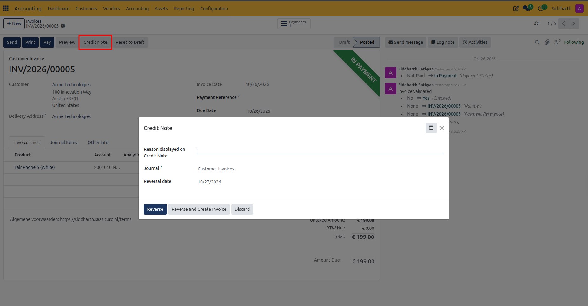
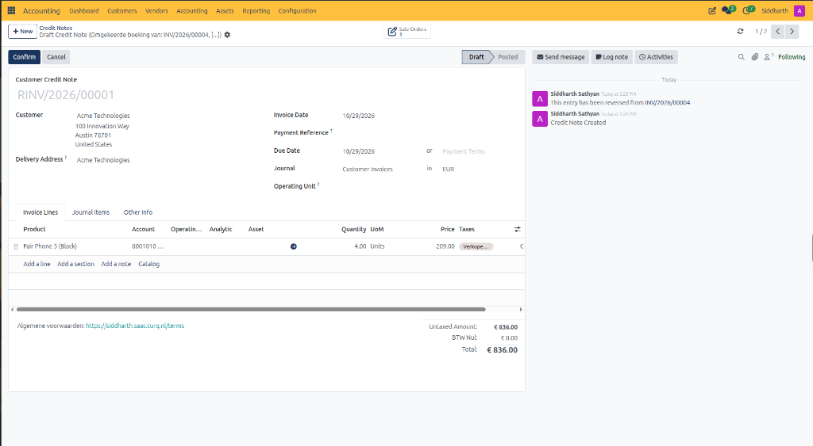
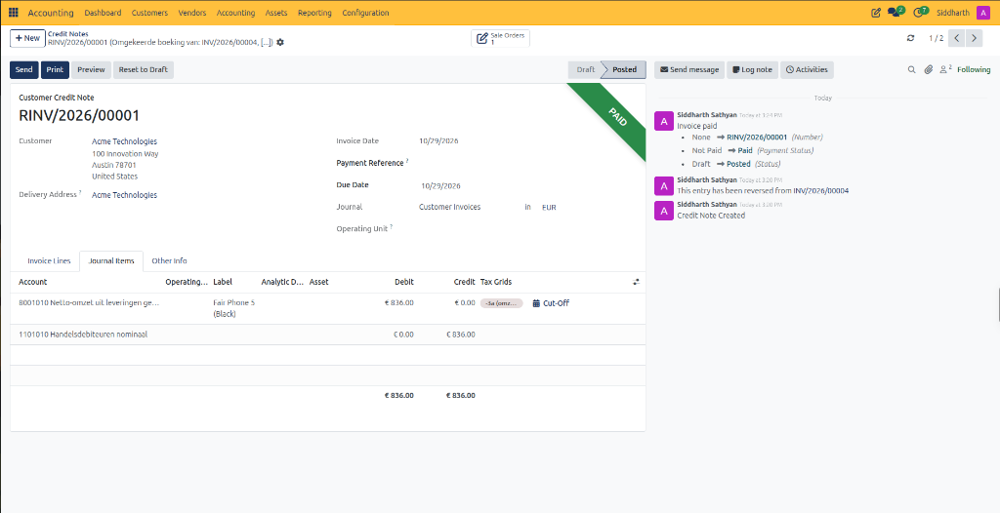
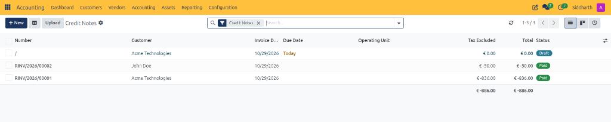
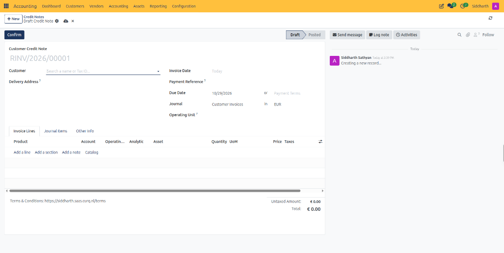
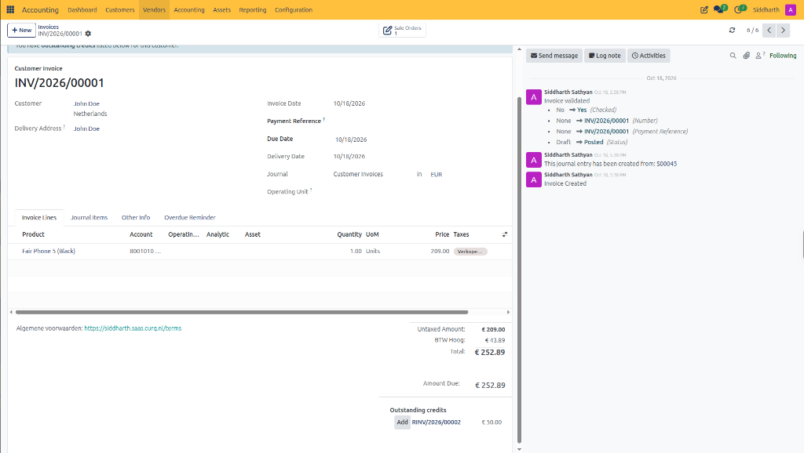
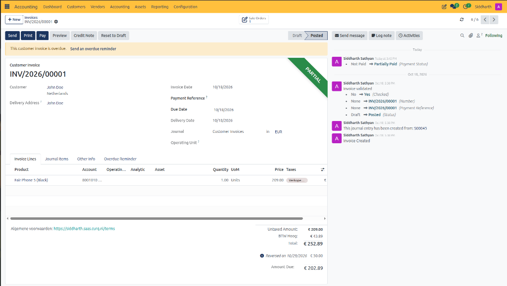
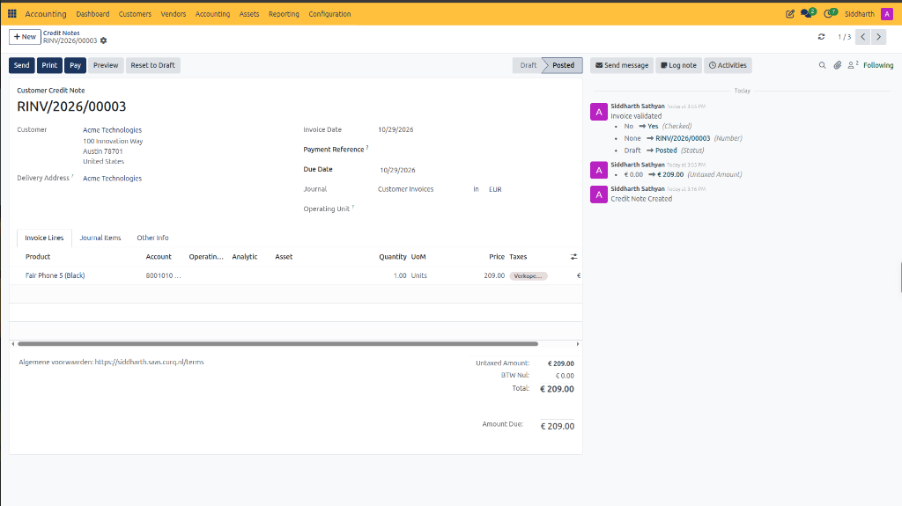
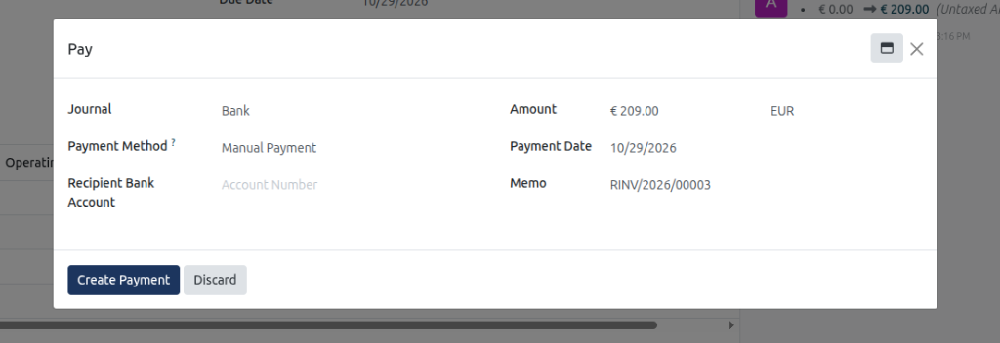
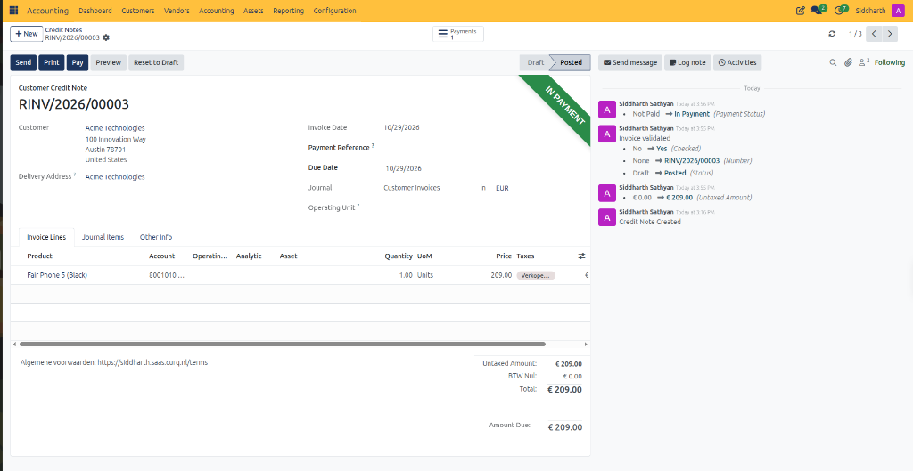

# Issue and Manage Customer Credit Notes

Issue customer credit notes (*Creditfacturen*), execute invoice reversals, apply partial billing adjustments for merchandise returns, process customer refunds, and reconcile credit balances against open accounts receivable in CURQ Accounting.

> **Prerequisites**
> * Ensure the target customer invoice is confirmed in **Posted** status before initiating an invoice-linked credit note.
> * Verify user permissions include **Billing Administrator** or **Accountant** access rights.
> * If issuing a monetary cash refund to the customer, ensure your bank journal and outgoing payment methods are configured in [**Register and Reconcile Payments**](./03-register-and-reconcile-payments.md).

---

## 1. Issue and Process Customer Credit Notes

### 1.1 Issue a Corrective Credit Note from an Existing Invoice

When an existing invoice contains erroneous pricing, incorrect quantities, or wrong customer details, generating a credit note directly from the invoice creates an automatic link between the original bill and the offsetting adjustment.

1. Open the **Accounting** application from your main dashboard.
2. In the top navigation bar, select **Customers > Invoices**.
3. Open the validated invoice you need to correct *(e.g., `INV/2026/00005`)*.
4. In the upper action bar, click the **Credit Note** button.

   

5. In the **Credit Note** dialog window, select your reversal parameters:
   * **Credit Method**: Choose how CURQ handles the accounting correction:
     * **Reverse and Create Invoice**: Cancels the original invoice by posting an offsetting credit note, then immediately creates a new pre-populated draft invoice for you to correct and re-send.
     * **Reverse**: Issues a standalone credit note that cancels the original invoice balance in full.
     * **Partial Refund**: Generates a draft credit note copying invoice lines, allowing you to reduce quantities or remove lines to credit only a portion of the original invoice.
   * **Reason displayed on Credit Note**: Enter the business justification *(e.g., `Defective merchandise return` or `Price adjustment per contract revision`)*. This text prints on the customer PDF and logs in the audit trail.
   * **Journal**: Defaults to the **Customer Invoices** sub-ledger.
   * **Reversal date**: Specify the accounting date for the credit note *(defaults to the current date)*.
6. Click **Reverse** *(or **Reverse and Create Invoice**)*.
7. CURQ generates the credit note document with a dedicated sequential identifier *(e.g., `RINV/2026/00001`)* in **Draft** status:

   

8. Verify the line items, credit totals, and tax codes, then click the dark blue **Confirm** button in the upper-left action bar.
9. CURQ commits the credit note to the general ledger and automatically marks it as settled:

   

   * **Status & Ribbon**: Advances from **Draft** to **Posted**, displaying the green **PAID** ribbon because it is automatically reconciled against the original invoice.
   * **Revenue Reduction**: Debits `8001010 Netto-omzet uit leveringen geproduceerde goederen` for `€ 836.00`.
   * **Tax Grid Alignment**: Stamped with tax grid `-3a` to reverse reported non-EU export turnover on the statutory VAT declaration.
   * **Receivable Offset**: Credits `1101010 Handelsdebiteuren nominaal` for `€ 836.00`, extinguishing the open debt on the original invoice.

> **Understanding the `PAID` Status on Credit Notes:**
>
> In CURQ and double-entry accounting, the **PAID** ribbon indicates that the document's open residual balance is strictly **`€ 0.00`**, rather than indicating cash movement.
>
> * **Invoice-Linked Reversals**: Because this credit note was generated directly from `INV/2026/00004`, CURQ automatically reconciles the credit note against the invoice. Both records reach an open balance of `€ 0.00`, causing the green **PAID** ribbon to appear immediately.
> * **When Would a Credit Note NOT Be Marked `PAID`?**: If you create a standalone credit note from **Customers > Credit Notes > + New** without linking it to an existing invoice, it remains in **Posted** status without the `PAID` ribbon. It stays open until you either:
>   1. Click **Add** under the **Outstanding Credits** section of an open customer invoice to offset a debt.
>   2. Click **Pay** to process a monetary cash refund to the customer's bank account.

---

### 1.2 Create a Standalone Credit Note from the Customers Menu

When providing a commercial concession, volume rebate, or financial adjustment that is not tied to a single specific invoice:

1. In the top navigation bar, select **Customers > Credit Notes**.

   

   * The list view displays all issued credit notes, customer counterparties, document dates, tax-excluded amounts, and settlement statuses (*Draft* or *Paid*).
2. In the upper-left action bar, click the blue **+ New** button.

   

3. Complete the credit note header fields:
   * **Customer**: Select the customer receiving the credit note *(e.g., `Acme Technologies` or `John Doe`)*. CURQ auto-populates the linked **Delivery Address**, default **Payment Terms**, and fiscal tax mappings.
   * **Invoice Date**: Set the legal document date for the credit note *(defaults to today's date)*. This determines the fiscal period for VAT and accounting.
   * **Payment Reference**: Enter an optional descriptive memo or reference string *(e.g., `REF-CREDIT-001` or original invoice reference)*.
   * **Due Date / Payment Terms**: Specify when settlement is due, or select contractual terms *(defaults to immediate settlement date)*.
   * **Journal**: Keep set to **`Customer Invoices`** in **`EUR`**. The system assigns sequential sequence `RINV/2026/00001` upon confirmation.
   * **Operating Unit**: *(Optional)* Select a business unit if multi-entity tracking is enabled.
4. Under the **Invoice Lines** tab, click **Add a line**:
   * **Product**: Select the product or service being credited. CURQ automatically loads the description, standard unit of measure (`UoM`), account, and default taxes.
   * **Account**: Verify the revenue account *(e.g., `8001010 Netto-omzet uit leveringen geproduceerde goederen`)*. Debiting this revenue account reduces recognized sales turnover.
   * **Quantity**: Enter the quantity being credited as a **positive value** *(e.g., `1.00`)*.
   * **Price**: Enter the unit credit price as a **positive value** *(e.g., `199.00`)*.
   * **Taxes**: Ensure the tax code matches the original rate *(e.g., `21% VAT`)* to ensure output tax is credited in the statutory tax declaration.
5. In the upper action bar, click the dark blue **Confirm** button to post the credit note.

> **Important:** Always enter quantities and prices as **positive values** on credit notes. CURQ inherently reverses the accounting polarity of credit note records (debiting revenue and crediting accounts receivable `1101010`). Entering negative values creates double-negatives that distort financial statements.

---

### 1.3 Reconcile Credit Notes against Customer Receivables

Once confirmed, an open credit note reduces the customer's overall balance. You can allocate the credit against specific open invoices:

1. Navigate to **Customers > Invoices** and open the customer invoice you wish to settle using the credit note *(e.g., `INV/2026/00001` for `John Doe`)*.
2. Scroll to the bottom of the invoice form beneath the monetary totals.
3. CURQ automatically detects available open credit notes and displays the **Outstanding credits** section:

   

4. Next to the appropriate credit note row *(e.g., `RINV/2026/00002` for `€ 50.00`)*, click the **Add** button.
5. CURQ links the two documents:

   

   * **Partial Ribbon**: The invoice receives the green **PARTIAL** ribbon in the upper-right corner.
   * **Reversal Line**: Beneath the Total block, CURQ records: `Reversed on 10/29/2026: € 50.00`.
   * **Updated Amount Due**: The customer's open obligation decreases from `€ 252.89` to **`€ 202.89`**.
   * **Chatter Log**: The chatter logs: `Payment Status: Not Paid -> Partially Paid`.
   * **Full vs Partial Settlement**: If a credit note matches or exceeds the full invoice amount, the ribbon displays **PAID** instead of **PARTIAL**, and any surplus credit remains open for subsequent invoices.

---

### 1.4 Process a Customer Cash Refund

If the customer requests a monetary repayment via bank transfer rather than a balance credit against future purchases:

1. Navigate to **Customers > Credit Notes** and open the confirmed standalone credit note *(e.g., `RINV/2026/00003` for `Acme Technologies`)*. Verify that the document is in the **Posted** state with an open balance in **Amount Due** *(e.g., `€ 209.00`)*:

   

2. In the top action bar, click the dark blue **Pay** button.
3. CURQ opens the **Pay** modal wizard:

   

   * **Journal**: Select the liquidity journal through which the refund will be disbursed *(e.g., `Bank`)*.
   * **Payment Method**: Select the payout mechanism *(e.g., `Manual Payment` or `SEPA Credit Transfer`)*.
   * **Recipient Bank Account**: Select the customer's verified bank account or enter the destination account number.
   * **Amount**: CURQ defaults to the full open credit amount *(e.g., `€ 209.00 EUR`)*. You can lower this amount if processing a partial disbursement.
   * **Payment Date**: Select the date when the payment was executed *(e.g., `10/29/2026`)*.
   * **Memo**: CURQ automatically populates the credit note identifier *(e.g., `RINV/2026/00003`)* as the payment reference.
4. Click the dark blue **Create Payment** button.
5. CURQ generates the outbound payment voucher and updates the credit note document:

   

   * **In Payment Ribbon**: A prominent green **IN PAYMENT** banner appears in the upper-right corner of the credit note.
   * **Payments Smart Button**: A **Payments 1** smart button appears in the upper action bar, providing direct drill-down access to the registered bank payment record.
   * **Chatter Log**: The audit trail records: `Not Paid -> In Payment (Payment Status)`.
   * **Bank Statement Clearing**: The payment sits in the liquidity clearing account `1101020` until the outbound bank statement transaction is imported and reconciled in [**Import and Reconcile Bank Statements**](./04-import-and-reconcile-bank-statements.md), at which point the ribbon transitions from **IN PAYMENT** to **PAID**.

---

## 2. Edge Cases and Compliance Guidelines

* **Statutory Immutability of Posted Documents**:
  * Dutch accounting standards and CURQ audit rules prohibit deleting or altering posted invoices. Never attempt to cancel an invoice by resetting it to draft once submitted to a customer. Always issue a formal credit note to preserve complete audit history.
* **Partial Returns on Multi-Line Invoices**:
  * If a customer returns only one item from a 5-item shipment, choose the **Partial Refund** option when clicking **Credit Note**. On the resulting draft credit note, delete the 4 accepted line items and keep only the single returned item before confirming.
* **VAT Declaration Alignment**:
  * Posted customer credit notes automatically reduce output VAT reported in Dutch Tax Box `1a` (Domestic 21%), Box `1b` (9%), or intra-community Box `3b`. Ensure the accounting date of the credit note falls into the correct statutory tax return period.

---

> **Tip:** For granular parameter descriptions and data dictionary field specifications, refer to [Customer Invoice, Vendor Bill, and Credit Note Field Definitions](../settings-and-fields/01-customer-invoice-and-vendor-bill-field-definitions.md).

---

## Related Documentation

* [Create and Validate Customer Invoices](./01-create-and-validate-customer-invoices.md)
* [Register and Reconcile Payments](./03-register-and-reconcile-payments.md)
* [Understanding the Invoice and Bill Lifecycle](../core-concepts/02-understanding-the-invoice-and-bill-lifecycle.md)
* [Customer Invoice and Vendor Bill Field Definitions](../settings-and-fields/01-customer-invoice-and-vendor-bill-field-definitions.md)
