# Manage SEPA Direct Debit Orders and Mandates

Configure customer bank mandates, prepare invoices for automatic direct debit collection, generate ISO 20022 SEPA XML collection files (`pain.008`), and reconcile batch collections in CURQ Accounting.

> **Prerequisites**
> * Ensure SEPA Direct Debit is activated in **Accounting > Configuration > Settings** and your organization's official **Creditor Identifier** (*Incassant ID*) is configured.
> * Ensure the customer's bank account (IBAN and BIC) is verified on their partner contact card.
> * Ensure your bank current account is configured with an incoming payment method supporting `[sepa_direct_debit] SEPA Direct Debit for customers (inbound)` as defined in [**Chart of Accounts, Taxes, and Journals Field Definitions**](../settings-and-fields/02-chart-of-accounts-and-taxes-field-definitions.md).

---

## 1. SEPA Direct Debit Collection Workflow

### 1.1 Create and Validate a Customer Banking Mandate

A signed SEPA mandate gives your business legal authorization to debit funds directly from a customer's bank account. Under European banking regulations, collections without a valid mandate are prohibited.

1. In the top navigation bar, select **Customers > Banking Mandates**:

   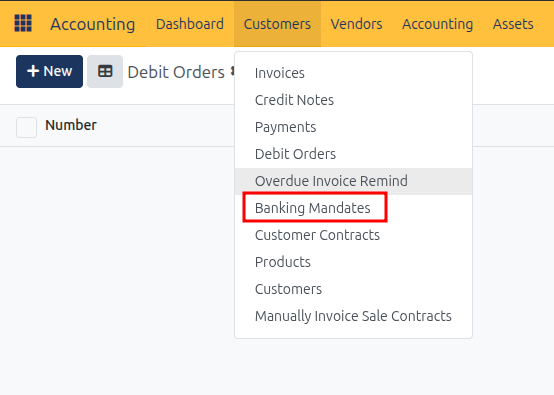

2. CURQ opens the Banking Mandates list view:

   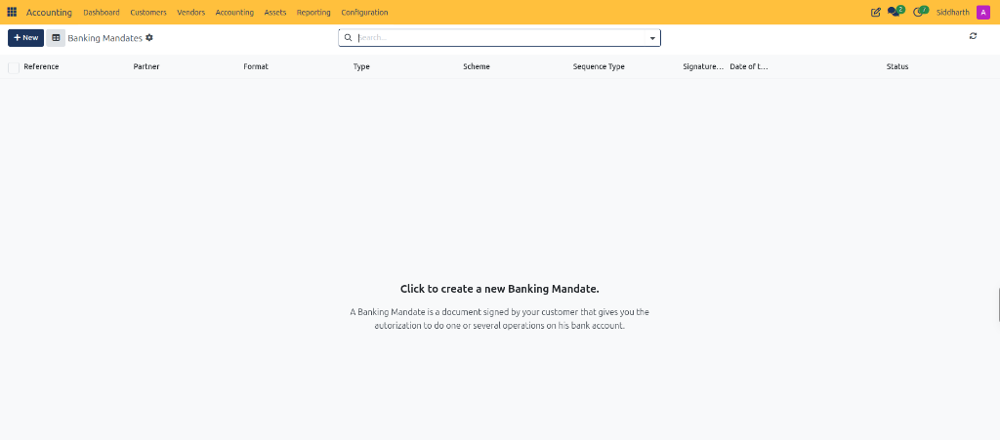

   * The list view displays all configured customer authorizations, including **Reference**, **Partner**, **Format**, **Type**, **Scheme**, **Sequence Type**, **Signature Date**, **Date of the Last Debit**, and **Status**.
3. In the upper action bar, click the dark blue **+ New** button.
4. CURQ opens the blank banking mandate form in **Draft** state:

   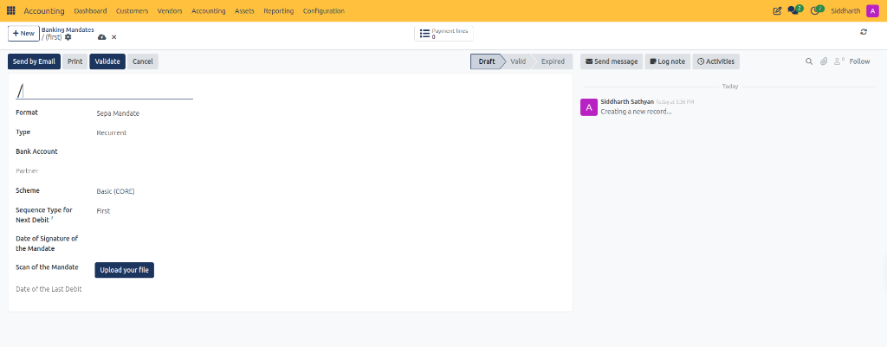

5. Complete the mandate parameters:
   * **Reference / Title line** *(top line with `/`)*: Leave blank or enter a custom identifier *(e.g., `MANDATE/ACME/001`)*. If left blank, CURQ auto-assigns a sequential reference upon validation.
   * **Partner**: Select the customer partner record *(e.g., `Acme Technologies`)*.
   * **Bank Account**: Select the customer's verified bank account IBAN. If the dropdown is empty, click **Create and Edit...** to add the customer's IBAN.
   * **Format**: Defaults to **`Sepa Mandate`**.
   * **Type**: Defaults to **`Recurrent`** for ongoing retainer or subscription collections. Select `One-Off` for a single non-repeating collection.
   * **Scheme**: Defaults to **`Basic (CORE)`** (standard consumer and corporate direct debit). Select `B2B` only if collecting under a business-to-business agreement where the debtor has registered the mandate with their bank.
   * **Sequence Type for Next Debit**: Defaults to **`First`** for the initial collection in a recurring sequence. CURQ automatically advances this to `Recurring` after the first debit order runs.
   * **Date of Signature of the Mandate**: Select the calendar date when the authorization was signed *(e.g., `10/29/2026`)*.
   * **Scan of the Mandate**: Click **Upload your file** to attach the signed authorization PDF scan for statutory audit records.

   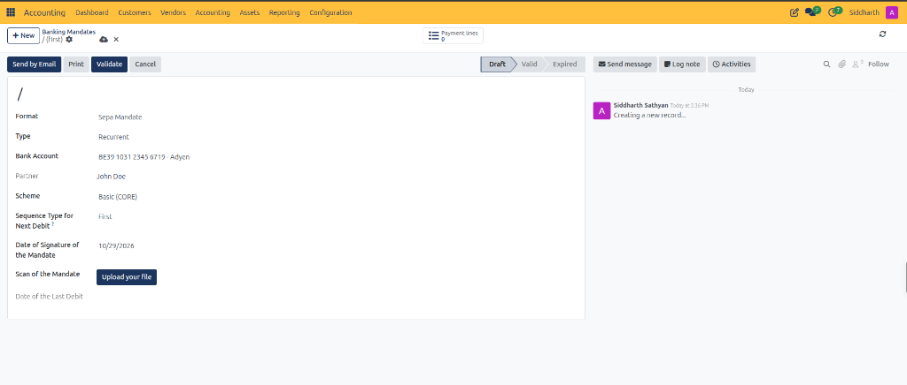

6. In the top action bar, click the dark blue **Validate** button.
7. CURQ activates the mandate, advancing the status from **Draft** to **Valid**:

   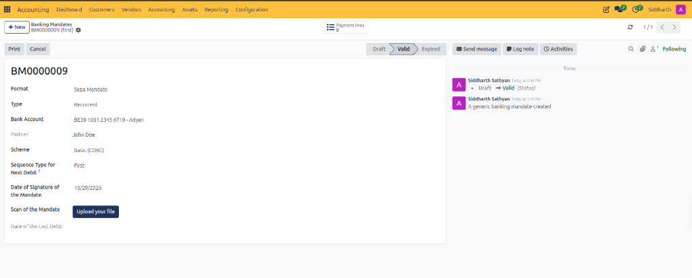

   * **Permanent Mandate Reference**: CURQ assigns a sequential identifier *(e.g., `BM0000009`)*.
   * **Active Status**: The status bar advances to **Valid**, and the document chatter records: `Draft -> Valid (Status)`.
   * **Available Actions**: The header updates with **Print** (to generate the signed authorization slip) and **Cancel** (to revoke authorization if the debtor terminates the agreement).

---

### 1.2 Configure Customer Invoices for Direct Debit Collection

When invoicing a customer who has an active direct debit mandate, CURQ routes the transaction into the electronic collection pipeline:

1. Navigate to **Customers > Invoices** and click **+ New** (or open an existing draft invoice).
2. In the **Customer** field, select the client who holds the active mandate *(e.g., `John Doe`)*.
3. Switch to the **Other Info** tab:
   * **Payment Method**: Verify that the settlement vehicle is set to **`SEPA Direct Debit for customers (Bank)`**.

   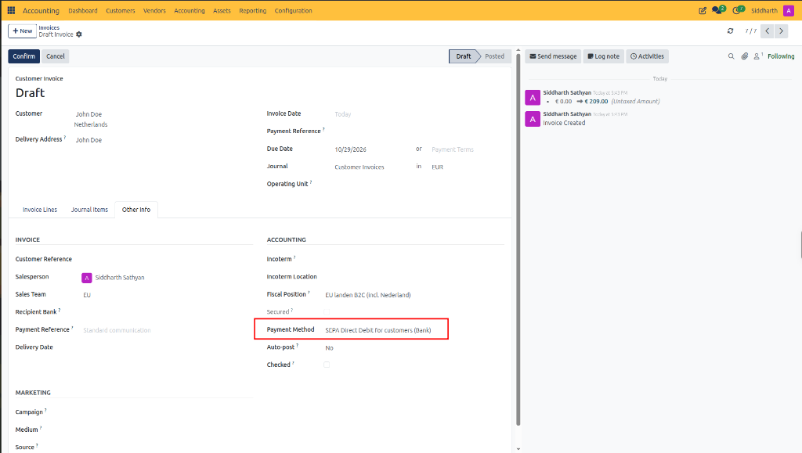

   * Setting this payment method flags the invoice for automatic batch retrieval by the debit order collection engine.
4. Return to the **Invoice Lines** tab:
   * Click **Add a line**, select the billable product *(e.g., `Fair Phone 5 (Black)`)*, and verify the unit price and tax calculation *(e.g., `€ 209.00` untaxed, `€ 43.89` BTW Hoog, totaling `€ 252.89`)*.

   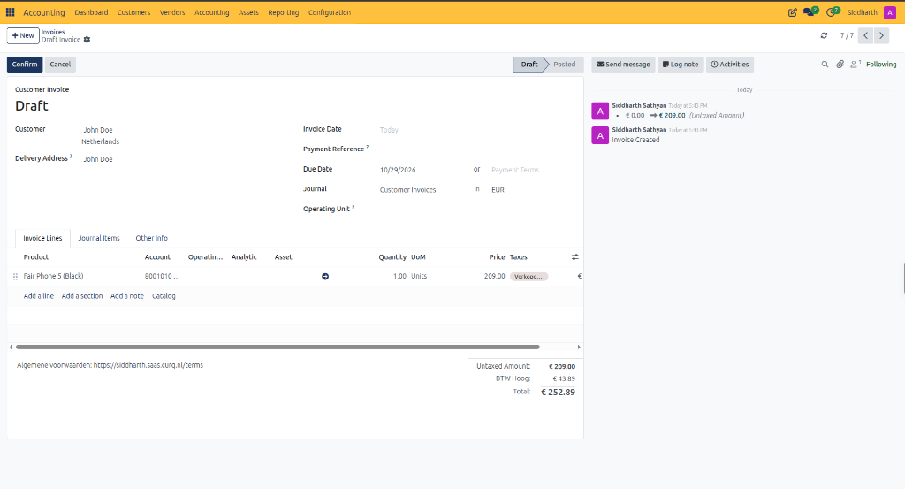

5. In the top action bar, click the dark blue **Confirm** button.
6. Upon validation:
   * CURQ commits the invoice to the general ledger, assigning sequential identifier `INV/2026/00006` in **Posted** status:

   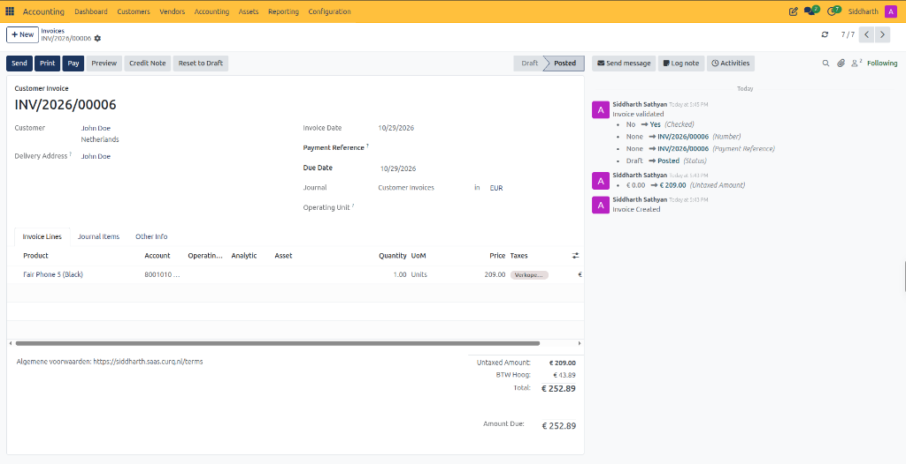

   * **Do not click Pay**: The invoice must remain open in **Posted** status with its full **Amount Due** *(e.g., `€ 252.89`)*. If you manually register a payment via **Pay**, the open residual balance is cleared, which prevents the batch collection engine from pulling this invoice into a SEPA debit order.

---

### 1.3 Create, Generate, and Export a SEPA Direct Debit Order

Rather than executing individual collections, CURQ bundles all eligible open direct debit invoices into an ISO 20022 XML batch file (`pain.008.001.02`) for electronic banking submission:

1. In the top navigation bar, select **Customers > Debit Orders**.
2. In the upper-left action bar, click **+ New**.

   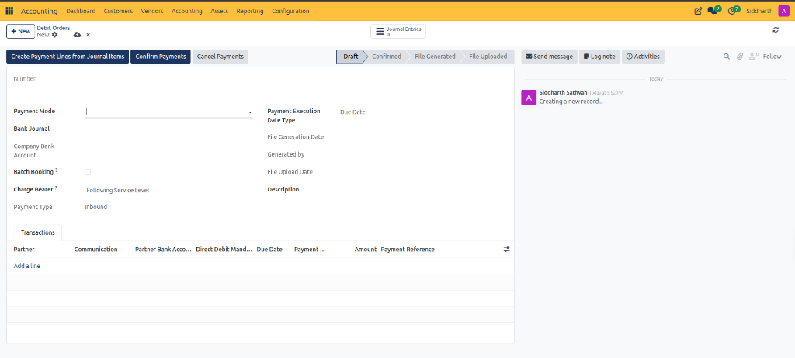

3. In the debit order header:
   * **Payment Mode**: Select the direct debit mode linked to your primary bank current account *(named **`Direct debit`**, linked to `[sepa_direct_debit] SEPA Direct Debit for customers (inbound)`)*:

   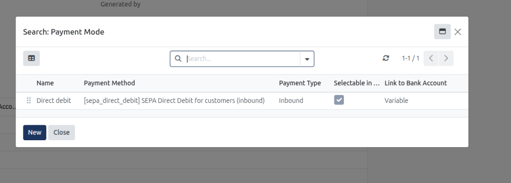

   * **Bank Journal**: Select **`Bank`** (or your designated liquidity journal).
   * **Company Bank Account**: Automatically displays your organization's IBAN once the Bank Journal is selected.
   * **SEPA Payment**: Automatically checked by CURQ for SEPA direct debit processing.
   * **Payment Execution Date Type**: Retain `Due Date` to execute debit collections according to invoice maturity dates.

   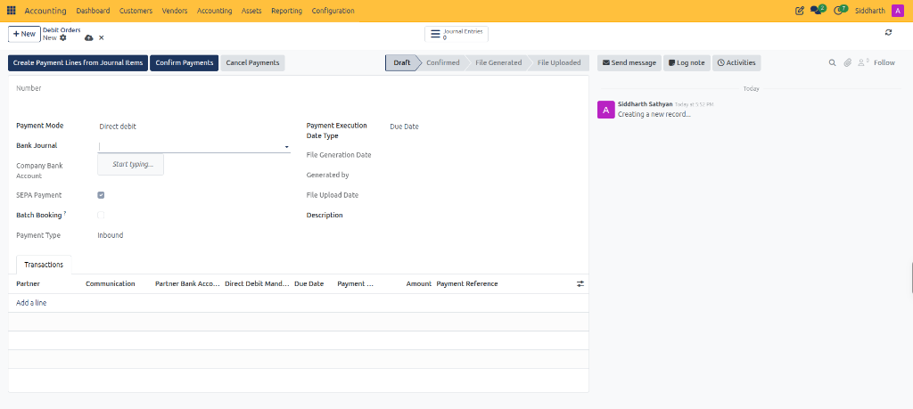
4. Populate collection transactions into the debit order:
   * Under the **Transactions** tab, click **Add a line** to open the **Create Transactions** modal:

   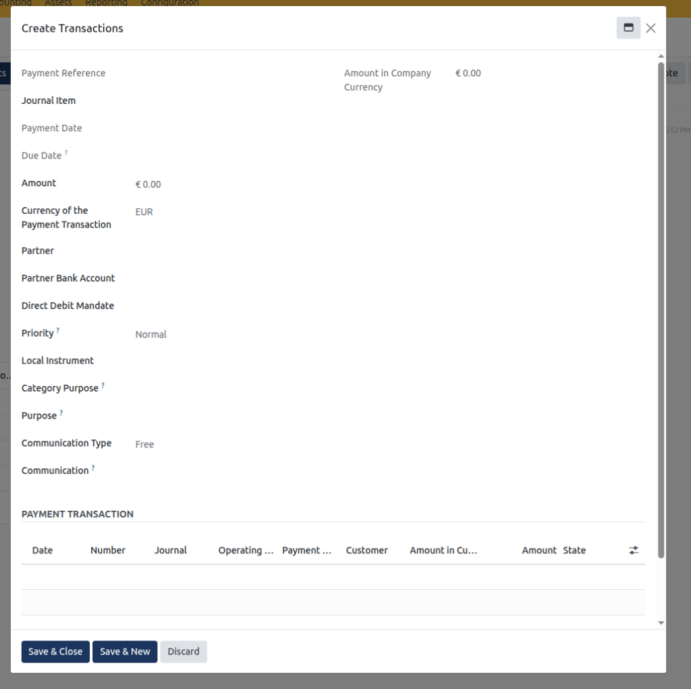

   * In the **Journal Item** field, select the open receivable item for customer invoice **`INV/2026/00006`**:

   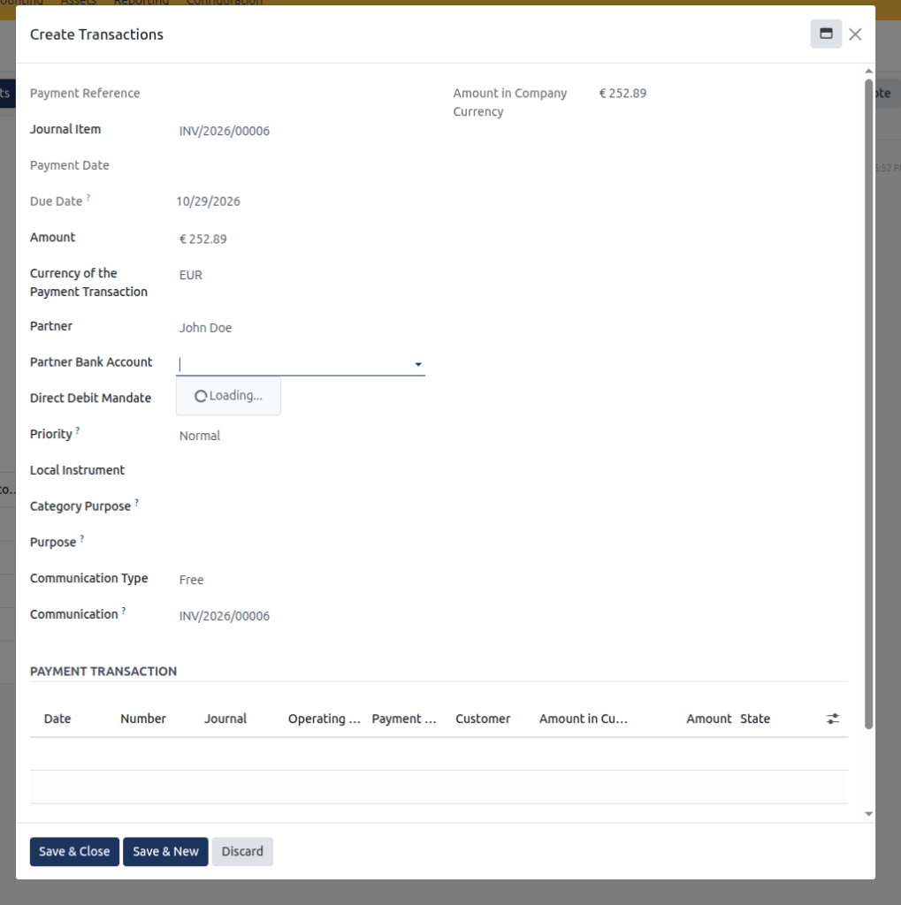

   * CURQ automatically populates the counterparty (**Partner**: `John Doe`), the open balance (**Amount**: `€ 252.89`), the maturity date (**Due Date**: `10/29/2026`), and communication memo.
   * Verify that **Partner Bank Account** displays the customer's authorized IBAN *(e.g., `BE39 1031 2345 6719 - Adyen`)* and **Direct Debit Mandate** displays the active authorization *(e.g., `BM0000009 (first)`)*:

   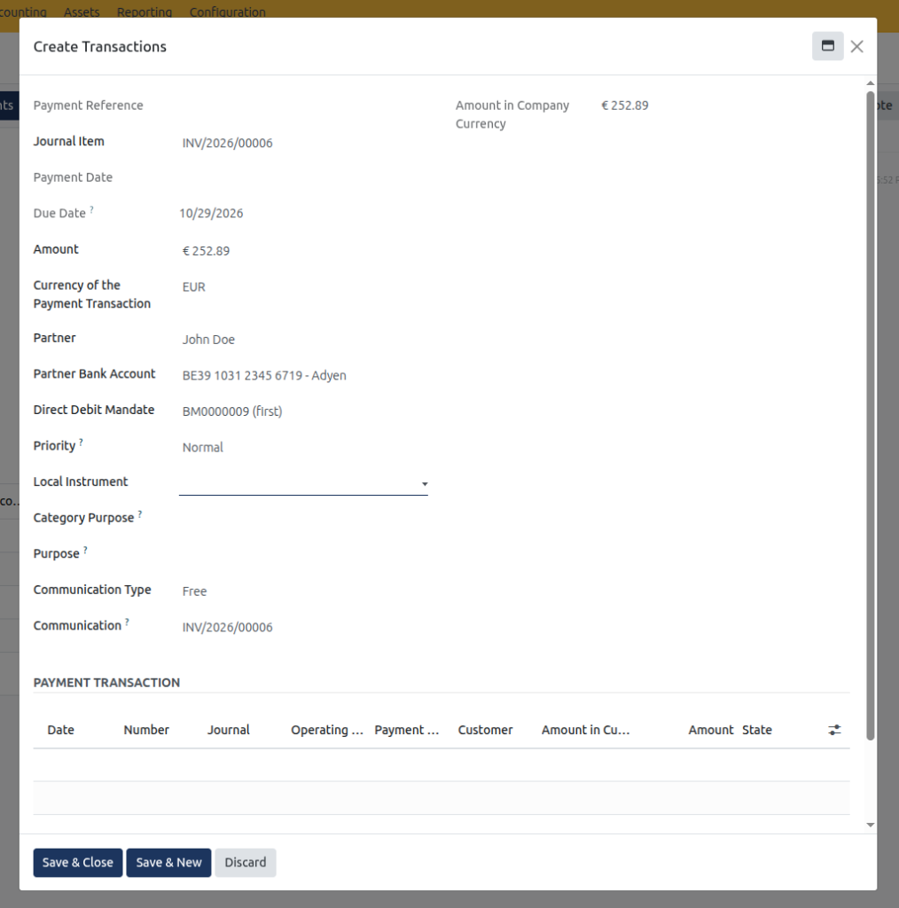

   * Click **Save & Close** in the lower-left corner to attach the collection line to the debit order:

   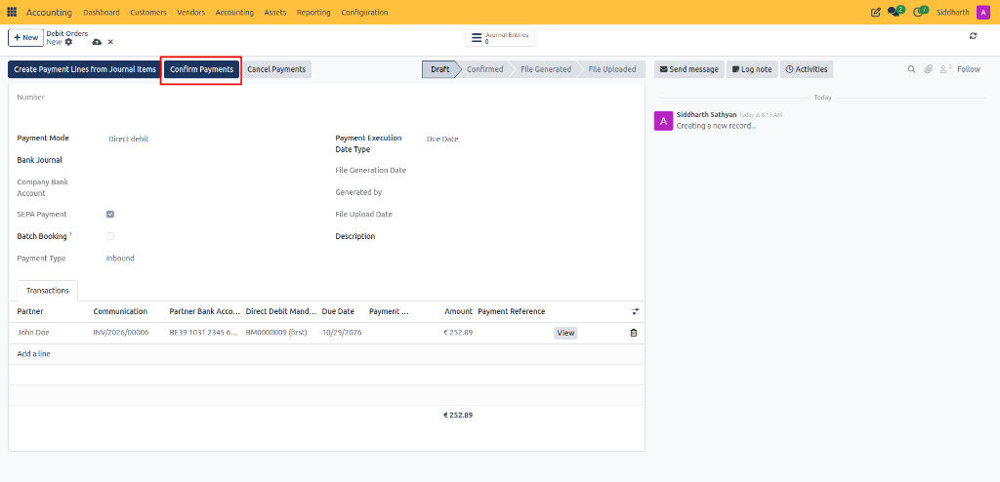

   * *(Batch Retrieval Alternative)*: You can also use the top action button **Create Payment Lines from Journal Items** to filter and pull multiple customer invoices across defined due-date windows simultaneously.
5. In the debit order header, select **`Bank`** in the **Bank Journal** field.

   > **Warning:** You must assign the destination **Bank Journal** before confirming the batch. Attempting to click **Confirm Payments** with a blank bank journal triggers an `Invalid Operation` error:
   >
   > 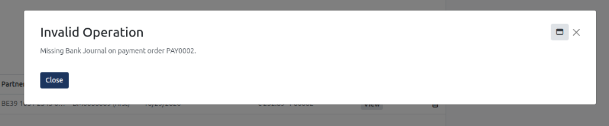

6. In the top action bar, click the dark blue **Confirm Payments** button:
   * The status pipeline advances from **Draft** to **Confirmed**.
   * CURQ assigns sequential batch identifier **`PAY0002`**, updates the chatter audit trail, and displays the **Generate Payment File** action button:

   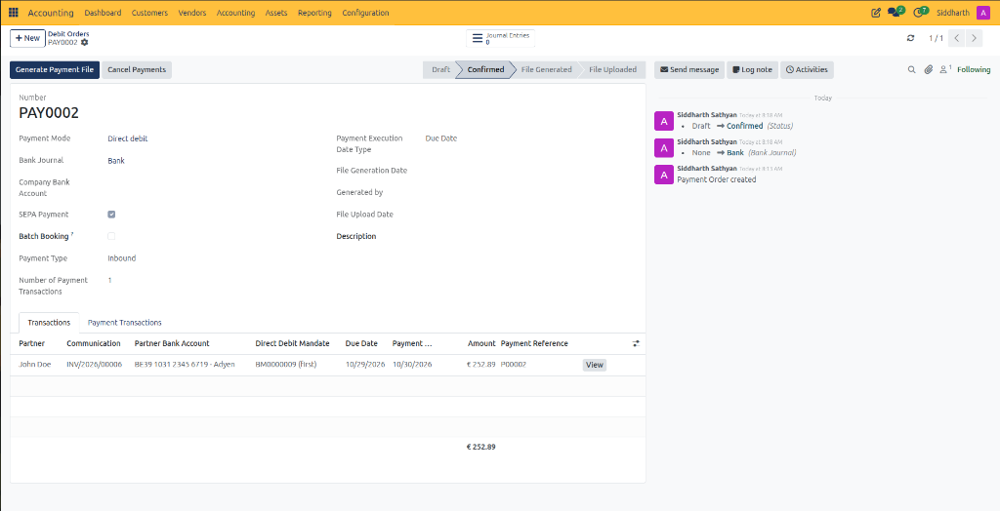

7. In the top action bar, click the dark blue **Generate Payment File** button:
   * CURQ compiles the batch into a standardized SEPA ISO 20022 XML direct debit file (`pain.008`) and opens the generated file record:

   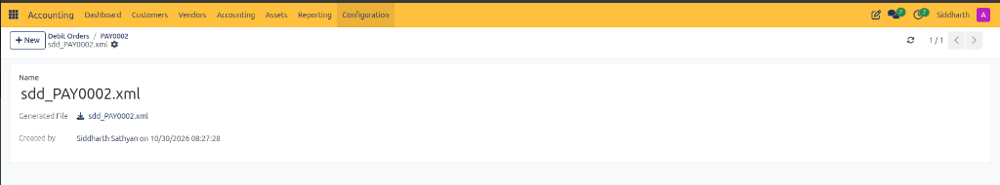

   * Click the **`sdd_PAY0002.xml`** file attachment link to download the XML file to your local computer.
8. Log in to your commercial banking portal and upload the downloaded XML file for processing.
9. In the top breadcrumb trail, click **`PAY0002`** to return to the debit order form, then click **File Uploaded to the Bank**:
   * The status pipeline advances to **File Uploaded**.
   * CURQ records the **File Generation Date** and **File Upload Date** *(e.g., `10/30/2026`)*.
   * In the transaction line, the mandate sequence automatically transitions from `(first)` to `(recurring)` for future collection runs.
   * Locks the debit order against accidental duplicate generation or modifications:

   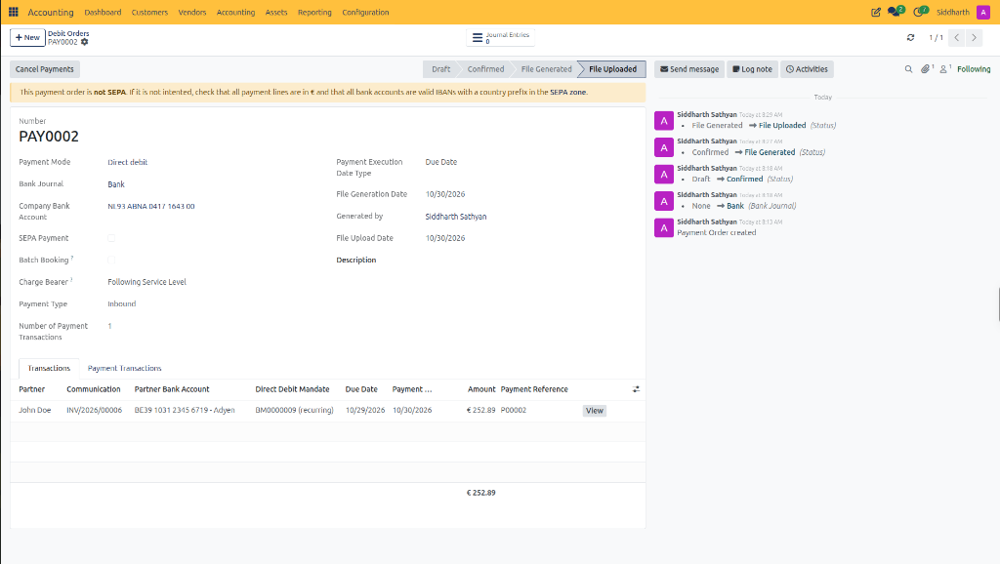

   * Updates linked customer invoices *(e.g., `INV/2026/00006`)* by adding a **`Payment Lines: 1`** stat button in the invoice header linking directly to the debit order:

   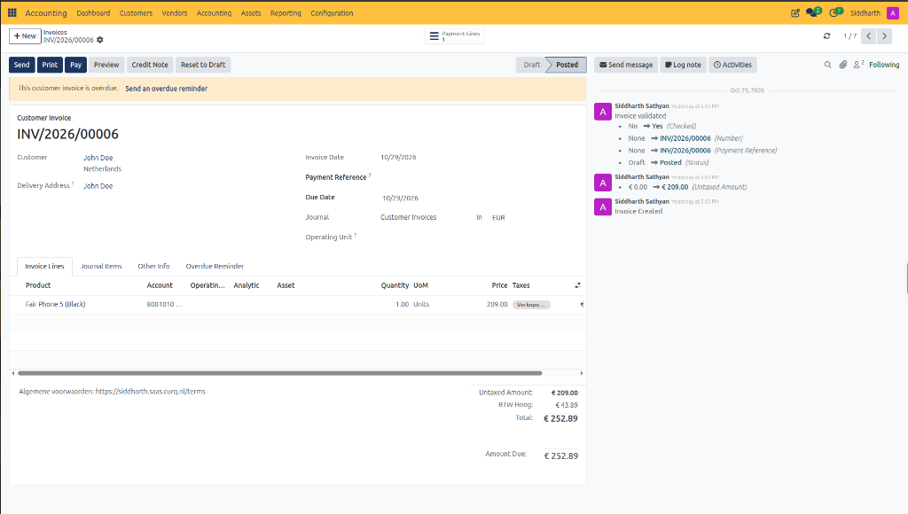

   * The invoice remains open in **Posted** status with its residual balance awaiting physical cash clearance on the bank statement. This protects accounting integrity during the 2 to 3 day SEPA inter-bank processing window.

---

### 1.4 Reconcile Incoming Batch Collections Against the Bank Statement

Once the clearing bank processes the direct debit file and credits the net collected funds to your bank account:

1. Navigate to **Accounting > Accounting > Bank Statements** and click **+ New** (or open an existing bank statement).
2. In the statement form:
   * **Reference**: Enter a statement identifier *(e.g., `BNK1/2026/00005`)*.
   * **Date**: Confirm the bank value date *(e.g., `10/30/2026`)*.
   * Under the **Transactions** tab, click **Add a line**:
     * **Date**: `10/30/2026`
     * **Label**: Enter `Direct debit collection PAY0002`.
     * **Partner**: Select `John Doe`.
     * **Amount**: Enter `252.89` *(positive figure for incoming customer receipt)*.
   * **Ending Balance**: Update the ending balance to equal `Starting Balance + 252.89` *(e.g., `€ 252.89`)*. If left at `€ 0.00`, CURQ displays a balance discrepancy warning:

   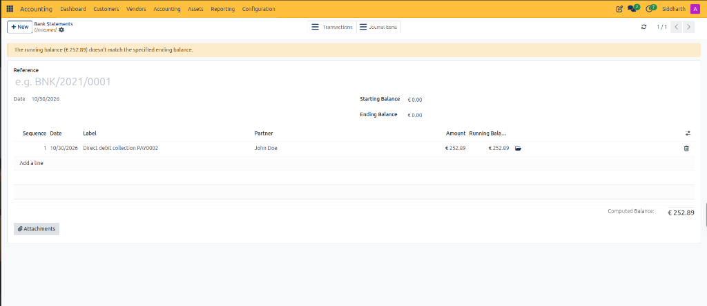

3. Save the statement. The computed balance matches the ending balance (`€ 252.89`), and the discrepancy warning clears:

   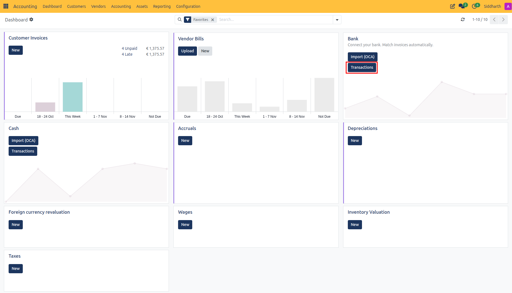

4. Navigate to **Accounting > Dashboard** (or click the **Transactions** stat button in the upper-right stat bar of the statement).
5. On the **Bank** journal card, click **Reconcile** (or **Reconcile 1 Items**) to open the reconciliation interface.
6. The reconciliation engine automatically matches the incoming `Direct debit collection PAY0002` debit on bank account `1002010 Rekening-courant bank` (`€ 252.89`) against the customer receivable credit on `1101010 Handelsdebiteuren nominaal` (`€ 252.89`), activating the primary **Validate** button:

   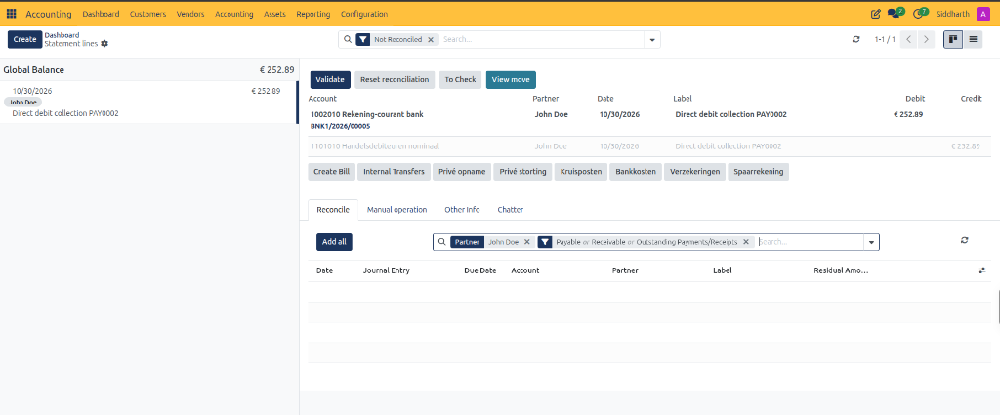

7. Click the dark blue **Validate** button:
   * Posts the reconciliation journal entry, clearing the customer receivable balance into bank liquidity account `1002010 Rekening-courant bank`.
   * Transitions customer invoice `INV/2026/00006` from **Posted** to **Paid** with **Amount Due: € 0.00**.
8. Open customer invoice `INV/2026/00006` under **Customers > Invoices**:
   * The green **PAID** ribbon displays across the upper right.
   * **Amount Due** recalculates to **`€ 0.00`**.
   * Below the totals table, the payment widget records `Paid on 10/30/2026 € 252.89`.
   * The chatter audit trail logs the milestone: `Invoice paid: Not Paid to Paid (Payment Status)`:

   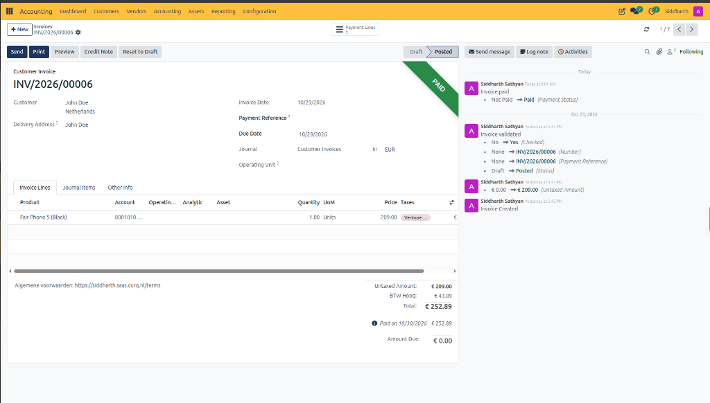

* *(Alternative Journal Items Reconciliation)*: If the bank statement line was validated as an unallocated customer receipt on account `1101010 Handelsdebiteuren nominaal` rather than matched during widget reconciliation:
  1. Navigate to **Accounting > Accounting > Journal Items**.
  2. Filter by Account `1101010` and check the box for both the invoice debit line (`INV/2026/00006`, `€ 252.89`) and the bank collection credit line (`BNK1/2026/00005`, `€ 252.89`):

  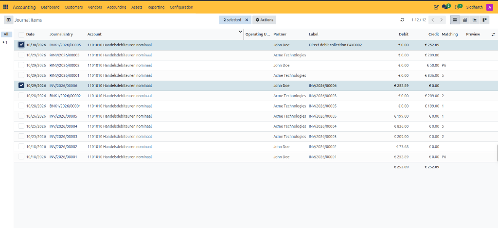

  3. Click **Actions > Reconcile** to link both lines with a reconciliation identifier and mark the invoice as Paid.

---

## 2. Edge Cases and Compliance Guidelines

* **Debtor Reversals and Chargebacks (*Storno*)**:
  * If a customer disputes a collection or their bank rejects the debit due to insufficient funds (*Storno*):
    1. The bank statement will reflect a negative chargeback transaction line including bank rejection fees.
    2. Open the reconciliation widget for the chargeback statement line.
    3. In the **Manual Operations** tab, debit the customer receivable account `1101010` for the principal amount to reopen the debt on the customer's balance.
    4. Allocate the bank chargeback penalty fee to expense account `4210040 Bankkosten`.
    5. Validate the reconciliation. The original invoice or customer debt is restored to open status for follow-up.
* **CORE vs B2B Mandate Rules**:
  * Ensure consumers are never registered under the B2B direct debit scheme. European banking directives mandate that CORE schemes be used for individual consumers and non-corporate entities.
* **Mandate Cancellation**:
  * If a customer terminates their agreement or revokes authorization, open their record in **Customers > Banking Mandates** and click **Cancel**. Deactivated mandates are immediately excluded from future debit orders.
* **Duplicate Customer Contacts**:
  * If multiple contact records exist with identical partner names, ensure the customer chosen on the invoice matches the partner record tied to the active banking mandate. Invoices billed to a twin partner record without registered bank details will fail validation during debit order generation.
  * During bank statement reconciliation, if the statement line Counterparty is assigned to twin Contact A while the invoice was billed to twin Contact B, the default partner filter will hide the open invoice. To resolve, remove the partner search filter in the reconciliation widget or merge the twin contact records under **Contacts > Action > Merge**.

---

## Related Documentation

* [Register and Reconcile Payments](./03-register-and-reconcile-payments.md)
* [Create and Validate Customer Invoices](./01-create-and-validate-customer-invoices.md)
* [Import and Reconcile Bank Statements](./04-import-and-reconcile-bank-statements.md)
* [Payment, Bank, and Journal Entry Field Definitions](../settings-and-fields/04-payment-bank-and-journal-entry-field-definitions.md)
