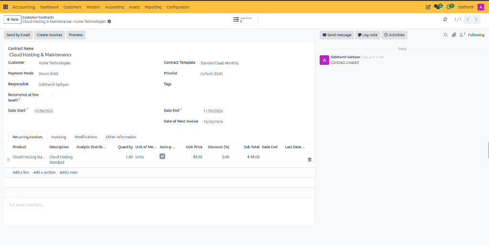
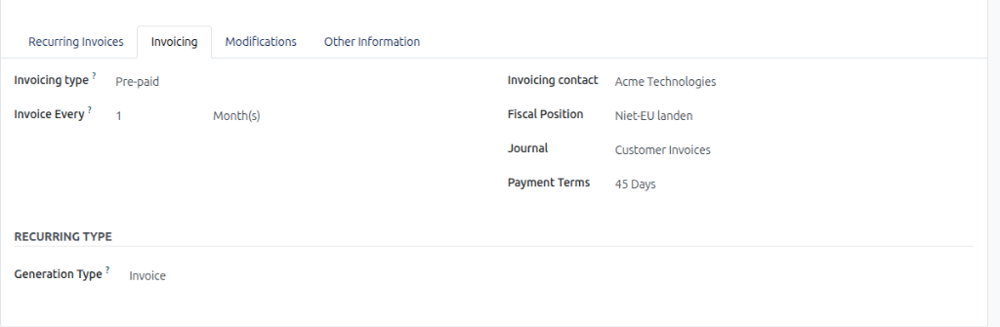
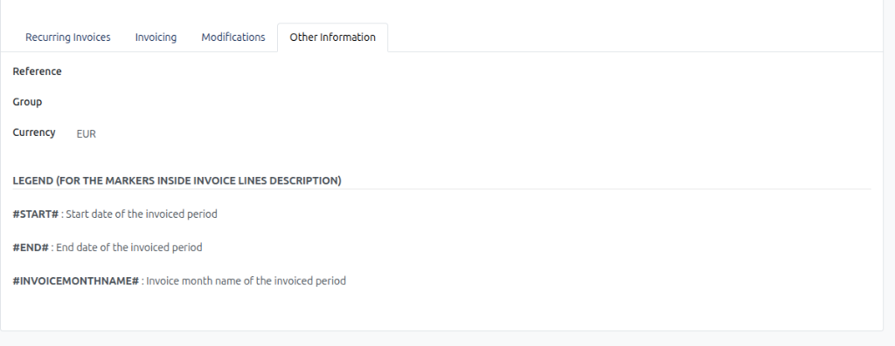
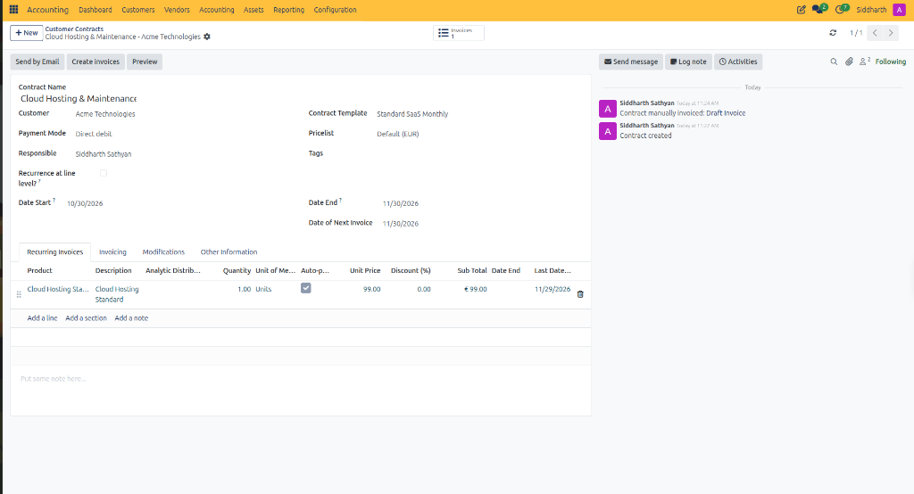
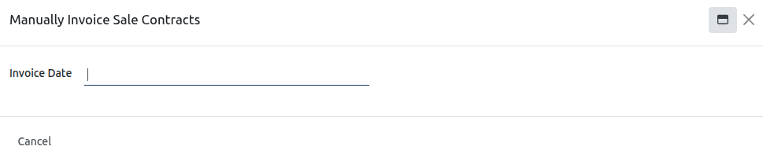
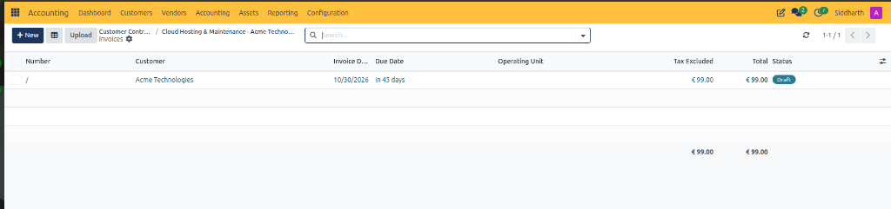
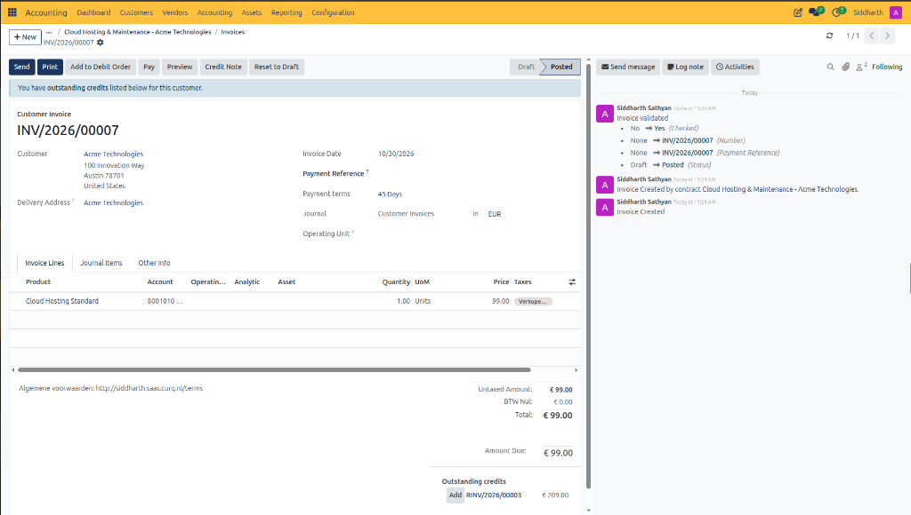
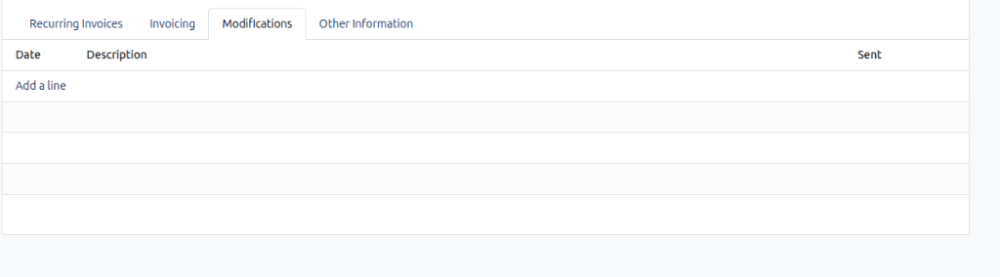
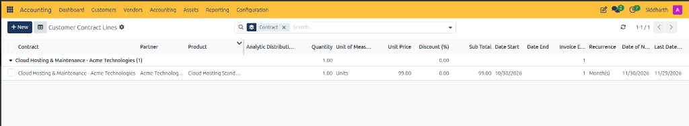
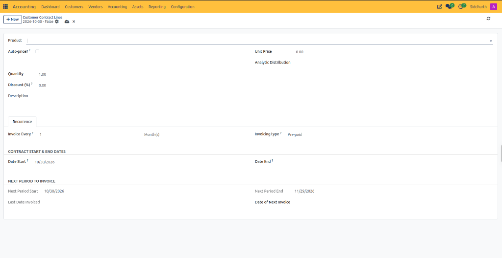

# Manage Customer Contracts and Recurring Invoicing

Recurring contracts automate subscription billing for ongoing services, software licenses, maintenance retainers, and scheduled deliveries. In CURQ, the Contracts module links customer agreements directly to automated accounting entries, issuing draft or posted customer invoices on fixed recurring cycles without repetitive manual entry.

---

### Prerequisites

* Ensure the customer partner record is created with designated billing addresses and payment terms under **Accounting > Customers > Customers**.
* If collecting recurring settlements electronically via SEPA Direct Debit, verify that an active banking mandate and customer IBAN are validated under **Accounting > Customers > Banking Mandates**.
* Configure recurring service or subscription products under **Sales > Products** with the appropriate revenue accounts and VAT rates.
* *(Optional)* Prepare a standard contract template under **Accounting > Configuration > Contract Templates** to pre-fill billing rules, lines, and journals for standard subscription offerings.

---

### Task 1: Create a Customer Contract

A customer contract establishes the legal and operational framework for recurring billing.

1. Navigate to **Accounting > Customers > Customer Contracts**.
2. Click **+ New** in the top action bar:

   

3. Complete the contract header details:
   * **Contract Name**: Enter a descriptive identification label *(e.g., `Cloud Hosting & Maintenance`)*.
   * **Customer**: Select the recipient debtor entity *(e.g., `Acme Technologies`)*.
   * **Payment Mode**: Choose the automated collection rule or payment vehicle *(e.g., `Direct debit`)*.
   * **Responsible**: Select the internal commercial representative overseeing the account *(defaults to current user)*.
   * **Recurrence at line level?**: Leave unchecked if all subscription items bill on the exact same schedule. Enable this checkbox if distinct items require separate recurrence cycles.
   * **Date Start**: Select the effective commencement date of the subscription agreement *(defaults to current date, e.g., `10/30/2026`)*.
   * **Contract Template**: Select a predefined template to automatically populate default billing intervals and lines *(e.g., `Standard SaaS Monthly`)*.
   * **Pricelist**: Select the commercial pricing catalog governing product pricing and discounts *(e.g., `Default (EUR)`)*.
   * **Tags**: Add optional classification tags for managerial reporting.
   * **Date End**: Specify an optional expiration date. Leave blank for ongoing, evergreen subscriptions.
   * **Date of Next Invoice**: Set the date for the initial billing run *(defaults to `Date Start`, e.g., `10/30/2026`)*.
4. Click the save icon to store the contract draft.

---

### Task 2: Configure Recurring Line Items and Invoicing Cadence

Configure the subscription products, pricing, and recurrence timing that govern automated invoice generation.

1. Under the **Recurring Invoices** tab, click **Add a line** to specify the billed items:
   * **Product**: Select the recurring subscription item or service *(e.g., `Cloud Hosting Standard`)*.
   * **Description**: Enter the invoice line label. You can embed dynamic date placeholders:
     * `#START#`: Substituted with the service window opening date *(e.g., `01/01/2026`)*.
     * `#END#`: Substituted with the service window closing date *(e.g., `31/01/2026`)*.
     * `#INVOICEMONTHNAME#`: Substituted with the name of the invoiced month *(e.g., `January`)*.
     * *Example*: `Hosting & Support Retainer (#START# - #END#)` generates on the invoice as `Hosting & Support Retainer (01/01/2026 - 31/01/2026)`.
   * **Analytic Distribution**: Assign analytic accounts or cost centers to track subscription revenue against specific business units.
   * **Quantity**: Number of units or licenses to bill per cycle.
   * **Unit Price**: Enter the fixed periodic charge, or check **Auto-price?** to pull pricing automatically from the assigned pricelist.
   * **Discount (%)**: Enter any contractual discount percentage.
   * **Date End**: *(Optional)* Set a termination date for this specific line item if it expires before the overall contract.
2. Organise complex subscriptions using **Add a section** to group related services or **Add a note** to insert terms.
3. In the free-text area at the bottom *(labeled `Put some note here...`)*, add invoice footer terms or payment instructions.
4. Navigate to the **Invoicing** tab to configure scheduling mechanics:

   

   * **Invoicing type**: Select `Pre-paid` *(invoices at the beginning of the service window)* or `Post-paid` *(invoices in arrears after service delivery)*.
   * **Invoice Every**: Set the numeric frequency *(e.g., `1`)* and interval unit *(e.g., `Month(s)`, `Day(s)`, `Week(s)`, `Last Day of Month`, or `Year(s)`)*.
   * **Invoicing contact**: Choose the specific counterparty billing contact *(e.g., `Acme Technologies`)*.
   * **Fiscal Position**: Select tax mapping rules for international or EU clients *(e.g., `Niet-EU landen`)*.
   * **Journal**: Confirm the sales sub-ledger where recurring invoices post *(defaults to `Customer Invoices`)*.
   * **Payment Terms**: Select contractual credit terms *(e.g., `45 Days`)*.
   * **Generation Type**: Confirm document output is set to `Invoice`.
5. Under the **Other Information** tab, review administrative references:

   

   * **Reference**: Enter external customer purchase order (PO) numbers or contract references.
   * **Group**: Assign an optional contract classification group.
   * **Currency**: Confirm the transaction currency *(e.g., `EUR`)*.

---

### Task 3: Generate Recurring Invoices

CURQ supports automated scheduled execution as well as on-demand batch or individual invoice generation.

#### Method A: Automated Daily Invoicing via System Scheduler
CURQ includes a built-in automated scheduled action titled **Generate Recurring Invoices from Contracts**:
* The scheduler executes daily in the background.
* The system evaluates all active contracts where `Date of Next Invoice` is equal to or earlier than the current date.
* Qualifying contracts automatically generate draft customer invoices matching their defined contract lines and advance `Date of Next Invoice` forward by one billing interval.

#### Method B: Immediate Generation via Create Invoices Button
When a new contract is signed and the initial invoice must be dispatched immediately:
1. Open the contract under **Accounting > Customers > Customer Contracts**.
2. Click **Create invoices** in the top action bar:
   * CURQ evaluates the contract lines, generates the draft customer invoice for the current period, logs the action in Chatter *(e.g., `Contract manually invoiced: Draft Invoice`)*, and shifts `Date of Next Invoice` forward to the subsequent billing period *(e.g., `11/30/2026`)*:

   

3. Notice the stat button in the top-right corner advances to **`Invoices 1`**.

#### Method C: Batch Generation via Manually Invoice Sale Contracts
To process multiple recurring contracts simultaneously across the company:
1. Navigate to **Accounting > Customers > Manually Invoice Sale Contracts**.
2. In the batch generation pop-up wizard, configure the target invoicing threshold:

   

   * **Invoice Date**: Enter the target billing date *(e.g., `10/30/2026`)*. CURQ evaluates all active contracts whose `Date of Next Invoice` falls on or before this specified cutoff date.
3. Click the primary button to create draft customer invoices in bulk for credit controller validation.

---

### Task 4: Monitor Generated Invoices and Billing History

1. Open the customer contract under **Accounting > Customers > Customer Contracts**.
2. Click the **Invoices** stat button *(e.g., `Invoices 1`)* in the top-right corner:
   * CURQ opens the filtered list view showing all customer invoices generated by this specific contract:

   

   * Review the provisional draft document *(e.g., `INV/...` with status `Draft`, payment due `In 45 days`, and total `€ 99.00`)*.
3. Open the draft invoice to review lines, taxes, and accounting allocations:

   

   * **Line Items & Period**: Verify product pricing *(e.g., `Cloud Hosting Standard` at `€ 99.00`)* and account assignments *(e.g., revenue account `8001010`)*.
   * **Credit Terms**: Verify payment terms *(e.g., `45 Days`)* and maturity schedule.
   * **Chatter Traceability**: Confirm the automated link logging origin contract details *(e.g., `Invoice Created by contract Cloud Hosting & Maintenance - Acme Technologies`)*.
4. Click **Confirm** in the top action bar:
   * CURQ posts the invoice to the General Ledger, assigns the permanent gapless legal sequence number *(e.g., `INV/2026/00007`)*, and transitions status from `Draft` to `Posted`.
5. Use the top action buttons for external communications:
   * **Send & Print**: Transmit the official invoice PDF to the debtor.
   * **Add to Debit Order**: If settled via direct debit, queue the invoice into an electronic SEPA collection order.
   * **Preview**: Review the Customer Portal view as seen by the customer online.

---

### Task 5: Log Contract Modifications and Terminate Lines

When service scopes change, customers upgrade/downgrade, or subscriptions cancel:

#### Logging a Formal Contract Modification
1. Navigate to the **Modifications** tab:

   

2. Click **Add a line**:
   * **Date**: Record the execution date of the amendment.
   * **Description**: Enter the summary of terms adjusted *(e.g., `Seat increase from 10 to 25 licenses`)*.
   * **Sent**: Check when the formal amendment has been dispatched to the client.

#### Terminating a Single Contract Line
1. Open the contract and locate the target line under **Recurring Invoices**.
2. Set the **Date End** column on the specific line item to the final billing date.
3. CURQ stops invoicing that line once the date passes. Remaining lines continue their normal automated recurrence.

#### Closing an Expired or Cancelled Contract
1. In the contract header, enter the final cancellation date in **Date End**.
2. Once `Date of Next Invoice` exceeds `Date End`, CURQ permanently stops evaluating the contract during scheduled runs.
3. Archive the record or update internal tags to preserve audit history while removing it from active billing queues.

---

### Task 6: Audit Customer Contract Lines Across Contracts (Reporting)

To monitor all recurring revenue lines, recurrence cadences, and scheduled next invoice dates across the entire customer contract portfolio:

1. Navigate to **Accounting > Reporting > Contracts > Customer Contract lines**.
2. Review the cross-contract overview grouped by parent contract:

   

   * **Contract Grouping**: Aggregates all individual active lines under their parent contract *(e.g., `Cloud Hosting & Maintenance - Acme Technologies (1)`)*.
   * **Contract**: Links to the legal master agreement.
   * **Partner**: Displays the billed client debtor *(e.g., `Acme Technologies`)*.
   * **Product**: The recurring subscription or service item *(e.g., `Cloud Hosting Standard`)*.
   * **Analytic Distribution**: Cost center and project tracking tags.
   * **Quantity & UoM**: Unit volume invoiced per cycle *(e.g., `1.00 Units`)*.
   * **Unit Price & Discount**: Agreed base unit rate *(e.g., `€ 99.00`)* and concession percentage *(e.g., `0.00%`)*.
   * **Sub Total**: Net cycle value *(e.g., `€ 99.00`)*.
   * **Date Start & Date End**: Lifecycle validity dates of the line *(e.g., started `10/30/2026`)*.
   * **Recurrence & Interval**: Cycle frequency *(e.g., `1 Month(s)`)*.
   * **Date of Next Invoice**: The next scheduled generation run *(e.g., `11/30/2026`)*.
   * **Last Date Invoiced**: Cutoff date of the most recently generated invoice cycle *(e.g., `11/29/2026`)*.

3. Click on any line row to inspect the full recurring schedule form:

   

   * **Auto-price?**: When checked, dynamically fetches catalog pricing from the client pricelist on each billing run.
   * **Recurrence Tab**:
     * **Invoice Every**: Recurrence interval value and unit *(e.g., `1 Month(s)`)*.
     * **Invoicing type**: Billing timing, set to `Pre-paid` *(invoiced in advance of service)* or `Post-paid` *(invoiced in arrears)*.
     * **Contract Start & End Dates**: Bounding calendar dates for line billing eligibility.
     * **Next Period to Invoice**: Exact date window covered by the upcoming billing batch *(e.g., `Next Period Start: 10/30/2026`, `Next Period End: 11/29/2026`)*.

---

### Edge Cases & Recovery Steps

* **Invoice Generated with Incorrect Price**: If a recurring invoice generated in `Draft` state with an obsolete price, edit the draft invoice lines directly before confirming. Then update the underlying contract line price or linked pricelist so subsequent cycles generate with the correct rate.
* **Invoice Already Confirmed Before Error Spotted**: Do not attempt to force contract edits onto posted invoices. Reverse the incorrect invoice using **Credit Note**, apply the credit, update the contract pricing, and use **Create invoices** to generate a corrected replacement invoice for the period.
* **Customer Dispute on Subscription Cancellation Date**: If a customer requests cancellation retroactively after a scheduled invoice posted, issue a partial or full credit note linked to that invoice, and set the contract line **Date End** to match the agreed cancellation date.
* **Failed Direct Debit on Recurring Contract**: If direct debit collection fails due to expired mandate or insufficient funds, the generated customer invoice transitions back to open status. Resolve mandate authorizations under **Accounting > Customers > Banking Mandates**, or register an alternative manual bank payment.

---

### Related Documentation

* [Contract and Recurring Invoicing Field Definitions (Customer and Supplier)](../settings-and-fields/06-customer-contract-and-recurring-invoicing-field-definitions.md)
* [Create and Validate Customer Invoices](./01-create-and-validate-customer-invoices.md)
* [Manage SEPA Direct Debit Orders and Mandates](./10-manage-sepa-direct-debit-orders-and-mandates.md)
* [Manage Supplier Contracts and Recurring Purchase Invoicing](./15-manage-supplier-contracts-and-purchase-invoicing.md)
