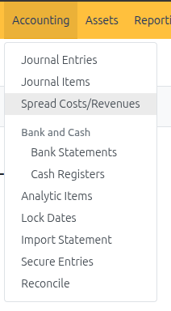
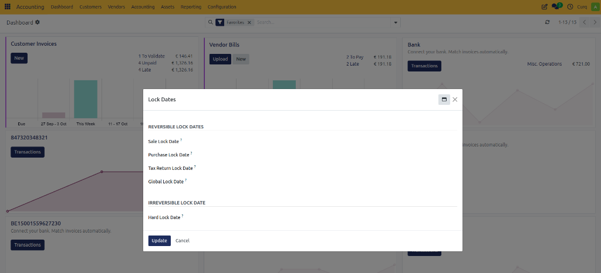
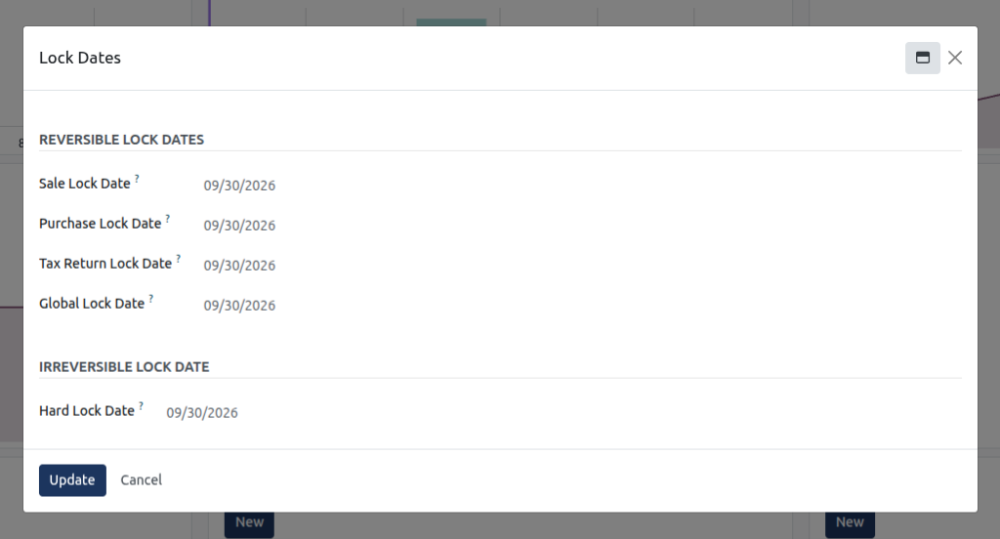

# Manage Lock Dates and Fiscal Year-End Closing

Configure reversible accounting period lock dates, protect filed statutory tax returns, execute the annual financial closing workflow, transfer net profit or loss to equity, and permanently seal historical fiscal years in CURQ Accounting.

> **Prerequisites**
> * Ensure your user account is assigned the **Billing Administrator**, **Accountant**, or **Financial Adviser** role. Configuring lock dates requires administrative accounting privileges.
> * Verify that all bank accounts, credit cards, and suspense clearing accounts are fully reconciled through the target closing period.
> * Confirm that customer invoices and vendor bills for the period are posted to the general ledger.
> * Verify that fixed asset depreciation entries have been computed and posted via [**Manage Fixed Assets and Depreciation**](./06-manage-fixed-assets-and-depreciation.md).
> * Verify that statutory Dutch VAT returns have been finalized via [**File Statutory VAT Returns and ICP Declaration**](./08-file-statutory-vat-returns-and-icp-declaration.md).

---

## 1. Understand Lock Date Types and Protection Levels

CURQ provides two distinct tiers of accounting lock dates: **Reversible Lock Dates** and an **Irreversible Lock Date**. Understanding the boundaries of each lock date ensures operational data integrity without accidentally restricting authorized financial adjustments.

1. Open the **Accounting** application.
2. In the top navigation bar, select **Accounting > Lock Dates**.

   

3. CURQ opens the **Lock Dates** configuration dialog:

   

4. Evaluate the functional protection tiers:

   * **Reversible Lock Dates**:
     * **Sale Lock Date**: Blocks users from creating, modifying, posting, or cancelling customer invoices, customer credit notes, and related sales journal items dated on or before this cutoff date. Financial advisers can modify, advance, or clear this date at any time.
     * **Purchase Lock Date**: Blocks users from creating, modifying, posting, or cancelling vendor bills, vendor refunds, and related purchase journal items dated on or before this cutoff date. Financial advisers can modify, advance, or clear this date at any time.
     * **Tax Return Lock Date**: Locks all journal entries and lines containing tax grids *(such as Dutch BTW boxes `1a`, `1b`, `2a`, `3a`, `4a`, `5b`)* up to this date. This prevents retroactive tax adjustments to periods where declarations have already been submitted to the *Belastingdienst*. Reversible by advisers if a formal supplementary tax return (*suppletie-aangifte*) is required.
     * **Global Lock Date**: Prevents standard operational users *(non-advisers such as sales staff, billing clerks, and project managers)* from creating, modifying, or cancelling any journal entries dated on or before this date across all journals. Users with the **Adviser** role retain permission to post manual adjusting entries or auditor corrections.

   * **Irreversible Lock Date**:
     * **Hard Lock Date**: Permanently and irreversibly seals all accounting entries, general ledger journals, and financial documents dated on or before this date across the company. Once saved, entries on or before this date cannot be modified, unposted, cancelled, or reconciled by any user, including system administrators, advisers, and root users. This lock date cannot be moved backward or cleared.

> **Tip:** For granular parameter descriptions and data dictionary field specifications, refer to [Customer Invoice, Vendor Bill, and Credit Note Field Definitions](../settings-and-fields/01-customer-invoice-and-vendor-bill-field-definitions.md).

---

## 2. Configure Interim Period Lock Dates (Monthly or Quarterly)

After completing monthly bank reconciliations or filing quarterly VAT returns, configure reversible lock dates to prevent operational staff from posting transactions into closed interim periods.

1. Select **Accounting > Lock Dates** from the top menu.
2. In the **Lock Dates** dialog, set the appropriate cutoff dates:
   * To close Accounts Receivable for the prior month: Enter the last calendar day of that month into **Sale Lock Date** *(e.g., `09/30/2026`)*.
   * To close Accounts Payable for the prior month: Enter the last calendar day of that month into **Purchase Lock Date** *(e.g., `09/30/2026`)*.
   * To protect a filed quarterly VAT return: Enter the final day of the filed tax quarter into **Tax Return Lock Date** *(e.g., `09/30/2026` for Q3 or `12/31/2026` for Q4)*.
   * To prevent general staff from recording any transactions in closed months while allowing the finance team to finalize adjustments: Enter the cutoff date into **Global Lock Date** *(e.g., `09/30/2026`)*.

   

3. **Leave Hard Lock Date blank during interim monthly and quarterly closes.**
4. Click the blue **Update** button to activate the lock dates immediately.

> **Caution on Hard Lock Date:** Setting a date in **Hard Lock Date** is completely irreversible. In the example above, setting `Hard Lock Date` to `09/30/2026` permanently seals all records prior to October 2026 for all users. For routine interim closes, **leave Hard Lock Date empty** and use **Global Lock Date** instead, preserving the ability for financial advisers to post audit adjustments later.

> **Note:** If a user attempts to validate, edit, or cancel a document dated on or prior to an active lock date, CURQ rejects the action with a validation error indicating that the accounting date falls within a locked period.

---

## 3. Annual Fiscal Year-End Closing Workflow

### 3.1 Execute the Annual Fiscal Year-End Closing Workflow

Performing a formal fiscal year-end close in CURQ ensures that all operational sub-ledgers agree with the general ledger, statutory tax obligations are finalized, and annual net income is transferred to equity. Complete the closing process using the following sequence:

#### 3.1.1 Step 1: Reconcile Financial and Clearing Accounts

1. Navigate to **Accounting > Bank Statements** and verify that all bank, credit card, and payment gateway statements through December 31 have been imported and reconciled.
2. Open the **Reconcile** widget under **Accounting > Reconcile** and confirm that all customer receipts and vendor payments are matched against open invoices and bills.
3. Review suspense clearing accounts *(such as `1109000 Bank suspense account`)* and ensure the ending balance is zero.

#### 3.1.2 Step 2: Process Pending Operational Documents

1. Go to **Customers > Invoices** and filter by status `Draft`. Validate all completed customer invoices dated in the fiscal year.
2. Go to **Vendors > Bills** and filter by status `Draft`. Validate all approved vendor bills belonging to the fiscal year.
3. Process all approved employee expenses and credit notes.

#### 3.1.3 Step 3: Reconcile Inventory and Stock Valuation

*(If physical inventory management is utilized)*
1. Perform the year-end physical inventory count.
2. Process inventory adjustments so that recorded quantities match actual warehouse stock on hand.
3. Confirm that stock valuation accounts in the general ledger align with perpetual inventory valuations.

#### 3.1.4 Step 4: Compute and Post Year-End Asset Depreciation

1. Navigate to **Assets > Compute Assets**.
2. Select the final date of the fiscal year *(e.g., `12/31/2026`)*.
3. Click **Compute** to generate and post all outstanding monthly depreciation journal entries across active fixed assets through the end of the year.
4. Review asset reports under **Reporting > Financial Assets report** to verify total accumulated depreciation and net book values.

#### 3.1.5 Step 5: Post Accrual, Prepayment, and Adjusting Entries

1. Navigate to **Accounting > Journal Entries**.
2. Click **+ New** to create adjusting journal entries in the **Miscellaneous Operations** journal dated `12/31/2026`:
   * **Accrued Expenses**: Record operational costs incurred in the fiscal year for which vendor bills have not yet been received.
   * **Prepaid Expenses**: Reclassify expenses paid in advance to asset balance sheet accounts.
   * **Deferred Revenue**: Reclassify invoiced subscription or contract revenue earned in subsequent periods to liability accounts.
   * **Bad Debt Provisions**: Record write-offs or adjustments for doubtful customer receivables.
3. Post each adjusting entry to the general ledger.

#### 3.1.6 Step 6: Finalize Statutory Tax Returns

1. Navigate to **Reporting > NL BTW Statement**.
2. Generate and calculate the final Q4 VAT return covering `10/01/2026` through `12/31/2026` via [**File Statutory VAT Returns and ICP Declaration**](./08-file-statutory-vat-returns-and-icp-declaration.md).
3. Validate, post, and click **Finalize** after submitting figures to the *Belastingdienst*.
4. Generate the corresponding **NL ICP Statement** for Q4 cross-border EU transactions.
5. Open **Accounting > Lock Dates** and set **Tax Return Lock Date** to `12/31/2026`.

#### 3.1.7 Step 7: Audit Financial Reports and Trial Balance

1. Navigate to **Reporting > MIS Reports**.
2. Generate the **Trial Balance** (*Proef- en Saldibalans*) for the full fiscal year (`01/01/2026` to `12/31/2026`) and confirm that total debits equal total credits.
3. Generate the **Profit and Loss** report using template `NL RGS Profit Loss` to establish the final net operating result for the year *(e.g., `Resultaat na belastingen`)*.
4. Generate the **Balance Sheet** report using template `NL RGS Balance Sheet` and review asset, liability, and equity positions.

---

### 3.2 Transfer Annual Net Profit or Loss to Equity

Under Dutch accounting conventions and double-entry bookkeeping standards, the annual net profit or loss calculated on the Profit and Loss statement must be transferred to the company balance sheet equity reserve *(such as `0500000 Algemene reserve` / Retained Earnings)* to close the income and expense accounts for the new financial year.

1. Navigate to **Accounting > Journal Entries**.
2. In the upper-left action bar, click **+ New**.
3. In the entry header, specify the closing parameters:
   * **Reference**: Enter `Year-End Result Allocation 2026` *(or `Overboeking Resultaat Boekjaar 2026`)*.
   * **Accounting Date**: Select the last day of the fiscal year *(e.g., `12/31/2026`)*.
   * **Journal**: Select `Miscellaneous Operations`.
4. Under the **Journal Items** tab, enter the balancing lines:
   * **If the company generated a net profit**:
     * Add a line: Select the annual result clearing account *(e.g., `0590000 Onverdeelde winst` or P&L summary account)* and enter the net profit figure in the **Debit** column.
     * Add a line: Select the general equity reserve account *(e.g., `0500000 Algemene reserve`)* and enter the identical net profit figure in the **Credit** column.
   * **If the company sustained a net loss**:
     * Add a line: Select the general equity reserve account *(e.g., `0500000 Algemene reserve`)* and enter the net loss figure in the **Debit** column.
     * Add a line: Select the annual result clearing account and enter the identical figure in the **Credit** column.
5. Verify that total debits match total credits exactly.
6. Click **Post** to record the equity transfer in the general ledger.

---

### 3.3 Seal the Fiscal Year with the Hard Lock Date

Once all financial statements have been approved by management and signed off by the external auditor, seal the fiscal year permanently to ensure complete compliance and audit immutability.

1. Open the **Accounting** application.
2. In the top navigation bar, select **Accounting > Lock Dates**.

   

3. In the **Lock Dates** dialog, locate the **IRREVERSIBLE LOCK DATE** section:

   

4. In the **Hard Lock Date** field, enter the closing date of the completed fiscal year *(e.g., `12/31/2025` or `12/31/2026` once that year has ended)*.
5. In the **REVERSIBLE LOCK DATES** section, ensure the other fields are aligned:
   * **Sale Lock Date**: `12/31/2026`
   * **Purchase Lock Date**: `12/31/2026`
   * **Tax Return Lock Date**: `12/31/2026`
   * **Global Lock Date**: `12/31/2026`
6. Click the blue **Update** button.

> **Important (Future Date Validation Rule):** CURQ enforces a strict safeguard: **no lock date can be set to a date in the future.** Attempting to set the Hard Lock Date or Tax Return Lock Date to a future date *(e.g., entering `12/31/2026` while today is `10/30/2026`)* triggers an `Invalid Operation: You tried to set Hard Lock Date to 12/31/2026, but it is in the future.` error. The fiscal year closing date can only be locked once that calendar year has concluded (on or after January 1 of the following year).

> **Warning:** The **Hard Lock Date** is completely irreversible. Once confirmed, neither regular users, accounting managers, nor system administrators can modify, cancel, or post transactions dated on or prior to this date. Never set the Hard Lock Date until statutory audits and tax declarations are fully finalized.

---

## 4. Temporarily Reopen a Reversible Lock Date for Auditor Corrections

If an external auditor requires an adjusting entry in a closed interim period or prior year before the Hard Lock Date is applied:

1. Log in with an authorized **Adviser** or **Accounting Administrator** user account.
2. Navigate to **Accounting > Lock Dates**.
3. In the **Global Lock Date** *(or relevant sub-ledger lock date)* field, clear the date or move it backward to a date preceding the required transaction date.
4. Click **Update** to apply the change.
5. Post the required adjusting journal entry or correction via **Accounting > Journal Entries**.
6. Immediately return to **Accounting > Lock Dates**, re-enter the original cutoff date, and click **Update** to restore period protection.

---

## Related Documentation

* [Create Manual Journal Entries](./05-create-manual-journal-entries.md)
* [Generate Financial Reports and Trial Balance](./07-generate-financial-reports-and-trial-balance.md)
* [Manage Fixed Assets and Depreciation](./06-manage-fixed-assets-and-depreciation.md)
* [Payment, Bank, and Journal Entry Field Definitions](../settings-and-fields/04-payment-bank-and-journal-entry-field-definitions.md)
