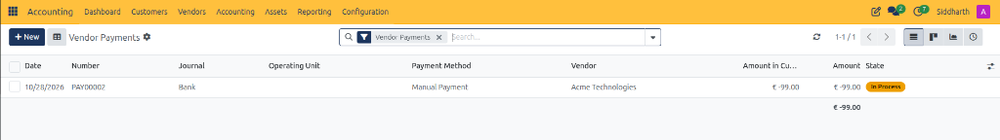
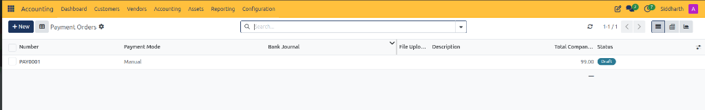
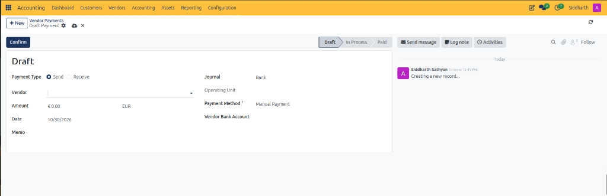
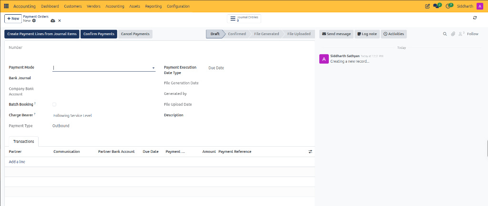
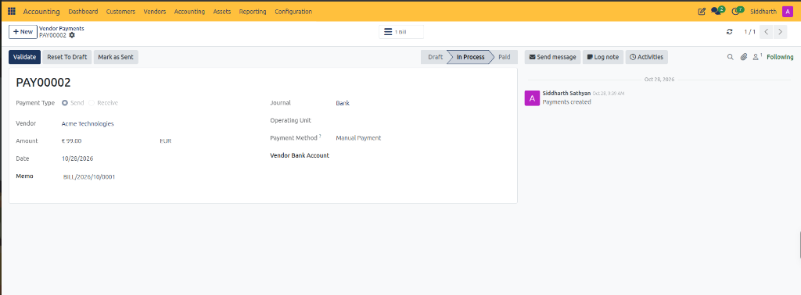
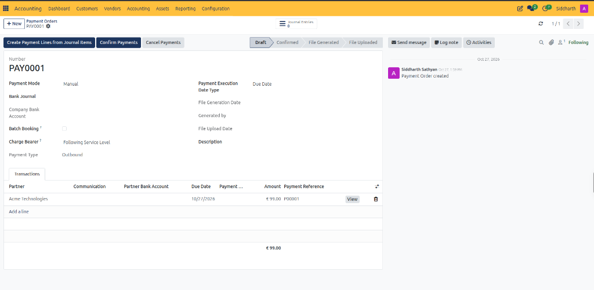
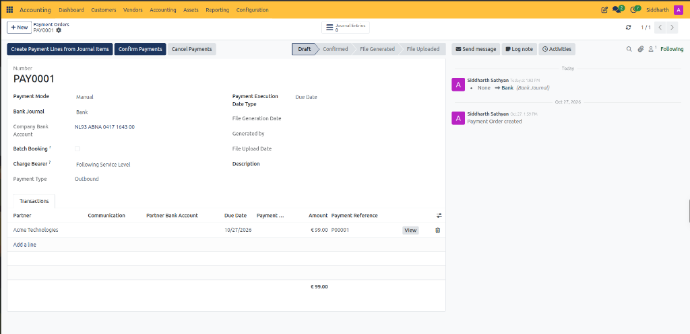
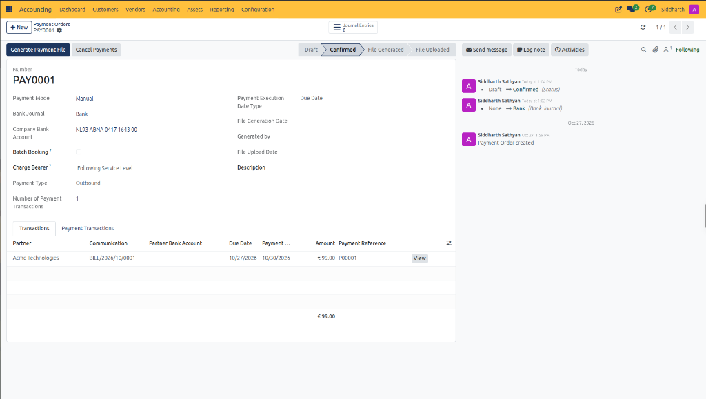
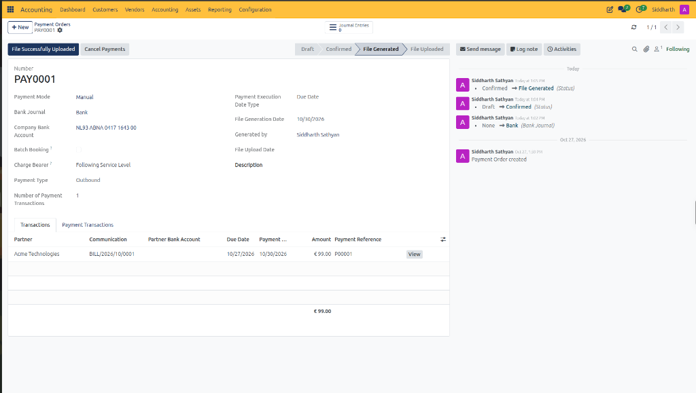
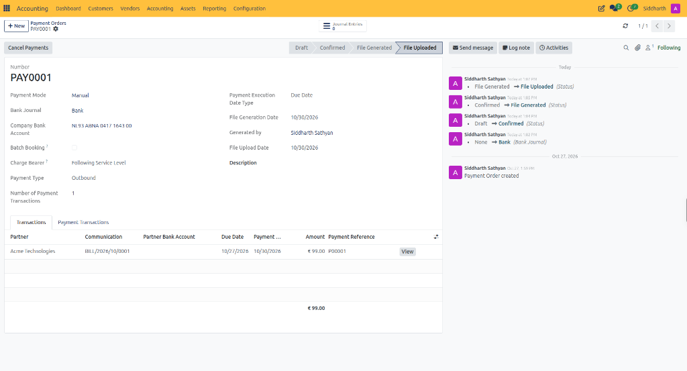

# Manage SEPA Vendor Payment Orders

Aggregate verified supplier bills into batch payment orders, generate standardized ISO 20022 SEPA XML credit transfer files (`pain.001`), process outbound banking files, and reconcile batch disbursements in CURQ Accounting.

---

### Prerequisites

* Ensure your user account has **Billing Administrator**, **Accountant**, or **Financial Adviser** permissions.
* Confirm that supplier bills are validated and open in [Create and Process Vendor Bills](./02-create-and-process-vendor-bills.md).
* Verify that each vendor profile contains a valid recipient bank account (IBAN/BIC) in [Contacts](../../Contacts/task-guides/01-create-and-manage-contacts.md).
* Ensure an outbound payment mode *(e.g., `SEPA Credit Transfer` or `Manual`)* is configured under **Configuration > Payment Modes** with a linked financial **Bank Journal**.

---

### Task 1: Initialize an Outgoing Payment Order

Rather than disbursing payments individually, CURQ enables finance teams to bundle multiple approved supplier bills into a single structured payment run.

1. Open the **Accounting** application.
2. In the top navigation bar, select **Vendors > Payment Orders** (or **Vendors > Payments** to review registered disbursement records):

   

   

   * The list view displays all recorded payment batches with **Number**, **Payment Mode**, **Bank Journal**, **File Upload Date**, **Description**, **Total Company Currency**, and **Status**.
3. In the upper-left action bar, click **+ New**.
4. CURQ opens the blank payment order creation form in **Draft** state:

   

   

   After initial validation and processing, payments advance through operational states:

   

   > For full field specifications of vendor payment orders, batch headers, and XML parameters, see [Vendor Payment Order Batch Form Fields](../settings-and-fields/04-payment-bank-and-journal-entry-field-definitions.md#vendor-payment-order-batch-form-fields).

5. Configure the payment batch header parameters:
   * **Payment Mode**: Select your electronic disbursement mode *(e.g., `Manual` or `SEPA Credit Transfer`)*.
   * **Bank Journal**: Select your disbursement journal *(typically `Bank`)*.
   * **Company Bank Account**: Auto-populates your company IBAN *(e.g., `NL93 ABNA 0417 1643 00`)* upon selecting the Bank Journal.
   * **Payment Type**: Automatically fixed to `Outbound` for supplier payments.
   * **Batch Booking?**: *(Optional)* Check this box if your financial institution should present the batch as a single consolidated debit entry on your bank statement rather than individual lines.
   * **Charge Bearer?**: Defaults to `Following Service Level` according to European SEPA scheme rules.
   * **Payment Execution Date Type**: Select `Due Date` to execute each payment according to the supplier invoice payment term, or `Immediately` for immediate processing.
   * **Description**: Optional internal label for the payment batch *(e.g., `Weekly Vendor Payments Oct W44`)*.

---

### Task 2: Populate Supplier Invoices into the Payment Batch

CURQ provides three methods to attach approved vendor bills to a payment order:

#### Method A: Batch Generation via Journal Items (Recommended for High Volume)
1. In the top-left action bar of the payment order, click **Create Payment Lines from Journal Items**.
2. In the selection wizard:
   * Set the maturity date filter *(e.g., all bills due on or before `10/31/2026`)*.
   * Select target move status **All Posted Entries**.
3. Click **Populate** to pull all matching open vendor payables (`1203010`) into the batch automatically.

#### Method B: Manual Transaction Line Entry
1. Under the **Transactions** tab, click **Add a line**.
2. Select the specific supplier bill or payable journal item.
3. CURQ populates counterparty, due date, open amount, and payment reference:

   

#### Method C: Direct Selection from Vendor Bills List
1. Navigate to **Vendors > Bills**.
2. Filter by status `To Pay` and select the checkboxes next to the bills to disburse.
3. In the **Action** menu at the top center, select **Add to Payment Order**.

---

### Task 3: Verify Mandatory Remittance Information and Bank Details

Before confirming any outbound payment batch, verify that every transaction line contains complete banking information:

1. Review the line items in the **Transactions** table:
   * **Partner**: Verified supplier name *(e.g., `Acme Technologies`)*.
   * **Communication**: Mandatory remittance reference transmitted to the supplier bank *(e.g., `BILL/2026/10/0001`)*.
   * **Partner Bank Account**: Recipient supplier IBAN.
   * **Due Date**: Contractual maturity date *(e.g., `10/27/2026`)*.
   * **Amount**: Payable figure in currency *(e.g., `€ 99.00`)*.
   * **Payment Reference**: System-assigned transaction voucher identifier *(e.g., `PO0001`)*.
2. To edit or inspect a line, click the **View** button at the right end of the row.

> **Warning (Mandatory Communication Rule):** In European SEPA banking, every electronic transfer line must contain remittance information. If you attempt to confirm a payment order where **Communication** is blank, CURQ halts execution with an `Invalid Operation: There's at least one validation error: Communication is empty on payment line` error. Ensure every line has an invoice or memo reference before proceeding.

---

### Task 4: Confirm the Payment Order

Once all lines, journals, and communication references are validated:

1. In the upper-left action bar, click the dark blue **Confirm Payments** button.
2. Observe the document updates:

   

   * The lifecycle status advances from **Draft** to **Confirmed**.
   * A new tab appears: **Payment Transactions**, displaying individual execution lines.
   * The **Number of Payment Transactions** counter updates *(e.g., `1`)*.
   * The dark blue action button transitions to **Generate Payment File**.
   * Chatter records the audit transition: `Draft -> Confirmed (Status)`.

---

### Task 5: Generate and Export the Banking File

1. In the top action bar, click **Generate Payment File**.
2. CURQ compiles the batch into a standardized ISO 20022 XML credit transfer file (`pain.001.001.03` for SEPA):

   

3. Review the status changes:
   * The pipeline advances from **Confirmed** to **File Generated**.
   * CURQ stamps **File Generation Date** with the current date *(e.g., `10/30/2026`)*.
   * The **Generated by** field records the responsible user account.
   * The action button updates to **File Successfully Uploaded**.
4. Download the generated XML payment file from the document chatter or file card to your local computer.

---

### Task 6: Transmit File to Bank and Finalize the Order

1. Log in to your commercial banking portal *(such as ING InsideBusiness, ABN AMRO Access Online, or Rabobank Corporate)*.
2. Navigate to the batch payment or SEPA file upload section and upload the downloaded XML file.
3. Authorize the batch using your company banking tokens or dual-signatory approvals.
4. Return to CURQ and open **Vendors > Payment Orders > `PAY0001`**.
5. In the top action bar, click **File Successfully Uploaded**.

   

6. Observe the finalization updates:
   * The pipeline advances to **File Uploaded**.
   * CURQ stamps the **File Upload Date** timestamp *(e.g., `10/30/2026`)*.
   * All vendor bills linked to this order transition from **Posted** to **In Payment**.
   * The payment order is finalized and locked against operational edits.

---

### Task 7: Reconcile Batch Disbursements Against Bank Statements

When the actual cash disbursement is executed by your commercial bank:

1. Import your periodic electronic bank statement *(CAMT.053 or CSV)* via [Import and Reconcile Bank Statements](./04-import-and-reconcile-bank-statements.md) or automatic Ponto synchronization.
2. Open **Accounting > Reconcile** or the statement reconciliation widget.
3. The bank statement will display a debit entry matching the payment order total *(e.g., `-€ 99.00`)*.
4. Match the statement line against the outstanding payment order clearing lines.
5. Click **Validate**:
   * The transitory clearing account balance is cleared to zero.
   * The vendor bills transition from **In Payment** to **Paid** (residual balance reaches `€ 0.00`).

---

### Edge Cases & Troubleshooting

* **Missing Bank Journal Error**: If clicking Confirm Payments returns `Missing Bank Journal on payment order`, verify that your Payment Mode under **Configuration > Payment Modes** has its **Link to Bank Account?** set to `Fixed` with an assigned Bank Journal, or select `Bank` directly in the header.
* **Missing Communication on Payment Line**: If confirmation fails with `Communication is empty`, click **View** on the transaction line and enter the vendor bill number or invoice reference.
* **Cancelling a Payment Order**: If a payment order is rejected by your bank prior to execution, open the order and click **Cancel Payments**. CURQ releases all attached vendor bills back to their open **Posted** status so they can be re-batched into a new payment run.

---

### Related Documentation

* [Create and Process Vendor Bills](./02-create-and-process-vendor-bills.md)
* [Register and Reconcile Payments](./03-register-and-reconcile-payments.md)
* [Import and Reconcile Bank Statements](./04-import-and-reconcile-bank-statements.md)
* [Manage SEPA Direct Debit Orders and Mandates](./10-manage-sepa-direct-debit-orders-and-mandates.md)
* [Payment, Bank, and Journal Entry Field Definitions](../settings-and-fields/04-payment-bank-and-journal-entry-field-definitions.md)
