# Manage Deferred Costs, Revenues, and Accruals

In accrual accounting, revenues and expenses must be recognized in the accounting period in which they are earned or incurred, rather than when cash is received or paid. CURQ provides automated **Cost and Revenue Spreading** to distribute multi-period transactions *(such as annual software subscriptions, prepaid insurance, annual rent, or maintenance retainers)* evenly across months, quarters, or custom intervals.

This guide explains how to set up spread templates, link spread schedules directly to customer invoice and vendor bill lines, manage spread tables, and generate periodic recognition journal entries.

> **Prerequisites**
> * Ensure that appropriate balance sheet accrual and deferral accounts are configured in your Chart of Accounts:
>   * **Deferred Revenue / Accrued Liability**: Account for unearned customer income *(e.g., `2101010 Vooruitontvangen bedragen` or `Overlopende passiva`)*.
>   * **Deferred Expense / Prepaid Asset**: Account for prepaid supplier expenses *(e.g., `1301010 Vooruitbetaalde kosten` or `Overlopende activa`)*.
>   * **Revenue Account**: Operating income account receiving monthly recognition entries *(e.g., `8001010 Omzet`)*.
>   * **Expense Account**: Operating expense account receiving monthly cost entries *(e.g., `4301010 Huurkosten` or `4401010 Softwarelicenties`)*.
> * Confirm that an appropriate **Miscellaneous Operations** journal exists to record periodic spreading adjustments without mixing them into customer sales or vendor purchase journals.

---

## 1. Revenue and Expense Spread Scheduling

### 1.1 Access Spread Tables in Accounting

1. In the top navigation bar, select **Accounting > Spread Costs/Revenues**.

   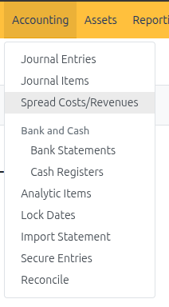

2. CURQ opens the **Cost / Revenue Spread** overview dashboard:

   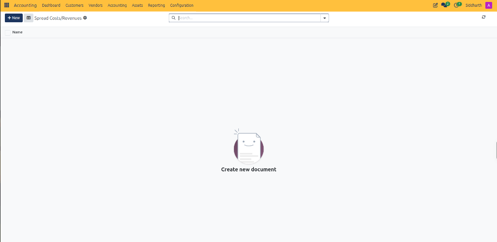

3. To create a standalone schedule manually, click **+ New**:

   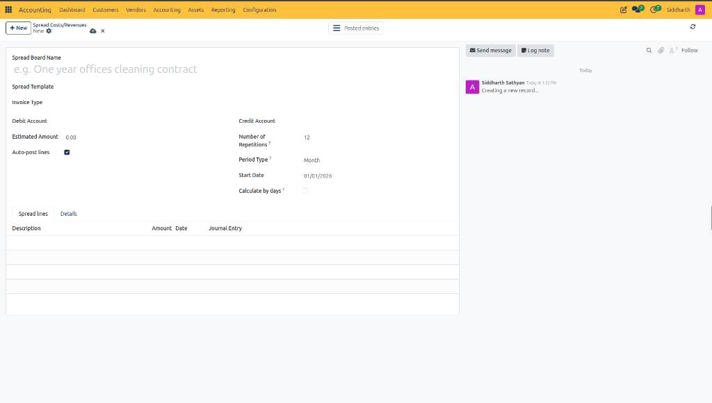

4. Select the **Details** tab to review currency and analytic assignments:

   

5. Return to the main form and configure the amortization parameters:
   * **Spread Board Name**: Enter a contract identifier *(e.g., `Annual Cloud Subscription 2026`)*.
   * **Invoice Type**: Select `Customer Invoice` *(for customer revenue)* or `Vendor Bill` *(for supplier expenses)*.
   * **Debit Account**: Select the Balance Sheet deferral liability account (`1210240 Vooruitontvangen huren`).
   * **Credit Account**: Select the P&L operating revenue account (`8010100 Huuropbrengsten`).
   * **Estimated Amount**: Enter the total principal to be amortized *(e.g., `1,200.00`)*.
   * **Number of Repetitions**: Set to `12` monthly installments.
   * **Period Type**: Set to `Month`.
   * **Start Date**: Enter the inception date *(e.g., `10/01/2026`)*.

> For chart of accounts configurations, allowed journals, and account classifications, see [**Chart of Accounts Field Definitions**](../settings-and-fields/02-chart-of-accounts-and-taxes-field-definitions.md#chart-of-accounts-field-definitions).

6. Click the Save icon:
   * CURQ saves the spread board record and displays the pending unposted balances:

   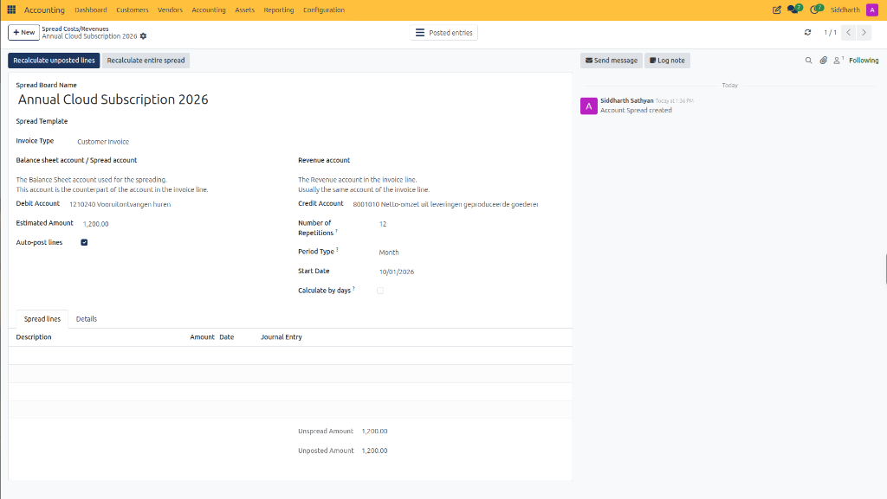

7. In the top action bar, click **Recalculate unposted lines** *(or **Recalculate entire spread**)*.
8. CURQ immediately computes and populates the multi-period installment schedule:

   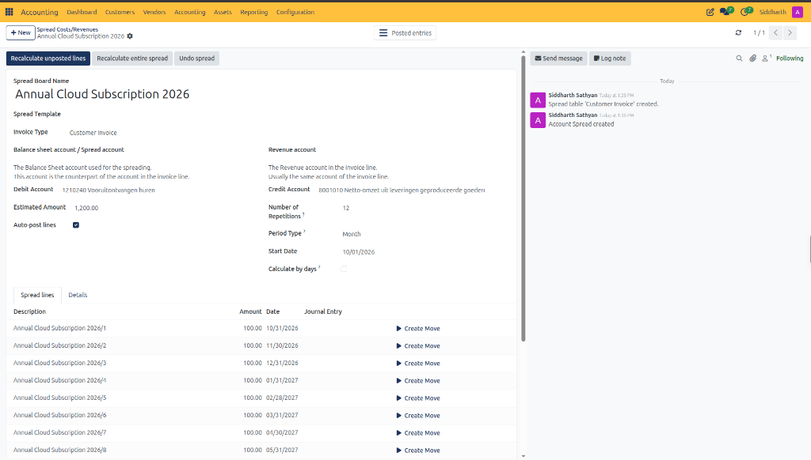

9. Observe the generated elements:
   * **Spread Lines Table**: 12 rows are scheduled from `10/31/2026` through `09/30/2027`, each recognized at `€ 100.00`.
   * **Create Move Action**: Each individual installment line features a **▶ Create Move** button to post the monthly recognition voucher.
   * **Undo Spread Action**: An **Undo spread** button appears in the top header, allowing you to discard calculated lines and return to draft parameters if modifications are needed.

---

### 1.2 Spread Revenue from a Customer Invoice Line

Revenue spreading can be linked directly to an invoice line while a customer sales invoice is in **Draft** status:

1. Navigate to **Customers > Invoices** and click **+ New** (or open an existing invoice in **Draft** state).
2. Enter the **Customer** *(e.g., `Acme Technologies`)*, **Invoice Date**, and **Payment Terms**.
3. In the **Invoice Lines** tab, click **Add a line** and enter the billable product and price *(e.g., Product: `Cloud Hosting Standard`, Price: `1,200.00`)*.
4. On the far right of the invoice line, click the circular arrow icon (**Spread Revenue icon**):

   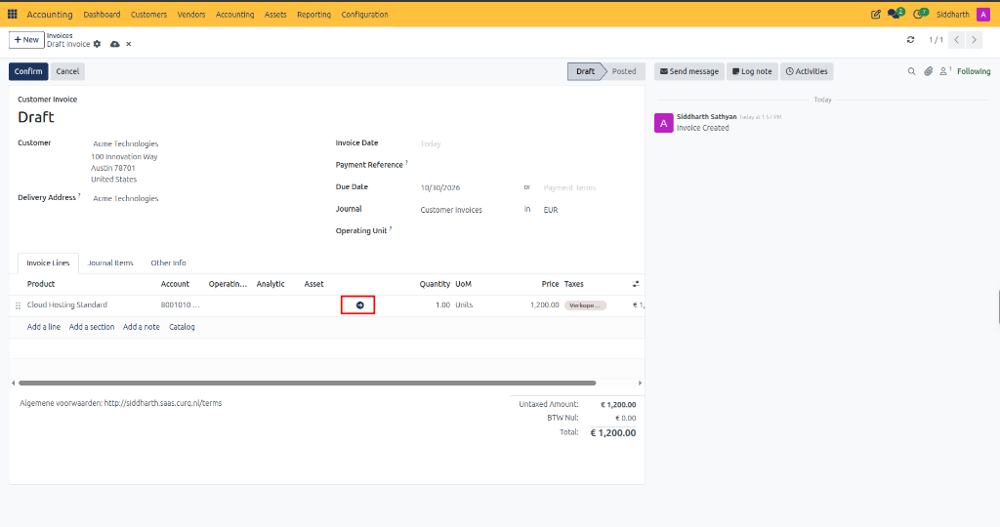

5. The **Link Invoice Line with Spread Board** configuration modal appears:

   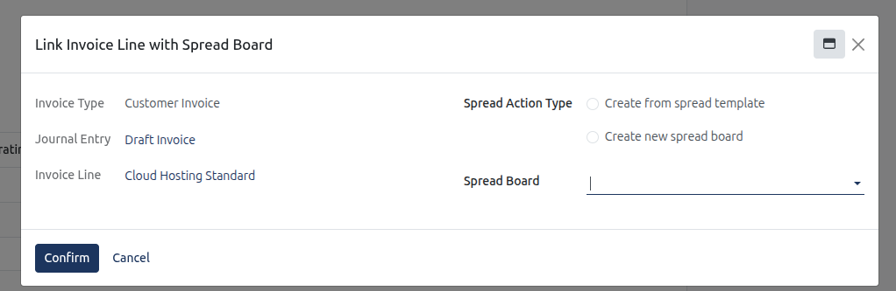

6. Select your linking method:
   * **Link to Existing Spread Board**: Under **Spread Board**, select an active pre-created schedule *(e.g., `Annual Cloud Subscription 2026`)*:

     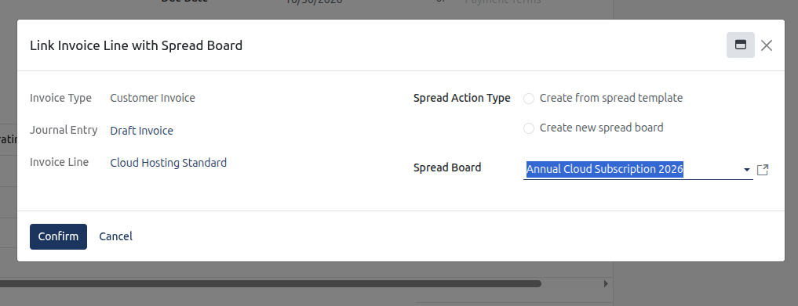

   * **Create from spread template**: Select a pre-configured template to inherit amortization intervals and accounts automatically.
   * **Create new spread board**: Opens a blank spread board form to configure custom period repetitions and accounts directly.
7. Click **Confirm**:
   * CURQ binds the spread schedule to the invoice line and opens the linked spread board:

   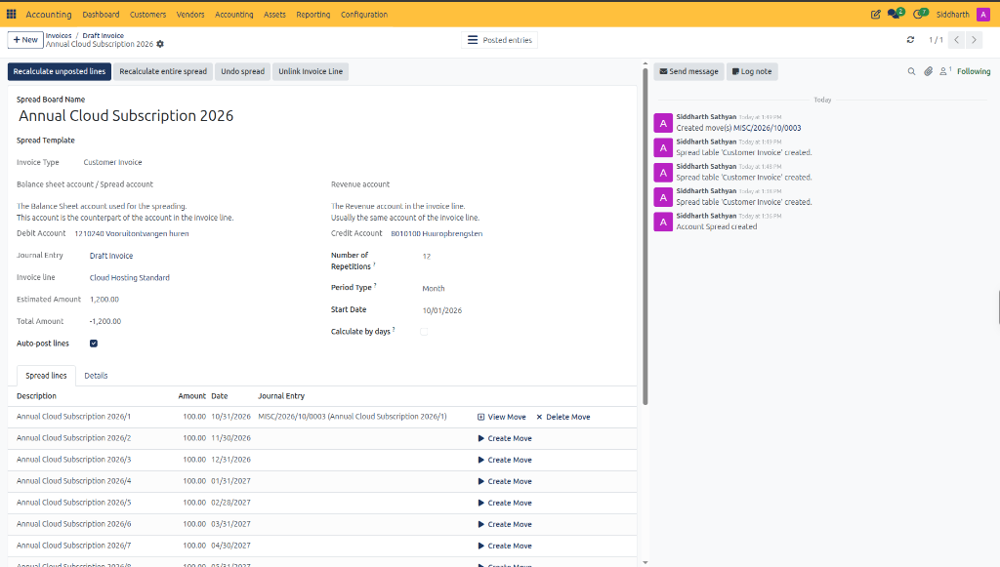

8. Observe the linked document properties:
   * **Journal Entry**: Automatically displays the source document *(e.g., `Draft Invoice`)*.
   * **Invoice Line**: Displays the specific product line item *(e.g., `Cloud Hosting Standard`)*.
   * **Unlink Invoice Line**: An action button appears in the header, allowing you to disconnect the schedule if an incorrect board was linked.
9. Return to the invoice and click **Confirm** in the header to validate and post the invoice to the sales ledger.

---

### 1.3 Spread Expenses from a Vendor Bill Line

Prepaid supplier expenses *(such as annual commercial insurance, upfront building rent, or software licenses)* are amortized using the identical mechanism on the purchase ledger:

1. Navigate to **Vendors > Bills** and click **+ New** (or open a draft vendor bill).
2. Enter the **Vendor**, **Bill Date**, and **Accounting Date**.
3. In the **Invoice Lines** tab, record the expense item *(e.g., Product: `Annual Commercial Property Insurance`, Amount: `€ 2,400.00`)*.
4. Click the circular **Spread Cost icon** on the bill line.
5. In the configuration modal, select **Create from Spread Template** and choose `Annual Prepaid Expense (12 Months)`.
6. Confirm that the **Balance Sheet Account** points to prepaid assets (`1301010 Vooruitbetaalde kosten`) and the target **Expense Account** points to operating insurance expenses (`4301010`).
7. Set the amortization **Start Date** and click **Confirm**.
8. Confirm and post the vendor bill:
   * The bill credits Accounts Payable (`1600000`) for `€ 2,400.00` and debits Prepaid Assets (`1301010`) for `€ 2,400.00`. No immediate expense hits the Profit and Loss statement upon billing.

---

### 1.4 Review and Manage the Spread Schedule

Once linked from an invoice or bill, the schedule can be reviewed under **Accounting > Spread Costs/Revenues**:

1. Open the generated spread table record.
2. Review the header configuration:
   * **Total Amount**: Gross amount to distribute *(e.g., `€ 1,200.00`)*.
   * **Auto-Post Lines**: When checked, CURQ automatically generates and confirms accounting entries as each recognition date arrives. When unchecked, entries remain in `Draft` status for manual accountant review.
3. Select the **Spread Lines** tab to inspect the installment breakdown:
   * Each row displays a scheduled installment:
     * **Recognition Date**: The monthly date on which the expense or revenue will be booked *(e.g., `10/31/2026`, `11/30/2026`, etc.)*.
     * **Amount**: The calculated portion for that period *(e.g., `€ 100.00` per month)*.
     * **Target Account**: The operating income or expense account receiving the debit or credit.
     * **Status**: Displays `Draft` (future unposted line) or `Posted` (committed general ledger voucher).
     * **Journal Entry**: Link to the generated accounting voucher once posted.

---

### 1.5 Post Periodic Accrual Journal Entries

To commit spread installments to the General Ledger:

#### 1.5.1 Option A: Manual Recognition Voucher Creation
1. Open the spread table and navigate to the **Spread Lines** tab.
2. Locate the line due for recognition *(e.g., installment 1 dated `10/31/2026`)*.
3. Click **▶ Create Move** on that specific line:

   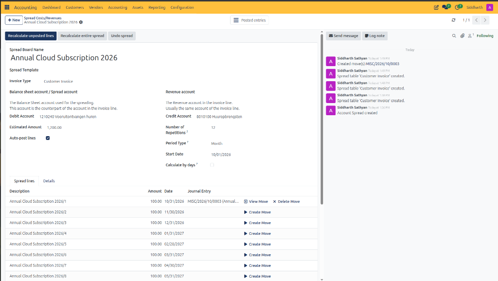

4. Observe the accounting updates:
   * CURQ generates and commits the recognition voucher to the general ledger *(e.g., `MISC/2026/10/0003`)*.
   * Debits Deferred Revenue (`1210240 Vooruitontvangen huren`) for `€ 100.00` and Credits Operating Revenue (`8010100 Huuropbrengsten`) for `€ 100.00`.
   * The **Journal Entry** column records the permanent voucher reference.
   * Line action buttons update to **View Move** *(to open the generated journal entry)* and **Delete Move** *(to cancel and unpost the entry if adjustments are required)*.
5. Click **View Move** on the posted installment row to inspect the accounting voucher:

   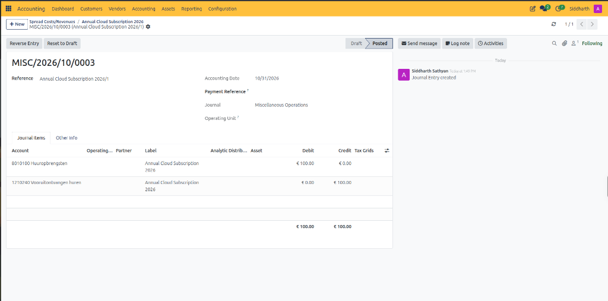

6. Confirm the voucher details:
   * **Status**: Reaches **Posted** status with **Reverse Entry** and **Reset to Draft** actions.
   * **Journal**: Automatically assigned to **Miscellaneous Operations**.
   * **Journal Items**: Perfectly balanced debit and credit entries totaling `€ 100.00`.

#### 1.5.2 Option B: Batch Generation
1. In the spread table header action bar, click **Create All Moves**.
2. CURQ processes all unposted spread lines across the entire schedule simultaneously.

#### 1.5.3 Option C: Automated System Accrual Run
1. If **Auto-Post Lines** is enabled on the spread table, CURQ executes an automated background cron job on the recognition date, creating and posting the installment entry automatically without manual intervention.

---

## 2. Adjusting, Recalculating, or Cancelling a Schedule

If commercial contract terms change or an invoice is amended mid-contract, CURQ provides dynamic recalculation tools:

* **Recalculate Unbooked Lines**: Updates amounts and remaining dates for future lines only, preserving all installments that have already been posted to the General Ledger. Use this when price adjustments or extensions apply only prospectively.
* **Recalculate Full Spread**: Completely rebuilds the entire schedule from the beginning date. Any existing unposted moves are purged and recalculated.
* **Undo Spread**: Clears all calculated spread lines and resets the spread table back to an empty draft state.
* **Unlink Invoice Line**: Detaches the spread table from the source customer invoice or vendor bill line if an incorrect schedule was assigned.

---

## Edge Cases & Troubleshooting

* **Invoice Already Validated**: Revenue or cost spreading can only be linked directly from an invoice line while the document is in **Draft** status. If an invoice or bill is already posted, you must either:
  1. Reset the document to draft (if period lock dates permit), add the spread, and re-post.
  2. Navigate directly to **Accounting > Spread Costs/Revenues**, click **+ New**, and create a standalone spread table manually linked to the relevant general ledger accounts.
* **Allowed Journals Restriction Error**: If clicking **Create Move** fails with `You cannot use this account in this journal, check the field 'Allowed Journals' on the related account`, the target revenue or expense account is restricted to sales or purchase journals only. To resolve this, open **Accounting > Configuration > Chart of Accounts**, select the account *(e.g., `8001010`)*, and add `Miscellaneous Operations` to the **Allowed Journals** field (or clear the field entirely so it can be used across all journals).
* **Impact of Lock Dates on Accruals**: If an installment recognition date falls on or before an active **Tax Return Lock Date** or **Global Lock Date** *(see [**Manage Lock Dates and Fiscal Year-End Closing**](./12-manage-lock-dates-and-fiscal-year-end-closing.md))*, CURQ blocks move creation with an error. The recognition date must be updated to an open period or the lock date must be temporarily adjusted by an authorized financial adviser.
* **Contract Cancellation / Early Termination**: If a customer terminates a subscription early, issue a credit note for the remaining unearned balance and click **Undo Spread** on the spread table to prevent future unearned revenue recognition entries from posting.

---

## Related Documentation

* [Create Manual Journal Entries](./05-create-manual-journal-entries.md)
* [Manage Lock Dates and Fiscal Year-End Closing](./12-manage-lock-dates-and-fiscal-year-end-closing.md)
* [Create and Validate Customer Invoices](./01-create-and-validate-customer-invoices.md)
* [Create and Process Vendor Bills](./02-create-and-process-vendor-bills.md)
* [Chart of Accounts and Taxes Field Definitions](../settings-and-fields/02-chart-of-accounts-and-taxes-field-definitions.md)
