# Manage Supplier Contracts and Recurring Purchase Invoicing

Recurring supplier contracts automate the receipt and booking of recurring vendor expenses, such as commercial leases, software subscriptions, maintenance service contracts, and periodic utility charges. In CURQ, the Supplier Contracts module links vendor agreements directly to automated accounting entries, issuing draft vendor bills on fixed recurring cycles without manual re-entry.

> **Prerequisites**
> * Ensure the vendor partner record is configured with designated payment terms, billing addresses, and supplier bank account details under **Accounting > Vendors > Vendors**.
> * If settling recurring vendor commitments electronically through SEPA credit transfers, verify that the vendor IBAN and BIC are validated.
> * Configure expense products or recurring service items under **Purchase > Products** (or **Sales > Products**) with the appropriate expense accounts and input VAT rates.
> * Verify user permissions in CURQ with Accountant or Financial Adviser access rights.

---

### Task 1: Create a Supplier Contract

A supplier contract establishes the legal, commercial, and operational framework for recurring vendor commitments.

1. Navigate to **Accounting > Vendors > Supplier Contracts**:

   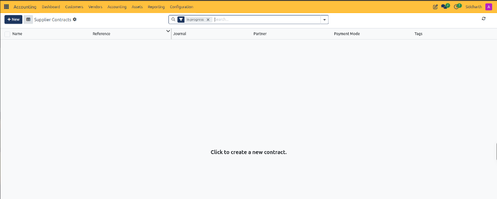

2. Click **+ New** in the top action bar to open the contract creation form:

   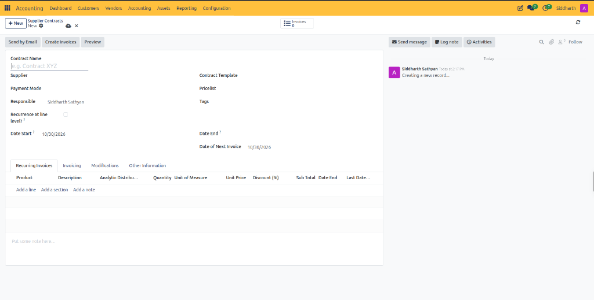

3. Complete the contract header details:
   * **Contract Name**: Enter a descriptive identification label *(e.g., `Datacenter Colocation Lease 2026`)*.
   * **Supplier**: Select the creditor vendor entity *(e.g., `Equinix Netherlands B.V.`)*.
   * **Payment Mode**: Choose the payment vehicle or settlement method *(e.g., `Manual bank transfer` or `SEPA Credit Transfer`)*.
   * **Responsible**: Select the internal manager or procurement officer overseeing the contract *(defaults to the current user)*.
   * **Recurrence at line level?**: Leave unchecked if all recurring contract items share the exact same billing cycle. Enable this checkbox if distinct line items require separate recurring intervals.
   * **Date Start**: Select the effective commencement date of the vendor contract *(defaults to the current date, e.g., `10/30/2026`)*.
   * **Contract Template**: *(Optional)* Select a predefined purchase contract template to pre-fill billing rules, line items, and accounts.
   * **Pricelist**: Select the commercial pricing catalog governing vendor rates *(defaults to company default, e.g., `Default (EUR)`)*.
   * **Tags**: Add optional classification tags for financial reporting and budget grouping.
   * **Date End**: Specify an optional contract expiration date. Leave blank for ongoing, evergreen agreements.
   * **Date of Next Invoice**: Set the calendar date on which the initial recurring vendor bill must be created *(defaults to `Date Start`, e.g., `10/30/2026`)*.
4. Click the save icon to store the draft contract.

---

### Task 2: Configure Recurring Expense Lines and Purchase Billing Schedule

Configure the recurring expense items, pricing, and recurrence timing that govern automated vendor bill generation.

1. Under the **Recurring Invoices** tab, click **Add a line** to specify the billed items:

   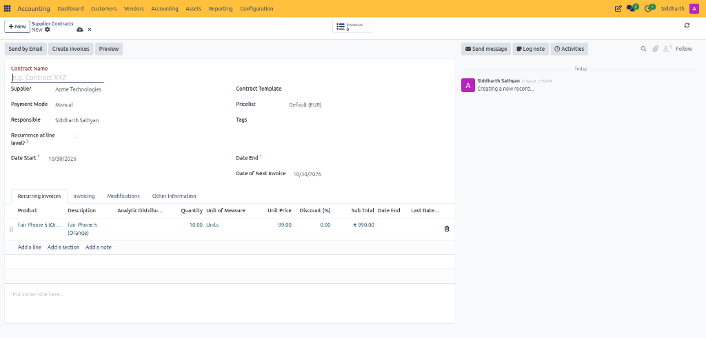

   * **Product**: Select the recurring expense item or service *(e.g., `Fair Phone 5 (Orange)`)*.
   * **Description**: Enter the bill line label. Dynamic date placeholders are supported:
     * `#START#`: Substituted with the service period opening date *(e.g., `01/01/2026`)*.
     * `#END#`: Substituted with the service period closing date *(e.g., `31/01/2026`)*.
     * `#INVOICEMONTHNAME#`: Substituted with the name of the billed month *(e.g., `January`)*.
     * *Example*: `Colocation Services (#START# - #END#)` generates on the bill as `Colocation Services (01/01/2026 - 31/01/2026)`.
   * **Analytic Distribution**: Assign analytic accounts or cost centers to attribute recurring expenses to specific projects, departments, or cost centers.
   * **Quantity**: Number of units, bandwidth tiers, or service seats billed per period.
   * **Unit Price**: Enter the agreed periodic fee per unit.
   * **Discount (%)**: Enter any contractual discount percentage granted by the supplier.
   * **Date End**: *(Optional)* Set an individual termination date for this specific line item if it terminates prior to the overall contract.
2. Structure complex contracts using **Add a section** to divide items into groups or **Add a note** to insert terms.
3. In the free-text area at the bottom *(labeled `Put some note here...`)*, add internal operational guidelines or supplier reference notes.
4. Navigate to the **Invoicing** tab to configure scheduling and accounting mechanics:

   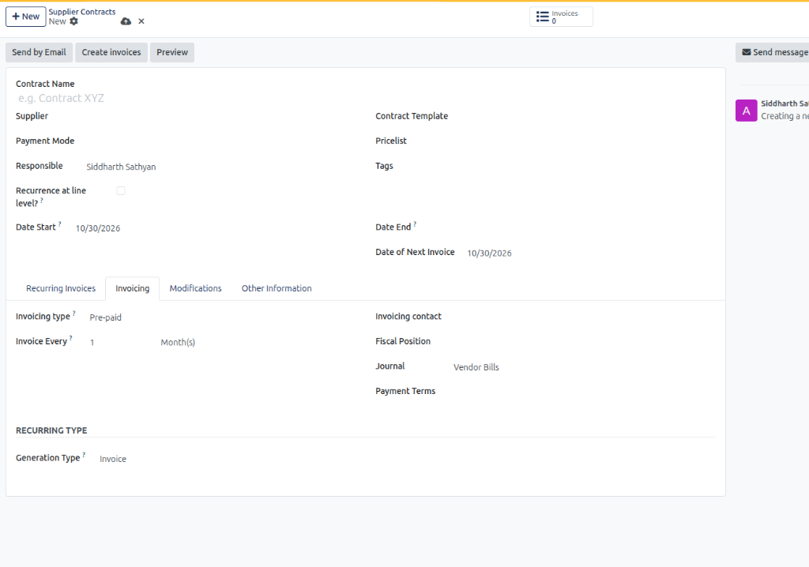

   * **Invoicing type**: Select `Pre-paid` *(bills generated at the start of the service period)* or `Post-paid` *(bills generated in arrears at the end of the service period)*.
   * **Invoice Every**: Enter the recurrence frequency *(e.g., `1`)* and interval unit *(e.g., `Month(s)`, `Day(s)`, `Week(s)`, `Last Day of Month`, or `Year(s)`)*.
   * **Invoicing contact**: Select the specific vendor contact or billing address receiving payment remittance advice.
   * **Fiscal Position**: Select tax mapping rules for international or EU suppliers *(e.g., `EU B2B Reverse Charge`)*.
   * **Journal**: Confirm the purchase sub-ledger where generated vendor bills post *(defaults to `Vendor Bills`)*.
   * **Payment Terms**: Select contractual vendor payment terms *(e.g., `30 Days`)*.
   * **Generation Type**: Confirm the output type is set to `Invoice` *(generates vendor bill accounting entries)*.
5. Under the **Other Information** tab, record administrative references:

   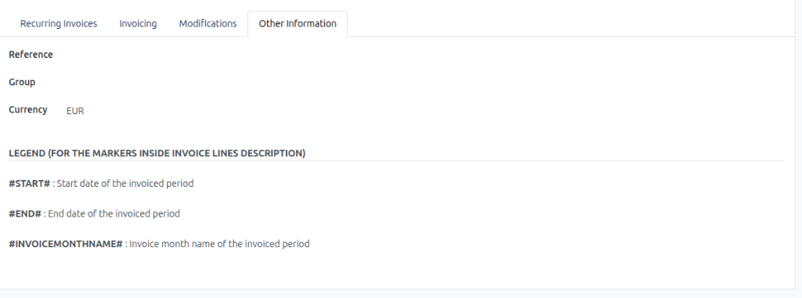

   * **Reference**: Enter the supplier's external master service agreement (MSA) number or quote reference.
   * **Group**: Assign an optional contract classification group for departmental reporting.
   * **Currency**: Confirm the transaction currency *(e.g., `EUR`)*.

---

### Task 3: Generate Recurring Vendor Bills

CURQ supports automated scheduled generation as well as on-demand batch or individual bill generation.

#### Method A: Automated Daily Generation via System Scheduler
CURQ runs an automated background scheduled action titled **Generate Recurring Invoices from Contracts**:
* The scheduler executes automatically once per day.
* The system evaluates all active supplier contracts where `Date of Next Invoice` is less than or equal to the current system date.
* Qualifying contracts automatically generate draft vendor bills matching the configured lines, assign the purchase journal, and advance `Date of Next Invoice` forward by one interval.

#### Method B: Immediate Generation via Create Invoices Button
When a new contract is agreed upon and the first vendor bill must be entered immediately:
1. Open the contract under **Accounting > Vendors > Supplier Contracts**.
2. Click **Create invoices** in the top action bar:
   * CURQ evaluates the contract lines, creates a new draft vendor bill for the current period, logs the creation in Chatter *(e.g., `Contract manually invoiced: Draft Bill`)*, and advances `Date of Next Invoice` forward to the subsequent billing cycle *(e.g., `11/30/2026`)*:

   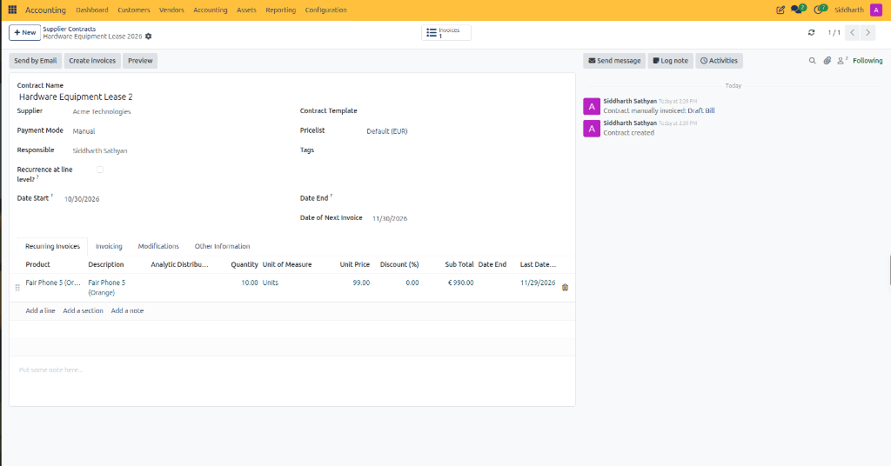

3. Notice the stat button in the top-right corner increments to **`Invoices 1`**.

#### Method C: Batch Generation via Manual Invoicing
To generate pending bills across multiple supplier contracts simultaneously:
1. Navigate to **Accounting > Vendors > Manually Invoice Purchase Contracts**:

   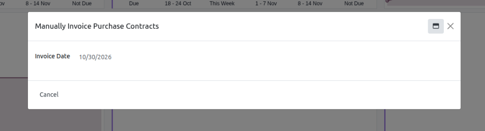

2. In the modal dialog, enter the target **Invoice Date** *(e.g., `10/30/2026`)*.
3. Confirm the batch creation:
   * CURQ evaluates all active supplier contracts across the company that are due for billing up to the selected date.
   * Draft vendor bills are created in bulk, ready for finance verification and invoice matching.

---

### Task 4: Validate, Match, and Settle Generated Vendor Bills

1. Open the supplier contract under **Accounting > Vendors > Supplier Contracts**.
2. Click the **Invoices** stat button *(e.g., `Invoices 1`)* in the top-right corner to open the filtered list of generated vendor bills:

   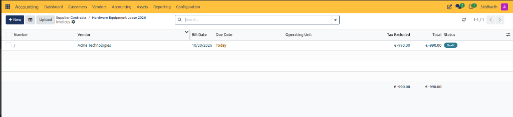

   * Review the generated draft bill record *(e.g., vendor `Acme Technologies`, status `Draft`, total `€ -990.00`)*.
3. Open the draft vendor bill to review allocations:

   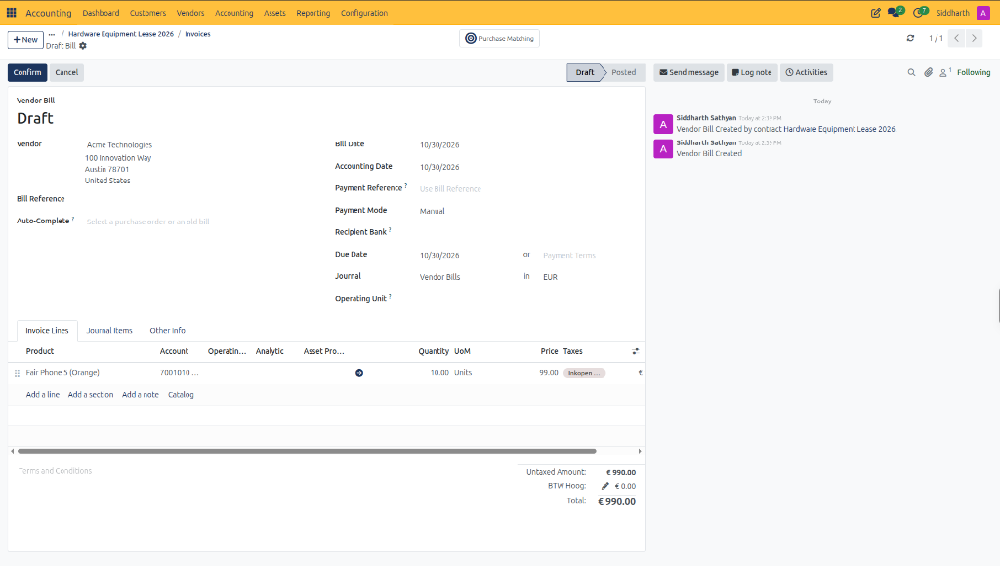

   * **Bill Reference**: When the physical or digital PDF invoice arrives from the vendor, enter their official invoice number in the **Bill Reference** field *(e.g., `INV-2026-9812`)*.
   * **Accounting Date & Bill Date**: Verify the bill date against the vendor document *(e.g., `10/30/2026`)*.
   * **Expense Allocations**: Verify that expense lines, general ledger accounts *(e.g., `7001010`)*, and VAT codes match the incoming document.
   * **Chatter Traceability**: Confirm the automated link logging the origin contract *(e.g., `Vendor Bill Created by contract Hardware Equipment Lease 2026.`)*.
4. Click **Confirm** in the top action bar to post the vendor bill to the General Ledger:
   * CURQ assigns a permanent legal bill number *(e.g., `BILL/2026/10/0004`)* and transitions the status to `Posted`.
5. Settle the bill according to your normal payment process:
   * Click **Register Payment** for direct bank settlement.
   * Or queue the bill into an electronic SEPA vendor payment batch under **Accounting > Vendors > Payments > SEPA Payment Orders**.

---

### Task 5: Log Contract Modifications and Terminate Lines

When subscription tiers change, supplier pricing updates, or contracts end:

#### Logging a Contract Modification
1. Navigate to the **Modifications** tab on the supplier contract:

   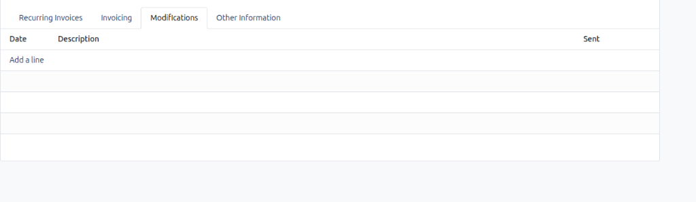

2. Click **Add a line**:
   * **Date**: Record the calendar date of the amendment.
   * **Description**: Enter details of the contractual change *(e.g., `Indexation adjustment: 3.5% annual rate increase`)*.
   * **Sent**: Audit checkbox recording whether the adjustment notice has been processed.

#### Terminating an Individual Line Item
1. Open the supplier contract and locate the target line under **Recurring Invoices**.
2. Set the **Date End** column on that specific line to the final effective service date.
3. CURQ excludes that line from future billing runs while continuing to generate recurring bills for remaining active lines.

#### Ending or Cancelling the Contract
1. In the contract header, enter the final termination date in **Date End**.
2. Once `Date of Next Invoice` surpasses `Date End`, automated recurring bill generation permanently ceases.
3. To stop billing immediately, advance `Date End` to today or set the contract status to closed.

---

### Task 6: Audit Supplier Contract Lines Across Contracts (Reporting)

To monitor recurring vendor subscription expenses, equipment leases, and scheduled next billing dates across all supplier contracts:

1. Navigate to **Accounting > Reporting > Contracts > Supplier Contract lines**.
2. Review the cross-contract overview grouped by parent supplier contract:

   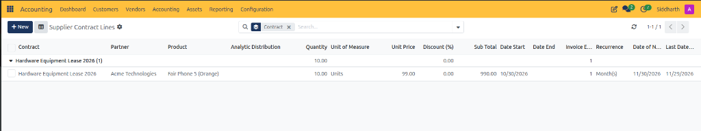

   * **Contract Grouping**: Groups recurring procurement commitments by parent agreement *(e.g., `Hardware Equipment Lease 2026 (1)`)*.
   * **Contract**: Direct link to the parent supplier agreement.
   * **Partner**: The vendor supplier *(e.g., `Acme Technologies`)*.
   * **Product**: The leased asset, recurring maintenance, or service product *(e.g., `Fair Phone 5 (Orange)`)*.
   * **Analytic Distribution**: Cost center and operational department allocation.
   * **Quantity & UoM**: Invoiced volume per recurrence cycle *(e.g., `10.00 Units`)*.
   * **Unit Price & Discount**: Contracted unit procurement cost *(e.g., `€ 99.00`)* and discount *(e.g., `0.00%`)*.
   * **Sub Total**: Periodic net payable expense commitment *(e.g., `€ 990.00`)*.
   * **Date Start & Date End**: Effective contract line duration *(e.g., `10/30/2026`)*.
   * **Recurrence & Interval**: Frequency cadence *(e.g., `1 Month(s)`)*.
   * **Date of Next Invoice**: Next projected vendor bill generation run *(e.g., `11/30/2026`)*.
   * **Last Date Invoiced**: Cutoff date of the most recently processed billing period *(e.g., `11/29/2026`)*.

3. Click on any line to open the detailed line configuration form:

   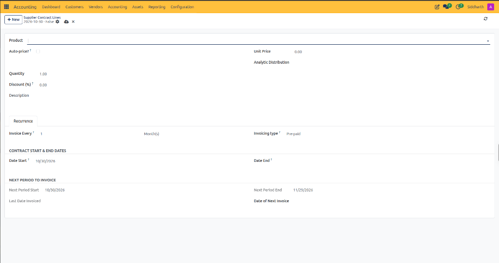

   * **Auto-price?**: When enabled, dynamically pulls purchase catalog pricing on generation runs.
   * **Recurrence Tab**:
     * **Invoice Every**: Billing cycle length *(e.g., `1 Month(s)`)*.
     * **Invoicing type**: Billing timing, set to `Pre-paid` or `Post-paid`.
     * **Contract Start & End Dates**: Active validity boundaries.
     * **Next Period to Invoice**: Exact calendar span covered by the next incoming bill run *(e.g., `10/30/2026` to `11/29/2026`)*.

---

### Edge Cases and Recovery Steps

* **Vendor Invoice Amount Differs from Contract Rate**: If a supplier sends a bill with variable charges *(such as electricity overage or additional bandwidth)*, open the generated draft bill and adjust the line quantity or unit price to match the physical invoice before clicking **Confirm**.
* **Duplicate Bill Generated**: If a vendor bill was already created manually before the recurring contract generated its draft, delete or cancel the surplus draft bill. Do not confirm both. If the recurring contract date was already advanced, manually adjust `Date of Next Invoice` on the contract back to the correct billing cycle.
* **Supplier Indexation or Price Increase**: When a supplier exercises an annual price increase clause, update the **Unit Price** on the contract line under **Recurring Invoices** and log the justification in the **Modifications** tab. All subsequent bills will generate at the new rate.
* **Contract Paid in Full Upfront**: If an annual contract was invoiced and paid as a single lump sum, do not use recurring monthly supplier contracts. Instead, book the single vendor bill and use **Accounting > Spread Costs/Revenues** to amortize the prepaid expense monthly across the fiscal year.

---

### Related Documentation

* [Contract and Recurring Invoicing Field Definitions (Customer and Supplier)](../settings-and-fields/06-customer-contract-and-recurring-invoicing-field-definitions.md)
* [Create and Process Vendor Bills](./02-create-and-process-vendor-bills.md)
* [Manage SEPA Vendor Payment Orders](./13-manage-sepa-vendor-payment-orders.md)
* [Manage Customer Contracts and Recurring Invoicing](./11-manage-customer-contracts-and-recurring-invoicing.md)
