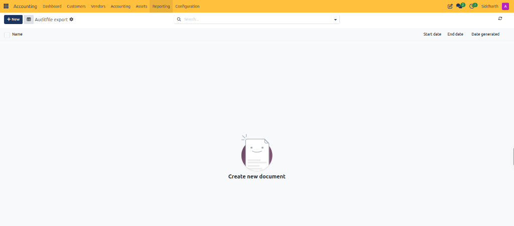
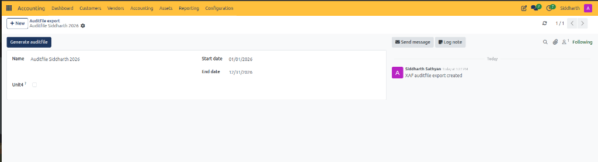

# Export Statutory Tax Auditfiles (XAF 3.2)

In the Netherlands, statutory financial audits require companies to export general ledger and journal transaction data in the standardized Auditfile Financieel format (XAF 3.2). This XML data interchange standard is mandated by the Dutch Tax and Customs Administration (*Belastingdienst*) and accepted by certified auditing firms to verify bookkeeping integrity, VAT returns, and statutory annual accounts.

In CURQ, the Auditfile export tool aggregates all posted journal entries, opening balances, chart of accounts hierarchies, tax codes, and partner master data across a specified fiscal period into a compliant XAF 3.2 XML file for official submission.

---

### Prerequisites

* Ensure that all bank statements, customer invoices, and vendor bills for the reporting period are fully posted and reconciled.
* Complete period-end accruals, depreciation entries, and VAT returns prior to compiling the final statutory auditfile.
* Verify that company statutory identification details (including Dutch Chamber of Commerce / KvK number, VAT number, and fiscal company name) are configured accurately under **Settings > Companies**.
* Verify that user permissions grant Financial Adviser or Chief Accountant administrative access.

---

### Task 1: Access the Auditfile Export Registry

1. In the top navigation bar, select **Accounting > Reporting > OCA accounting reports > Auditfile export**.
2. Review the registry of previously compiled statutory audit files:

   

3. Examine the auditfile registry columns:
   * **Name**: Descriptive reference identifying the fiscal year or audit period *(e.g., `Statutory Auditfile FY2025`)*.
   * **Start date**: Beginning calendar date of the audited transaction window *(e.g., `01/01/2025`)*.
   * **End date**: Final calendar date of the audited transaction window *(e.g., `12/31/2025`)*.
   * **Date generated**: System timestamp recording when the XML file was compiled and locked.

---

### Task 2: Create and Configure a New Auditfile Export

1. In the top action bar of the Auditfile export registry, click **+ New**.
2. Complete the configuration parameters on the export form:

   

   * **Name**: Enter an official auditfile reference *(e.g., `Auditfile FY2026`)*.
   * **Start date**: Beginning calendar date of the audited transaction window *(defaults to start of the calendar year, e.g., `01/01/2026`)*.
   * **End date**: Final calendar date of the audited transaction window *(defaults to end of the calendar year, e.g., `12/31/2026`)*.
   * **Unit4 ?**: Enable this checkbox if the exported XML must adhere to Unit4 Multivers formatting specifications.
3. Click the save icon to store the auditfile export record.

---

### Task 3: Generate and Download the XML Auditfile

1. On the configured auditfile form, click the **Generate auditfile** button in the upper header action bar.
2. CURQ initiates the background compilation process:
   * Validates general ledger balances across the selected date range.
   * Compiles chart of accounts, tax structures, customers, vendors, and journal entry lines into the official XAF 3.2 schema.
   * Attaches the compiled `.xml` data document directly to the record for local download.
   * Updates the **Date generated** timestamp in the registry.
3. In the attachment section or download widget, click the generated file link *(e.g., `auditfile_2026.xml`)* to download the file locally.
4. Verify the XML file using standard Belastingdienst validation tools before submitting to statutory tax auditors.

---

### Edge Cases and Recovery Steps

* **AttributeError on Reconciled Transactions**: If clicking **Generate auditfile** encounters a server error regarding `account.full.reconcile`, contact your system administrator to ensure the latest Dutch localization patch (`l10n_nl_xaf_auditfile_export`) is deployed. As a temporary test or workaround, verify date ranges or isolate journals prior to running the export.
* **Unbalanced Trial Balance Warning**: If CURQ detects an unposted or asymmetrical journal entry within the date range, the auditfile compilation may fail validation. Verify that all journal entries for the period are balanced and posted before re-running the export.
* **Missing Company Tax Identifier**: If the generated XML fails Belastingdienst schema validation, check that your company record has a valid Dutch VAT number (`BTW-nummer`) and KvK number configured under **Settings > Companies**.
* **Audit Request Covering Multiple Years**: The XAF 3.2 standard requires separate files for each individual fiscal year. If tax authorities request data for a multi-year inspection window, generate individual auditfiles for each consecutive calendar year.

---

### Related Documentation

* [File Statutory VAT Returns and ICP Declaration](./08-file-statutory-vat-returns-and-icp-declaration.md)
* [Generate Financial Reports and Trial Balance](./07-generate-financial-reports-and-trial-balance.md)
* [Manage Lock Dates and Fiscal Year-End Closing](./12-manage-lock-dates-and-fiscal-year-end-closing.md)
* [Statutory Tax Statement and ICP Field Definitions](../settings-and-fields/03-statutory-tax-statement-and-icp-field-definitions.md)
* [Understanding Double-Entry Bookkeeping and Journals](../core-concepts/01-understanding-double-entry-bookkeeping-and-journals.md)
