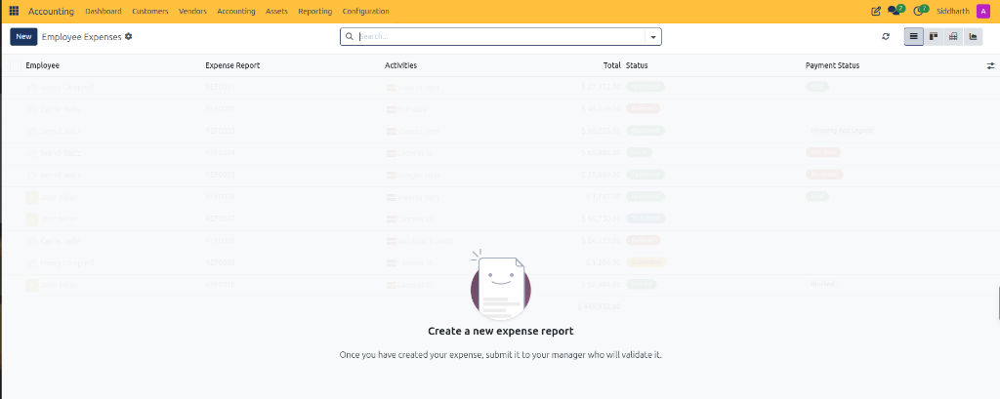
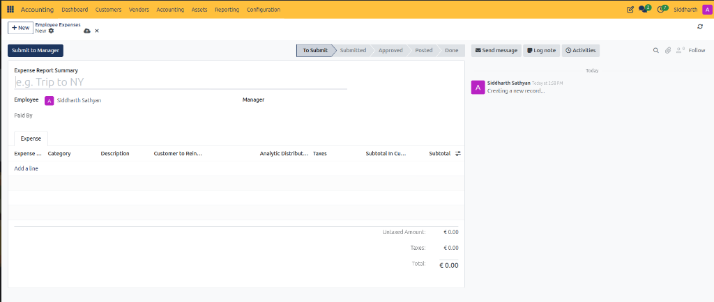
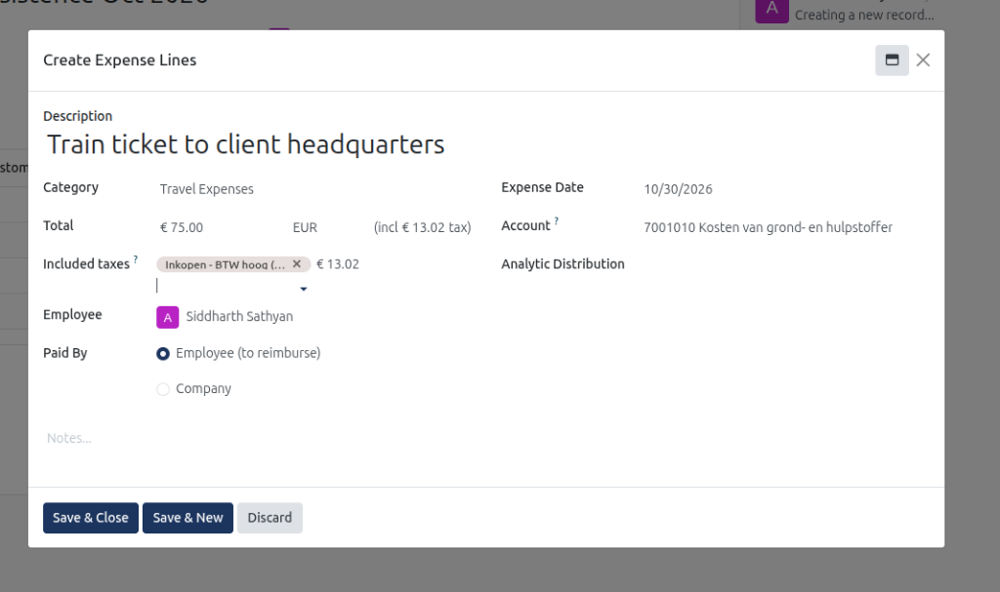
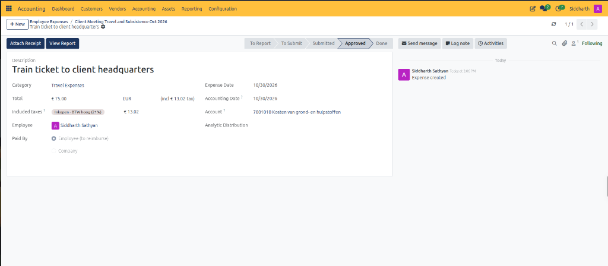
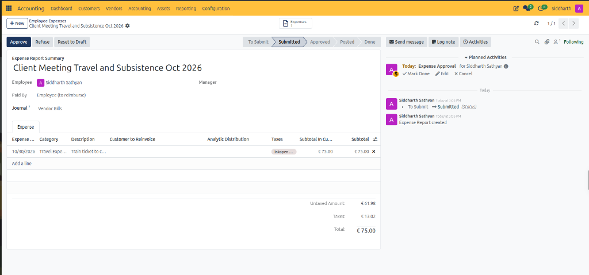
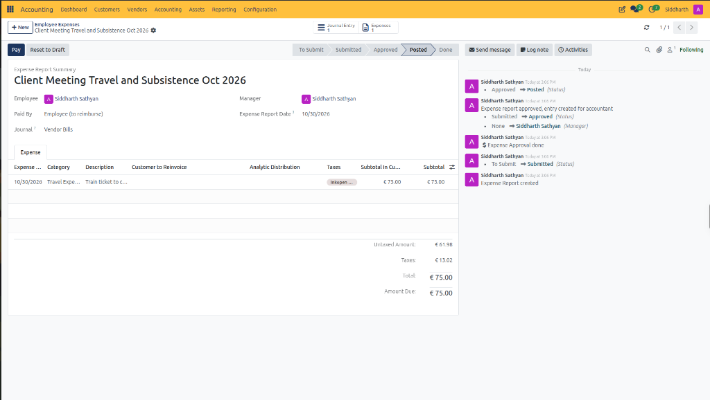
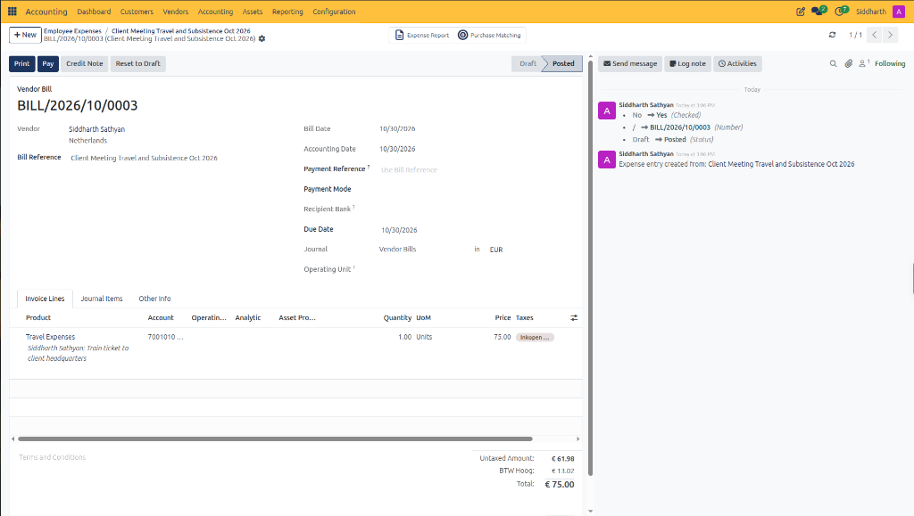
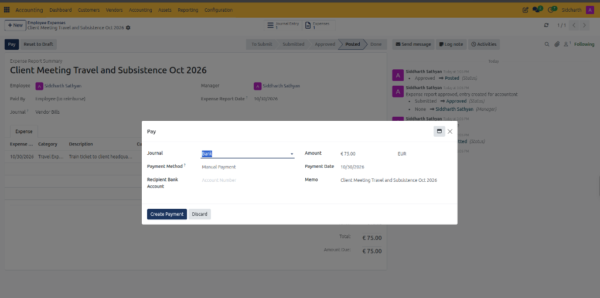
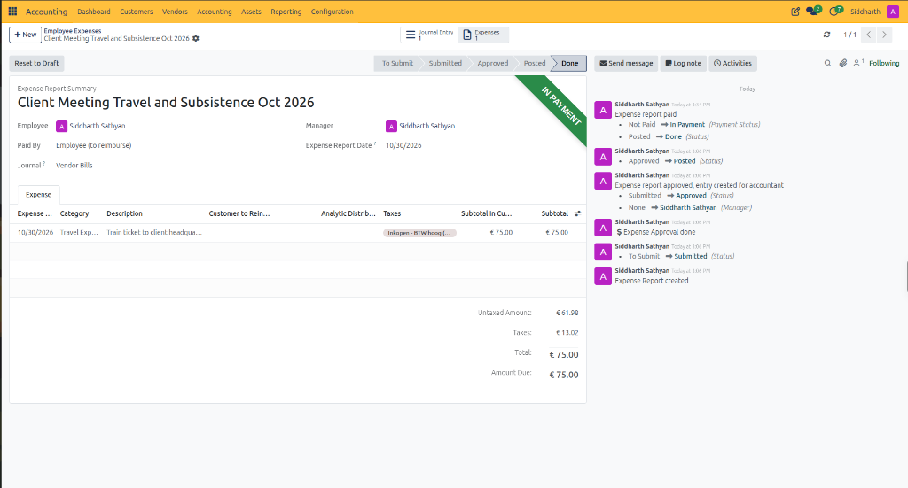

# Process and Reimburse Employee Expenses

Employee expense management in CURQ integrates employee out-of-pocket spending, travel claims, and corporate card transactions directly into the accounting system. When employees incur business expenses on behalf of the company, expense reports group individual receipts into formal reimbursement vouchers that route through manager approval, post to general ledger expense accounts, and generate accounts payable obligations to reimburse staff.

---

### Prerequisites

* Ensure that employee profiles exist with designated private addresses, linked user accounts, and home bank accounts (IBAN) for reimbursement under **Employees** (or **Contacts**).
* Configure expense categories and products under **Expenses > Configuration > Expense Categories** (or **Accounting > Configuration > Products**) with appropriate general ledger expense accounts and deductible input VAT rates.
* Set up an internal expense journal *(typically `Miscellaneous Operations` or a dedicated `Expenses` purchase journal)*.
* Verify user permissions granting Employee Expense Officer, Accountant, or Financial Adviser rights.

---

### Task 1: Access the Employee Expenses Registry

1. In the top navigation bar, select **Accounting > Vendors > Employee Expenses**.
2. Review the central expense report registry:

   

3. Understand the expense registry columns:
   * **Employee**: Staff member who incurred the expenditure and is owed reimbursement.
   * **Expense Report**: Unique report code or summary title *(e.g., `Trip to NY`)*.
   * **Activities**: Scheduled follow-up tasks, approvals, or review reminders.
   * **Total**: Gross monetary amount claimed across all attached receipts.
   * **Status**: Operational approval state (`To Submit`, `Submitted`, `Approved`, `Posted`, `Done`, or `Refused`).
   * **Payment Status**: Settlement state (`Not Paid`, `In Payment`, `Paid`, or `Reversed`).

---

### Task 2: Create a New Expense Report

1. In the top-left action bar of the Employee Expenses registry, click **+ New**:

   

2. Complete the report header details:
   * **Expense Report Summary**: Enter a concise business purpose for the claim *(e.g., `Client Workshop Travel and Lodging Oct 2026`)*.
   * **Employee**: Select the employee submitting the claim *(defaults to the current user)*.
   * **Manager**: Select the designated supervisor responsible for initial commercial approval.
   * **Paid By**: Select the funding source:
     * `Employee (to reimburse)`: Used when the employee paid out-of-pocket and the company must disburse payment to their personal bank account.
     * `Company`: Used when the transaction was charged directly to a corporate debit or credit card, requiring an offset against company liquidity accounts rather than an employee payable.

---

### Task 3: Add Individual Expense Lines and Receipts

1. Under the **Expense** tab, click **Add a line** to open the **Create Expense Lines** dialog:

   

   * **Description**: Enter the specific commercial item or service *(e.g., `Train ticket to client headquarters`)*.
   * **Category**: Select the expense classification product *(e.g., `Travel Expenses`)*. CURQ automatically populates the assigned general ledger expense account.
   * **Total**: Enter the gross expenditure amount *(e.g., `€ 75.00`)*. CURQ displays the calculated tax amount inline *(e.g., `incl € 13.02 tax`)*.
   * **Expense Date**: Date printed on the merchant receipt *(defaults to current date, e.g., `10/30/2026`)*.
   * **Account**: Verify the expense general ledger account populated automatically from the category *(e.g., `7001010 Kosten van grond- en hulpstoffen`)*.
   * **Included taxes**: Select or verify the input VAT rate applied to the expenditure *(e.g., `Inkopen - BTW hoog`)*.
   * **Analytic Distribution**: Assign project codes, cost centers, or departmental units to track internal project costs.
   * **Employee**: Confirm the employee who incurred the expenditure.
   * **Paid By**: Choose `Employee (to reimburse)` or `Company`.
   * **Notes**: Optional internal notes or remarks regarding the claim.
2. Click **Save & Close** (or **Save & New** to immediately record another receipt).
3. Reviewing an individual expense line:
   * Clicking on a recorded expense line opens its full individual detail record:

   

   * **Attach Receipt**: Action button to directly upload merchant receipts or invoice PDFs to this specific expenditure.
   * **View Report**: Action button navigating directly back to the parent Expense Report voucher.
   * **Accounting Date**: Confirms the posting date assigned to the general ledger voucher *(e.g., `10/30/2026`)*.
4. Attach supporting documents:
   * Click the paperclip icon in the chatter panel to upload scans, PDF invoices, or photo receipts of physical vouchers for audit compliance.
5. Click the save icon to store the expense report draft.

---

### Task 4: Submit, Approve, and Post Expense Reports

The expense report workflow advances through a sequential four-stage verification cycle:

#### Stage 1: Submission
1. Review all lines, attached receipts, and computed tax totals.
2. Click **Submit to Manager** in the top action bar:
   * The status pipeline advances from `To Submit` to `Submitted`.
   * A financial **Journal** field appears on the header *(defaults to `Vendor Bills`)*.
   * An automated planned activity schedules for managerial review *(e.g., `Today: Expense Approval` in Chatter)*:

   

#### Stage 2: Managerial Approval
1. The approving manager opens the submitted report.
2. Verify business justification, receipt attachments, and line items.
3. Click **Approve**:
   * The status pipeline advances to `Approved`.
   * If rejected, the manager clicks **Refuse**, entering an explanation reason in the dialog. The report returns to draft status for employee revision.

#### Stage 3: Accounting Posting
1. Once approved, an accountant reviews tax codes and general ledger distributions.
2. Click **Post Journal Entries**:
   * CURQ generates a balanced journal voucher in the general ledger:
     * **Debit**: Expense accounts assigned to categories *(e.g., `7001010` for `€ 61.98`)* and input tax accounts *(e.g., `€ 13.02`)*.
     * **Credit**: Employee payable clearing account *(e.g., `1203010 Crediteuren` or `2101010 Schulden aan personeel`)*.
   * The status pipeline transitions to **`Posted`**.
   * The **`Journal Entry 1`** stat button appears in the top header.
   * The primary header action button updates to **`Pay`**:

   

3. Click the **Journal Entry** stat button *(e.g., `Journal Entry 1`)* in the top header:
   * CURQ displays the generated posted vendor bill *(e.g., `BILL/2026/10/0003`)*:

   

   * **Vendor**: Automatically assigned to the employee partner record.
   * **Bill Reference**: Populated with the expense report summary *(e.g., `Client Meeting Travel and Subsistence Oct 2026`)*.
   * **Journal**: Posted directly to the `Vendor Bills` purchase sub-ledger.
   * **Chatter Traceability**: Confirms the origin link *(e.g., `Expense entry created from: Client Meeting Travel and Subsistence Oct 2026`)*.

---

### Task 5: Settle Employee Reimbursement

1. Open the posted expense report under **Accounting > Vendors > Employee Expenses**.
2. Click **Pay** in the upper-left action bar to open the payment settlement dialog:

   

   * **Journal**: Select the company liquidity journal from which reimbursement funds are disbursed *(e.g., `Bank`)*.
   * **Payment Method**: Select the disbursement channel *(defaults to `Manual Payment`)*.
   * **Recipient Bank Account**: Verified bank account / IBAN of the employee.
   * **Amount**: Reimbursable balance *(e.g., `€ 75.00 EUR`)*.
   * **Payment Date**: Calendar date of the disbursement transaction *(defaults to current date, e.g., `10/30/2026`)*.
   * **Memo**: Payment description passed to the bank sub-ledger *(defaults to the Expense Report Summary)*.
3. Click **Create Payment**:
   * CURQ posts the reimbursement payment move, clearing the employee payable balance against the bank clearing account.
   * The status pipeline advances from `Posted` to **`Done`**.
   * A green **`IN PAYMENT`** banner appears across the upper-right corner of the voucher:

   

   * The chatter logs the lifecycle progression:
     * `Expense report paid`
     * `Not Paid -> In Payment (Payment Status)`
     * `Posted -> Done (Status)`
4. When the matching bank statement line is imported and reconciled in **Accounting > Bank Statements**, the payment moves from `In Payment` to fully reconciled `Paid`.

---

### Edge Cases and Recovery Steps

* **Personal Purchase Mixed with Business Expense**: If an employee receipt contains both business and personal items, edit the **Subtotal** on the expense line to reflect only the deductible business portion. Do not claim the personal fraction.
* **Refused Expense Resubmission**: When an expense is refused due to missing documentation, open the report, upload the requested receipt in Chatter, adjust line amounts if required, and click **Reset to Draft** followed by **Submit to Manager**.
* **Corporate Credit Card Expenses**: For lines marked **Paid By: Company**, do not click **Register Payment** to reimburse the employee. Instead, reconcile the posted expense move against the corresponding corporate credit card statement line in **Accounting > Accounting > Bank Statements**.
* **Reinvoicing Expenses to Clients**: When **Customer to Reinvoice** is selected, open the linked sales order or navigate to **Sales > To Invoice > Orders to Invoice**. The approved expense automatically appears as an invoiceable line item ready to bill the client.

---

### Related Documentation

* [Create and Process Vendor Bills](./02-create-and-process-vendor-bills.md)
* [Register and Reconcile Payments](./03-register-and-reconcile-payments.md)
* [Manage SEPA Vendor Payment Orders](./13-manage-sepa-vendor-payment-orders.md)
* [Customer Invoice and Vendor Bill Field Definitions](../settings-and-fields/01-customer-invoice-and-vendor-bill-field-definitions.md)
* [Understanding Double-Entry Bookkeeping and Journals](../core-concepts/01-understanding-double-entry-bookkeeping-and-journals.md)
