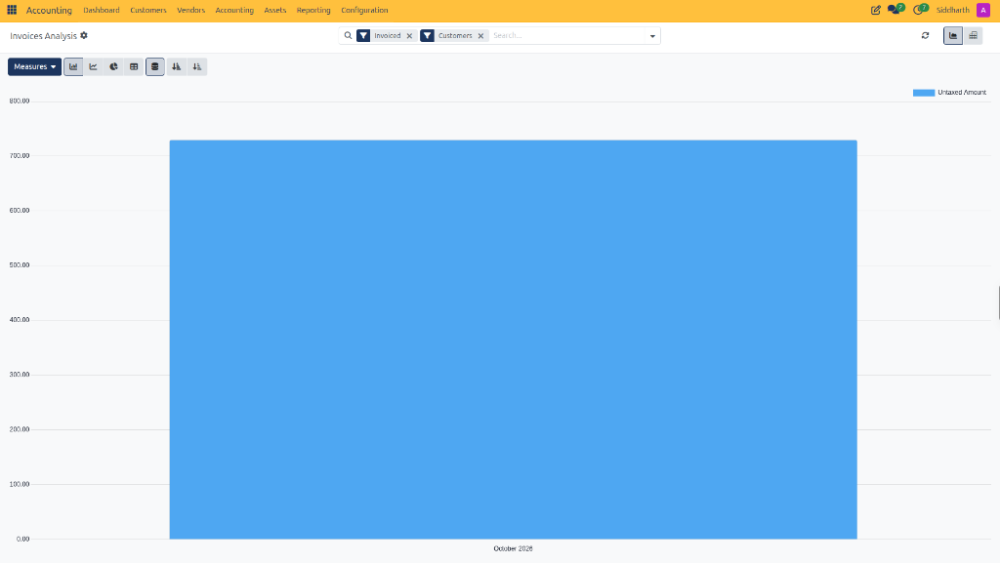
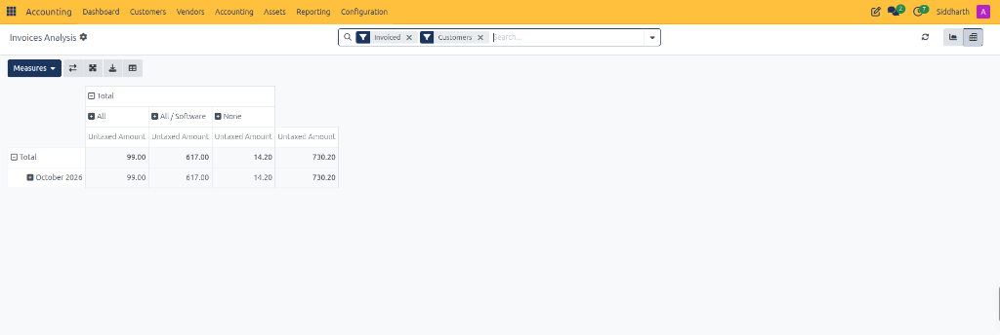
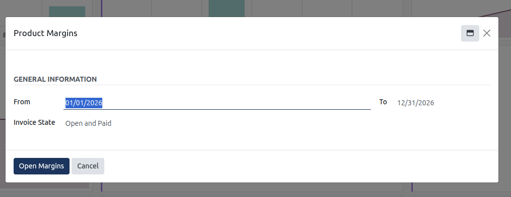
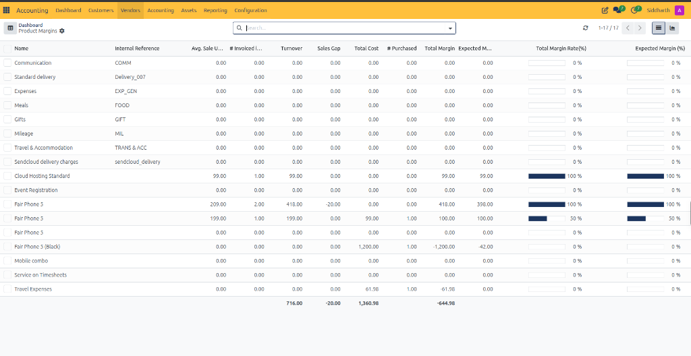
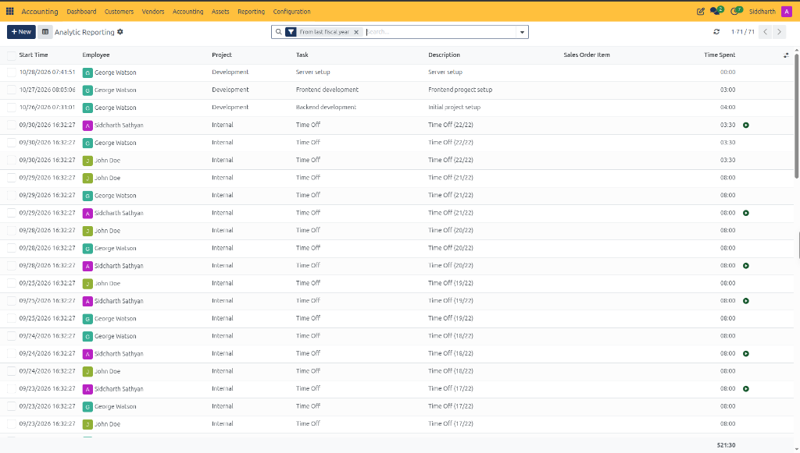

# Analyze Invoicing Trends and Product Margins

Management reporting in CURQ provides financial directors, commercial controllers, and business owners with analytical insight into sales revenue, procurement volume, and gross profit margins. Unlike statutory reports that focus strictly on compliance and balance sheet accuracy, management reports evaluate operational performance across products, commercial categories, partner accounts, and temporal dimensions.

CURQ delivers three complementary managerial accounting tools under **Reporting > Management**:
1. **Invoices Analysis**: A dynamic graphical and multidimensional OLAP cube that evaluates customer invoicing and vendor billing volume across custom metrics *(e.g., untaxed revenue, total billing, margin, and product quantities)*.
2. **Product Margins**: A specialized analytical engine calculating turnover, cost of goods sold, and gross margin percentages per product over specified accounting periods.
3. **Analytic Report**: An operational cost ledger tracking project timesheets, labor duration, billable task allocations, and sales order links across personnel.

> **Prerequisites**
> * Ensure customer invoices and vendor bills are validated and posted so their financial figures populate analytical cubes.
> * Verify that sales products have accurate cost prices (*Cost*) configured under **Products** to ensure gross margin calculations reflect actual procurement costs.
> * Verify that user permissions grant Financial Adviser, Billing Manager, or Chief Accountant administrative access.

---

## 1. Invoicing Trends and Visual Analysis

### 1.1 Access the Invoices Analysis Dashboard

1. In the top navigation bar, select **Accounting > Reporting > Management > Invoice Analysis**.
2. By default, CURQ opens the analytical dashboard with standard pre-configured filters:
   * **Invoiced**: Restricts calculations to validated and posted invoices, excluding draft entries.
   * **Customers**: Filters transactions to customer sales invoices, isolating revenue from supplier bills.

---

### 1.2 Configure Chart Types and Graphical Dimensions

The graphical view visualizes sales revenue trajectories and dimensional distributions over time:

1. Select your evaluation metric using the **Measures** dropdown:
   * **Untaxed Amount**: Evaluates net commercial turnover before value-added tax *(default metric, e.g., `€ 725.00` in October 2026)*.
   * **Total**: Gross invoice amount including statutory VAT.
   * **Margin**: Net profit contribution calculated as `Untaxed Amount - Cost of Goods Sold`.
   * **Quantity**: Total physical or service units invoiced.
   * **Average Price**: Computed mean selling price per product unit.
   * **Count**: Total volume of invoice records processed.
2. Toggle the presentation format using the chart buttons:
   * **Bar Chart** *(first icon)*: Displays discrete rectangular columns grouped by period *(e.g., monthly columns)*.
   * **Line Chart** *(second icon)*: Renders continuous line plots to identify seasonal growth trajectories or cyclical patterns.
   * **Pie Chart** *(third icon)*: Illustrates proportional revenue distribution across categories or partners.
3. Apply advanced visual toggles:
   * **Stacked**: Stacks multi-category values inside a single bar to compare dimensional composition.
   * **Cumulative**: Accumulates periodic values continuously to track year-to-date trajectory against budgetary targets.
   * **Ascending / Descending Sort**: Reorders columns from highest to lowest revenue contributors.

---

### 1.3 Cross-Tabulate Data with Multidimensional Pivot Cubes

While charts highlight visual trends, the **Pivot View** enables cross-tabulation across multiple business dimensions:

1. In the upper-right view switcher, click the **Pivot** icon *(grid symbol)* next to the graph icon:

   

2. Utilize matrix navigation controls:
   * **Flip Axis** *(two opposing arrows)*: Swaps horizontal columns with vertical rows to invert perspective.
   * **Expand All** *(four outward arrows)*: Expands all dimensional sub-levels simultaneously.
   * **Download XLSX** *(download icon)*: Exports the current pivot layout into an Excel spreadsheet.
   * **Insert in Spreadsheet** *(table icon with plus)*: Saves the dynamic matrix into CURQ Documents spreadsheet.
3. Segment and drill down:
   * Click the **+** icon on row headers to segment data by **Customer**, **Product Category**, **Salesperson**, or **Invoice Date**.
   * Click the **+** icon on column headers to cross-reference dimensions *(e.g., categories `Software` and `All` versus `October 2026`)*.

---

### 1.4 Evaluate Product Margins and Profitability

To analyze commercial product margins across inventory turnover:

1. In the top navigation bar, select **Accounting > Reporting > Management > Product Margins**.
2. Configure the evaluation criteria in the selection dialog:

   

   * **From**: Earliest customer invoice date included in the margin analysis *(e.g., `01/01/2026`)*.
   * **To**: Closing calendar date of the analytical period *(e.g., `12/31/2026`)*.
   * **Invoice State**: Transaction status criteria evaluated:
     * `Open and Paid`: Includes both posted outstanding invoices and settled invoices *(recommended standard)*.
     * `Paid`: Restricts margin analysis strictly to settled receipts.
     * `Draft, Open and Paid`: Includes provisional unposted draft documents for forward margin forecasting.
3. Click the **Open Margins** button in the lower action bar:
   * CURQ computes commercial profitability metrics across all products:

   

4. Review the analytical margin columns:
   * **Name**: Commercial product title *(e.g., `Cloud Hosting Standard`, `Fair Phone 5`)*.
   * **Internal Reference**: Product SKU code *(e.g., `COMM`, `EXP_GEN`)*.
   * **Avg. Sale Unit Price**: Computed arithmetic mean selling price per unit *(e.g., `€ 99.00`, `€ 209.00`)*.
   * **# Invoiced in Sale**: Total units billed to customers within the evaluation window *(e.g., `1.00`, `2.00`)*.
   * **Turnover**: Cumulative net sales invoice turnover generated *(e.g., `€ 418.00`, `€ 716.00 total`)*.
   * **Sales Gap**: Pricing variance between standard catalog price and negotiated invoice price *(e.g., `-€ 20.00`)*.
   * **Total Cost**: Total purchase or manufacturing procurement costs attributed to goods sold *(e.g., `€ 99.00`, `€ 1,360.98 total`)*.
   * **# Purchased**: Total supplier units acquired.
   * **Total Margin**: Absolute monetary margin contribution (`Turnover - Total Cost`, e.g., `€ 99.00`, `€ 418.00`).
   * **Expected Margin**: Standard projected profit margin calculated from base catalog pricing *(e.g., `€ 398.00`)*.
   * **Total Margin Rate(%)**: Visual progress bar and percentage of net margin realized *(e.g., `100%`, `50%`)*.
   * **Expected Margin (%)**: Target list-price profit margin percentage.
5. Sort product rows by **Total Margin** or **Total Margin Rate(%)** descending to identify your most profitable offerings.

> **Tip:** For granular parameter descriptions and data dictionary field specifications, refer to [Contract and Recurring Invoicing Field Definitions (Customer and Supplier)](../settings-and-fields/06-customer-contract-and-recurring-invoicing-field-definitions.md).

---

## 2. Audit Operational Time and Project Costs via Analytic Reporting

Beyond commercial invoices and product margins, financial controllers must audit internal operational labor, billable service hours, and project cost allocations before issuing customer invoices:

1. In the top navigation bar, select **Accounting > Reporting > Management > Analytic Report**.
2. CURQ opens the **Analytic Reporting** operational ledger:

   

3. Review the active search bar filters and controls:
   * **Filter Tag (`From last fiscal year`)**: Defaults to current and preceding fiscal periods, capturing ongoing project hours.
   * **Search Bar**: Allows instant filtering by project name *(e.g., `Development`, `Internal`)*, task title, or employee name.
   * **Navigation and Volume Pager**: Shows record position *(e.g., `1-71/71`)* with immediate pagination and refresh controls.
   * **View Switchers**: Toggle between List view *(table of individual timesheets)*, Pivot view *(cross-tabulating project hours by month)*, Graph view *(bar and line charts of team workload)*, and Activity view.
4. Audit key operational column metrics:
   * **Start Time**: Timestamp recording when work was logged or timer commenced *(e.g., `10/28/2026 07:41:51`)*.
   * **Employee**: Staff member or consultant delivering the service *(e.g., `George Watson`, generic roles)*.
   * **Project**: Operational initiative or client project receiving the labor allocation *(e.g., `Development`, `Internal`)*.
   * **Task**: Specific work package or milestone *(e.g., `Server setup`, `Frontend development`, `Time Off`)*.
   * **Description**: Detailed timesheet memorandum *(e.g., `Server setup`, `Frontend project setup`)*.
   * **Sales Order Item**: Linked billable contract or sales order line, establishing the commercial billing rate when recharging costs to clients.
   * **Time Spent**: Recorded labor duration formatted in hours and minutes *(e.g., `04:00`, `08:00`)*.
5. Inspect the bottom-right footer:
   * CURQ calculates the aggregate cumulative time across all filtered records *(e.g., `521:30` total recorded hours)*, providing immediate validation of labor capacity and unbilled project investment.

---

## 3. Edge Cases and Recovery Steps

* **Zero or Negative Margin on Product Sales**: If the analysis displays a 0% or negative margin for a product, check the product master record under **Accounting > Customers > Products**. Ensure the **Cost** field reflects actual purchase prices. If cost was set to zero when invoices were generated, update the cost price and recalculate margins.
* **Vendor Bills Included in Sales Figures**: If revenue figures appear unexpectedly low or distorted, check the search bar filters. If the default **Customers** filter is cleared, CURQ aggregates both customer invoices and vendor bills into a net figure. Re-apply the **Customers** filter to isolate sales.
* **Credit Notes Reducing Turnover**: Customer credit notes automatically post as negative values in the Invoice Analysis cube. This accurately reflects net revenue after returns and price adjustments.

---

## Related Documentation

* [Generate Financial Reports and Trial Balance](./07-generate-financial-reports-and-trial-balance.md)
* [Fixed Assets and Financial Reports Field Definitions](../settings-and-fields/05-fixed-assets-and-financial-reports-field-definitions.md)
* [Create and Validate Customer Invoices](./01-create-and-validate-customer-invoices.md)
* [Create Manual Journal Entries and Manage Analytic Items](./05-create-manual-journal-entries.md)
