# Navigate and Use the Accounting Dashboard

The **Accounting Dashboard** is the central operational command center in CURQ Accounting. Located at **Accounting > Dashboard**, it delivers immediate visibility into cash liquidity, customer receivable aging, vendor payable obligations, and direct shortcuts to all accounting sub-ledgers.

Rather than navigating through multi-level menus, accountants use the dashboard to monitor financial health at a glance, import statements, and launch pre-routed journal vouchers with automated account assignments.

---

### Dashboard Overview and Journal Topology

The dashboard organizes your company's sub-ledgers into 12 dedicated cards across trade, liquidity, and specialized general journals:

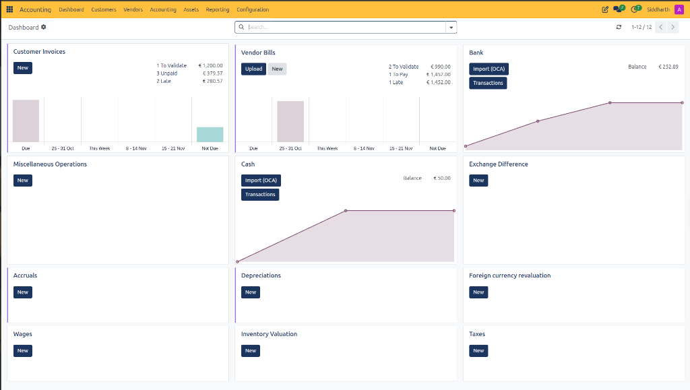

1. **Trade Journals**: `Customer Invoices` and `Vendor Bills` (visualizing aging distributions and payment processing stages).
2. **Liquidity Journals**: `Bank` and `Cash` (tracking real-time reconciled bank balances and statement import tools).
3. **Specialized General Journals**: `Miscellaneous Operations`, `Exchange Difference`, `Accruals`, `Depreciations`, `Foreign currency revaluation`, `Wages`, `Inventory Valuation`, and `Taxes`.

---

### Task 1: Audit Commercial Receivables via Customer Invoices

The **Customer Invoices** card monitors customer debt, collection urgency, and billing pipeline stages:

1. In the top navigation bar, select **Accounting > Dashboard**.
2. Locate the **Customer Invoices** card in the upper-left grid:
   * **Aging Bar Chart**: Classifies outstanding receivables across six dynamic time buckets:
     * `Due`: Receivables currently past their commercial payment terms.
     * `25 - 31 Oct`: Outstanding balances maturing in the preceding calendar week.
     * `This Week`: Balances maturing within the current 7-day operating cycle.
     * `8 - 14 Nov`: Projected customer receipts maturing in the next operating cycle.
     * `15 - 21 Nov`: Medium-term receivables maturing in two weeks.
     * `Not Due`: Validated invoices whose due dates fall beyond the active projection window.
   * **Processing Counters**:
     * **To Validate**: Draft sales invoices awaiting manager confirmation *(e.g., `1 To Validate (€ 1,200.00)`)*.
     * **Unpaid**: Total volume of posted customer invoices awaiting full settlement *(e.g., `3 Unpaid (€ 379.57)`)*.
     * **Late**: Overdue invoices that have exceeded contract maturity dates *(e.g., `2 Late (€ 280.57)`)*.
3. Operational actions:
   * Click **New** on the card to open a draft customer invoice directly pre-routed to `Customer Invoices` *(see [Create and Validate Customer Invoices](./01-create-and-validate-customer-invoices.md))*:

     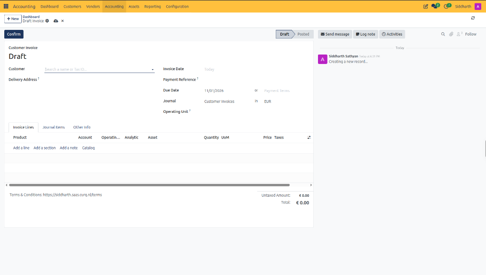

   * Click on any hyperlinked counter *(e.g., `3 Unpaid`)* to view an immediate list of filtered customer invoices.
   * Click the three dots icon in the upper-right corner of the card to reveal the fast-action dropdown menu:

     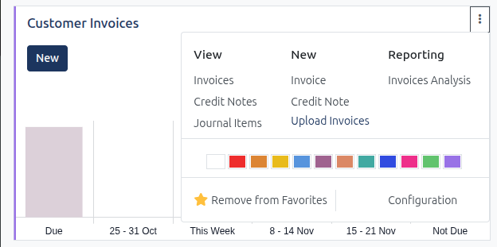

     * **View**: Fast shortcuts to filtered views:
       * **Invoices**: Opens the sales invoice list view.
       * **Credit Notes**: Opens customer credit notes *(see [Issue and Manage Customer Credit Notes](./09-issue-and-manage-customer-credit-notes.md))*.
       * **Journal Items**: Opens the detailed debit/credit line ledger for this journal.
     * **New**: Fast creation actions:
       * **Invoice**: Initializes a new draft sales invoice.
       * **Credit Note**: Initializes a new customer refund voucher.
       * **Upload Invoices**: Launches the batch document import dialog.
     * **Reporting**:
       * **Invoices Analysis**: Directly launches the multidimensional OLAP sales report *(see [Analyze Invoicing Trends and Product Margins](./18-analyze-invoicing-trends-and-product-margins.md))*.
     * **Color Palette**: Click any color swatch to customize the card vertical left border stripe for rapid visual identification.
     * **Configuration**: Opens the journal master definition to adjust sequence prefixes, default accounts, or allowed payment methods.

---

### Task 2: Manage Vendor Obligations via Vendor Bills

The **Vendor Bills** card tracks supplier procurement liabilities, payment staging, and working capital outflows:

1. Locate the **Vendor Bills** card in the top row:
   * **Aging Bar Chart**: Visualizes supplier payment deadlines across identical aging time brackets, allowing cash managers to plan disbursements.
   * **Processing Counters**:
     * **To Validate**: Draft vendor bills awaiting approval or three-way matching against purchase orders *(e.g., `2 To Validate (€ 990.00)`)*.
     * **To Pay**: Approved bills ready for electronic payment batching *(e.g., `1 To Pay (€ 1,452.00)`)*.
     * **Late**: Overdue supplier invoices exposing the company to commercial interest or vendor credit holds *(e.g., `1 Late (€ 1,452.00)`)*.
2. Operational actions:
   * Click **Upload** to ingest vendor invoices via automated PDF/OCR processing.
   * Click **New** to open a blank manual vendor bill form pre-routed to `Vendor Bills` with sequence prefix `BILL/YYYY/MM/XXXX` *(see [Create and Process Vendor Bills](./02-create-and-process-vendor-bills.md))*:

     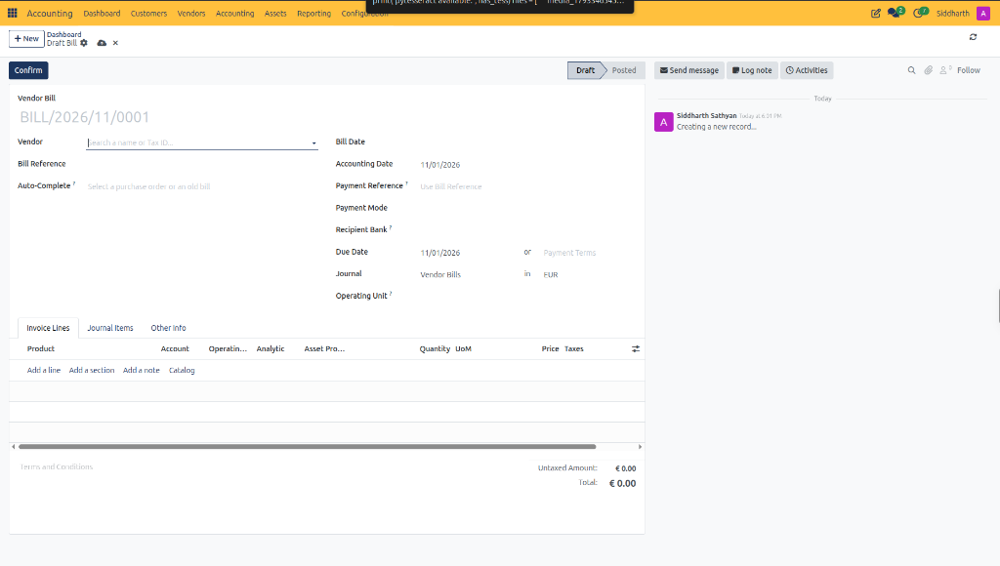

   * Click **1 To Pay** to batch outgoing SEPA credit transfers directly *(see [Manage SEPA Vendor Payment Orders](./13-manage-sepa-vendor-payment-orders.md))*.

---

### Task 3: Monitor Liquid Balances via Bank and Cash Cards

The **Bank** and **Cash** cards provide real-time liquidity oversight and automated electronic reconciliation:

1. Inspect the **Bank** card:
   * **Balance**: Displays the total general ledger book balance of the bank account *(e.g., `€ 252.89`)*.
   * **Balance Trendline**: Continuous linear plot tracking cumulative account balance fluctuations across recent accounting dates.
   * **Import (OCA)**: Primary action button launching the electronic statement import wizard for CAMT.053, OFX, QIF, and CSV files *(see [Import and Reconcile Bank Statements](./04-import-and-reconcile-bank-statements.md))*.
   * **Transactions**: Direct shortcut opening the interactive bank reconciliation interface to match statement lines against open invoices, bills, and transit accounts *(see [Register and Reconcile Payments](./03-register-and-reconcile-payments.md))*.
2. Inspect the **Cash** card:
   * Displays physical vault and petty cash balances *(e.g., `€ 50.00`)* with independent reconciliation tools.

---

### Task 4: Fast-Track Adjustments in Pre-Configured General Sub-Ledgers

Clicking **New** on any general journal card on the dashboard immediately creates a manual Journal Entry pre-assigned to that specific sub-ledger, eliminating manual journal selection errors.

For workflows already detailed in dedicated guides, use the dashboard card as an entry shortcut:

1. **Accruals**:
   * Dedicated sub-ledger isolating period-end expense accruals, unearned income, and amortization schedules from general operational entries.
   * Clicking **New** on the **Accruals** card pre-configures the voucher with **Journal** set to `Accruals` and sequence prefix **`ACCR/YYYY/MM/XXXX`**:

   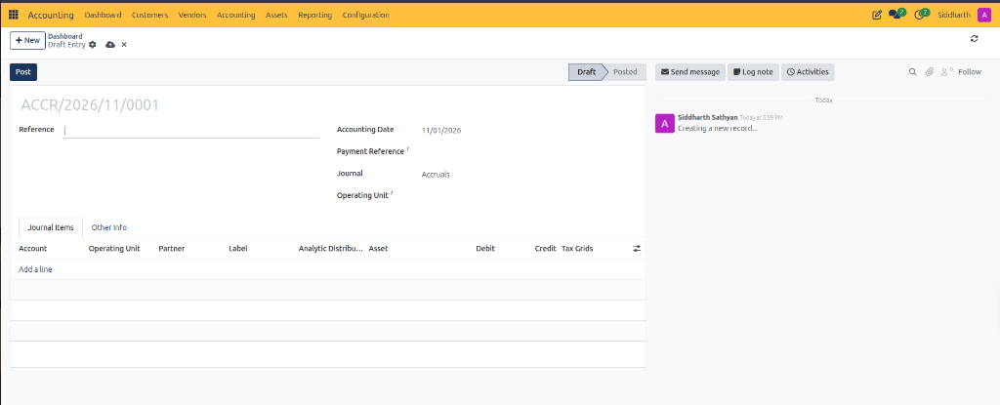

   * *Detailed procedure*: [Manage Deferred Costs, Revenues, and Accruals](./14-manage-deferred-costs-revenues-and-accruals.md) and [Reverse a Journal Entry (Accruals)](./05-create-manual-journal-entries.md#task-4-reverse-a-journal-entry-accruals-and-adjustments).

2. **Exchange Difference**:
   * Dedicated sub-ledger recording realized foreign currency gains (`8501020`) and losses (`4501020`) calculated during multi-currency invoice settlements and bank statement reconciliations.
   * Clicking **New** on the **Exchange Difference** card opens a draft entry pre-routed to `Exchange Difference` with sequence prefix **`EXCH/YYYY/MM/XXXX`**:

   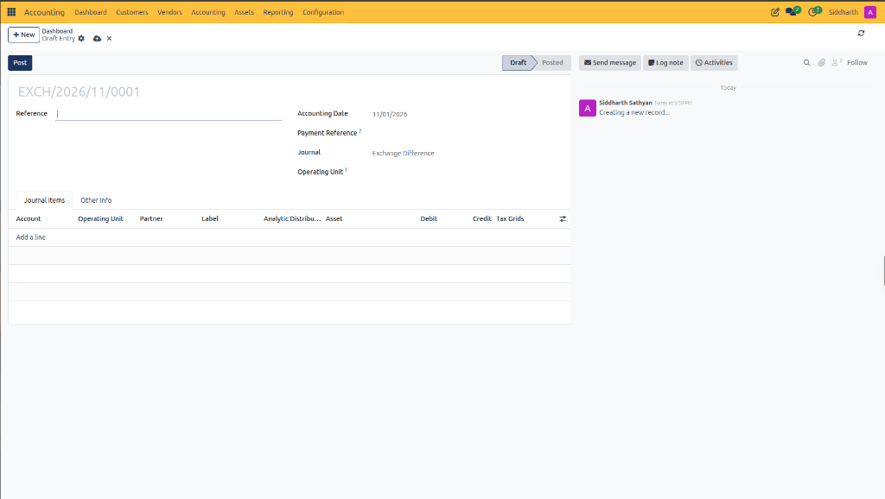

   * *Detailed procedure*: [Register and Reconcile Payments](./03-register-and-reconcile-payments.md).

3. **Taxes**:
   * Dedicated sub-ledger recording quarterly VAT clearing vouchers, small business scheme (KOR) adjustments, and statutory payments to the tax office.
   * Clicking **New** on the **Taxes** card pre-assigns the voucher to the `Taxes` sub-ledger with sequence prefix **`TAX/YYYY/MM/XXXX`**:

   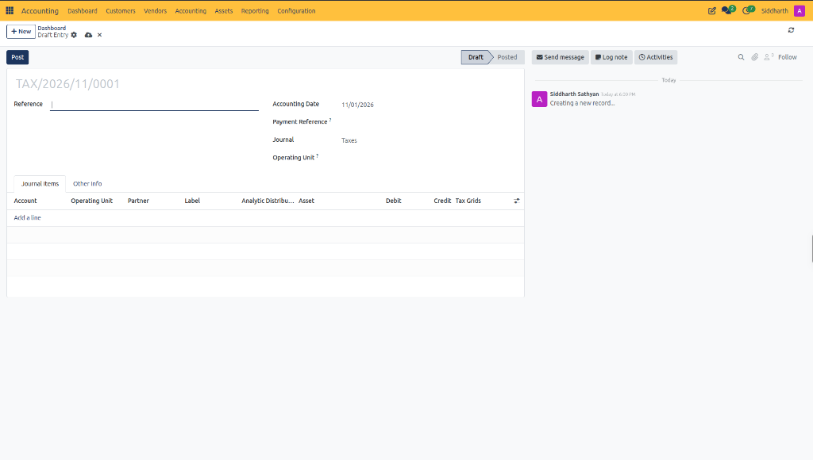

   * *Detailed procedure*: [File Statutory VAT Returns and ICP Declaration](./08-file-statutory-vat-returns-and-icp-declaration.md).

4. **Depreciations**:
   * Dedicated sub-ledger receiving automated monthly depreciation write-downs generated by the fixed asset management engine.
   * Clicking **New** on the **Depreciations** card initializes a manual write-down voucher pre-assigned to `Depreciations` with sequence prefix **`DEPR/YYYY/MM/XXXX`**:

   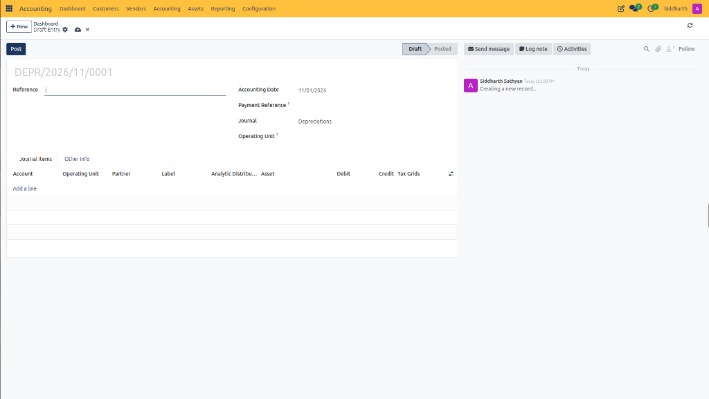

   * *Detailed procedure*: [Manage Fixed Assets and Depreciation](./06-manage-fixed-assets-and-depreciation.md).

5. **Miscellaneous Operations**:
   * General journal sub-ledger used for miscellaneous year-end closing entries, opening balances, and unallocated non-commercial adjustments.
   * Clicking **New** on the **Miscellaneous Operations** card opens a draft journal entry pre-assigned to `Miscellaneous Operations` with sequence prefix **`MISC/YYYY/MM/XXXX`**:

   

   * *Detailed procedure*: [Create Manual Journal Entries](./05-create-manual-journal-entries.md).

---

### Task 5: Post Month-End Unrealized Currency Adjustments via Foreign Currency Revaluation

Under international and Dutch accounting standards, monetary assets and liabilities denominated in foreign currencies *(such as USD bank accounts or unpaid GBP receivables)* must be revalued to the official closing spot rate at the end of every fiscal month or quarter.

1. On the **Accounting Dashboard**, locate the **Foreign currency revaluation** card.
2. Click **New** on the card:
   * CURQ opens a new journal entry voucher with **Journal** pre-selected as `Foreign currency revaluation` and sequence prefix **`FCR/YYYY/MM/XXXX`**:

   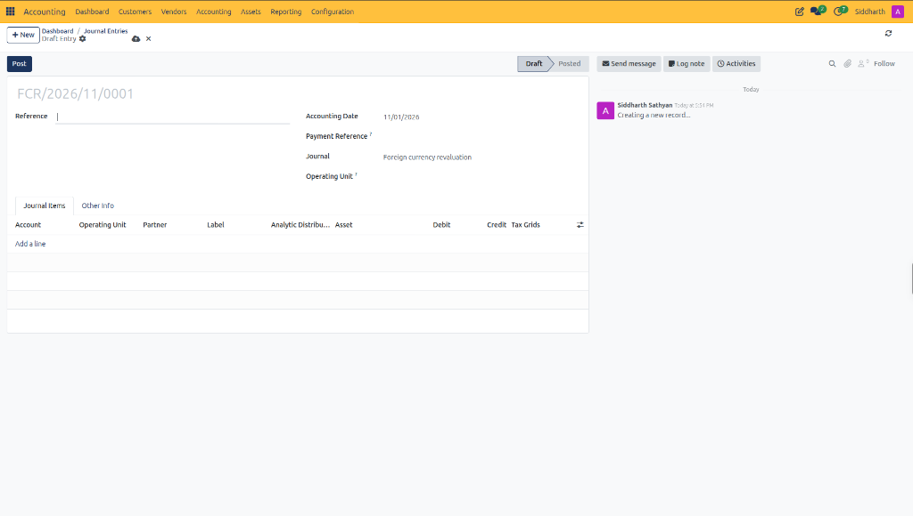

3. In the **Reference** field, enter the revaluation context *(e.g., `Unrealized FX Revaluation - October 2026`)*.
4. Set the **Accounting Date** to the final day of the period *(e.g., `10/31/2026`)*.
5. In the **Journal Items** tab, click **Add a line**:
   * **For an Unrealized Currency Gain**:
     * Debit the asset or receivable account *(e.g., `1002020 USD Bank Account` or `1101010 Accounts Receivable`)* by the net gain in local currency EUR.
     * Credit the P&L unrealized currency gain account *(e.g., `8501030 Ongerealiseerde koersverschillen`)* by the matching amount.
   * **For an Unrealized Currency Loss**:
     * Debit the P&L unrealized currency loss account *(e.g., `4501030 Ongerealiseerde koersverschillen`)*.
     * Credit the balance sheet account *(e.g., `1002020 USD Bank Account` or `1203010 Accounts Payable`)*.
6. Click the Save icon and click **Post**.
7. In the header action bar, click **Reverse Entry**:
   * Set **Reversal Date** to the first day of the subsequent fiscal period *(e.g., `11/01/2026`)*.
   * Click **Reverse**.
   * CURQ generates an automated contra-entry on day one of the new period, ensuring subsequent real settlements compute realized exchange gains and losses accurately without double-counting.

---

### Task 6: Record Monthly Payroll Commitments via the Wages Journal

Payroll transactions contain sensitive employee compensation details that must be aggregated into financial statements without exposing individual remuneration figures in general operational journals.

1. On the **Accounting Dashboard**, locate the **Wages** card.
2. Click **New** on the card:
   * CURQ initializes a new voucher with **Journal** pre-set to `Wages` and sequence prefix **`WAG/YYYY/MM/XXXX`**:

   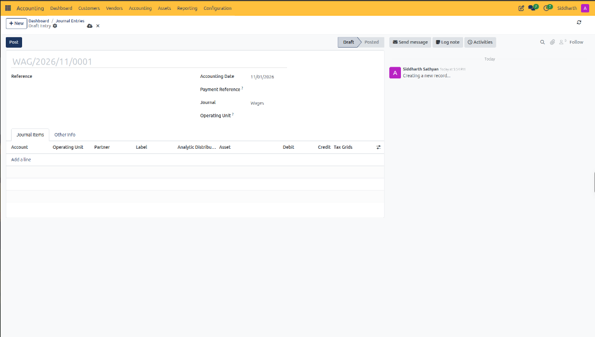

3. Configure the header:
   * **Reference**: Enter the payroll run identifier *(e.g., `Monthly Payroll Run - October 2026`)*.
   * **Accounting Date**: Select the wage recognition date *(e.g., `10/31/2026`)*.
4. In the **Journal Items** tab, enter the standard double-entry payroll components:
   * **Line 1 (Gross Salaries)**:
     * Account: `4001010 Lonen en salarissen` (Expense)
     * Debit: Total gross payroll amount *(e.g., `€ 10,000.00`)*.
   * **Line 2 (Employer Social Contributions)**:
     * Account: `4002010 Sociale lasten werkgever` (Expense)
     * Debit: Employer social security and pension contributions *(e.g., `€ 2,200.00`)*.
   * **Line 3 (Tax & Social Security Withholding Liability)**:
     * Account: `1206010 Te betalen loonheffing en premies` (Current Liability)
     * Credit: Statutory wage tax and employee social security withholdings *(e.g., `€ 4,200.00`)*.
   * **Line 4 (Net Salaries Payable)**:
     * Account: `1207010 Te betalen nettolonen` (Current Liability)
     * Credit: Net monetary amounts owed to employees *(e.g., `€ 8,000.00`)*.
5. Verify total debits equal total credits (`€ 12,200.00 = € 12,200.00`) and click **Post**.
6. When disbursing net wages to employee bank accounts via SEPA payment batching:
   * Debit `1207010 Te betalen nettolonen` and Credit `1002010 Rekening-courant bank`, completely clearing the liability to zero *(see [Manage SEPA Vendor Payment Orders](./13-manage-sepa-vendor-payment-orders.md))*.

---

### Task 7: Record Stock Adjustments via Inventory Valuation

For companies maintaining periodic inventory accounting or recording physical stocktaking discrepancies, the **Inventory Valuation** card isolates goods adjustments from commercial procurement invoices.

1. On the **Accounting Dashboard**, locate the **Inventory Valuation** card.
2. Click **New** on the card:
   * CURQ initializes a voucher with **Journal** pre-set to `Inventory Valuation` and sequence prefix **`STJ/YYYY/MM/XXXX`**:

   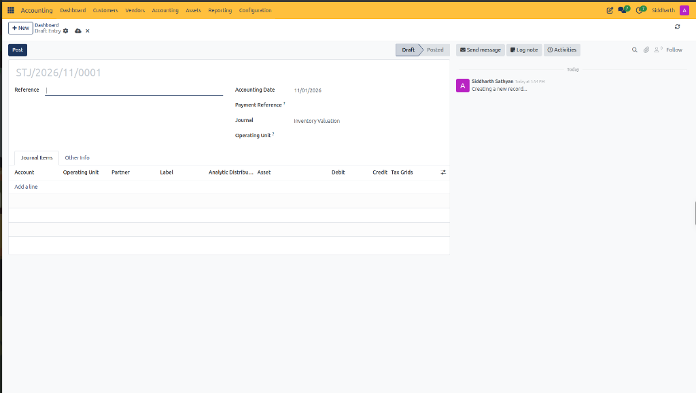

3. In the **Reference** field, record the audit basis *(e.g., `Annual Physical Inventory Count Adjustment 2026`)*.
4. Add balanced journal items according to the physical audit result:
   * **Case A: Stock Shrinkage / Inventory Write-Off (Deficit)**:
     * Debit: `7001090 Voorraadverschillen en afboekingen` (P&L Cost of Goods Sold expense).
     * Credit: `0201010 Handelsgoederen voorraad` (Balance Sheet current asset account).
   * **Case B: Stock Surplus (Overage)**:
     * Debit: `0201010 Handelsgoederen voorraad` (Balance Sheet asset increase).
     * Credit: `7001090 Voorraadverschillen en afboekingen` (P&L expense reduction).
5. Verify line balance and click **Post**.
6. The updated inventory book balance immediately reflects in your Balance Sheet under current assets *(see [Generate Financial Reports and Trial Balance](./07-generate-financial-reports-and-trial-balance.md))*.

---

### Edge Cases and Dashboard Troubleshooting

* **Journal Missing from Dashboard**: If a specific journal does not appear as a card on the dashboard, navigate to **Accounting > Configuration > Journals**, open the journal record, and verify that **Show Journal on Dashboard** is enabled. Configure journal accounts, payment methods, and dashboard preferences across the journal tabs:

  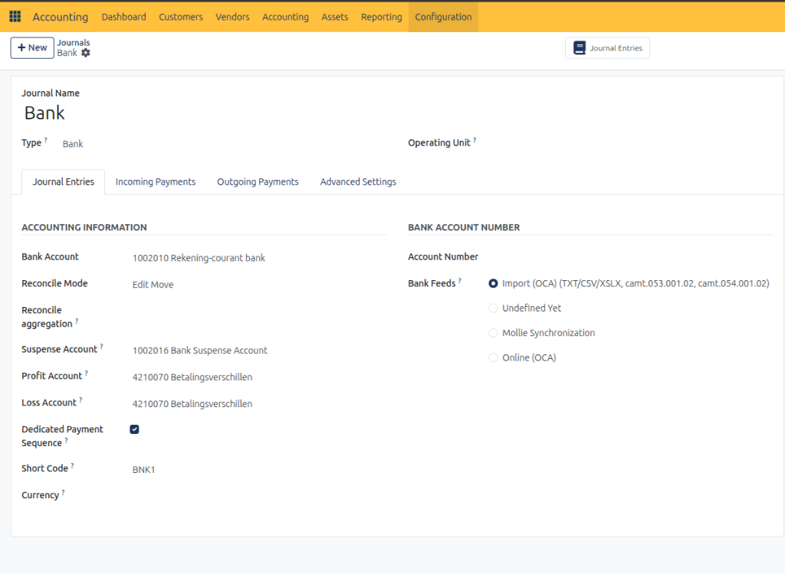
  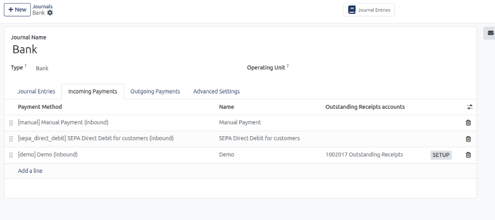
  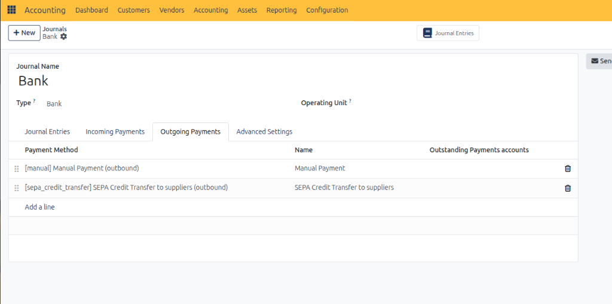
  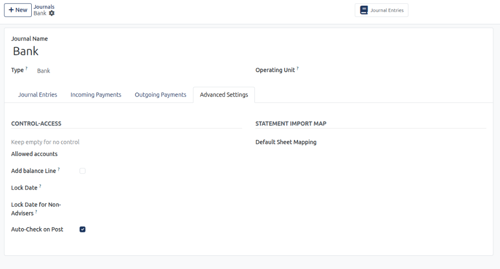

  > For complete journal parameter specifications, see [Financial Journals Field Definitions](../settings-and-fields/02-chart-of-accounts-and-taxes-field-definitions.md#financial-journals-field-definitions).
* **Unbalanced Dashboard Warning**: If a journal card displays an unexpected red alert icon, one or more unposted draft entries contain balance discrepancies. Click the card title to review and balance draft items.
* **Filter Persistence**: Dashboard counters reflect real-time database state. If numbers appear unexpectedly low, verify the top search bar is clear and no restrictive partner or date filters are active.

---

### Related Documentation

* [Create and Validate Customer Invoices](./01-create-and-validate-customer-invoices.md)
* [Create and Process Vendor Bills](./02-create-and-process-vendor-bills.md)
* [Import and Reconcile Bank Statements](./04-import-and-reconcile-bank-statements.md)
* [Create Manual Journal Entries](./05-create-manual-journal-entries.md)
* [Manage Fixed Assets and Depreciation](./06-manage-fixed-assets-and-depreciation.md)
* [File Statutory VAT Returns and ICP Declaration](./08-file-statutory-vat-returns-and-icp-declaration.md)
* [Manage Deferred Costs, Revenues, and Accruals](./14-manage-deferred-costs-revenues-and-accruals.md)
* [Payment, Bank, and Journal Entry Field Definitions](../settings-and-fields/04-payment-bank-and-journal-entry-field-definitions.md)
* [Understanding Double-Entry Bookkeeping and Journals](../core-concepts/01-understanding-double-entry-bookkeeping-and-journals.md)
