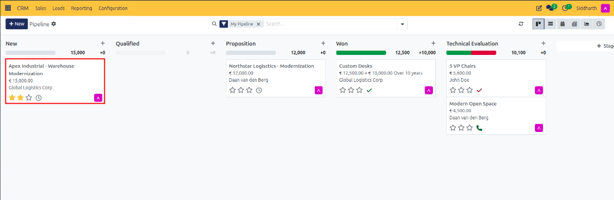
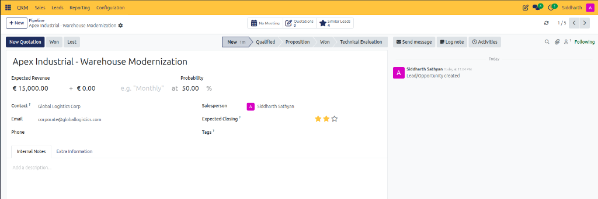
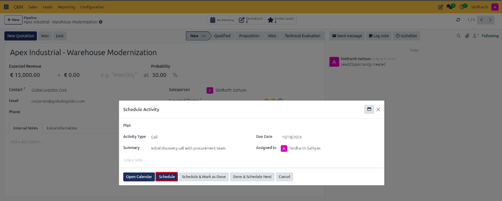
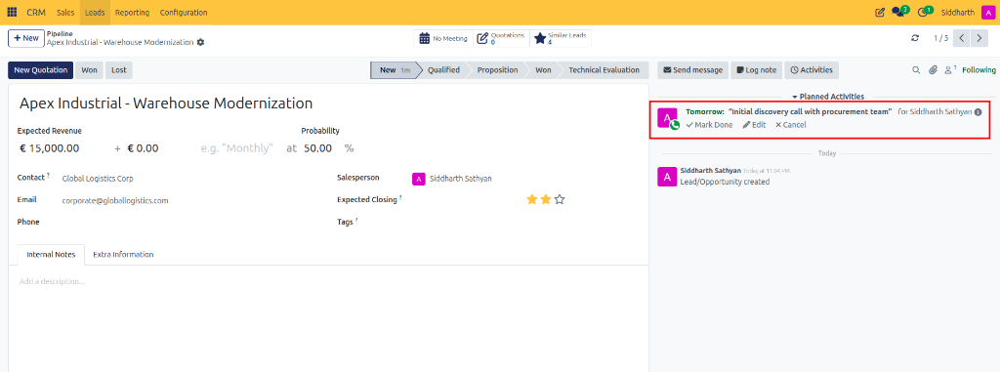
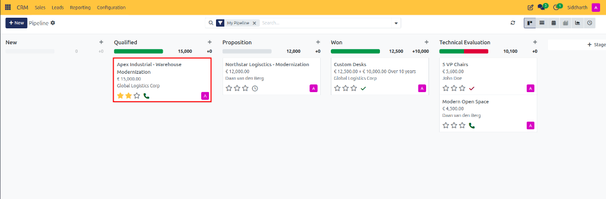

# Getting Started: Overview & Track Your First Lead from Inquiry to Won Deal

Welcome to CURQ CRM. The **CRM** application serves as the pipeline intelligence and prospect engagement center. It provides end-to-end visibility into the customer acquisition journey, transforming raw inquiries into qualified pipeline opportunities, coordinating team follow-up activities, and synchronizing commercial proposals directly with Sales.

In this tutorial, you will build a clear mental model of how CURQ organizes the sales cycle and complete a hands-on exercise to track your first lead from initial inquiry to won deal in 4 quick steps.

```{mermaid}
flowchart TD
    A["`**Incoming Inquiries**
    Web Forms • Emails • Events`"] --> B["`**CRM Leads**
    Qualification Filter`"]
    B -->|"Convert"| K1["New"]
    
    subgraph Pipeline ["Sales Pipeline Kanban"]
        direction LR
        K1["New"] --> K2["Qualified"] --> K3["Proposition"] --> K4["Won"]
    end
    
    Pipeline --> Q["`**Quotation / Order**
    Updates Expected Revenue`"]
```

---

## Hands-On Exercise: Track Your First Lead from Inquiry to Won Deal

### Prerequisites
* Access to a standard CURQ instance with the **CRM** app installed.
* Standard default pipeline stages (*New*, *Qualified*, *Proposition*, *Won*). No special configuration is required.

---

### Step 1: Open the Pipeline and Create an Opportunity

1. From the main CURQ dashboard, click the **CRM** app icon to open **My Pipeline**.
2. Notice the visual columns representing pipeline stages: **New**, **Qualified**, **Proposition**, and **Won**.
3. At the top left of the pipeline view, click the **New** button (or click the **+** Quick Add button at the top of the **New** column).

   

4. Enter the primary opportunity details:
   * **Opportunity**: Type `Apex Industrial - Warehouse Modernization`.
   * **Customer**: Select or type an existing customer, or type `Apex Industrial` (e.g., `Global Logistics Corp`).
   * **Expected Revenue**: Enter `15000`.
   * **Priority**: Click the second star to set a high priority rating (`★★☆`).
5. Click **Add**.

Your new deal card appears immediately in the **New** stage column:



---

### Step 2: Schedule a Follow-Up Activity

Now, let us schedule an initial discovery call so your team knows what step to take next.

1. Click on the deal card you just created to open the detailed opportunity form:

   

2. In the Chatter area on the right side of the screen, click the **Activities** button (clock icon).
3. In the **Schedule Activity** dialog:
   * **Activity Type**: Select **Call**.
   * **Summary**: Type `Initial discovery call with procurement team`.
   * **Due Date**: Select tomorrow's date (e.g., `10/18/2026`).
4. Click the dark blue **Schedule** button:

   

5. The scheduled call appears directly in the Chatter pane under **Planned Activities**:

   

---

### Step 3: Advance the Deal Through Pipeline Stages

As your conversation progresses, move the deal forward along your sales cycle:

1. Click **My Pipeline** in the top breadcrumbs to return to the Kanban board.
2. Click and hold the `Apex Industrial - Warehouse Modernization` card in the **New** column.
3. Drag the card into the **Qualified** column, and release your mouse:

   

Notice how the stage totals at the top of the **Qualified** column update automatically to reflect the new pipeline distribution (`15,000`).

---

### Step 4: Mark the Opportunity as Won

After the customer approves the proposal, finalize the deal:

1. Click into the `Apex Industrial` card to open the form view.
2. In the top action bar, click the green **Won** button:

   

3. CURQ immediately awards the deal:
   * The probability automatically locks to **100%**.
   * A vibrant green **Won** ribbon attaches to the top-right corner of the record.
   * Rainbow celebration confetti confirms the closed sale.

Congratulations! You have completed your first sales cycle in CURQ CRM. You now understand how to create deals, schedule follow-up tasks, and advance opportunities from inquiry to closed revenue.

---

## Exploring Further: Key Capabilities of CURQ CRM

Now that you have completed your first sales cycle, explore the core capabilities and architectural principles that govern the CRM module:

### 1. Lead Intake & Qualification Funnel
* **Two-Tier Qualification Engine**: Capture raw inquiries from website forms, incoming emails, phone calls, and marketing campaigns as **Leads**. Dedicated development reps (BDRs/SDRs) qualify prospective buyers before converting them into pipeline opportunities, keeping primary revenue forecasts clean.
* **Smart Deduplication & Contact Linking**: Automatically check incoming leads against existing contacts to prevent duplicate partner records, link historical correspondence, or establish new company and individual accounts.

### 2. Visual Pipeline & Opportunity Governance
* **Interactive Kanban Pipeline**: Track deals across customizable stages reflecting your sales methodology. Drag-and-drop cards to advance stages, adjust priority stars, and instantly view stage totals and weighted revenue.
* **Expected Revenue & Probabilities**: Calculate realistic revenue projections based on deal value and closing probabilities. As deals progress through stages, probabilities update automatically to reflect higher closing confidence.
* **Recurring Revenue & MRR**: Track monthly, quarterly, and annual subscription contracts with dedicated recurring revenue plans and contract duration metrics.

### 3. Activity Scheduling & Follow-Up Automation
* **Activity-Driven Selling**: Schedule next steps (calls, meetings, emails, reminders) directly on opportunity cards. Color-coded badges indicate overdue (red), due today (orange), and future (green) activities.
* **Automated Activity Plans**: Trigger standardized follow-up sequences (e.g., *Onboarding Follow-Up* or *Enterprise Demo Plan*) that generate multi-step tasks across team members upon stage transitions.
* **Integrated Calendar & Communications**: Sync appointments with external calendars and log client communications directly within the Chatter feed for complete team visibility.

### 4. Predictive Scoring & Rule-Based Routing
* **Predictive Lead Scoring**: Leverage machine learning to evaluate historical conversion data against key attributes (stage, geography, email/phone quality, acquisition source). The algorithm assigns data-backed win probabilities, eliminating optimistic sales bias.
* **Rule-Based Lead Assignment**: Automatically route leads to regional or specialized sales teams using territory domain filters (country, state, language, tag).
* **Capacity-Capped Round-Robin**: Distribute leads fairly among team members while enforcing individual monthly lead capacity limits to prevent team overload.

### 5. Sales Integration & Win/Lost Analytics
* **Seamless Quotation Integration**: Generate formal quotations directly from the opportunity card. The quotation untaxed total synchronizes with the opportunity's expected revenue.
* **Automated Won Progression**: When a client accepts and confirms a quotation, the linked opportunity automatically transitions to **Won** with 100% probability.
* **Lost Reason Governance**: Prevent record deletion by requiring structured **Lost Reasons** (e.g., *Too Expensive*, *Competitor*, *Missing Feature*) when archiving lost deals. Management can analyze win/loss ratios in Pivot reports to uncover product gaps, pricing friction, and campaign quality.

---

## Related Documentation

* [Getting Started: Setting Up Your First Test Pipeline](./02-set-up-your-first-test-pipeline.md)
* [Task Guide: Create and Manage Opportunities](../task-guides/01-create-and-manage-opportunities.md)
* [Task Guide: Qualify and Convert Leads into Opportunities](../task-guides/02-convert-leads-to-opportunities.md)
* [Task Guide: Manage Pipeline Stages and Won/Lost Status](../task-guides/03-manage-pipeline-stages-and-won-lost-status.md)
* [Task Guide: Configure Pipeline Stages](../task-guides/05-configure-pipeline-stages.md)
* [Core Concepts: Understanding Leads vs. Opportunities in CURQ](../core-concepts/01-understanding-leads-vs-opportunities.md)
* [Settings & Fields: Lead and Opportunity Form Field Definitions](../settings-and-fields/01-lead-and-opportunity-field-definitions.md)
* [Frequently Asked Questions](../faq.md)
