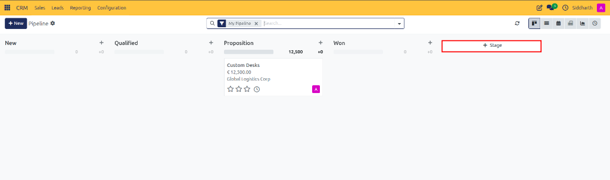
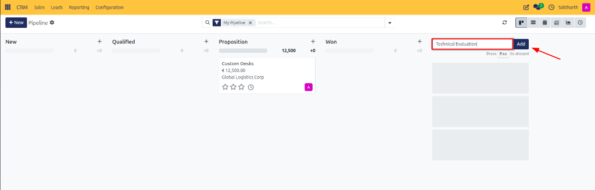
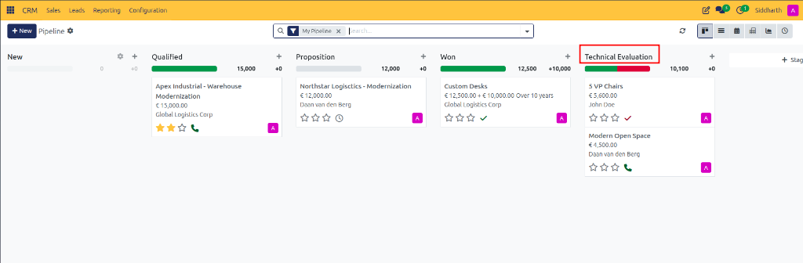
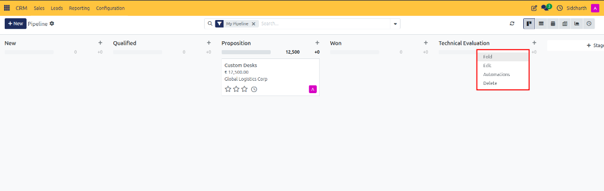
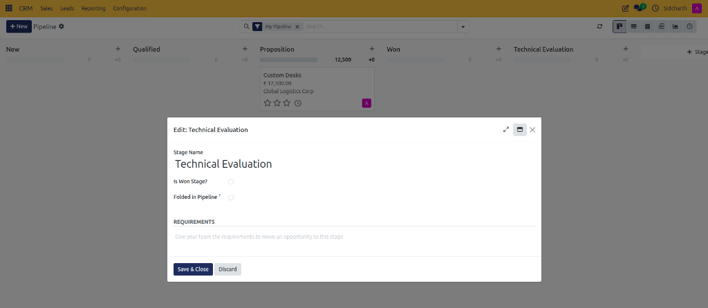
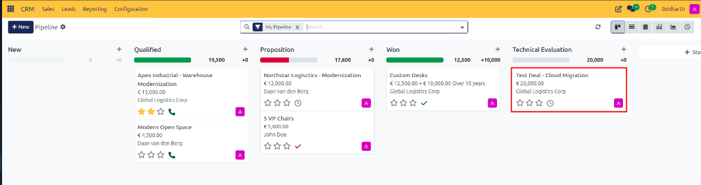
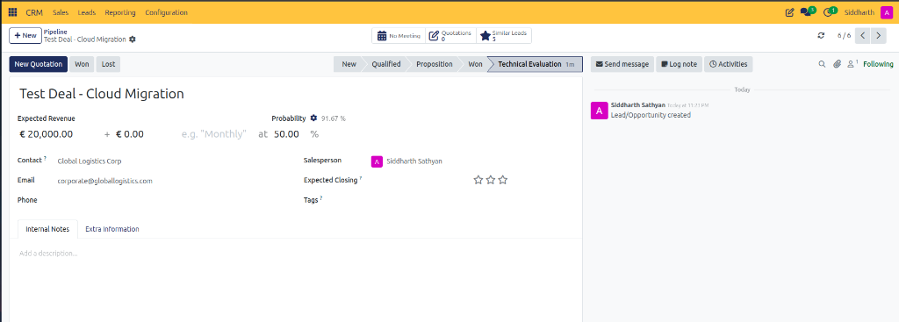

# Getting Started: Setting Up Your First Test Pipeline

Welcome to CURQ CRM. In this introductory tutorial, you will learn how to configure your sales workspace by adding a custom pipeline stage, adjusting its win probability, and creating a test deal card.

By the end of this exercise, you will understand how pipeline columns reflect your real-world sales process and feel confident customizing the Kanban board for your team.

---

### Prerequisites
* Access to a standard CURQ instance with the **CRM** app installed.
* Standard default pipeline stages. No advanced permissions or multi-team configurations are needed.

---

### Step 1: Open the Kanban Pipeline

1. From the main CURQ dashboard, click the **CRM** app icon to open **My Pipeline**.
2. Notice your existing stage columns (*New*, *Qualified*, *Proposition*, *Won*).
3. Scroll horizontally to the far right of the board.

---

### Step 2: Add a Custom Stage

Let us add a new stage called **Technical Evaluation** where deals will pause while solutions architects evaluate customer requirements.

1. At the top right of the last stage column, click the **+ Stage** button.

   

2. In the text box that appears, type `Technical Evaluation`.

   

3. Click **Add**.
4. The **Technical Evaluation** column is immediately added to your pipeline board:

   

---

### Step 3: Set the Stage Default Win Probability

Every stage should reflect the statistical likelihood that a deal in this stage will eventually close:

1. Hover your cursor over the title of the **Technical Evaluation** column and click the gear icon (Settings).
2. Click **Edit Stage**.

   

3. In the stage edit modal dialog:

   

   * In the **Default Probability** field, enter `50%`.
   * In the **Requirements** field, type `Technical architecture must be approved by engineering lead.`
4. Click **Save**.

Now, whenever a salesperson drags an opportunity into this column, its probability updates to 50% automatically.

---

### Step 4: Add a Test Opportunity Card

Let us verify that your new stage works by adding a test deal:

1. At the top of your new **Technical Evaluation** column, click the **+** button.
2. In the quick-add card:

   

   * **Contact**: Select or type `Global Logistics Corp`.
   * **Opportunity**: Type `Test Deal - Cloud Migration`.
   * **Expected Revenue**: Enter `20000`.
3. Click **Add**.
4. The test deal card appears directly inside your new stage column:

   

5. Click into the newly created card to open its full form view:

   

6. Review the stage calculations on the opportunity record:
   * The status indicator highlights **Technical Evaluation** as the active stage milestone.
   * The **Expected Revenue** displays `€ 20,000.00`.
   * The baseline stage probability defaults to `at 50.00 %`, while CURQ's predictive lead scoring computes the calculated probability (`91.67 %`).

Congratulations! You have successfully customized your sales pipeline by adding a new stage, defining its milestone requirements, and verifying deal calculations.

---

### Next Steps

* To learn how to configure multi-team routing and automated lead distribution, see [How-To: Configure Sales Teams and Rule-Based Lead Assignment](../task-guides/06-configure-sales-teams-and-assignment.md).
* To explore all stage parameters, see [Reference: Pipeline Configuration and Assignment Settings](../settings-and-fields/02-pipeline-configuration-and-assignment-settings.md).
* To understand the commercial strategy behind stage velocity, see [Explanation: Understanding Leads vs. Opportunities in CURQ](../core-concepts/01-understanding-leads-vs-opportunities.md).
