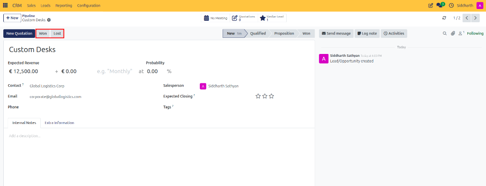
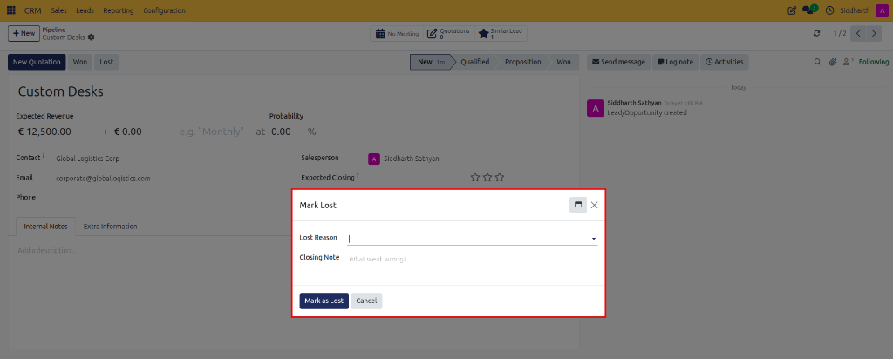
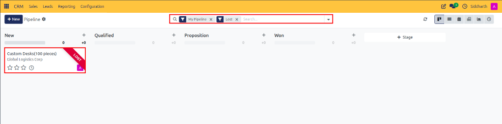

# How-To: Manage Pipeline Stages and Won or Lost Deals

Advance deals through visual Kanban stages, record won sales, apply standardized lost reasons, and restore archived opportunities.

---

### Task 1: Move Deals Across Kanban Stages

1. Open **CRM > Sales > My Pipeline**.
2. Locate the target opportunity card.
3. Click and drag the card from its current column into the next pipeline stage (e.g., from **Qualified** to **Proposition**).
4. Release the mouse. The stage revenue sums update immediately.

---

### Task 2: Mark an Opportunity as Won

When a client accepts your commercial proposal:

1. Open the opportunity card from the pipeline.
2. In the top action bar, click the **Won** button (located alongside **Lost**).

   

3. CURQ immediately awards the deal:
   * Sets win probability to **100%**.
   * Attaches a green **Won** banner.
   * Updates pipeline win metrics in reporting.

---

### Task 3: Mark an Opportunity as Lost

When negotiations conclude without a sale, recording structured reasons ensures accurate analytical feedback:

1. Open the opportunity card.
2. In the top action bar, click **Lost**.
3. In the **Mark Lost** popup modal:

   

   * **Lost Reason**: Select the standardized reason from the dropdown (e.g., `Too expensive`, `Not enough stock`).
   * **Closing Note**: (Optional) Type detailed explanation or competitor feedback (*"What went wrong?"*).
4. Click **Mark as Lost**.
5. The opportunity probability drops to **0%**, a red **Lost** ribbon attaches to the record, and the card archives from active Kanban views.

> [!NOTE]
> For standard reason categories and analytical definitions, see [Reference: Standard Lost Reasons Catalog](../reference/03-activity-types-recurring-plans-and-lost-reasons.md#standard-lost-reasons-catalog).

---

### Task 4: Find and Restore Lost Opportunities

If a prospective client contacts your company again to resume discussions:

1. Open **CRM > Sales > My Pipeline**.
2. Click the search bar at the top center.
3. In the filter dropdown, select **Filters > Lost** (or type `Lost` and press Enter).

   

4. Locate the archived opportunity marked with the red **LOST** ribbon (e.g., `Custom Desks(100 pieces)` under `New`).
5. Click into the lost opportunity card to open its form.
6. In the top action bar, click **Restore**.
7. The red Lost ribbon is removed, and the card returns to its previous active stage on the Kanban board.

---

### Edge Cases & Recovery Steps

* **Accidentally Marked Lost**: If you clicked Lost by mistake, immediately filter by **Lost**, open the deal, and click **Restore**.
* **Stage Probability Mismatch**: Moving a deal into a stage updates its probability to that stage's default value unless you have entered a manual override.

---

### Related Documentation
* [Reference: Standard Lost Reasons Catalog](../reference/03-activity-types-recurring-plans-and-lost-reasons.md#standard-lost-reasons-catalog)
* [How-To: Configure Standardized Lost Reasons and Deal Tags](./07-configure-lost-reasons-and-tags.md)
* [Explanation: Understanding Leads vs. Opportunities in CURQ](../explanation/01-understanding-leads-vs-opportunities.md)
