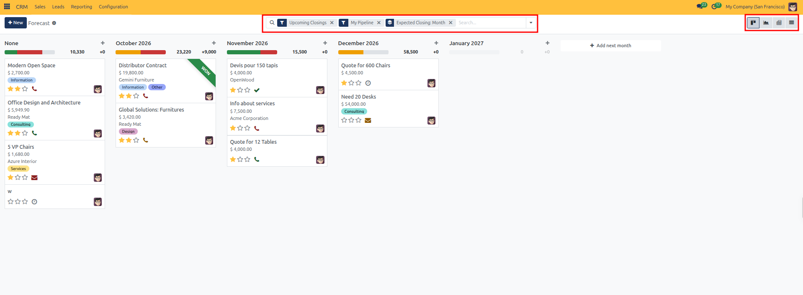
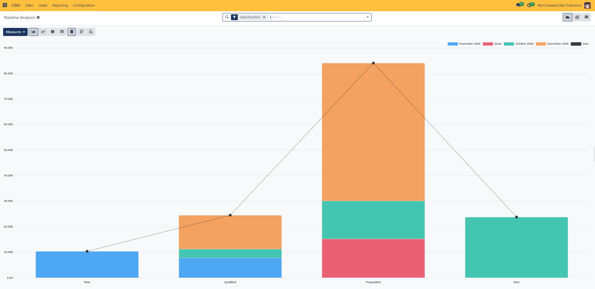
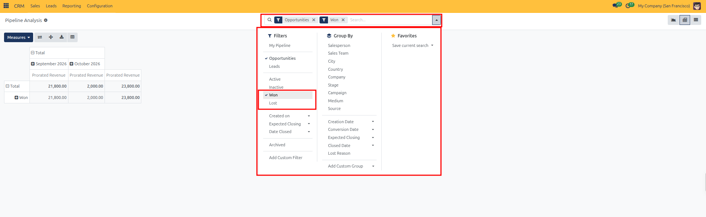
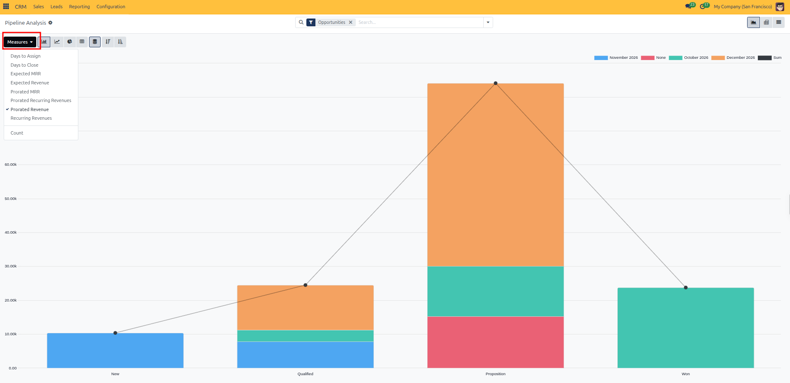
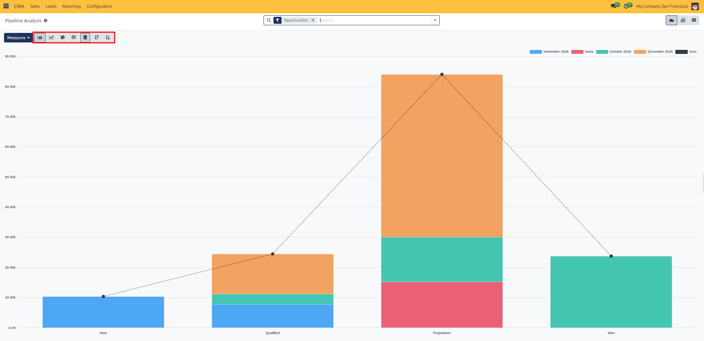
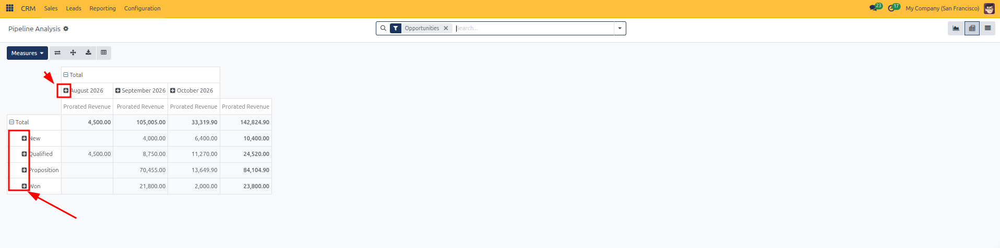
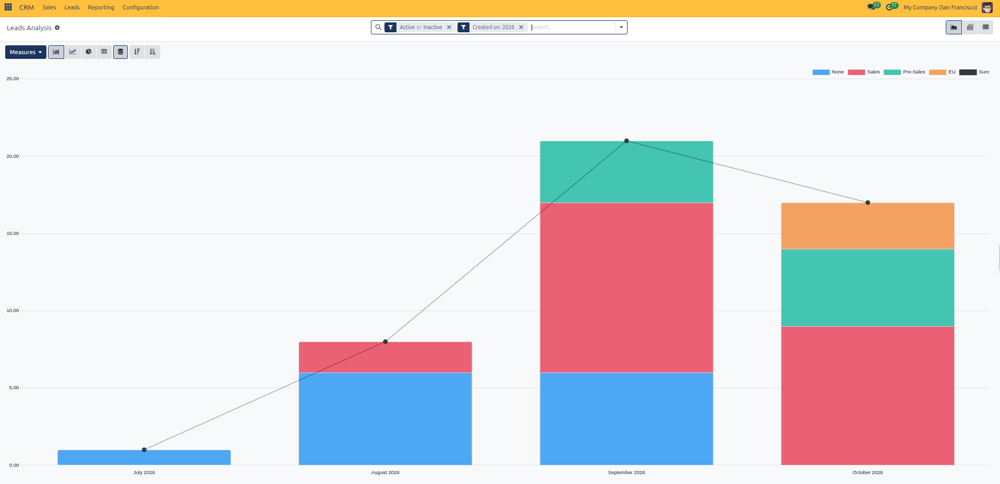
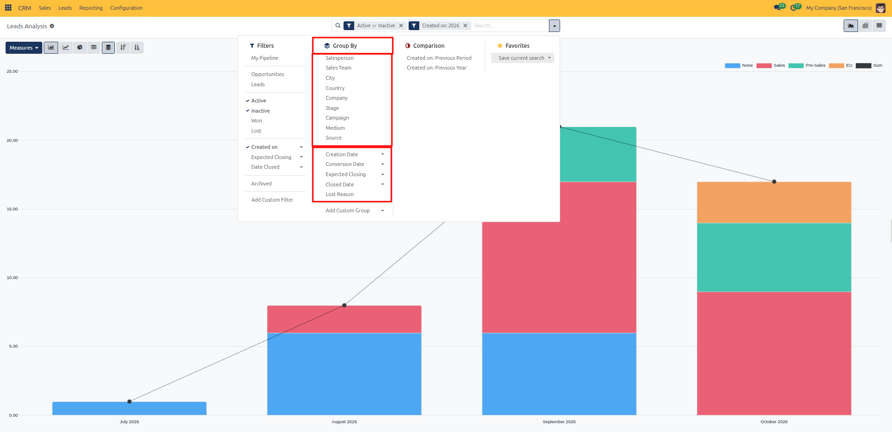
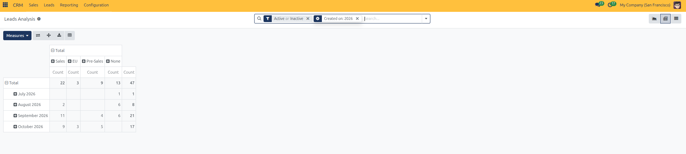
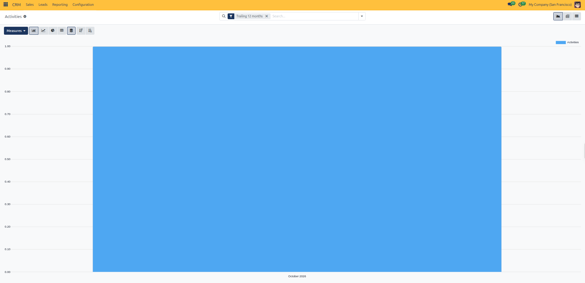

# How-To: Analyze Pipeline Performance, Forecasts, and Team Activities

Evaluate commercial revenue forecasts, analyze pipeline conversion velocity, track lead inflow trends, and monitor team activity completion.

---

### Task 1: Track Revenue Forecasts by Closing Month

1. Open the **CRM** app.
2. In the top navigation bar, click **Reporting > Forecast**.
3. CURQ opens the **Forecast** Kanban view, organizing opportunities into columns by expected closing month (e.g., `October 2026`, `November 2026`).

   

4. Evaluate key metrics:
   * **Expected Closing Month Sums**: Weighted prorated revenues displayed at the head of each month column.
   * **Expected MRR**: If recurring revenues are enabled, the monthly recurring contribution is displayed separately.
5. **Reschedule Deals**: Drag any deal card into a different month column to adjust its expected closing deadline immediately.

---

### Task 2: Evaluate Pipeline Values and Stage Velocity

1. In the top navigation bar, click **Reporting > Pipeline**.
2. By default, CURQ presents the pipeline in **Graph View**.

   

3. Customize your analysis using the top control bar:
   * **Filters & Grouping**: Click the search dropdown to filter by Sales Team, Stage, or fiscal quarter:

     

   * **Measures**: Click **Measures** to switch the metric from `Expected Revenue` to `Prorated Revenue`, `Probability`, or `Count`.

     

   * **Chart Types**: Click icons to switch between **Bar Chart**, **Line Chart**, and **Pie Chart**.

     

4. **Pivot View**: Click the **Pivot** icon in the top right to open a multi-dimensional spreadsheet matrix.

   

---

### Task 3: Analyze Inbound Lead Inflow and Marketing Sources

1. In the top navigation bar, click **Reporting > Leads**.
2. Review the inflow bar chart showing new lead volume over time:

   

3. Click into the search bar dropdown and select **Group By**:

   

   * **Source** / **Campaign**: Determine which marketing channels deliver the highest volume of prospects.
   * **Salesperson** / **Team**: Evaluate lead qualification distribution across your commercial team.
4. **Pivot Analysis**: Switch to the **Pivot View** to inspect monthly lead conversions broken down by source medium:

   

---

### Task 4: Monitor Sales Activities and Team Follow-ups

1. In the top navigation bar, click **Reporting > Activities**.
2. Review the activity completion chart comparing completed calls, meetings, and emails against scheduled tasks across team members:

   

3. Use the search bar to filter by date ranges (e.g., `Last 30 Days` or `This Quarter`).

---

### Edge Cases & Recovery Steps

* **Missing Inactive Deals in Reports**: Pipeline reports evaluate active opportunities by default. To analyze lost opportunities, click into the search bar and select **Filters > Lost**.

---

### Related Documentation
* [Explanation: Understanding Leads vs. Opportunities in CURQ](../explanation/01-understanding-leads-vs-opportunities.md)
* [Reference: Lead and Opportunity Form Field Definitions](../reference/01-lead-and-opportunity-field-definitions.md)
* [How-To: Schedule and Execute Sales Activities](./04-schedule-and-track-sales-activities.md)
