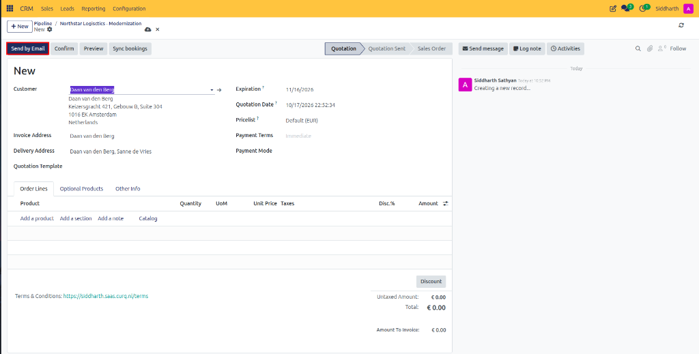
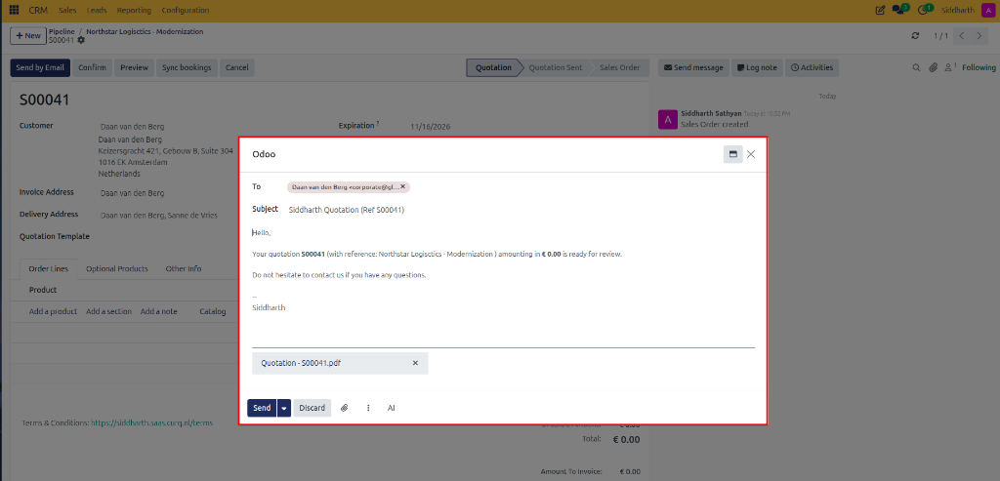
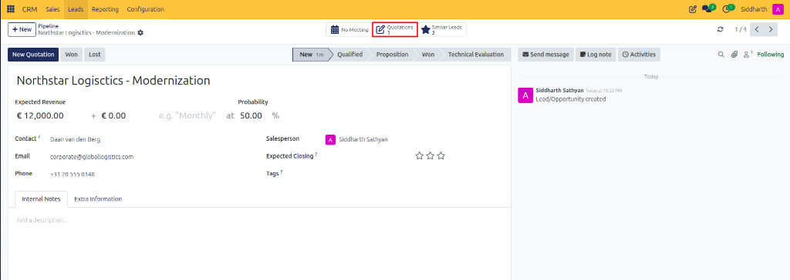
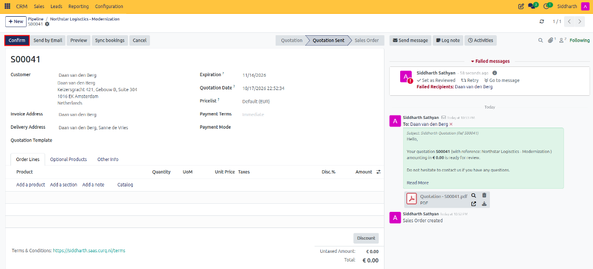

# How-To: Generate and Track Sales Quotations from Opportunities

Create commercial quotations directly from CRM opportunities, manage quote revisions, track customer signatures, and convert accepted proposals into confirmed sales orders.

---

### Task 1: Create a Quotation from an Opportunity

1. Open **CRM > Sales > My Pipeline**.
2. Click into the target opportunity card to open its full form view (e.g., `Northstar Logistics - Modernization`).
3. In the top action bar, click the **New Quotation** button:

   

4. CURQ automatically generates a draft quotation pre-filled with:
   * **Customer**: Inherited from the opportunity's contact card (e.g., `Daan van den Berg`).
   * **Salesperson** and **Sales Team**: Inherited from the deal record (e.g., `Siddharth Sathyan`).
   * **Commercial Terms**: Default payment terms and currency pricelist (`Default (EUR)`).
5. In the **Order Lines** tab, click **Add a product** to select goods, software licenses, or consulting services.
6. Click the cloud icon to save the draft quotation.

---

### Task 2: Send the Quotation to the Prospect

1. On the quotation form, click **Send by Email** in the top action bar:

   

2. In the email composer dialog, review the pre-configured email template and proposal attachment:

   

   * **To**: Recipient contact email (`Daan van den Berg` &mdash; `corporate@globallogistics.com`).
   * **Subject**: Automated proposal title (e.g., `Siddharth Quotation (Ref S00041)`).
   * **Body**: Contextual message referencing the deal scope (`Northstar Logistics - Modernization`).
   * **Attachment**: Auto-generated proposal PDF document (`Quotation - S00041.pdf`).
3. Click **Send**.
4. The quotation state advances from **Quotation** to **Quotation Sent**, and the sent email logs directly into the record's Chatter timeline.

---

### Task 3: Track Quotations on the Opportunity Card

1. Click the breadcrumbs link at the top to return to the opportunity form (`Pipeline / Northstar Logistics - Modernization`).
2. In the form header, notice the **Quotations** smart button:

   

   * It displays the total count of active quotations linked to this deal (e.g., `Quotations: 1`).
3. If negotiations evolve and the client requests an alternate scope, click **New Quotation** again to issue a secondary proposal without overwriting the original.

---

### Task 4: Confirm the Sale and Finalize the Opportunity

1. When the customer accepts the proposal or signs online via the Customer Portal:
2. Open the quotation (`S00041`) and click **Confirm** in the top action bar:

   

3. CURQ advances the quotation into a confirmed **Sales Order** (status indicator shifts from `Quotation Sent` to `Sales Order`).
4. Return to the opportunity:
   * The **Expected Revenue** synchronizes with the confirmed sales order total.
   * In the top action bar, click **Won** to lock the deal at 100% and record the closed sale.

---

### Edge Cases & Recovery Steps

* **Multiple Competing Quotations**: If you send multiple alternate quotes to a client, only the quotation that is confirmed will update the final order revenue; remaining draft quotes can be cancelled.
* **Customer Cancels Before Confirmation**: If the deal falls through, click **Cancel** on the draft quotation and click **Lost** on the opportunity record, selecting the appropriate rejection reason.

---

### Related Documentation
* [Reference: Opportunity Form Fields](../reference/01-lead-and-opportunity-field-definitions.md#opportunity-form-fields)
* [How-To: Create and Manage Pipeline Opportunities](./01-create-and-manage-opportunities.md)
* [Explanation: Understanding Leads vs. Opportunities in CURQ](../explanation/01-understanding-leads-vs-opportunities.md)
