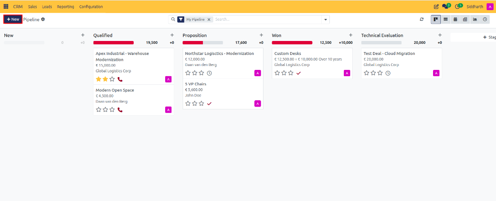
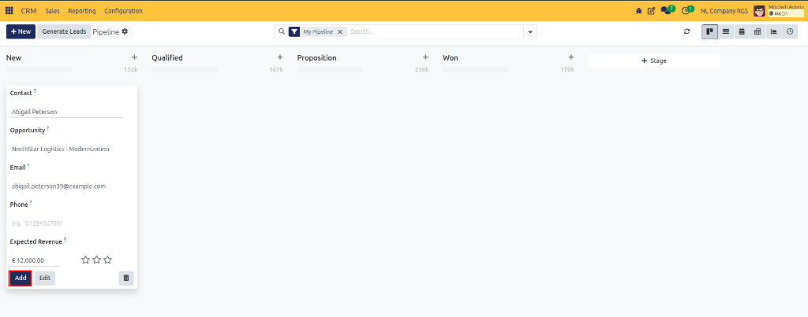
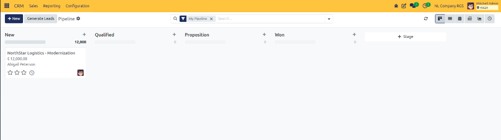
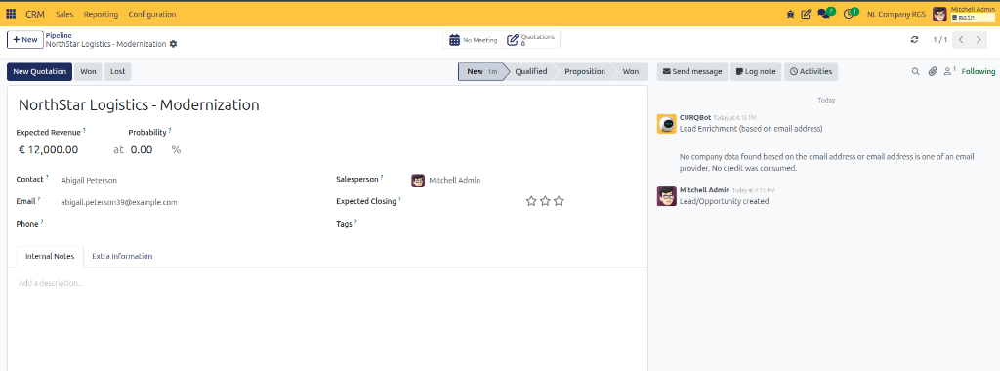
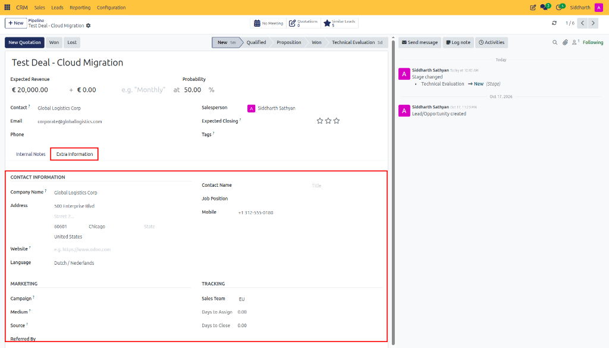
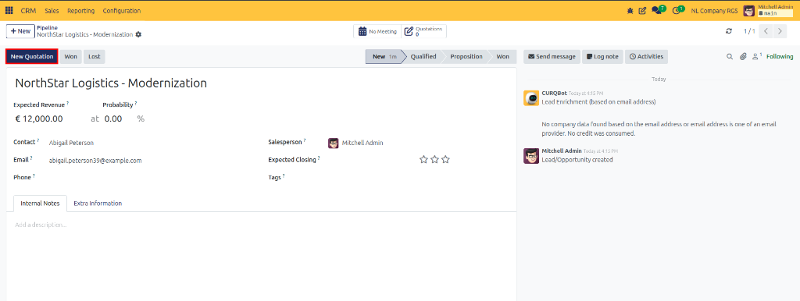

# Task Guide: Create and Manage Pipeline Opportunities

Create commercial opportunities directly on the Kanban board or via detailed form view, assign customers and salespeople, configure win probabilities, and generate sales quotations.

---

### Task 1: Quick Creation from the Pipeline Kanban

1. Open the **CRM** app from your main dashboard to access **My Pipeline**.
2. At the top left of the pipeline view, click the **+ New** button (highlighted in red) or click the **+** icon in the **New** stage column header.

   

3. Fill in the quick-creation fields:
   * **Contact**: Select an existing partner (e.g., `Global Logistics Corp`) or type a new name to create one.
   * **Opportunity**: Enter a descriptive title (e.g., `Test Deal - Cloud Migration`).
   * **Email**: Contact email address (`corporate@globallogistics.com`).
   * **Phone**: Direct telephone number.
   * **Expected Revenue**: Enter the estimated gross transaction value (e.g., `20,000.00`, which formats as `€ 20,000.00`).
   * **Priority**: Click stars (1 to 3) to flag high-priority deals.

   

4. Click the **Add** button at the bottom of the card (highlighted in red) to create the card immediately in the stage column (or click **Edit** to open the full form view).

   

The `Test Deal - Cloud Migration` deal card appears directly in the **New** column with its expected revenue (`€ 20,000.00`), customer (`Global Logistics Corp`), and scheduled activity icon.

> [!NOTE]
> For allowed formats, character constraints, and definitions of each field, see [Settings and Fields: Opportunity Form Fields](../settings-and-fields/01-lead-and-opportunity-field-definitions.md#opportunity-form-fields).

---

### Task 2: Configure Detailed Opportunity Properties

1. Open the `Test Deal - Cloud Migration` opportunity card from your pipeline to view the full form.

   

2. Review and configure core sales details:
   * **Expected Revenue & Recurring**: Displays `€ 20,000.00` alongside recurring plan options (`+ € 0.00 e.g. "Monthly"`).
   * **Probability**: By default, CURQ displays the baseline stage win probability (e.g., `at 50.00 %`). To set a custom percentage, type directly into the field.
   * **Contact**: Linked commercial partner (`Global Logistics Corp`).
   * **Email**: Contact email address (`corporate@globallogistics.com`).
   * **Salesperson**: Assigned sales representative (`Siddharth Sathyan`).
   * **Expected Closing**: Select the target date by which you expect the contract to close.
   * **Tags**: Click into the field and select or type color-coded category labels (e.g., `Enterprise`, `Software`).
   * **Priority**: Rating stars (`☆☆☆`).
3. In the **Internal Notes** tab at the bottom, type qualification background, technical specifications, or negotiation summaries.
4. Notice the header smart buttons (**Quotations**, **Similar Leads**), the stage status milestone bar (**New**, **Qualified**, **Proposition**, **Won**, **Technical Evaluation**), and the Chatter audit feed on the right tracking status changes. CURQ saves changes automatically.

---

### Task 3: Complete Extra Tracking and Campaign Attribution

1. On the opportunity form, select the **Extra Information** tab (highlighted in red).

   

2. Under the **Contact Information** section, review or populate:
   * **Company Name**: Legal entity name (`Global Logistics Corp`).
   * **Address**: Physical street address (`500 Enterprise Blvd`), postal code and city (`60601 Chicago`), and country (`United States`).
   * **Mobile**: Direct mobile number (`+1 312-555-0180`).
   * **Language**: Preferred communication language (`Dutch / Nederlands`).
   * **Website**: Web portal URL (e.g., `https://www.globallogistics.com`).
   * **Contact Name** & **Job Position**: Key individual decision-maker contacts within the partner account.
3. Under the **Marketing** section, track prospect acquisition source:
   * **Campaign**: Select the marketing initiative that generated this lead (e.g., `Webinar 2026`).
   * **Medium**: Select the delivery channel (e.g., `Email`, `Website Form`).
   * **Source**: Select the referral origin (e.g., `LinkedIn`, `Newsletter`).
   * **Referred By**: Enter the individual or partner who introduced the deal.
4. Under the **Tracking** section, monitor velocity and team ownership:
   * **Sales Team**: Assigned internal sales unit (`EU`).
   * **Days to Assign**: Automatically tracked days elapsed from lead creation to assignment (`0.00`).
   * **Days to Close**: Automatically tracked days elapsed to closed deal (`0.00`).
5. CURQ saves your updates automatically.

> [!NOTE]
> For descriptions of tracking metadata and assignment duration metrics, see [Settings and Fields: Extra Information Tab Fields](../settings-and-fields/01-lead-and-opportunity-field-definitions.md#extra-information-tab-fields).

---

### Task 4: Connect an Opportunity to a Sales Quotation

1. From the top action bar of the opportunity form, click the **New Quotation** button (highlighted in red).

   

2. CURQ creates a draft sales order pre-populated with the customer (`Global Logistics Corp`), salesperson (`Siddharth Sathyan`), and commercial terms.
3. Add quotation line items and product quantities.
4. When you save or confirm the quotation, the opportunity displays the **Quotations** smart button in its header showing real-time quote values and order status.

---

### Edge Cases & Recovery Steps

* **Resetting Overridden Probability**: If you entered a manual win probability and wish to restore the automated calculation, click the small gear icon next to the **Probability** field and select **Reset to default**.
* **Reassigning Deals**: If an opportunity needs to move to another representative, change the **Salesperson** field; the deal will automatically update in their personal pipeline.

---

### Related Documentation
* [Settings and Fields: Lead and Opportunity Form Field Definitions](../settings-and-fields/01-lead-and-opportunity-field-definitions.md)
* [Task Guide: Qualify and Convert Leads into Opportunities](./02-convert-leads-to-opportunities.md)
* [Task Guide: Manage Pipeline Stages and Won or Lost Deals](./03-manage-pipeline-stages-and-won-lost-status.md)
