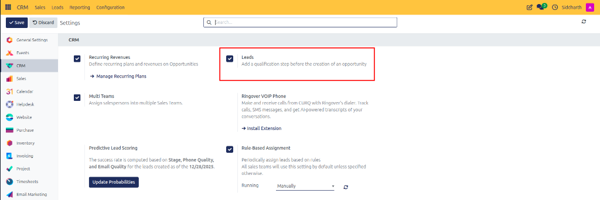
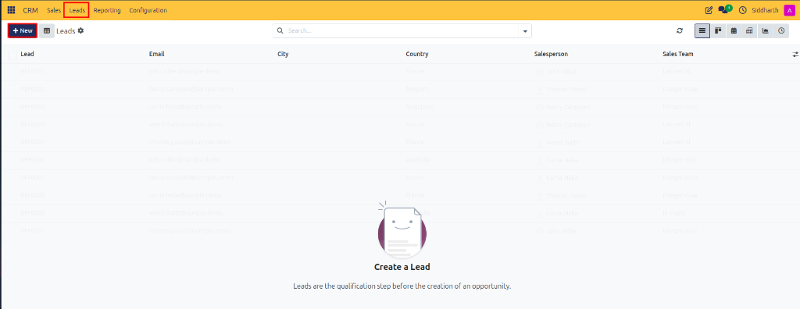
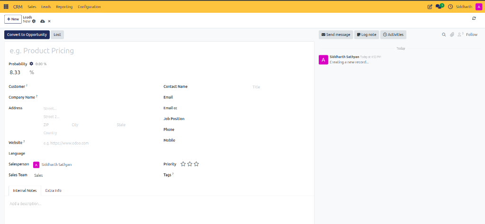
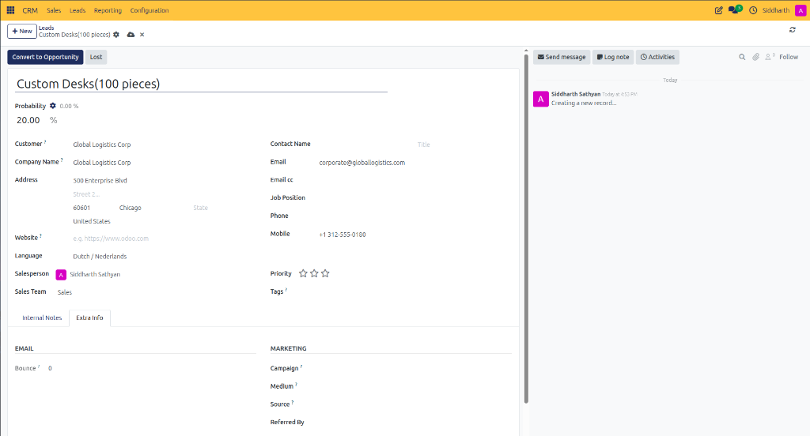
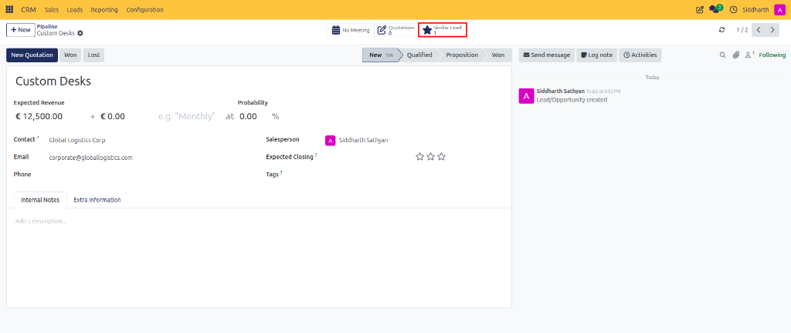
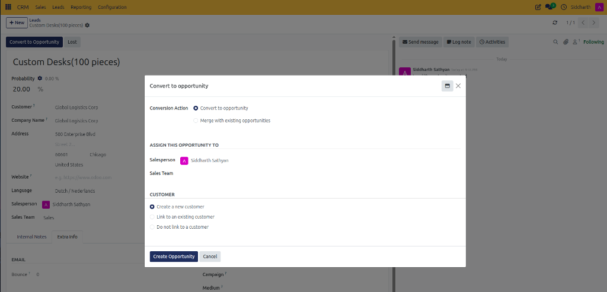
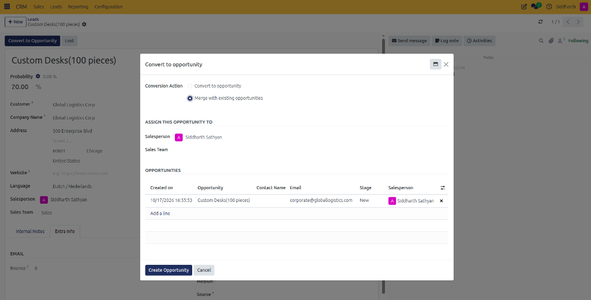
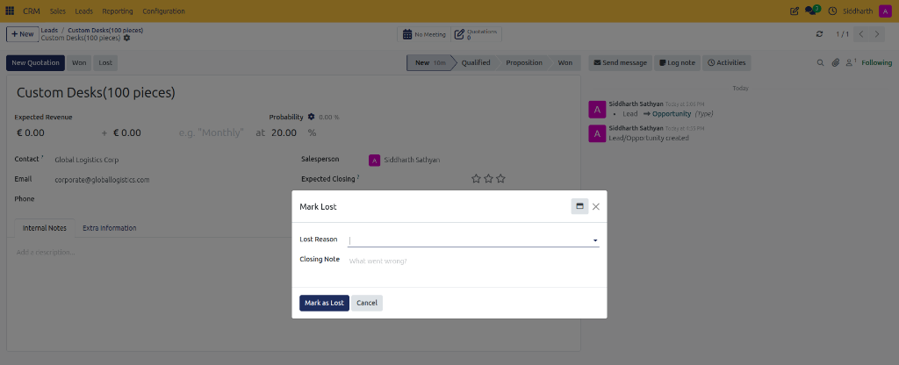

# How-To: Convert a Lead into an Opportunity

Capture unqualified inquiries, evaluate prospect suitability, identify duplicate records, and convert qualified leads into pipeline opportunities.

---

### Task 1: Enable the Leads Intake Workflow

1. Open the **CRM** app.
2. In the top navigation bar, click **Configuration > Settings**.
3. Under the **CRM** section, locate the **Leads** option.
4. Check the box labeled **Add a qualification step before the creation of an opportunity**.

   

5. Click **Save** in the top-left control panel.
6. A dedicated **Leads** menu item now appears in the top navigation bar.

---

### Task 2: Create and Manage Inbound Leads

1. In the top navigation bar, click **Leads**.
2. Click **+ New** at the top left of the list view.

   

3. Fill in the prospective inquiry information:

   

   * **Lead**: Type a descriptive subject (e.g., `Custom Desks(100 pieces)`).
   * **Customer** and **Company Name**: Enter prospect identity details (e.g., `Global Logistics Corp`).
   * **Address**: Enter street, city, state, postal code, and country (e.g., `500 Enterprise Blvd, Chicago, 60601, United States`).
   * **Email** and **Mobile**: Enter communication coordinates (e.g., `corporate@globallogistics.com`, `+1 312-555-0180`).
   * **Language**: Select correspondence language (e.g., `Dutch / Nederlands`).
   * **Salesperson** and **Sales Team**: Verify lead assignment (e.g., `Siddharth Sathyan` on `Sales`).
4. In the **Extra Info** tab, verify email tracking metrics and marketing attribution sources (**Campaign**, **Medium**, **Source**, **Referred By**).

   

5. The system automatically saves the record as fields are completed.

> [!NOTE]
> For field formats and allowed constraints, see [Reference: Inbound Lead Form Fields](../settings-and-fields/01-lead-and-opportunity-field-definitions.md#inbound-lead-form-fields).

---

### Task 3: Check for Duplicates Using Similar Leads

1. While reviewing an inquiry or pipeline record, inspect the stat buttons in the upper-right header.
2. When CURQ detects shared emails, phone numbers, or company names with existing records, the **Similar Lead** smart button activates and displays the match count (e.g., **Similar Lead 1**).

   

3. Click **Similar Lead** to view and compare matching inquiries side by side, preventing redundant outreach and confirming whether to merge.

---

### Task 4: Convert a Qualified Lead into an Opportunity

1. Open the qualified lead and click **Convert to Opportunity** in the top action bar.

   

2. In the conversion dialog, select the **Conversion Action**:
   * **Convert to opportunity**: Creates a new opportunity card in your pipeline.
   * **Merge with existing opportunities**: Combines this lead into an existing deal card if duplicate records were detected. You can review matched records in the **Opportunities** table or click **Add a line** to search and append further opportunities.

   

3. Choose the **Customer** destination:
   * **Create a new customer**: Automatically creates a new partner record with the lead's details.
   * **Link to an existing customer**: Select if the company is already registered in Contacts.
   * **Do not link to a customer**: Creates the opportunity without creating a contact profile.
4. Verify or adjust the assigned **Salesperson** (e.g., `Siddharth Sathyan`) and **Sales Team**.
5. Click **Create Opportunity**.

> [!NOTE]
> For behavioral rules and parameter outcomes of the conversion dialog, see [Reference: Lead Conversion Dialog Parameters](../settings-and-fields/01-lead-and-opportunity-field-definitions.md#lead-conversion-dialog-parameters).

---

### Edge Cases & Recovery Steps

* **Marking an Unqualified Lead as Lost**: If an inbound lead is spam, irrelevant, or not a commercial fit, click **Lost** in the top action bar. In the **Mark Lost** modal, select a **Lost Reason** from the dropdown, optionally add an explanation in **Closing Note**, and click **Mark as Lost** to close the inquiry.

   

* **Accidentally Converted Lead**: Once converted, the lead transforms into an opportunity. If conversion occurred prematurely, navigate to **CRM > Sales > My Pipeline**, open the deal card, and keep it in the **New** stage until qualified.
* **Merged Leads Data Retrieval**: When leads are merged, all secondary email addresses and notes are preserved in the destination record's Chatter history.

---

### Related Documentation
* [Explanation: Understanding Leads vs. Opportunities in CURQ](../core-concepts/01-understanding-leads-vs-opportunities.md)
* [Reference: Lead and Opportunity Form Field Definitions](../settings-and-fields/01-lead-and-opportunity-field-definitions.md)
* [How-To: Create and Manage Pipeline Opportunities](./01-create-and-manage-opportunities.md)
