# Schedule a Follow-Up Call and Manage Sales Activities

Schedule follow-up calls, meetings, and tasks from deal records, and manage commercial follow-ups using the centralized My Activities workspace.

---

### Task 1: Schedule an Activity on an Opportunity

1. Open any opportunity card from your pipeline (e.g., `Custom Desks`).
2. In the Chatter area on the right, click **Activities** (clock icon).
3. Configure the task in the **Schedule Activity** modal:

   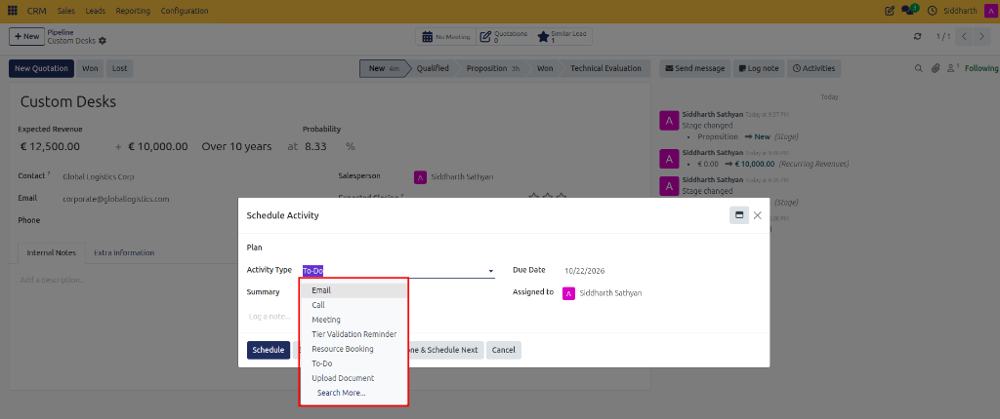

   * **Activity Type**: Select the interaction category from the dropdown (e.g., `Email`, `Call`, `Meeting`, `Tier Validation Reminder`, `Resource Booking`, `To-Do`, `Upload Document`).
   * **Summary**: Enter a short title or task objective (e.g., `Discuss proposal`).
   * **Due Date**: Select the completion deadline (e.g., `10/19/2026`).
   * **Assigned to**: Choose the responsible colleague (e.g., `Siddharth Sathyan`).
4. If scheduling a calendar meeting, notice the **Open Calendar** button next to Schedule:

   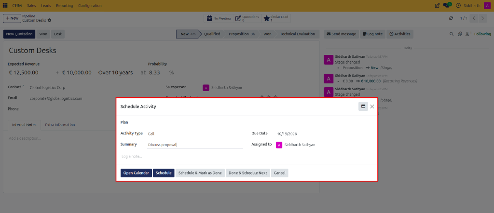

   * Click **Open Calendar** to check availability and book a meeting directly on the calendar grid, or click **Schedule** to log the task.
5. Click **Schedule** (or **Schedule & Mark as Done** if completing it immediately).

> [!NOTE]
> For default delay parameters, icon behaviors, and auto-chaining triggers, see [Activity Type Specifications](../settings-and-fields/03-activity-types-recurring-plans-and-lost-reasons.md#activity-type-specifications).

---

### Task 2: Manage Daily Tasks in My Activities Workspace

1. In the top navigation bar, click **Sales > My Activities**.

   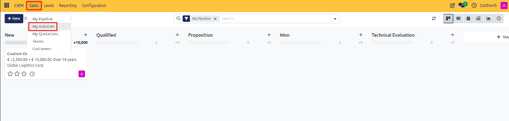

2. Click the purple **+ New** button at the top left to create an activity directly from the workspace:

   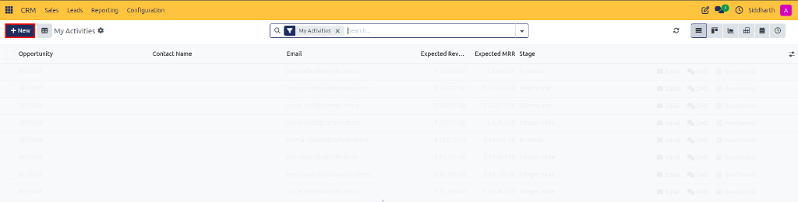

3. In the **Schedule Activity** dialog, enter the activity specifications:

   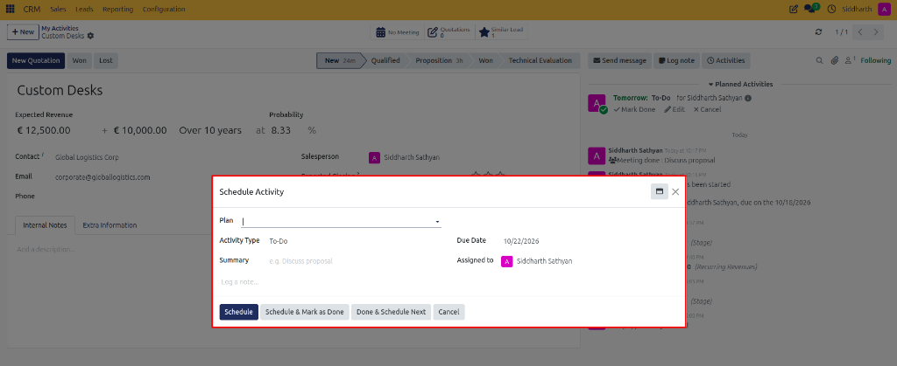

   * **Plan**: Optionally assign a structured multi-step sequence (e.g., automated onboarding or qualification plan).
   * **Activity Type**: Select the activity category (e.g., `To-Do`, `Call`, `Email`, `Meeting`).
   * **Due Date**: Set the deadline date (e.g., `10/22/2026`).
   * **Summary**: State the primary action item (e.g., `Discuss proposal`).
   * **Assigned to**: Designate the sales representative responsible (e.g., `Siddharth Sathyan`).
   * **Log a note...**: Provide internal context or conversation talking points.

4. In the main table, monitor active assignments across all opportunities:

   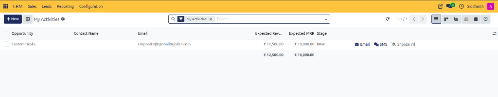

   * **Opportunity**: Target deal record (e.g., `Custom Desks`).
   * **Email**: Primary contact email (`corporate@globallogistics.com`).
   * **Expected Revenue & MRR**: One-off pipeline value (`€ 12,500.00`) and monthly recurring revenue (`€ 10,000.00`).
   * **Stage**: Current deal milestone (`New`).
   * **Quick Actions**: Inline shortcuts for **Email**, **SMS**, or **Snooze 7d** to defer follow-up by one week.

5. Review color-coded due dates:
   * **Red**: Overdue tasks requiring immediate attention.
   * **Green**: Tasks scheduled for today.
   * **Orange / Grey**: Tasks due in future days.

---

### Task 3: Filter Activities by Urgency and Type

1. In the search bar at the top center of **My Activities**, click to reveal search criteria:

   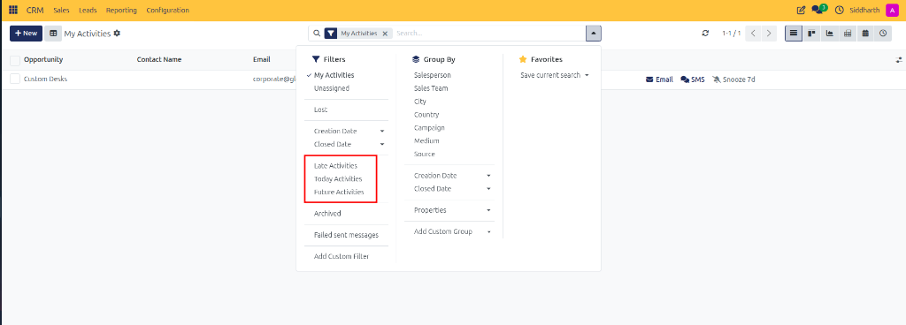

2. Apply preset urgency filters:
   * **Late Activities**: Isolate tasks that are overdue past their deadline.
   * **Today Activities**: Focus strictly on tasks scheduled for today's agenda.
   * **Future Activities**: Review upcoming milestones and follow-ups.
3. Group activities: Under **Group By**, categorize tasks by **Salesperson**, **Sales Team**, **City**, **Country**, **Campaign**, **Medium**, or **Source**.

---

### Task 4: Mark Activities Done and Chain Next Steps

1. In the opportunity's Chatter pane under **Planned Activities** (or from the **My Activities** table), locate the scheduled activity and click **Mark Done**:

   * For upcoming activities (indicated with a green status indicator, e.g., "Due in 4 days"):

     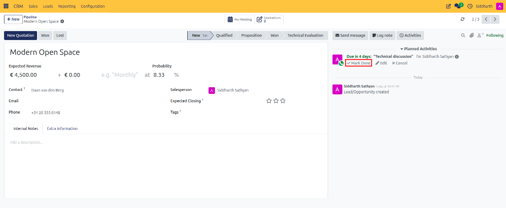

   * For overdue activities (indicated with a red warning badge, e.g., "3 days overdue"):

     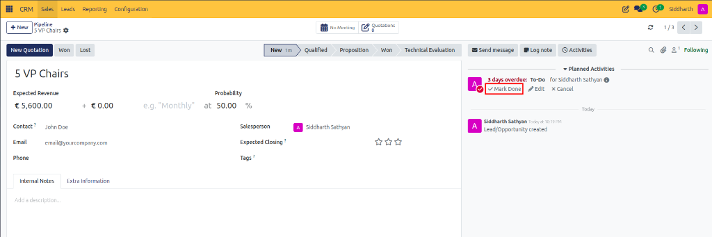

2. In the **Mark Done** feedback popover, enter optional completion notes in **Write Feedback** summarizing the conversation:

   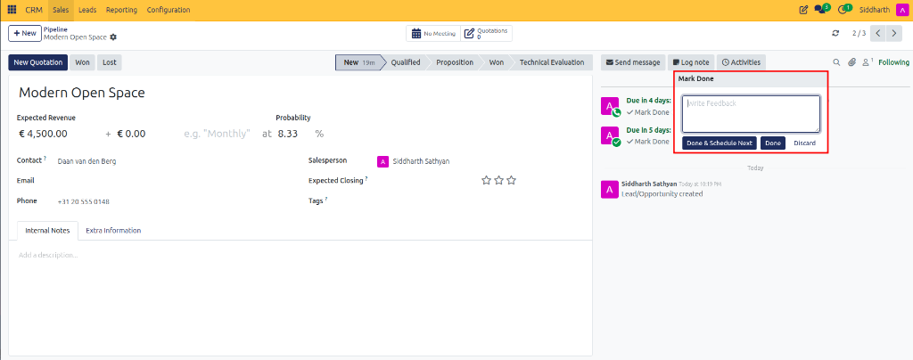

3. Choose the completion action:
   * **Done**: Completes the activity and archives the note permanently in the Chatter audit trail.
   * **Done & Schedule Next**: Closes the current activity and immediately opens the **Schedule Activity** dialog to configure the subsequent follow-up action:

     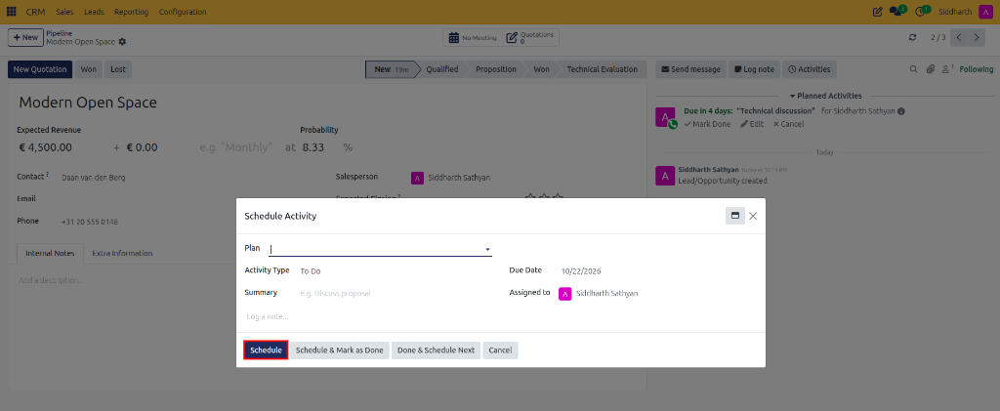

   * Enter the follow-up details and click **Schedule**.

---

### Task 5: Switch Activity View Modes

At the top right of **My Activities**, switch between visual execution layouts:

* **Kanban Card View**: Displays visual opportunity cards organized by stage (*New*, *Qualified*, *Proposition*, *Won*, *Technical Evaluation*) with color-coded activity urgency bars and activity icons.

  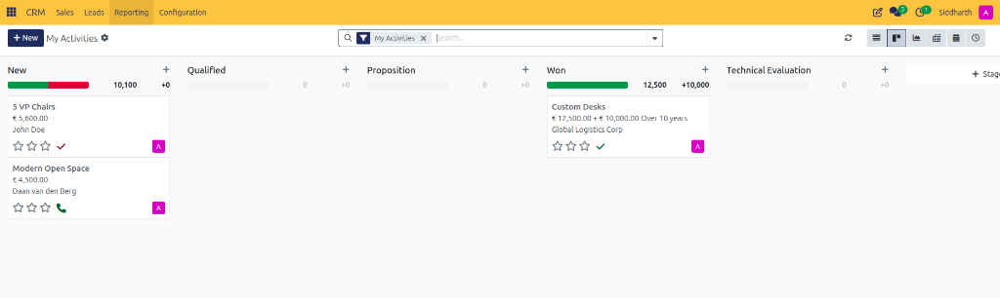

* **Calendar View**: Displays scheduled calls, tasks, and meetings on an interactive monthly, weekly, or daily grid with side filters for customers and salespersons.

  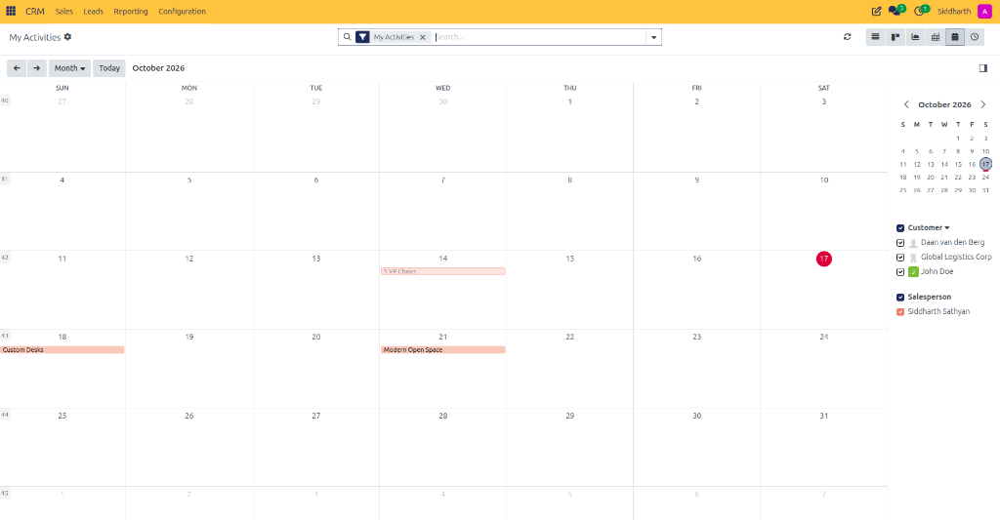

* **Activity Matrix View**: Displays a cross-tabulation matrix mapping opportunities (*5 VP Chairs*, *Custom Desks*, *Modern Open Space*) against configured activity types (*Email*, *Call*, *Meeting*, *To-Do*, etc.), complete with top-level tally bars and color-coded deadline badges (red for overdue, green for scheduled):

  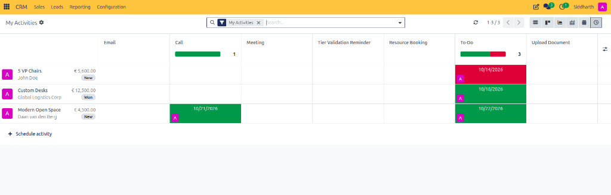

* **Pivot View**: Summarizes expected revenue and opportunity counts grouped by pipeline stage and closing months in a multi-dimensional table.

  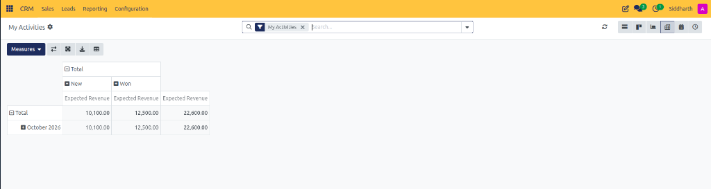

---

### Edge Cases & Recovery Steps

* **Rescheduling a Missed Call**: Open the deal, locate the overdue activity in the Chatter pane, click the small pencil icon, update the **Due Date**, and click **Save**.
* **Activity Scheduled by Mistake**: Click the trash can icon next to the scheduled activity line in the Chatter to cancel it without recording a completed entry.

---

### Related Documentation
* [Activity Types, Recurring Plans, and Lost Reasons](../settings-and-fields/03-activity-types-recurring-plans-and-lost-reasons.md)
* [Configure Activity Types and Automated Activity Plans](./09-configure-activity-types-and-plans.md)
