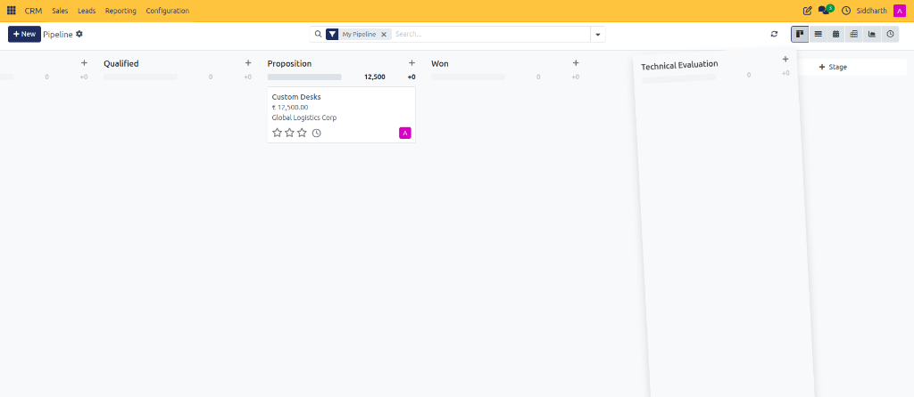

# Task Guide: Configure Custom Pipeline Stages

Create custom pipeline stages, adjust stage properties, configure folded columns, and reorder stages to match your sales methodology.

---

### Task 1: Add a New Stage on the Kanban Board

1. Open **CRM > Sales > My Pipeline**.
2. Scroll to the far right of the Kanban board.
3. Click the **+ Stage** button located to the right of the existing columns.

   

4. In the inline input box, enter the stage name (e.g., `Technical Evaluation`).

   

5. Click **Add** (or press Enter). The new stage column appears on your board immediately.

---

### Task 2: Configure Stage Properties and Guidelines

1. Hover over the title of the newly created stage column and click the gear actions icon.
2. Select **Edit** from the dropdown menu.

   

3. In the **Edit: [Stage Name]** modal dialog:

   

   * **Stage Name**: Edit the display title of the stage (e.g., `Technical Evaluation`).
   * **Is Won Stage?**: Check this box if opportunities moved to this stage should be automatically recognized as won.
   * **Folded in Pipeline**: Check this box if you want this column to stay collapsed vertically unless a deal is dragged into it.
   * **Requirements**: Enter internal criteria, guidelines, or milestone checklists displayed to salespeople to move an opportunity into this stage.
4. Click **Save & Close**.

> [!NOTE]
> For detailed field constraints and pipeline behaviors, see [Settings and Fields: Pipeline Stage Properties](../settings-and-fields/02-pipeline-configuration-and-assignment-settings.md#pipeline-stage-properties).

---

### Task 3: Reorder Stages in the Pipeline

1. Hover your cursor over the title bar of the stage column you want to move (e.g., `Technical Evaluation`).
2. Click and hold the column header.
3. Drag the column horizontally to its new position along your sales timeline.

   

4. Release the mouse. CURQ stores the new stage order for all users.

---

### Edge Cases & Recovery Steps

* **Deleting vs. Folding Stages**: If you delete a stage that contains active opportunities, CURQ prompts you to move them or cancel. To keep past deal records intact without deleting them, consider checking **Folded in Pipeline** instead.
* **Column Actions Menu Options**: The gear icon on each column provides quick access to **Fold** (collapse immediately), **Edit** (open configuration modal), **Automations** (set stage trigger actions), or **Delete** (remove stage).

---

### Related Documentation
* [Settings and Fields: Pipeline Configuration and Assignment Settings](../settings-and-fields/02-pipeline-configuration-and-assignment-settings.md)
* [Task Guide: Manage Pipeline Stages and Won or Lost Deals](./03-manage-pipeline-stages-and-won-lost-status.md)
* [Core Concepts: Understanding Leads vs. Opportunities in CURQ](../core-concepts/01-understanding-leads-vs-opportunities.md)
