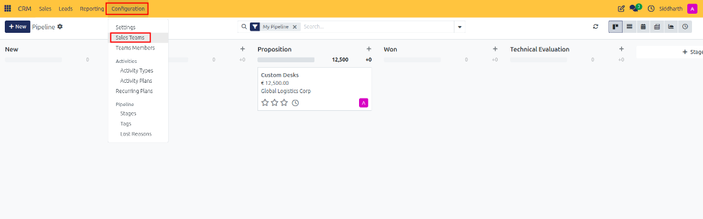
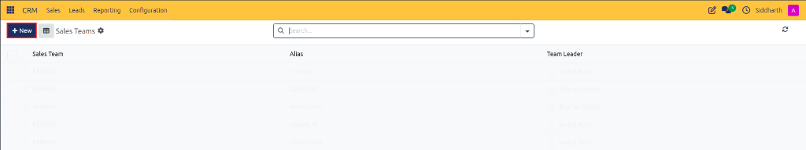
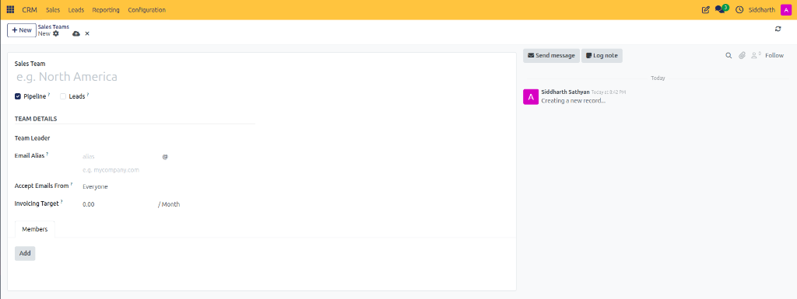
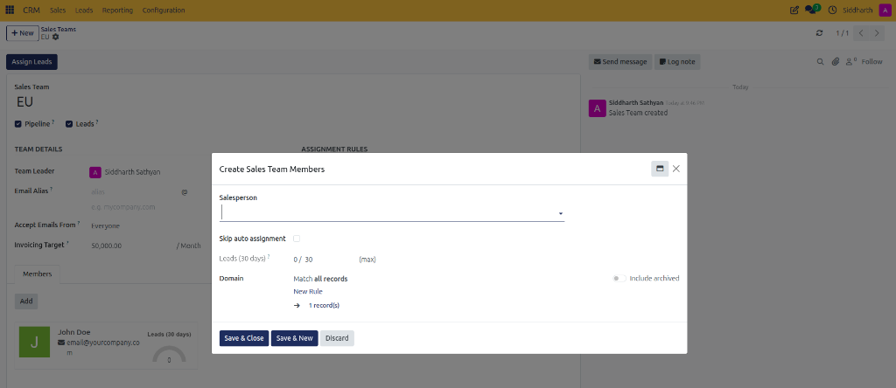
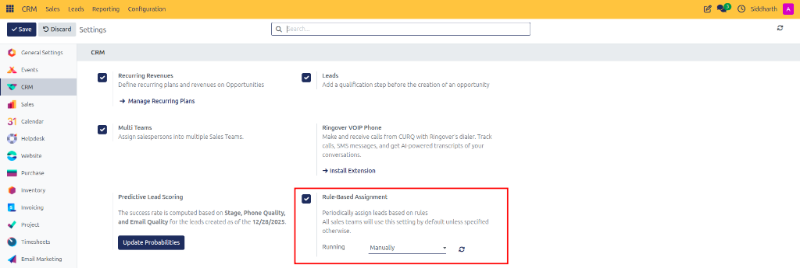
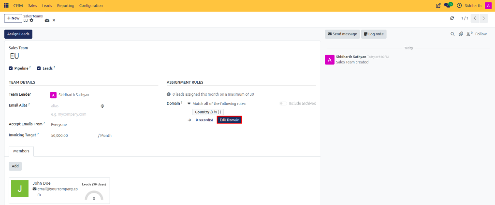
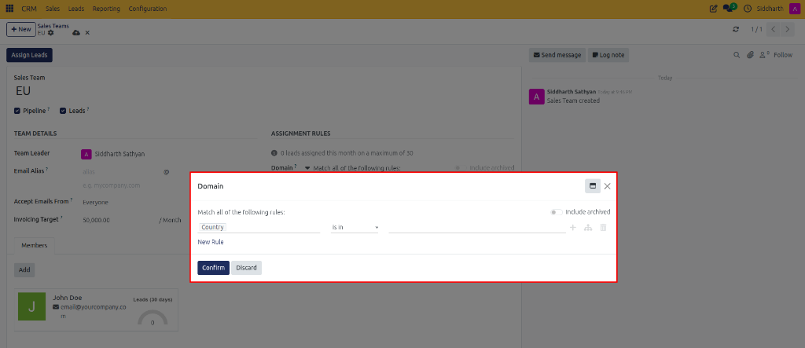
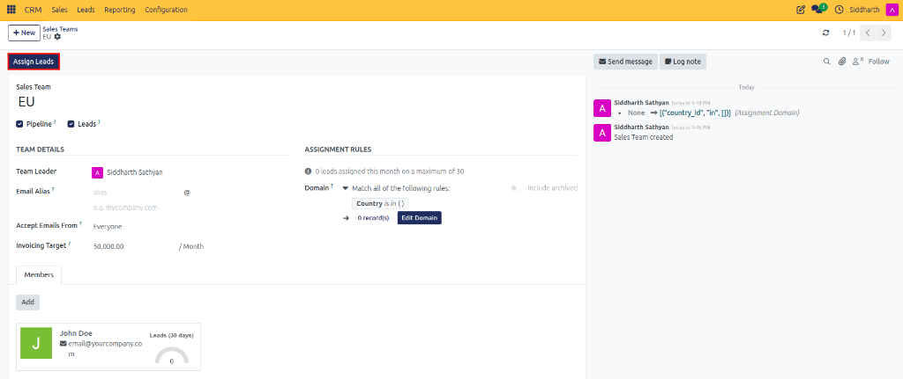
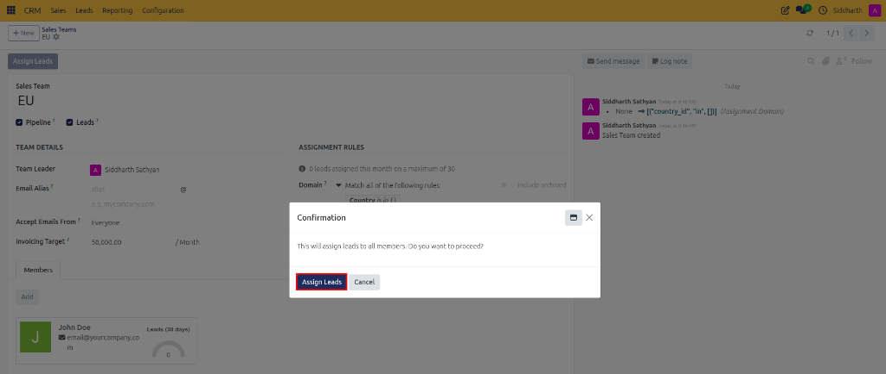

# How-To: Configure Sales Teams and Rule-Based Lead Assignment

Organize sales teams, set monthly invoicing targets, configure territorial assignment domains, and automate lead allocation across team members.

---

### Task 1: Create a Sales Team

1. Open the **CRM** app from your main dashboard.
2. In the top navigation bar, click **Configuration > Sales Teams**.

   

3. Review the existing teams in the list view, then click **+ New** at the top left.

   

4. On the sales team form, configure the core attributes:

   

   * **Sales Team**: Enter the name of the sales unit (e.g., `North America` or `EU`).
   * **Pipeline**: Checked by default; keeps the stage pipeline board active for this team.
   * **Leads**: Check this box if the team processes unassigned incoming leads.
   * Under **TEAM DETAILS**:
     * **Team Leader**: Select the manager supervising this team.
     * **Email Alias**: Enter a dedicated inbound email prefix (e.g., `sales-na` or `alias`) so messages sent to this address automatically generate opportunities.
     * **Accept Emails From**: Set sender authorization permissions (defaults to `Everyone`).
     * **Invoicing Target**: Enter the monthly team revenue target in company currency (e.g., `10,000.00 / Month`).
5. CURQ auto-saves updates, or click the cloud icon in the top header to save immediately.

> [!NOTE]
> For parameter specifications and capacity definitions, see [Reference: Sales Team Parameters](../settings-and-fields/02-pipeline-configuration-and-assignment-settings.md#sales-team-parameters).

---

### Task 2: Add Team Members and Set Monthly Capacities

1. On the sales team form, locate the **Members** tab at the bottom.
2. Click **Add**.

   

3. In the **Create Sales Team Members** modal dialog:
   * **Salesperson**: Select the user from your company directory (e.g., `John Doe`).
   * **Skip auto assignment**: Leave unchecked to include this salesperson in automated lead routing, or check it if they should only receive manual assignments.
   * **Leads (30 days)**: Set the maximum quota cap for unassigned leads this representative can receive in a rolling 30-day window (e.g., `0 / 30 (max)`).
   * **Domain**: (Optional) Define member-specific routing conditions by clicking **New Rule** (e.g., specific territory, language, or lead score criteria).
4. Click **Save & Close** (or **Save & New** to add additional team members).
5. Active members appear as cards with visual gauges tracking their assigned leads over the past 30 days.

---

### Task 3: Enable Rule-Based Assignment in Settings

1. In the top navigation bar, click **Configuration > Settings**.
2. Under the **CRM** section, locate **Rule-Based Assignment**.
3. Check the **Rule-Based Assignment** box.

   

4. Configure the **Running** schedule:
   * **Manually**: Lead distribution triggers only when an authorized leader clicks **Assign Leads**.
   * **Repeatedly**: Runs an automated background job (e.g., Every `1` `Hours`).
5. Click **Save** in the top action bar.

> [!NOTE]
> For cron interval options and execution descriptions, see [Reference: Rule-Based Assignment Parameters](../settings-and-fields/02-pipeline-configuration-and-assignment-settings.md#rule-based-assignment-parameters).

---

### Task 4: Configure Assignment Domains and Territories

1. Return to **Configuration > Sales Teams** and select your team (e.g., `EU`).
2. Under the **ASSIGNMENT RULES** column, observe the monthly capacity summary (e.g., `0 leads assigned this month on a maximum of 30`).
3. Click the purple **Edit Domain** button (highlighted in red) next to the matching record counter.

   

4. In the **Domain** configuration modal dialog, define your territorial or qualification criteria:

   

   * Choose the rule aggregation method from the top dropdown: **Match all of the following rules** (AND logic) or **Match any of the following rules** (OR logic).
   * Define territorial filter rules (e.g., `Country` `is in` `[selected countries]` or `Expected Revenue >= 50,000`).
   * Click the **+** button or **New Rule** to append further conditions, or use the branch icon for nested logical groups.
   * (Optional) Toggle **Include archived** if inactive customer records should be evaluated.
5. Click **Confirm** to save the assignment domain.

---

### Task 5: Execute Manual Lead Assignment

1. On the sales team form, click the purple **Assign Leads** button in the header action bar (highlighted in red).

   

2. In the **Confirmation** dialog, review the prompt: *"This will assign leads to all members. Do you want to proceed?"*.

   

3. Click **Assign Leads** (highlighted in red). CURQ immediately evaluates unassigned leads against the team domain rules and distributes them across active team members up to their 30-day capacity limits.

---

### Edge Cases & Recovery Steps

* **Team Member Exceeding Capacity**: If a representative reaches their rolling 30-day cap defined in **Leads (30 days)**, the assignment algorithm automatically skips them and routes subsequent leads to remaining team members with available capacity.
* **Leads Not Routing**: Verify that the lead attributes match the exact assignment domain filters configured under **ASSIGNMENT RULES**. If a domain matches zero records, click **Edit Domain** and adjust your filter criteria.
* **Excluding Team Leaders from Routing**: To prevent supervisors from receiving automated lead allocations, check the **Skip auto assignment** box on their member card.
* **Scheduled Cron Failures**: If scheduled lead routing stops running, verify in **Configuration > Settings** that **Rule-Based Assignment** is enabled and set to **Repeatedly**.

---

### Related Documentation
* [Reference: Pipeline Configuration and Assignment Settings](../settings-and-fields/02-pipeline-configuration-and-assignment-settings.md)
* [Explanation: Understanding Lead Assignment and Predictive Scoring](../core-concepts/02-understanding-lead-assignment-and-predictive-scoring.md)
* [How-To: Configure Custom Pipeline Stages](./05-configure-pipeline-stages.md)
* [How-To: Convert Leads into Pipeline Opportunities](./02-convert-leads-to-opportunities.md)
