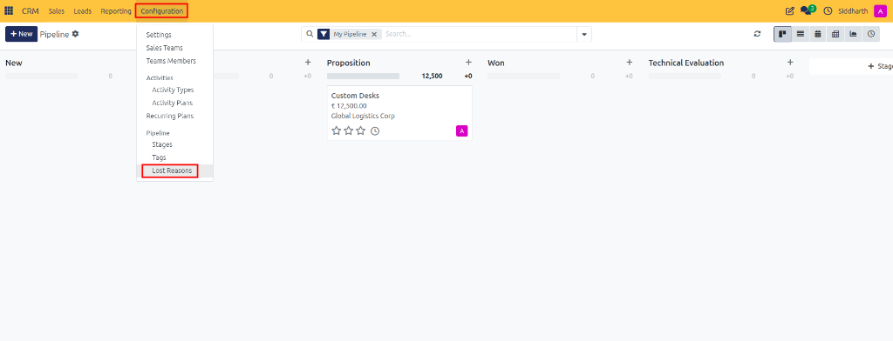
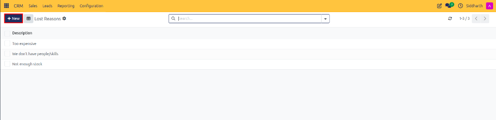
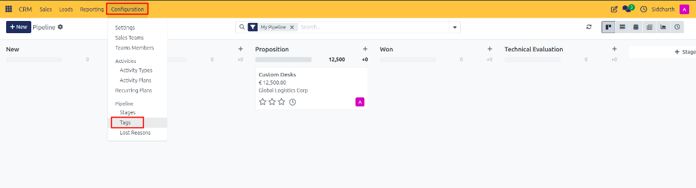
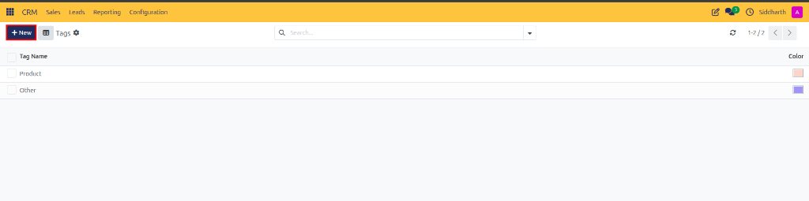

# Task Guide: Configure Standardized Lost Reasons and Deal Tags

Configure standardized lost reason taxonomies and create color-coded deal tags to maintain structured pipeline reporting.

---

### Task 1: Configure Standard Lost Reasons

1. Open the **CRM** app from your main dashboard.
2. In the top navigation bar, click **Configuration > Lost Reasons** (located under the **Pipeline** section).

   

3. Review the existing catalog of default reasons (`Too expensive`, `We don't have people/skills`, `Not enough stock`).

   

4. Click the purple **+ New** button at the top left to append an entry.
5. In the inline **Description** field, enter your standardized reason title (e.g., `Competitor Selected` or `Technical Scope Incompatibility`).
6. Press **Enter** or click the cloud icon at the top of the window to save the reason.

> [!NOTE]
> For standard analytical categories and industry taxonomies, see [Settings and Fields: Standard Lost Reasons Catalog](../settings-and-fields/03-activity-types-recurring-plans-and-lost-reasons.md#standard-lost-reasons-catalog).

---

### Task 2: Create Color-Coded Opportunity Tags

1. In the top navigation bar, click **Configuration > Tags** (located under the **Pipeline** section).

   

2. Review the active tags catalog (e.g., `Product`, `Other`).

   

3. Click the purple **+ New** button at the top left.
4. In the **Tag Name** column, type your custom tag label (e.g., `Enterprise`, `Consulting`, or `Q4 Push`).
5. In the **Color** column, click the color swatch box to open the swatch palette, then click a color index to visually style the tag badge.
6. Press **Enter** or click away to save the new tag.

> [!NOTE]
> For recommended tag taxonomies and color schemes, see [Settings and Fields: Default Deal Tags](../settings-and-fields/03-activity-types-recurring-plans-and-lost-reasons.md#default-deal-tags).

---

### Task 3: Assign Tags Directly from Deal Cards

1. Open any opportunity card or form from your Kanban pipeline or list view.
2. Locate the **Tags** field in the form details.
3. Click into the **Tags** field:
   * Select an existing tag from the dropdown list.
   * Or type a new tag name and click **Create "[Tag Name]"** to create and assign it on the fly.
4. Assigned tags appear as colored pills on the opportunity card across Kanban boards, list views, and reporting filters.
5. Click the cloud icon (or navigate away) to save.

---

### Edge Cases & Recovery Steps

* **Archiving Outdated Lost Reasons**: Never delete a lost reason that has historical opportunities attached. Instead, open the reason record, click the gear actions icon, and select **Archive**. This preserves historical win/loss analytics while preventing salespeople from selecting the obsolete reason on new deals.
* **Updating Tag Colors**: Changing a tag's color swatch from the **Configuration > Tags** list immediately updates that tag's appearance on all open and closed opportunities across the company.
* **Managing Duplicate Tags**: If users create overlapping tags (e.g., `Enterprise` and `enterprise`), reassign deals to the primary tag, then delete or archive the duplicate from the **Tags** list view.

---

### Related Documentation
* [Settings and Fields: Activity Types, Recurring Plans, and Lost Reasons](../settings-and-fields/03-activity-types-recurring-plans-and-lost-reasons.md)
* [Task Guide: Manage Pipeline Stages and Won or Lost Deals](./03-manage-pipeline-stages-and-won-lost-status.md)
* [Task Guide: Create and Manage Pipeline Opportunities](./01-create-and-manage-opportunities.md)
* [Task Guide: Configure Custom Pipeline Stages](./05-configure-pipeline-stages.md)
