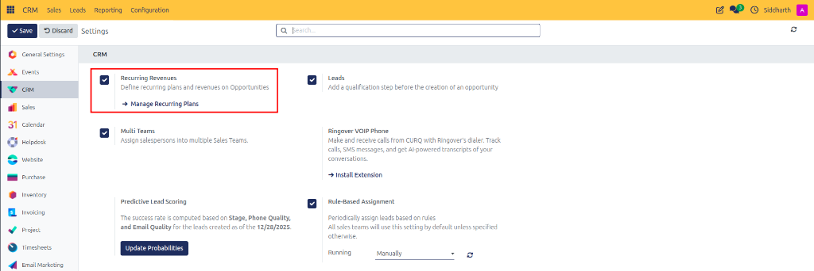
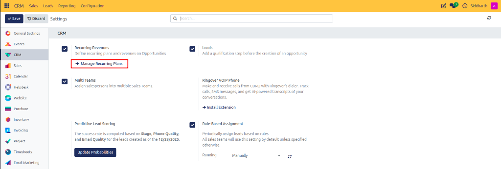
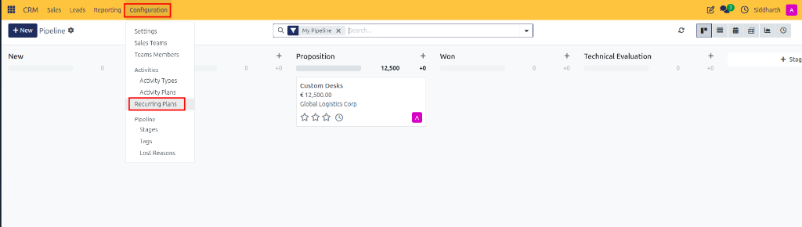
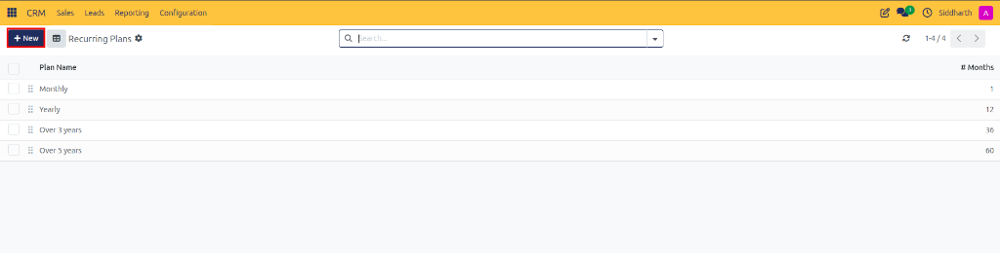
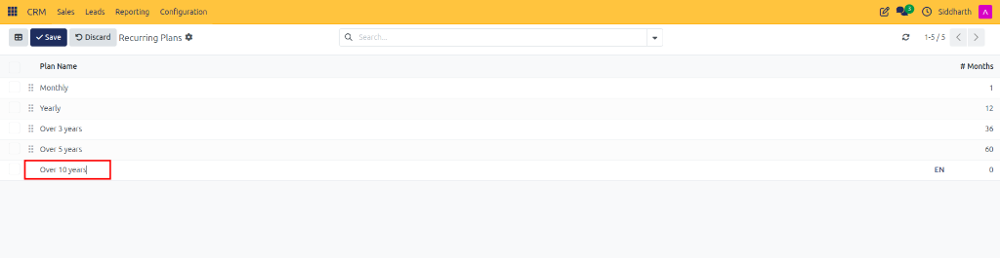
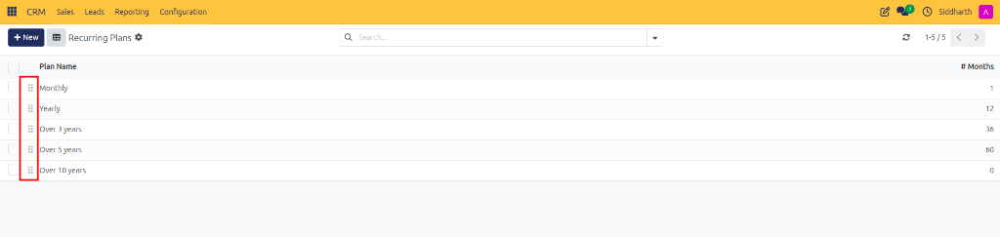
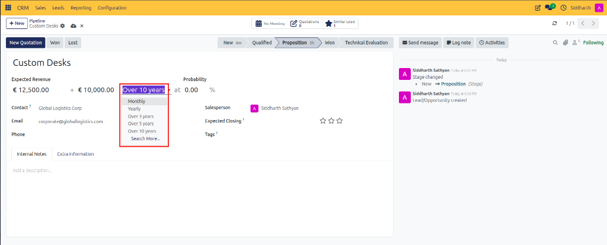
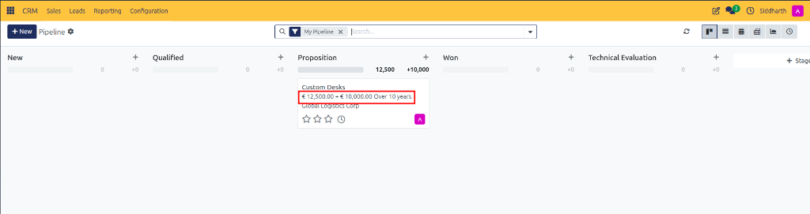
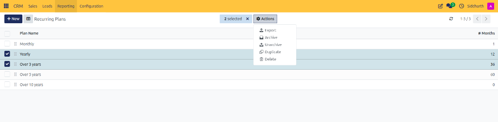

# Configure Recurring Revenue Plans

Enable subscription tracking, configure recurring billing intervals, and apply recurring plans to commercial opportunities.

---

### Task 1: Enable Recurring Revenues in Settings

1. Open the **CRM** app from your main dashboard.
2. In the top navigation bar, click **Configuration > Settings**.
3. Under the **CRM** section, check the box for **Recurring Revenues** (*"Define recurring plans and revenues on Opportunities"*).

   

4. Click **Save** in the top left action bar.
5. Once saved, you can access your recurring plans in two ways:
   * Click the **➜ Manage Recurring Plans** shortcut link directly beneath the setting:

     

   * Or navigate through the top menu via **Configuration > Recurring Plans** (located under the **Activities** section):

     

---

### Task 2: Create and Manage Recurring Plans

1. Navigate to **Configuration > Recurring Plans** (or click the shortcut from Settings).

   

2. Review the existing default intervals:
   * `Monthly`: 1 month
   * `Yearly`: 12 months
   * `Over 3 years`: 36 months
   * `Over 5 years`: 60 months
3. Click the purple **+ New** button at the top left of the list to add a plan.
4. An editable row appears at the bottom of the table:

   

   * **Plan Name**: Enter the contract billing frequency (e.g., `Over 10 years`, `Quarterly Retainer`, or `Bi-annually`).
   * **# Months**: Enter the number of months the contract period covers (e.g., `120` for 10 years, `3` for quarterly).
5. Click **Save** in the top left action bar (or press Enter).
6. Drag the 6-dot reorder handle on the far left of any row (highlighted in red) to reorder how the plans appear in opportunity selection menus.

   

> [!NOTE]
> For duration specifications and monthly normalization formulas, see [Recurring Revenue Plan Intervals](../settings-and-fields/03-activity-types-recurring-plans-and-lost-reasons.md#recurring-revenue-plan-intervals).

---

### Task 3: Apply Recurring Plans to Opportunities

1. Open any opportunity form in your pipeline Kanban or list view (e.g., `Custom Desks`).
2. In the top revenue header, locate the recurring revenue fields:

   

3. Review the base one-off **Expected Revenue** amount (e.g., `€ 12,500.00`).
4. In the recurring revenue amount field, enter the contract installment value (e.g., `€ 10,000.00`).
5. Click the recurring plan dropdown (highlighted in red) and select your billing interval (e.g., `Over 10 years`).
6. Save the record. On the pipeline Kanban board, the deal card displays both one-off and recurring revenue metrics clearly:

   

   * Example: `€ 12,500.00 + € 10,000.00 Over 10 years`.

---

### Edge Cases & Recovery Steps

* **Archiving a Discontinued Plan**: If a contract duration is retired, select its row checkbox in **Configuration > Recurring Plans** (e.g., `Yearly` and `Over 3 years`), click the **⚙ Actions** dropdown menu, and select **Archive**. Existing opportunities linked to this plan maintain their historical calculations, but the plan will no longer be offered on new deals.

   

* **Handling Multi-Currency Contracts**: Expected MRR is computed using the active opportunity's company currency exchange rate at the time of quoting.

---

### Related Documentation
* [Understanding Leads vs. Opportunities in CURQ](../core-concepts/01-understanding-leads-vs-opportunities.md)
* [Default Deal Tags, Lost Reasons, and Activity Specifications](../settings-and-fields/03-activity-types-recurring-plans-and-lost-reasons.md)
* [Create and Manage Pipeline Opportunities](./01-create-and-manage-opportunities.md)
* [Configure Activity Types and Automated Activity Plans](./09-configure-activity-types-and-plans.md)
