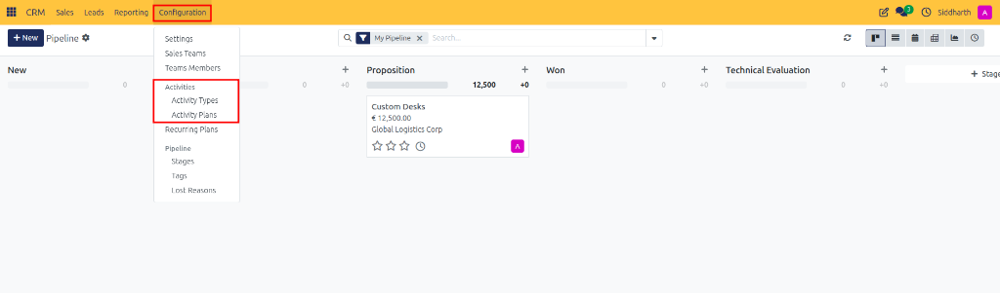
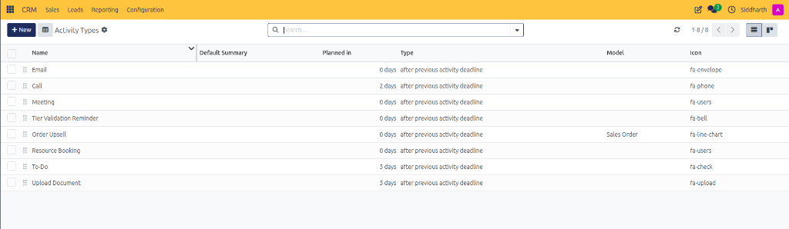
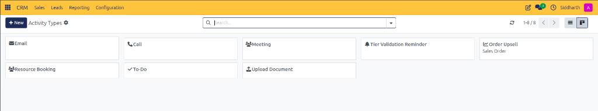
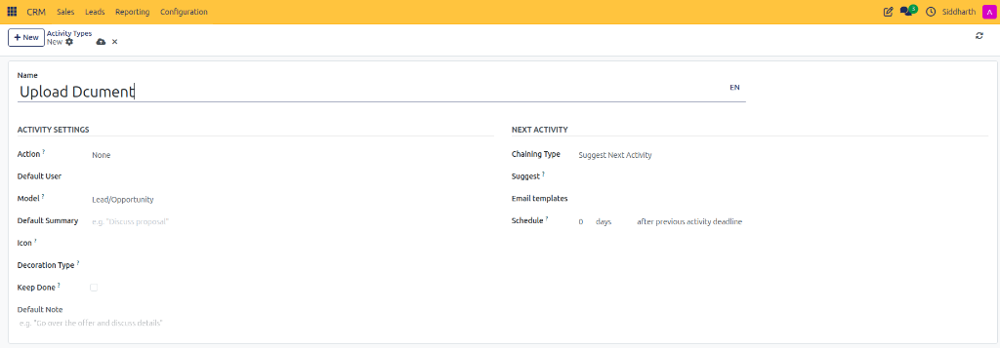
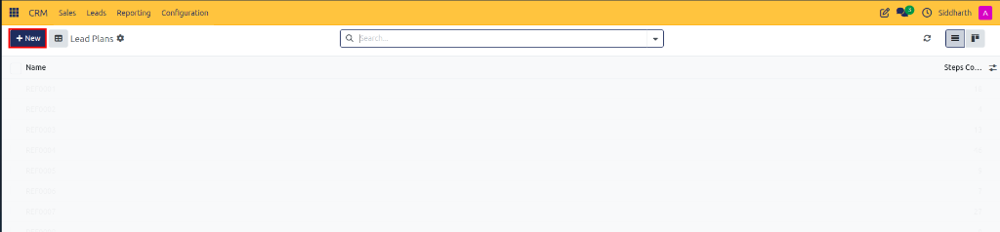
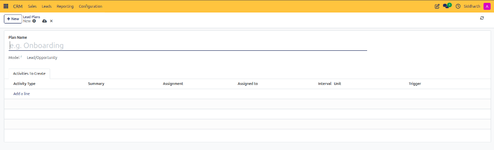
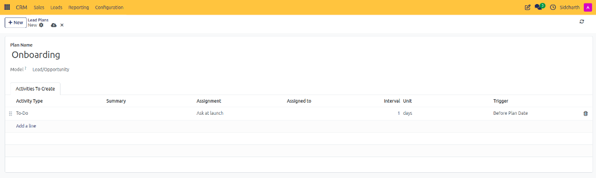
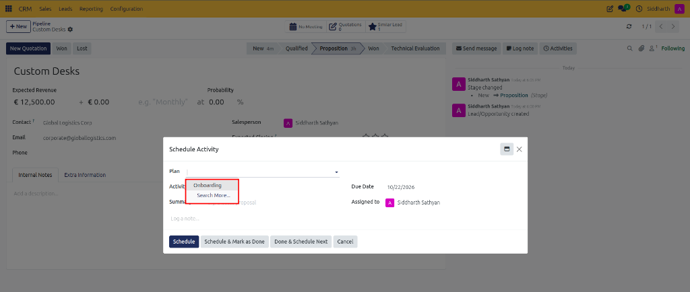

# Configure Activity Types and Automated Activity Plans

Standardize customer engagement actions, automate multi-step milestone task sequences, and launch activity plans on deals.

---

### Task 1: Configure Activity Types

1. Open the **CRM** app from your main dashboard.
2. In the top navigation bar, click **Configuration > Activities > Activity Types**.

   

3. Review the existing categories in the list view (or switch to Kanban view using the view toggle at the top right):

   

   

4. Click the purple **+ New** button at the top left to create a new type (or click an existing record such as `Call`, `Meeting`, or `Upload Document` to edit it).
5. On the activity type configuration form, configure the core attributes:

   

   * **Name**: Enter the descriptive activity title (e.g., `Executive Discovery Call` or `Upload Document`).
   * Under **ACTIVITY SETTINGS**:
     * **Action**: Choose specialized behavior (e.g., `None`, `Meeting` to connect with calendar scheduling, or `Upload Document`).
     * **Default User**: (Optional) Designate a specific user automatically assigned when this activity is scheduled.
     * **Model**: Constrain the activity to a specific target model (e.g., `Lead/Opportunity`).
     * **Default Summary**: Enter a default subject line or placeholder (e.g., `Discuss proposal`).
     * **Icon**: Select an icon glyph from the FontAwesome picker (e.g., `fa-phone`, `fa-users`, `fa-upload`).
     * **Keep Done**: Check this box if completed instances should remain pinned in the Chatter stream.
     * **Default Note**: Provide standard instructions or guidelines displayed to salespeople when executing the task.
   * Under **NEXT ACTIVITY**:
     * **Chaining Type**: Set to **Suggest Next Activity** (prompts the rep to schedule a follow-up upon completion) or **Trigger Next Activity** (automatically schedules a sequential task).
     * **Suggest**: Select which activity type to recommend next in the sales workflow.
     * **Schedule**: Enter the standard due delay (e.g., `2 days after previous activity deadline` or completion date).
6. CURQ auto-saves updates, or click the cloud icon in the top header to save immediately.

> [!NOTE]
> For action types, icon bindings, and chaining behaviors, see [Activity Type Specifications](../settings-and-fields/03-activity-types-recurring-plans-and-lost-reasons.md#activity-type-specifications).

---

### Task 2: Build a Multi-Step Activity Plan

Activity Plans allow you to launch an entire sequence of milestone activities with a single click:

1. In the top navigation bar, click **Configuration > Activities > Activity Plans**.

   

2. Click the purple **+ New** button at the top left.
3. In the blank plan form:

   

   * **Plan Name**: Enter a descriptive workflow title (e.g., `Onboarding` or `Enterprise Deal Qualification Sequence`).
   * **Model**: Defaults to `Lead/Opportunity`.
4. In the **Activities To Create** tab, click **Add a line** for each sequential task:

   

   * **Activity Type**: Select the task action (e.g., `To-Do`, `Call`, `Meeting`, or `Email`).
   * **Summary**: Enter the milestone title or objective.
   * **Assignment**: Set who performs the task (e.g., `Ask at launch` or fixed representative).
   * **Interval** & **Unit**: Specify the execution timeline (e.g., `1` `days`).
   * **Trigger**: Select relative scheduling timing (e.g., `Before Plan Date` or `After Plan Date`).
5. Click the cloud icon to save the plan template.

> [!NOTE]
> For plan parameters and assignment options, see [Activity Plan Structure](../settings-and-fields/03-activity-types-recurring-plans-and-lost-reasons.md#activity-plan-structure).

---

### Task 3: Launch an Activity Plan on an Opportunity

1. Open any opportunity card or form from your pipeline (e.g., `Custom Desks`).
2. In the Chatter area on the right, click the **Activities** button (clock icon).
3. In the **Schedule Activity** modal dialog, click the **Plan** dropdown:

   

4. Select your configured plan (e.g., `Onboarding`).
5. Review the scheduled task details, due date, and assigned colleague.
6. Click **Schedule** at the bottom left of the modal.
7. CURQ instantly schedules the entire sequence of tasks in the opportunity Chatter stream.

---

### Edge Cases & Recovery Steps

* **Editing a Step on an Active Deal**: Launching a plan creates discrete scheduled tasks. To adjust a specific step on an individual deal without modifying the master template, click the pencil icon next to that scheduled activity in Chatter.
* **Model Constraints**: If an activity type or activity plan does not appear when scheduling from a deal, ensure its **Model** is set to `Lead/Opportunity` rather than another app module.
* **Chaining Next Steps**: Using `Suggest Next Activity` guides reps through a consistent sales methodology by pre-filling the next logical action when they mark an activity as done.

---

### Related Documentation
* [Activity Types, Recurring Plans, and Lost Reasons](../settings-and-fields/03-activity-types-recurring-plans-and-lost-reasons.md)
* [Schedule and Execute Sales Activities](./04-schedule-and-track-sales-activities.md)
* [Create and Manage Pipeline Opportunities](./01-create-and-manage-opportunities.md)
* [Configure Custom Pipeline Stages](./05-configure-pipeline-stages.md)
