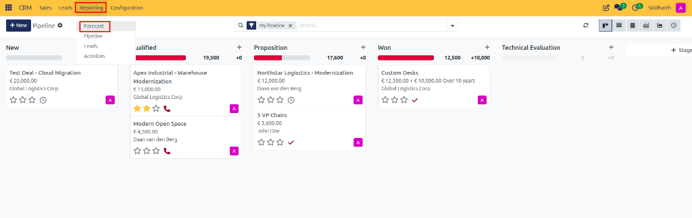
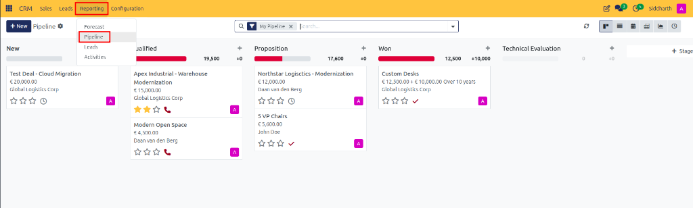
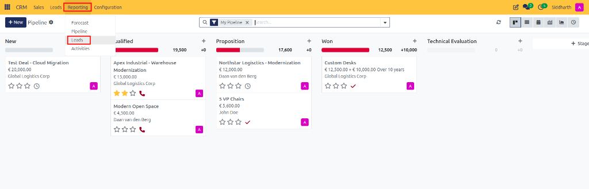

# How-To: Analyze Pipeline Performance, Forecasts, and Team Activities

Evaluate commercial revenue forecasts, analyze pipeline conversion velocity, track lead inflow trends, and monitor team activity completion.

---

### Task 1: Track Revenue Forecasts by Closing Month

1. Open the **CRM** app from your main dashboard.
2. In the top navigation bar, click **Reporting > Forecast**:

   

3. CURQ opens the **Forecast** Kanban view, organizing deals into monthly expected closing columns:

   

4. Evaluate key metrics:
   * **Active Search Filters**: Notice the default filters in the search bar (**Upcoming Closings**, **My Pipeline**, and grouped by **Expected Closing: Month**).
   * **Monthly Expected Closing Columns**:
     * **None**: Unscheduled opportunities (e.g., `Apex Industrial - Warehouse Modernization` at `€ 13,750.50`).
     * **October 2026**: Prorated monthly forecast (`11,000` with `Northstar Logisctics - Modernization` at `€ 11,000.40`).
     * **November 2026**: High-velocity pipeline (`27,634` + `€ 10,000` recurring), including `Test Deal - Cloud Migration` (`€ 10,000.00`), `5 VP Chairs` (`€ 5,133.52`), and closed `Custom Desks` (`€ 12,500.00` with a green `WON` ribbon).
     * **December 2026**: Extended deals (e.g., `Modern Open Space` at `€ 4,125.15`).
   * **Expected Closing Month Sums**: Weighted prorated revenues and monthly recurring revenue contributions (e.g., `+10,000`) displayed at the head of each column.
   * **View Switcher**: The controls in the top right allow toggling between **Kanban**, **Graph**, **Pivot**, and **List** views.
5. **Reschedule Deals**: Drag any deal card into a different month column to update its expected closing date immediately.

---

### Task 2: Evaluate Pipeline Values and Stage Velocity

1. In the top navigation bar, click **Reporting > Pipeline**:

   

2. By default, CURQ presents the pipeline in **Graph View**:

   

3. Review the visual metrics and customize your analysis:
   * **Stage Distribution**: The stacked bar chart shows revenue across pipeline milestones (**New**, **Qualified**, **Proposition**, and **Won**), with stacked segments color-coded by closing month (`October 2026`, `November 2026`, `December 2026`, and `None`) and a trend line tracking cumulative sums.
   * **Filters & Grouping**: Click the search dropdown to filter by deal status or group by sales criteria:

     

     * Filter by **Opportunities** and closed deals (such as **Won** or **Lost**).
     * Group by dimensions such as **Sales Team** (e.g., `EU`), **Salesperson**, **Stage**, or **Campaign**.
     * The embedded **Pivot Table** matrix on the left breaks down prorated revenue by closing period (e.g., `October 2026: € 12,500.00` for `Won` deals).
   * **Measures**: Click **Measures** to switch the metric from `Expected Revenue` to `Prorated Revenue`, `Probability`, or `Count`.
   * **Chart Types**: Click icons in the top control bar to switch between **Bar Chart**, **Line Chart**, and **Pie Chart**.
   * **Pivot View**: Click the **Pivot** icon in the top right to open the dedicated multi-dimensional matrix.

---

### Task 3: Analyze Inbound Lead Inflow and Marketing Sources

1. In the top navigation bar, click **Reporting > Leads**:

   

2. Review the **Leads Analysis** graph view:

   

   * **Filters**: Default filter tags include **Active or Inactive** and **Created on: 2026**.
   * **Inflow Volume**: The stacked bar chart shows total leads created in `October 2026` (`7.00` leads), broken down by team allocation (`Sales` with `2.00` leads in blue, and `EU` with `5.00` leads in magenta).
3. Click into the search bar dropdown to explore grouping dimensions (highlighted in red):

   

   * **Source** / **Campaign**: Track acquisition channels delivering the highest lead volume.
   * **Sales Team** / **Salesperson**: Review lead allocation balance between teams (`EU`, `Sales`).
   * **Creation Date** / **Conversion Date**: Inspect cohort conversion velocity over time.
4. Click the **Pivot** icon in the top right control bar to inspect detailed counts in a spreadsheet matrix:

   

   * The matrix displays monthly lead totals broken down by sales team: `October 2026` records `2` leads for `Sales`, `5` leads for `EU`, totaling `7` leads.

---

### Task 4: Monitor Sales Activities and Team Follow-ups

1. In the top navigation bar, click **Reporting > Activities**.
2. Review the activity tracking chart:

   

   * **Trailing Period**: Filtered by **Trailing 12 months** by default.
   * **Monthly Execution**: The bar chart tracks completed and scheduled activities per month (e.g., `1.00` activity in `October 2026`).
3. Toggle the top right view icons to inspect activities in **Pivot** or **List** format to analyze individual team follow-up performance.

---

### Edge Cases & Recovery Steps

* **Missing Inactive Deals in Reports**: Pipeline reports evaluate active opportunities by default. To analyze lost opportunities, click into the search bar and select **Filters > Lost**.

---

### Related Documentation
* [Explanation: Understanding Leads vs. Opportunities in CURQ](../core-concepts/01-understanding-leads-vs-opportunities.md)
* [Reference: Lead and Opportunity Form Field Definitions](../settings-and-fields/01-lead-and-opportunity-field-definitions.md)
* [How-To: Schedule and Execute Sales Activities](./04-schedule-and-track-sales-activities.md)
