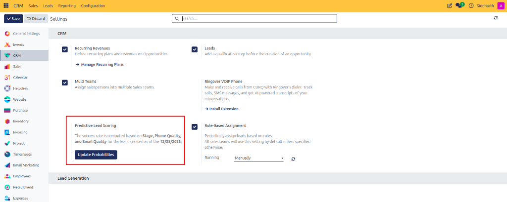
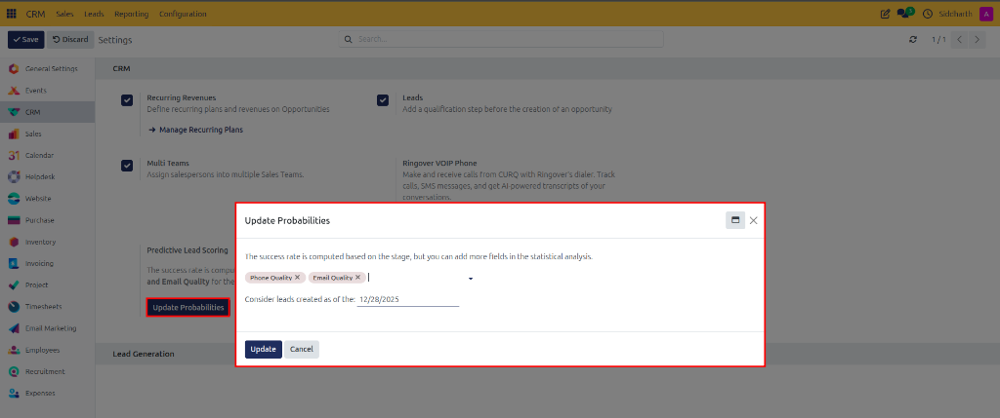

# Configure Predictive Lead Scoring

Configure automated win probability calculations, select statistical attributes, set historical lead cutoff dates, and retrain pipeline predictive scoring models.

---

### Task 1: Access Predictive Lead Scoring in Settings

1. Open the **CRM** app from your main dashboard.
2. In the top navigation bar, click **Configuration > Settings**.
3. Under the **CRM** section, locate the **Predictive Lead Scoring** configuration block.

   

4. Review the active model summary, which lists the statistical fields currently factored into probability calculations and the historical cutoff date (e.g., *"The success rate is computed based on Stage, Phone Quality, and Email Quality for the leads created as of the 12/28/2025."*).

---

### Task 2: Configure Statistical Attributes and Historical Cutoff Dates

1. Inside the **Predictive Lead Scoring** block, click the purple **Update Probabilities** button.
2. The **Update Probabilities** modal dialog opens:

   

3. Review the explanatory guidance: *"The success rate is computed based on the stage, but you can add more fields in the statistical analysis."*
4. In the fields multi-selection input, add or remove variables to include in the statistical model:
   * **Stage**: Automatically evaluated as the primary baseline for probability progression.
   * **Phone Quality**: Evaluates the completeness and formatting validity of customer phone numbers.
   * **Email Quality**: Evaluates contact email deliverability and domain structure.
   * **Country / State**: Evaluates geographical historical conversion rates.
   * **Source / Medium**: Evaluates marketing attribution channels.
5. In the **Consider leads created as of the:** field, select or enter a historical cutoff date (e.g., `12/28/2025` or 12–24 months prior). Records created before this threshold will be excluded, ensuring outdated sales cycles or discontinued pricing don't skew modern win predictions.

> [!NOTE]
> For mathematical details, Bayesian weighting rules, and parameter definitions, see [Predictive Lead Scoring Parameters](../settings-and-fields/02-pipeline-configuration-and-assignment-settings.md#predictive-lead-scoring-parameters).

---

### Task 3: Retrain Probabilities Across Active Deals

1. After choosing your statistical variables and setting the date threshold, click the purple **Update** button at the bottom of the modal dialog.
2. CURQ executes the Bayesian predictive algorithm across all active opportunities meeting the date criteria:
   * High-quality records with validated email, phone, and advanced stage progress receive elevated win probability ratings.
   * High-risk or data-sparse deals update with realistically lower probabilities.
3. In the top action bar of Settings, click **Save**.
4. Open **CRM > Sales > My Pipeline** to verify that opportunity cards and form views display the freshly calibrated win probabilities.

---

### Edge Cases & Recovery Steps

* **Manual Overrides are Protected**: If a salesperson manually typed a custom win probability percentage on an individual deal, retraining the predictive model **does not overwrite** their manual input. The deal preserves the custom value until explicitly cleared or reset.
* **Insufficient Historical Data**: If your database contains fewer than 50 closed (won or lost) deals within the chosen date window, the model may lack statistical significance. Consider extending the cutoff date further back or relying on default stage probabilities until deal volume increases.
* **Adding Marketing Attribution**: When introducing new marketing campaign sources, add `Source` to the statistical fields list so the model starts factoring origin channels into probability weights.

---

### Related Documentation
* [Pipeline Configuration and Assignment Settings](../settings-and-fields/02-pipeline-configuration-and-assignment-settings.md)
* [Understanding Lead Assignment and Predictive Scoring](../core-concepts/02-understanding-lead-assignment-and-predictive-scoring.md)
* [Create and Manage Pipeline Opportunities](./01-create-and-manage-opportunities.md)
* [Configure Custom Pipeline Stages](./05-configure-pipeline-stages.md)
