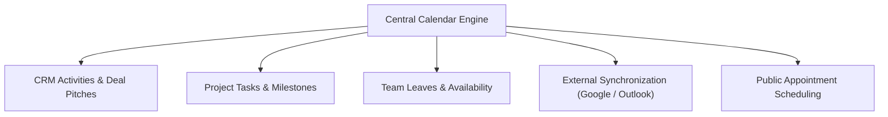

# Understanding Calendar and Meeting Management

The Calendar application in CURQ 18 serves as a centralized operational hub for scheduling, organizing, and tracking meetings, appointments, and collaborative team activities across the entire enterprise.

---

## 1. Architectural Role of Calendar in CURQ

In CURQ 18, the Calendar application coordinates schedules across departments and integrates directly with cross-functional business workflows:

* **Unified Visibility**: Consolidates personal commitments, team activities, customer demos, and company events into a single interactive grid.
* **Cross-Application Scheduling**: Enables users to schedule meetings directly from record chatters in CRM, Projects, and Helpdesk, linking meeting history to customer records.
* **Synchronized Workflows**: Connects with external calendar providers (Google Calendar, Microsoft Outlook) and booking portals for seamless external scheduling.

---

## 2. Key Capabilities

* **Multi-Format Views**: Switch effortlessly between Day, Week, Month, and Year calendar perspectives.
* **Meeting Lifecycle Management**: Configure meeting subjects, scheduled timeframes, locations, durations, and organizers.
* **Attendee Coordination**: Invite internal colleagues and external contacts with automated email invitations and ICS calendar attachments.
* **Recurrence Engine**: Plan repeating events with flexible daily, weekly, monthly, or annual recurrence intervals and termination boundaries.
* **Side-by-Side Team Availability**: Overlay team members' calendars to rapidly detect mutual free time slots and eliminate scheduling conflicts.
* **Automated Reminders**: Configure multi-channel alerts (pop-up notifications, email dispatches, or SMS messages) triggered at set intervals prior to meeting start times.
* **Online Collaboration**: Attach meeting locations or generate direct video-conferencing URLs (such as Google Meet, Teams, or Odoo discuss).

---

## Related Documentation

* [**Create Your First Meeting**](../getting-started/01-create-your-first-meeting.md)
* [**Plan a Recurring Meeting**](../getting-started/02-plan-a-recurring-meeting.md)
* [**Navigate the Calendar**](../task-guides/01-navigate-the-calendar.md)
* [**Manage Meetings and Attendees**](../task-guides/02-manage-meetings-and-attendees.md)
* [**Meeting Form Field Definitions**](../settings-and-fields/01-meeting-form-field-definitions.md)
