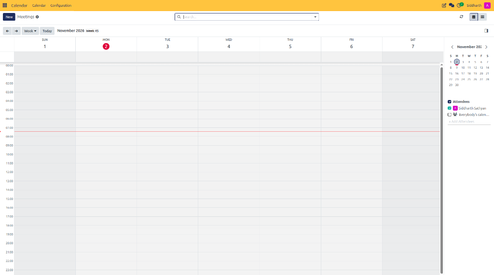
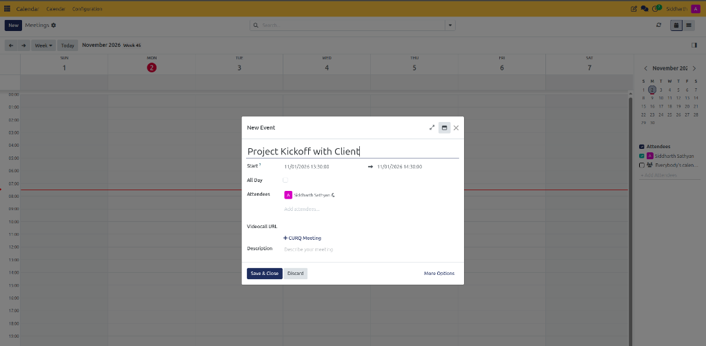
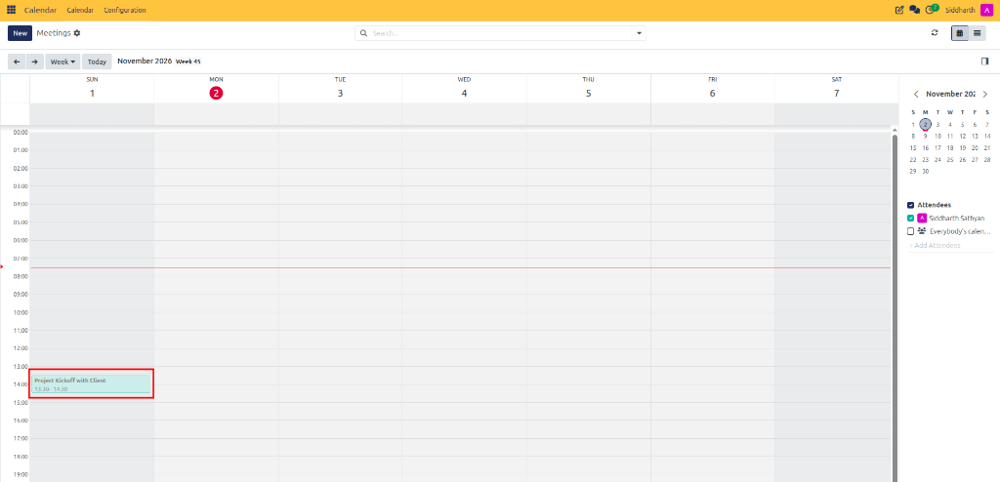
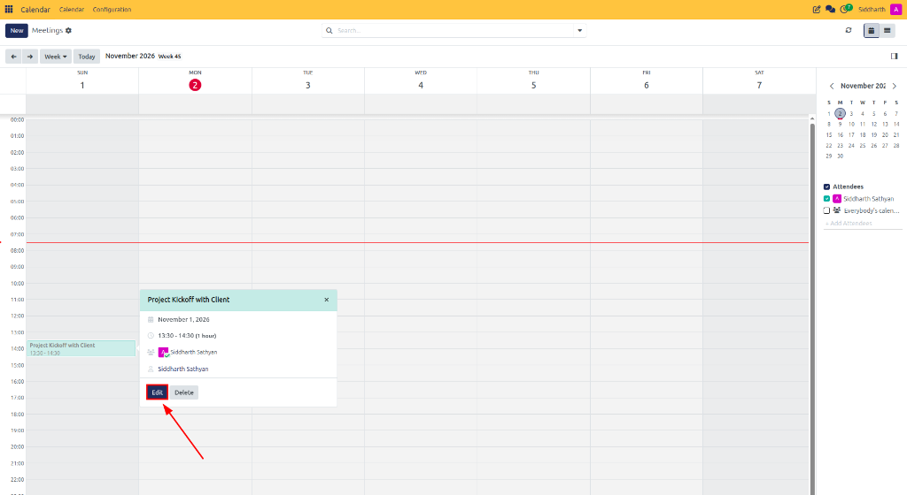
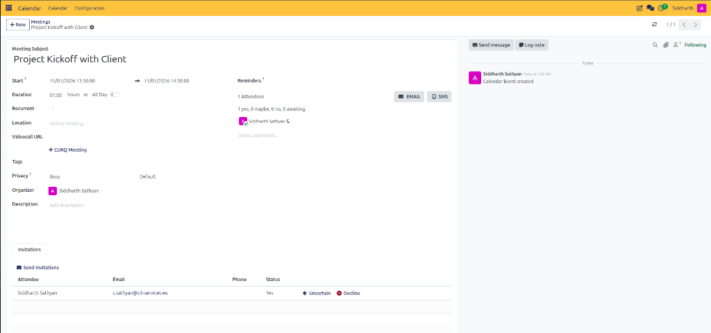

# Create Your First Meeting

This tutorial guides you through scheduling an event in CURQ 18 Calendar, specifying time slots, inviting internal and external attendees, configuring video-call links, and setting up automated reminder notifications.

> **Prerequisites**
> * You have access to the **Calendar** application on your CURQ dashboard.
> * Your user profile is assigned basic calendar scheduling permissions.
> * Outgoing email servers are configured if sending invitations to external participants.

---

## 1. Schedule and Configure Your First Meeting

### 1.1 Open the Calendar

1. Open the CURQ main dashboard.
2. Click on the **Calendar** application icon.
3. The calendar opens to the default **Week** view showing your current schedule.

   

---

### 1.2 Schedule the Meeting Slot

1. Navigate to the date when the meeting should take place using the date navigation controls or the right-side mini calendar.
2. Click directly on the required start time slot in the calendar grid (or click and drag downwards across hours to set the initial duration).
3. In the **New Event** quick-create modal pop-up:
   * Enter the **Meeting Subject** (e.g., `Project Kickoff with Client`).
   * Verify the start date and time (e.g., `11/01/2026 13:30:00` to `11/01/2026 14:30:00`).
   * Select or verify **Attendees** (defaults to your user profile; type to add teammates or external email addresses).
   * Optionally click **+ CURQ Meeting** to generate an integrated video call URL.
   * Enter an optional meeting **Description**.

   

4. Click **Save & Close** to schedule the meeting immediately, or click **More Options** to configure advanced options.

---

### 1.3 Verify the Scheduled Event

1. Return to the main calendar grid.
2. Confirm that the new meeting block appears in the designated time slot with your user's assigned attendee color code.

   

3. Click directly on the scheduled meeting card to open the quick summary popover:

   

4. From the popover card:
   * Click **Edit** (indicated by the red arrow) to open the full event form for adjustments or detailed agenda updates.
   * Click **Delete** if you need to remove or cancel the event.

---

### 1.4 Configure Detailed Meeting Parameters

Clicking **Edit** opens the comprehensive meeting management form:

1. **Duration and Recurrence**: Review the **Start** and end timestamps, adjust the **Duration**, toggle **All Day** if applicable, or check **Recurrent** to schedule a repeating event.
2. **Videocall URL & Location**: Click **+ CURQ Meeting** to attach an integrated video room, or specify a room/branch in **Location** (e.g., `Online Meeting`).
3. **Reminders**: Configure automated reminder alerts using the **EMAIL** and **SMS** notification options.
4. **Attendees & Status Tracking**: Add participants using **Select attendees...**. The panel tracks real-time RSVPs (e.g., *1 yes, 0 maybe, 0 no, 0 awaiting*).
5. **Invitations Tab**: In the bottom notebook tab, view attendee email addresses, phone numbers, and individual response statuses (**Yes**, **Uncertain**, or **Decline**). Click **Send Invitations** to dispatch invite emails.
6. **Chatter Pane**: Use the right-side communication pane to **Send message** to participants or **Log note** for internal coordination.

---

> For complete parameter descriptions across scheduling, location, reminders, and attendee tracking, see [**Primary Event Header & Scheduling Fields**](../settings-and-fields/01-meeting-form-field-definitions.md#1-primary-event-header--scheduling-fields) and [**Attendee Invitation Tracking Columns**](../settings-and-fields/01-meeting-form-field-definitions.md#3-attendee-invitation-tracking-columns).

---

## Related Documentation

* [Plan a Recurring Meeting](./02-plan-a-recurring-meeting.md)
* [Manage Meetings and Attendees](../task-guides/02-manage-meetings-and-attendees.md)
* [Meeting Form Field Definitions](../settings-and-fields/01-meeting-form-field-definitions.md)
* [Meeting Form Field Definitions](../settings-and-fields/01-meeting-form-field-definitions.md)
