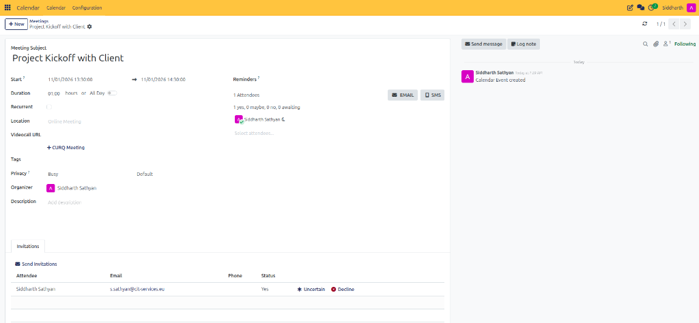
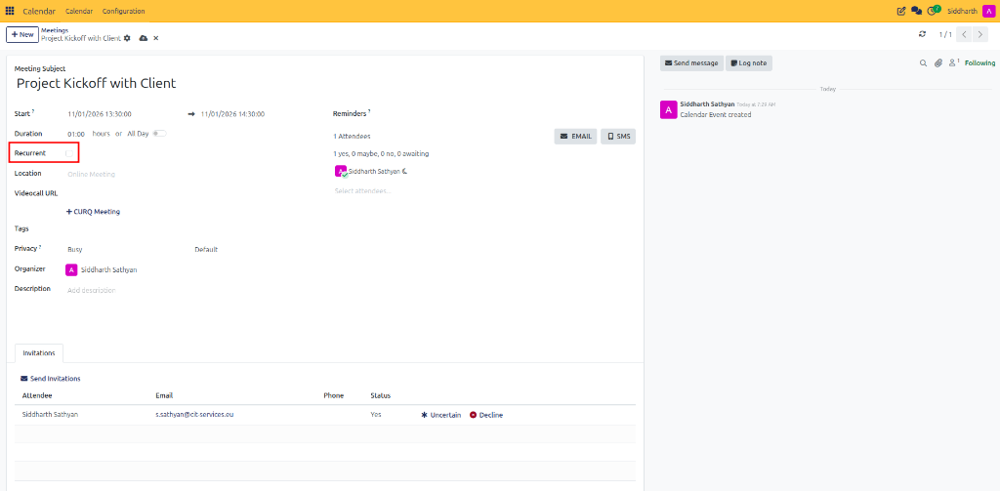
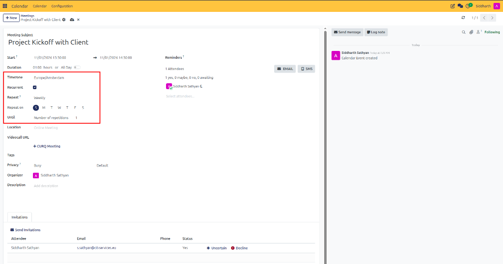
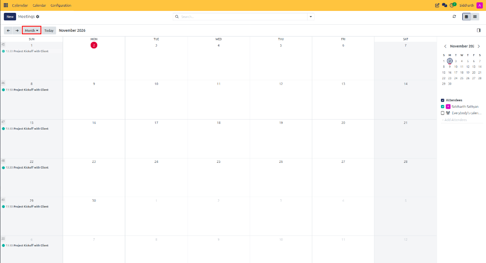

# Plan a Recurring Meeting

This tutorial guides you through setting up repeating events in CURQ 18 Calendar, configuring daily, weekly, or monthly repetition cycles, and establishing recurrence termination rules.

---

## Prerequisites

Before starting, ensure that:
* You have permission to create calendar events.
* You have determined the recurring schedule and participant list for the series.

---

## Step 1: Create or Open a Meeting

1. Navigate to **Calendar**.
2. Click an open time slot to create a new meeting, or click an existing event that you wish to convert into a repeating series.
3. Open the full event form by clicking **Edit** (or clicking **More Options** in the quick-create modal).
4. Enter the **Meeting Subject** (e.g., `Project Kickoff with Client`), start date, time, and expected duration.

   

---

## Step 2: Enable Recurrence

1. On the left side of the meeting form, locate the **Recurrent** checkbox directly beneath **Duration**.
2. Check the **Recurrent** box to convert the meeting into a repeating series.

   

---

## Step 3: Configure Recurrence Rules

Once **Recurrent** is enabled, CURQ expands the dedicated recurrence parameters:

1. **Timezone**: Confirm the base timezone (e.g., `Europe/Amsterdam`) used to evaluate meeting times across distributed participants.
2. **Repeat**: Select the repetition cycle frequency from the dropdown:
   * **Daily**: Repeats every *X* days.
   * **Weekly**: Repeats every *X* weeks on designated weekdays. Under **Repeat on**, select the specific days (e.g., select **S** for Sunday, or multiple weekdays for recurring standups).
   * **Monthly**: Repeats on a specific calendar day of each month.
   * **Yearly**: Repeats once annually on the scheduled date.
3. **Until**: Specify the termination rule for the recurring series:
   * **Number of repetitions**: Automatically ends after a specified count of meetings (e.g., `1` or `10`).
   * **End Date**: Stops recurrence after a fixed calendar deadline.
   * **Forever**: Continues indefinitely until manually adjusted or removed.

---

## Step 4: Save and Verify Series Occurrences

1. In CURQ 18, your settings save automatically as you make changes. Click the **Meetings** breadcrumb to return to the calendar grid.
2. In the top-left view switcher, change the view from **Week** to **Month**.
3. Verify that the scheduled meeting (e.g., `13:30 Project Kickoff with Client`) appears across all designated days (e.g., every Sunday) throughout the month.

   

4. Click on any future occurrence in the series to confirm that all attendee lists, reminders, and video-call links are inherited.

---

## Related Documentation

* [Create Your First Meeting](./01-create-your-first-meeting.md)
* [Manage Meetings and Attendees](../task-guides/02-manage-meetings-and-attendees.md)
* [Meeting Form Field Definitions](../settings-and-fields/01-meeting-form-field-definitions.md)
