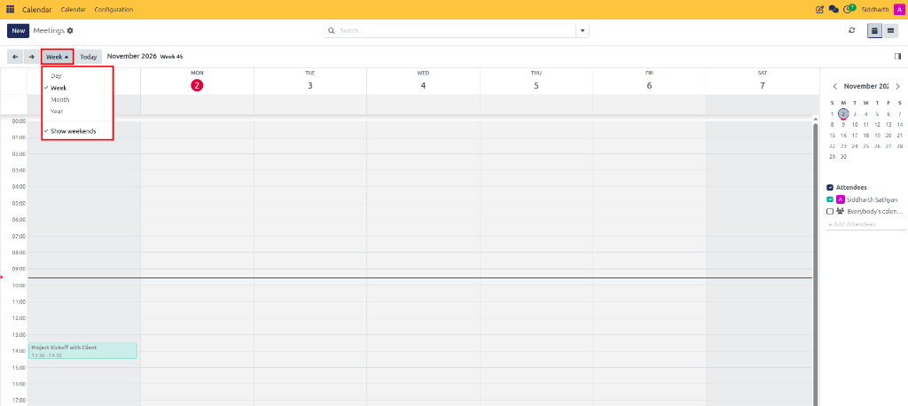
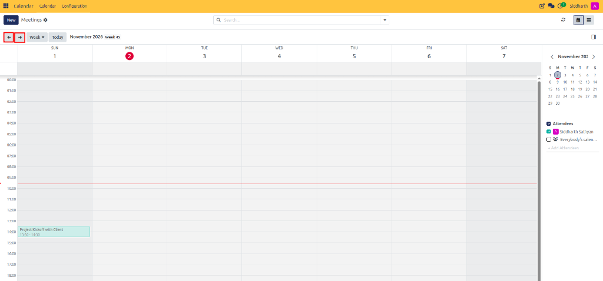
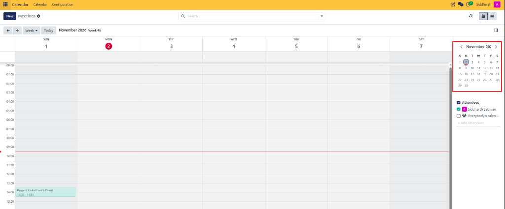
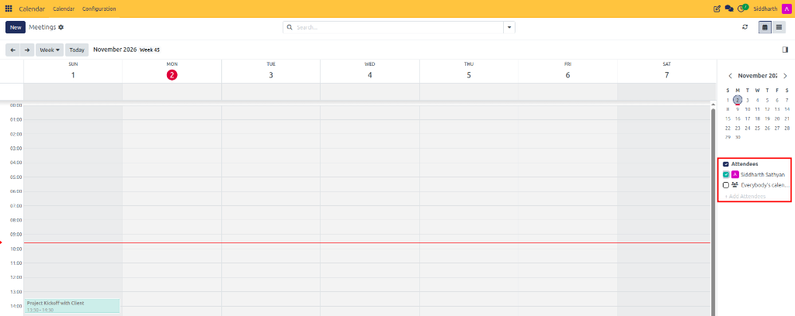

# Navigate the Calendar

This guide covers how to switch calendar view modes, navigate between dates, use the mini calendar picker, and control visibility filters in CURQ 18 Calendar.

---

## 1. Calendar View Modes and Date Navigation

### 1.1 Switch Calendar Views

CURQ Calendar provides four distinct display perspectives to accommodate short-term scheduling and long-term planning:

1. Open **Calendar** from the main apps dashboard.
2. In the top-left navigation controls, click the active view dropdown (defaults to **Week**):

   

3. Select your preferred display mode:
   * **Day**: Displays a granular single-day timeline divided by hourly increments. Ideal for detailed daily agenda management.
   * **Week** *(Default)*: Displays a 7-day horizontal grid showing all hourly commitments from morning to evening.
   * **Month**: Provides a macro calendar grid showing scheduled events across an entire month.
   * **Year**: Offers a high-level 12-month bird's-eye matrix highlighting meeting density across the annual schedule.
   * **Show weekends**: Toggle to display or hide Saturday and Sunday columns to customize your work week view.

---

### 1.2 Navigate Between Dates

Use the top-left date navigation controls to traverse your schedule:

1. Click the **←** (Previous) arrow button to move back by one time period (one day, week, month, or year depending on the active view).
2. Click the **→** (Next) arrow button to advance forward by one time period.

   

3. Click the **Today** button to immediately center the view back on the current date and time.

---

### 1.3 Use the Mini Calendar

The right-hand side panel contains an interactive monthly **Mini Calendar**:

1. Click on any specific day in the mini calendar to instantly jump the primary workspace grid to that date.
2. Use the left and right arrow icons on the mini calendar header to browse past or future months without altering your current view mode.

   

---

## 2. Filter by Attendee Calendars

Directly underneath the mini calendar, the **Attendees** panel allows you to control which schedules are overlaid on your view:

1. Locate the **Attendees** section in the right sidebar:

   

2. Check or uncheck the box next to your name (e.g., *Siddharth Sathyan*) to show or hide your personal schedule.
3. Check **Everybody's calendar...** or check specific colleagues' names to overlay their active bookings alongside yours.
4. Click **+ Add Attendees** to search for additional team members and include their calendars in your comparison view.
5. Each attendee's events are rendered in a distinct color to make cross-team comparison intuitive.

---

## Related Documentation

* [Coordinate Team Availability](./03-coordinate-team-availability.md)
* [Calendar Views and Navigation Controls](../settings-and-fields/02-calendar-views-and-navigation-controls.md)
* [Create Your First Meeting](../getting-started/01-create-your-first-meeting.md)
