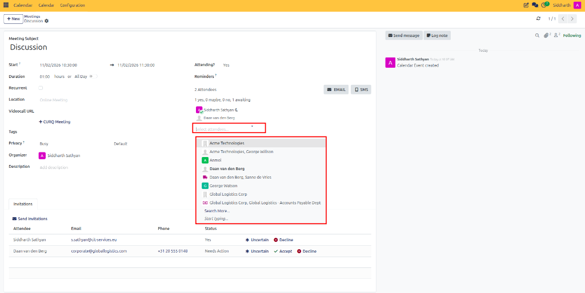
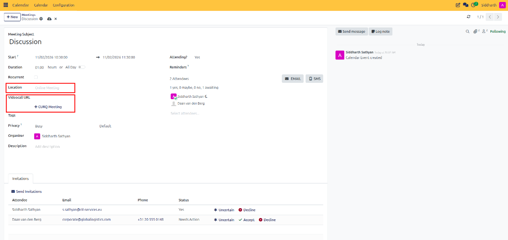
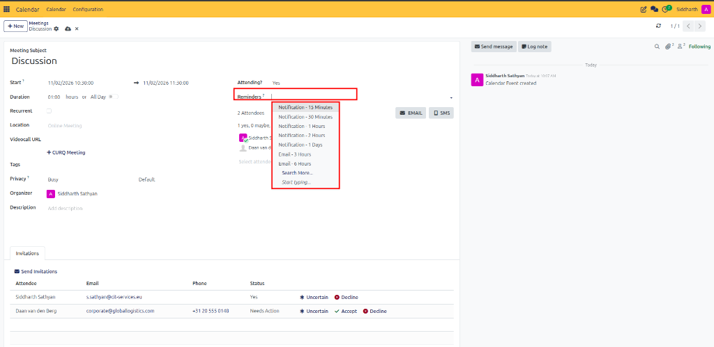

# Manage Meetings and Attendees

This guide covers how to modify existing events, invite participants, dispatch formal invitations, configure location and video conferencing links, set reminders, and designate meeting organizers in CURQ 18 Calendar.

---

## Task 1: Open and Edit a Meeting

1. Navigate to **Calendar**.
2. Locate the meeting card on the calendar grid.
3. Click the event card to open the quick summary pop-up, then click **Edit** (or double-click the card) to open the full form view.
4. Modify the meeting title, dates, or details as needed.
5. In CURQ 18, changes auto-save automatically as you update fields. Click the **Meetings** breadcrumb to return to your calendar grid.

---

## Task 2: Manage Attendees and Invitation Status

1. On the meeting form, locate the **Attendees** section and click the **Select attendees...** dropdown:

   

2. Choose colleagues, partners, or contacts from the searchable list, or type an external email address to invite guest participants.
3. The attendees panel displays an attendance summary (e.g., *1 yes, 0 maybe, 0 no, 1 awaiting*).
4. Review the **Invitations** table at the bottom of the form:
   * **Attendee**: The participant's contact card.
   * **Email**: The delivery email address.
   * **Phone**: Mobile or telephone contact number.
   * **Status**: Tracks the current response status (**Yes**, **Needs Action**, **Uncertain**, or **Decline**).
5. Click **Send Invitations** to transmit email notices containing standard `.ics` calendar invitation files.

---

## Task 3: Set Location and Video-Call Details

Provide clear attendance instructions for physical or remote participants:

1. **Location**: For in-person or hybrid events, specify the physical conference room, branch office, or site address. For virtual events, designate as `Online Meeting`.
2. **Videocall URL**: For online meetings, click **+ CURQ Meeting** to automatically generate an integrated video conference link, or paste a third-party conference URL (e.g., Google Meet, Teams, or Zoom).

---

## Task 4: Configure Reminders and Organizers

1. **Reminders**: Click the **Reminders** field to open the alert preset dropdown:

   

2. Select your desired notification lead time:
   * **In-app notifications**: *Notification - 15 Minutes*, *Notification - 30 Minutes*, *Notification - 1 Hours*, *Notification - 2 Hours*, or *Notification - 1 Days*.
   * **Email notifications**: *Email - 3 Hours* or *Email - 6 Hours*.
   * Alternatively, click the **EMAIL** or **SMS** action buttons for immediate on-demand reminders.
3. **Organizer**: Review the meeting **Organizer** (defaults to the event creator, e.g., *Siddharth Sathyan*). If scheduling on behalf of another manager or team member, click the field to reassign the organizer.
4. **Attending?**: Toggle your own attendance status (**Yes**, **No**, or **Maybe**) directly on the event record.

---

## Related Documentation

* [Coordinate Team Availability](./03-coordinate-team-availability.md)
* [Meeting Form Field Definitions](../settings-and-fields/01-meeting-form-field-definitions.md)
* [Create Your First Meeting](../getting-started/01-create-your-first-meeting.md)
