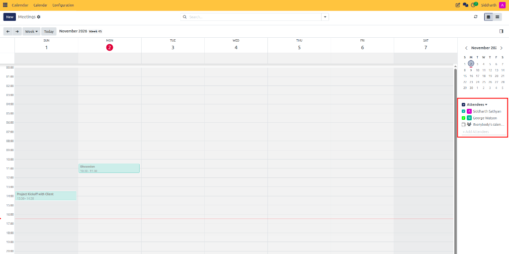

# Coordinate Team Availability

This guide covers how to overlay multiple team members' calendars, identify mutual free time slots, and schedule group meetings without scheduling conflicts in CURQ 18 Calendar.

---

## Task 1: Display Multiple Attendee Calendars

When arranging sessions involving several colleagues, you can overlay their individual commitments directly onto your calendar workspace:

1. Open **Calendar** and switch to **Day** or **Week** view for granular hourly visibility.
2. In the right-hand panel, locate the **Attendees** section.
3. Check the checkbox next to each colleague whose availability you need to consult.
4. If a colleague's name is not listed, click **+ Add Attendees** in the attendees section and select their user profile.
5. CURQ dynamically overlays their scheduled bookings on the time grid, rendering each attendee in a distinct color.

   

---

## Task 2: Identify Mutual Open Time Slots

1. Scan the combined time grid to identify vertical gaps where no team member has an active or conflicting commitment.
2. Verify that the open window accommodates the full required meeting duration.
3. Once an optimal slot is identified, click directly on the free time block to initiate a new meeting.

---

## Task 3: Schedule the Coordinated Group Meeting

1. In the quick-create pop-up, enter the meeting title and click **Edit**.
2. Notice that all colleagues whose calendars were checked in the sidebar are automatically populated in the **Attendees** list.
3. Confirm the scheduled start time and duration.
4. Set the location or add a **Videocall URL**.
5. Click **Save** (and dispatch invitations via **Send Invitations** if required).
6. Uncheck colleagues' names in the right-side panel when finished to return to your personal calendar view.

---

## Related Documentation

* [Navigate the Calendar](./01-navigate-the-calendar.md)
* [Manage Meetings and Attendees](./02-manage-meetings-and-attendees.md)
* [Meeting Form Field Definitions](../settings-and-fields/01-meeting-form-field-definitions.md)
