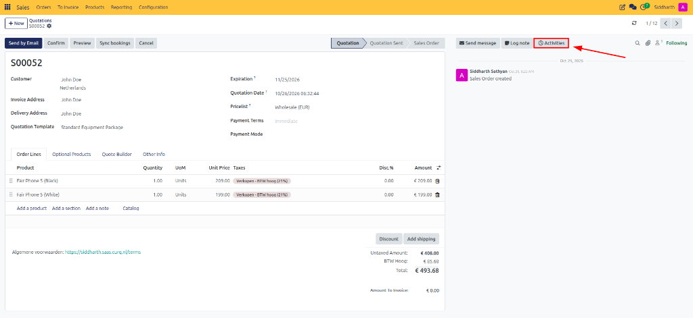

# Create Meetings from Chatter

This guide covers how to schedule meetings and calendar activities directly from record chatters in CURQ 18 applications like CRM, Projects, and Sales.

---

## Task 1: Schedule a Meeting Activity from a Record

You can initiate a calendar event directly from any business document that supports chatter:

1. Open the target record (for example, a Quotation / Sales Order, CRM Opportunity, Project Task, or Contact card).
2. Scroll to the **Chatter** section on the right or bottom of the form.
3. Click the **Activities** button (clock icon) to open the **Schedule Activity** modal dialog.

   

4. In the **Activity Type** field, select an activity type linked to the calendar, such as **Meeting** or **Call for Demo**.
5. Set the **Due Date** and enter a brief summary or agenda in the note area.
6. Click **Open Calendar** to transition directly into the Calendar application with the customer and record pre-linked.

---

## Task 2: Complete and Log Meeting Activities

Once a scheduled calendar meeting has concluded, update the originating record:

1. Locate the activity card in the record's chatter, or click the **Activity Clock** icon in the top systray bar.
2. Click on the scheduled meeting activity to reveal completion actions:
   * **Mark as Done**: Logs the activity as completed and records your feedback notes in the chatter history.
   * **Done & Schedule Next**: Marks the current meeting finished while immediately opening a new scheduling window for follow-up actions.
   * **Cancel**: Removes the activity if the session was called off without execution.

---

## Related Documentation

* [Create Your First Meeting](../getting-started/01-create-your-first-meeting.md)
* [Manage Meetings and Attendees](./02-manage-meetings-and-attendees.md)
* [Calendar Settings and Integrations](../settings-and-fields/03-calendar-settings-and-integrations.md)
