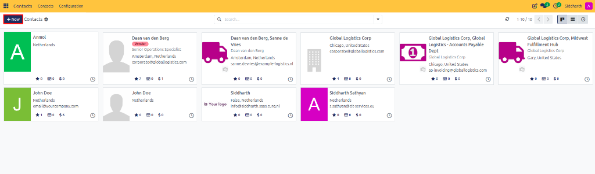
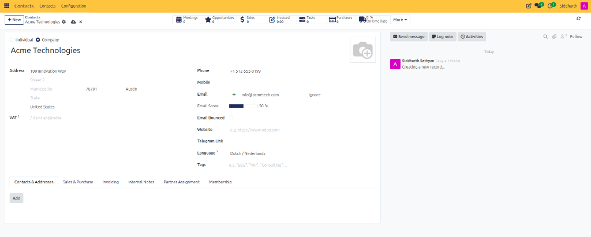
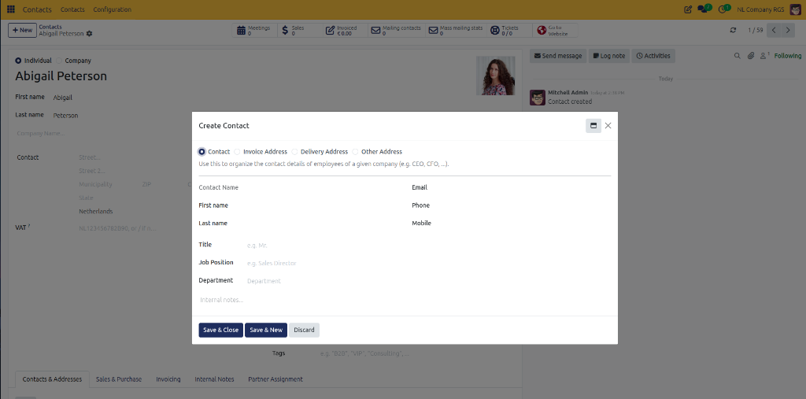
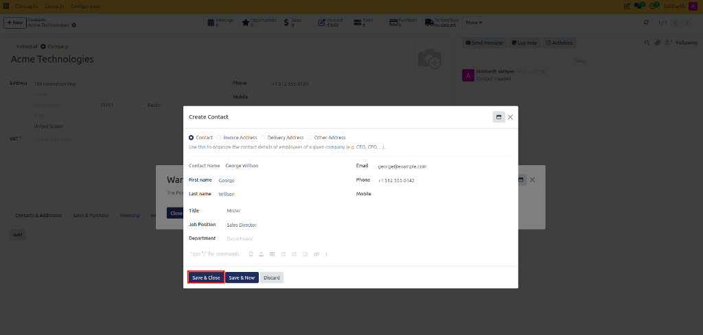
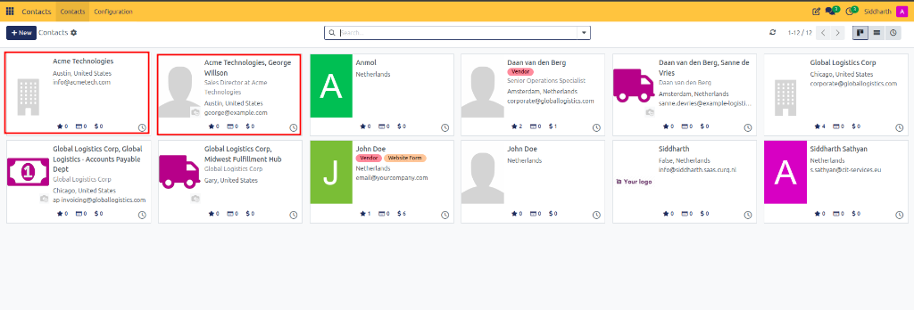

# Getting Started: Overview & Create Your First Contact

Welcome to the CURQ Contacts application. CURQ uses a single, unified address book to manage all commercial counterparties—companies, individual contacts, branch delivery hubs, billing departments, and vendor bank accounts.

In this tutorial, you will build a clear mental model of how CURQ organizes contact relationships and complete a hands-on exercise to create your first company contact and link an individual employee to it in 3 quick steps.

```{mermaid}
flowchart LR
    C["`**Company: Acme Technologies**
    Tax ID • Terms • Pricelist`"]
    C --> I["`**Employee: George Willson**
    Sales Director • Email & Phone`"]
    C --> D["`**Delivery Address**
    Acme East Warehouse`"]
```

---

## Hands-On Exercise: Create Your First Contact

### Prerequisites
* Access to a standard CURQ instance with the **Contacts** app installed.
* Standard default settings. No prior configuration or administrative permissions are necessary.

---

### Step 1: Open Contacts and Create a Company

1. From the main CURQ dashboard, click the **Contacts** app icon.
2. At the top left of the directory view, click the **New** button.

   

3. Notice the radio buttons at the top of the form: **Individual** and **Company**. Select **Company**.
4. Enter the primary company information:
   * **Name**: Type `Acme Technologies`.
   * **Address**: Enter a street address, city, state, postal code, and country (for example, `100 Innovation Way, Austin, TX 78701, United States`).
   * **Phone**: Enter `+1 (512) 555-0199`.
   * **Email**: Enter `info@acmetech.com`.

   

5. Leave all advanced tabs (**Sales & Purchase**, **Invoicing**, etc.) at their default settings for now.
6. Look at the top left near the document title—CURQ saves changes automatically. You can also click the cloud icon to confirm saving.

You now have your first corporate partner record in CURQ.

---

### Step 2: Add an Employee Linked to the Company

Now, let's attach a real person to Acme Technologies:

1. On the Acme Technologies company form, select the **Contacts & Addresses** tab.
2. Click the **Add** button. A popup window opens.

   

3. Keep the radio option set to **Contact** (this represents an individual employee).
4. Enter the employee's details:
   * **Contact Name**: Enter First name `George` and Last name `Willson`.
   * **Title**: Select `Mister`.
   * **Job Position**: `Sales Director`.
   * **Email**: `george@example.com`.
   * **Phone**: `+1 512-555-0142`.
5. Notice that CURQ automatically inherits the street address from Acme Technologies. Leave it as is.
6. Click **Save & Close** at the bottom of the popup window.

   

George Willson now appears as an employee card directly under Acme Technologies.

---

### Step 3: Find Your Contacts in the Directory

Let's verify that both records are visible and accessible in the main address book:

1. Click **Contacts** in the breadcrumbs bar at the top left to return to the main directory.
2. In the search bar at the top center, type `Acme`.
3. Press **Enter**. You will see both `Acme Technologies` and `Acme Technologies, George Willson` displayed as cards.

   

4. Next, clear the search bar, type `George Willson`, and press **Enter**.
5. Click on George Willson's card. Notice that:
   * His contact type is **Individual**.
   * The **Company Name** field is automatically linked to **Acme Technologies**.
   * His business address matches the parent company.

Congratulations! You have completed your first exercise in CURQ Contacts. You now understand how CURQ links individual people to corporate entities.

---

## Exploring Further: Key Capabilities of CURQ Contacts

Now that you have created your first contact, explore the core capabilities and architectural principles that govern the Contacts module:

### 1. Unified Partner Architecture & Hierarchies
* **Single Address Book**: Eliminates data silos by storing all commercial counterparties (clients, suppliers, subcontractors, service providers) in one standardized structure.
* **Company vs. Individual Roles**:
  * *Company Records*: Represent legal entities holding legal corporate names, VAT/tax IDs, commercial credit terms, and consolidated financial balances.
  * *Individual Contacts*: Represent real people (buyers, department heads, accounts payable officers). When linked to a company, an individual inherits the company's commercial rules while retaining distinct job titles, direct telephone numbers, and email addresses.
* **Standalone Individuals**: Independent contractors, freelancers, and B2C consumers operate as independent commercial entities without a parent organization.

### 2. Multi-Address Routing & Commercial Logistics
* **Decoupled Address Types**: Attach multiple specialized address records to a single parent company:
  * *Invoice Address*: Directs formal billing documents, tax identifiers, and Peppol electronic invoices to corporate accounting.
  * *Delivery Address*: Directs warehouse pickings, shipping labels, and carrier dispatch to regional distribution facilities, manufacturing plants, or retail job sites.
  * *Other Address*: Tracks secondary offices, showrooms, and satellite branches.
* **Automated Order Splitting**: Sales and purchase orders automatically split physical logistics to branch delivery locations while posting accounting entries to central corporate headquarters.

### 3. Data Integrity & Deduplication Governance
* **Deduplication & Merge Engine**: Safeguards database hygiene by detecting and merging duplicate contact records.
* **Foreign Key Preservation**: When merging duplicate partners, the engine automatically reassigns all foreign key pointers—including open quotations, confirmed sales orders, vendor bills, posted ledger items, CRM deals, and scheduled activities—to the surviving destination contact without data corruption or orphan records.
* **Audit Logging**: Full contact revision history, outbound emails, and customer portal activities remain permanently tracked in the Chatter audit feed.

### 4. Banking, Security & Verification
* **Partner Bank Registries**: Store multiple IBAN, BIC/SWIFT, and domestic routing numbers for each commercial counterparty.
* **Bank Account Verification**: Protect against wire fraud and vendor email compromise (BEC) attacks through dedicated security verification workflows. Unverified bank details trigger visual warning badges before vendor disbursements can be authorized.

### 5. Fiscal Localization & Commercial Restrictions
* **Automatic Tax Mapping (Fiscal Positions)**: Dynamically adapt transaction taxes based on customer geographic location (domestic VAT, intra-community B2B reverse charge, export zero-rating, or US state tax jurisdictions).
* **Commercial Warning & Blocking System**: Set customer-specific alerts on the **Internal Notes** tab. Choose between informative warnings (non-blocking notification banners) or hard blocking messages that prevent sales reps from creating or confirming orders for delinquent or high-risk accounts.
* **Geographic Registries**: Centralized management of countries, states, provinces, and city ZIP code auto-fill definitions.

---

## Related Documentation

* [Getting Started: Set Up an Enterprise Customer with Branch Locations](./02-set-up-an-enterprise-customer-with-branch-locations.md)
* [Task Guide: Create and Manage Contacts](../task-guides/01-create-and-manage-contacts.md)
* [Core Concepts: Understanding Unified Partner Architecture and Hierarchies](../core-concepts/01-understanding-unified-partner-architecture-and-hierarchies.md)
* [Settings and Fields: Contact Form Field Definitions](../settings-and-fields/01-contact-form-field-definitions.md)
