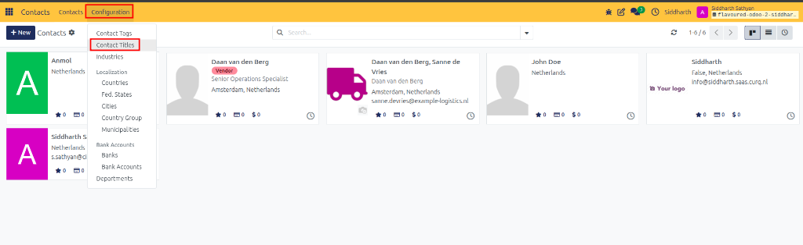
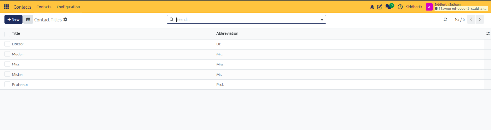
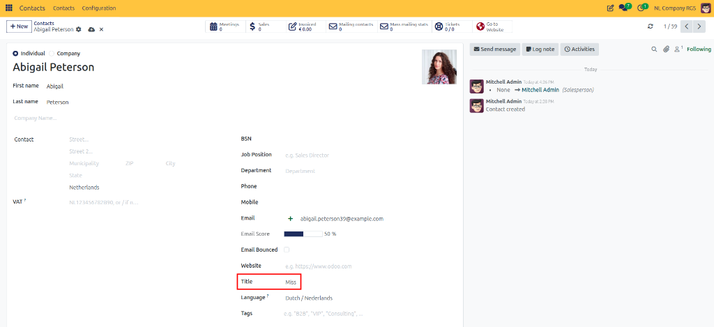

# How-To: Configure and Assign Contact Titles

Define standard and custom professional salutations with abbreviations (such as Dr., Prof., or Eng.) and assign them to individual contact cards for customer communications.

---

### Task 1: Create a Custom Contact Title

1. Open the **Contacts** app.
2. In the top navigation bar, click **Configuration > Contact Titles**.

   

3. Review the existing titles list. CURQ pre-populates standard titles such as *Doctor* (Dr.), *Madam* (Mrs.), *Miss* (Miss), *Mister* (Mr.), and *Professor* (Prof.).

   

4. Click **+ New** at the top left of the list (or click into an empty row at the bottom).
5. Enter the title parameters:
   * **Title**: The complete name (such as `Engineer` or `Reverend`).
   * **Abbreviation**: The short salutation used in printed correspondence (such as `Eng.` or `Rev.`).
6. Click **Save** at the top left or click outside the row.

---

### Task 2: Assign a Title to an Individual Contact

1. In the **Contacts** directory, open an individual contact card (or click **New** and ensure the type is **Individual**).
2. On the right side of the form, locate the **Title** field (positioned between **Website** and **Language**).

   

3. Click the dropdown and select the desired salutation (for example, `Miss`).
4. Click the cloud icon to save.

---

### Edge Cases & Recovery Steps

* **Title Field Missing from Form**: The **Title** field is exclusively reserved for individual persons. If the contact record is set to **Company**, the field is hidden by design. If you need a salutation, change the contact type to **Individual** or add an individual employee under the company's **Contacts & Addresses** tab.
* **Removing an Unwanted Title**: Navigate to **Configuration > Contact Titles**, select the checkbox next to the title, and click **Actions > Delete**. *(Note: Deleting a title clears the selection from existing contact cards using it).*

---

### Related Documentation
* [Reference: Contact Form Field Definitions](../reference/01-contact-form-field-definitions.md)
* [How-To: Create and Manage Contacts](./01-create-and-manage-contacts.md)
