# Create and Manage Contacts

Create corporate or individual partner profiles, link employees to parent companies, configure dedicated delivery and invoice addresses, and set commercial credit terms and sales order alerts.

> **Prerequisites**
> * Active user account with **Contacts / User** rights.
> * Partner master directory active in the **Contacts** application.

---

## 1. Create and Configure Partner Contacts

### 1.1 Create a Company or Individual Contact

1. Navigate to the **Contacts** app from your main dashboard.
2. In the top-left corner, click **New**.

   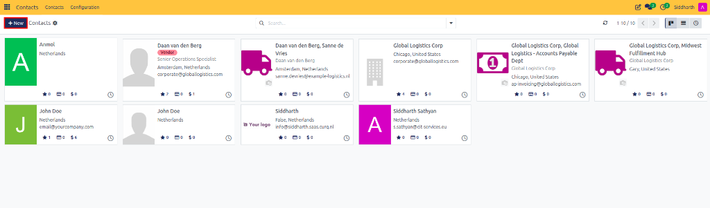

3. Choose the contact type:
   * **Individual**: Select for private customers, independent contractors, or specific employees.

     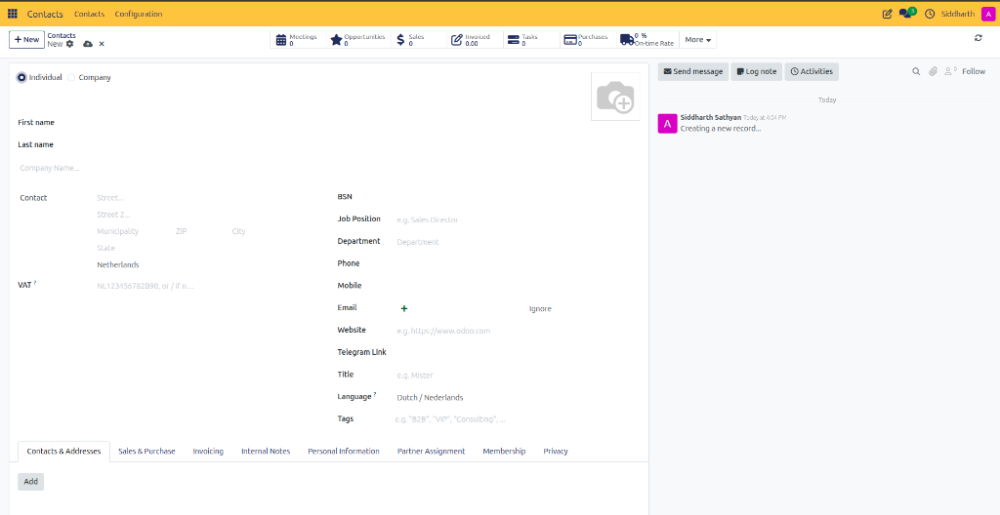

   * **Company**: Select for corporate organizations, vendors, or institutions.

     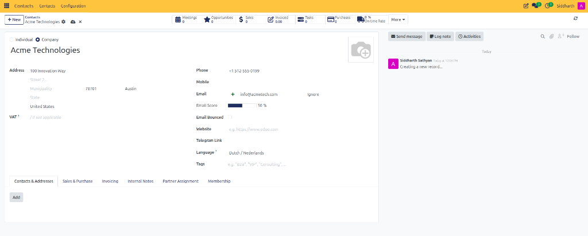

4. Enter the primary details:
   * **Name**: Enter the personal name or legal company name, and optionally upload an **Avatar / Logo** using the camera icon on the upper right.
   * **Company Name** *(Individual only)*: If the person works for an existing organization, select or type the parent company name. If they are independent, leave this field blank.
   * **Address**: Enter **Street**, **Street 2**, **Municipality**, **ZIP**, **City**, **State**, and **Country**.
   * **VAT / Tax ID**: Enter the business VAT, GSTIN, or national tax registration number *(placeholder reads `/ If not applicable`)*.
   * **Communication & Channels**: Enter **Phone**, **Mobile**, **Email**, **Website**, **Telegram Link**, preferred **Language**, and classification **Tags**. *(You can also monitor **Email Score** and **Email Bounced** status directly on the form).*

> For descriptions, formats, and allowed values of every field and top ribbon metric on this form, see [**Header Smart Buttons (Stat Metrics)**](../settings-and-fields/01-contact-form-field-definitions.md#11-header-smart-buttons-stat-metrics), [**Primary Identity & Address Fields**](../settings-and-fields/01-contact-form-field-definitions.md#12-primary-identity--address-fields), and [**Communication & Contact Channels**](../settings-and-fields/01-contact-form-field-definitions.md#13-communication--contact-channels).

5. Click the cloud icon at the top of the form (or navigate away) to save.
6. Once saved, monitor linked commercial and operational activity directly from the top header smart buttons (**Meetings**, **Opportunities**, **Sales**, **Invoiced**, **Tasks**, **Purchases**, **On-time Rate**, and **More**).

---

### 1.2 Add Separate Delivery, Invoice, and Sub-Contact Addresses

Large clients and vendors often operate across multiple locations. To ensure invoices and shipments are routed to the correct locations automatically:

1. Open the target company contact record.
2. Select the **Contacts & Addresses** tab and click **Add**.

   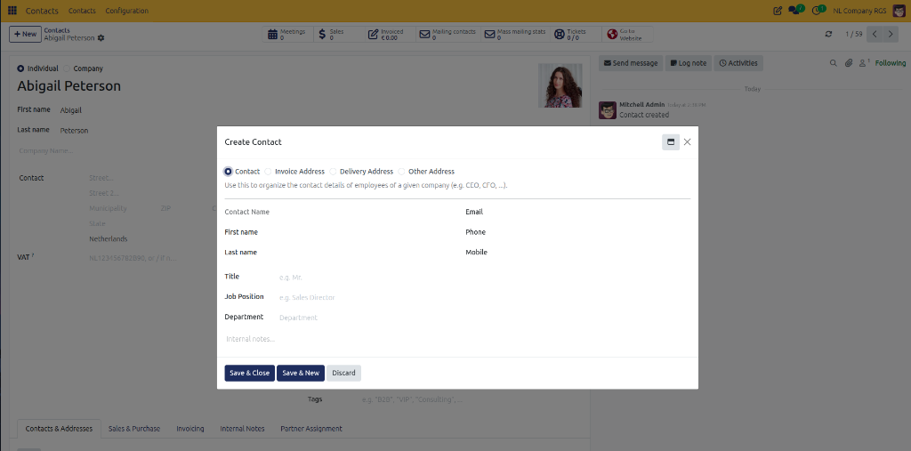

3. In the modal dialog, select the address type:
   * **Contact**: Adds a named employee or representative working at this business.
   * **Invoice Address**: Sets the billing destination for accounting invoices and credit notes.
   * **Delivery Address**: Sets the shipping destination for delivery slips and physical goods.
   * **Other Address**: Adds a subsidiary office, factory site, or secondary location.
4. Enter the location name, direct contact phone, email, and street address.
5. Click **Save & Close** (or **Save & New** to add another location immediately).

> For technical definitions of each address type and delivery/billing routing rules, see [**Contacts and Addresses Tab**](../settings-and-fields/01-contact-form-field-definitions.md#2-contacts-and-addresses-tab).

> **Tip:** When creating a Sales Order or Vendor Bill for this company, CURQ automatically defaults the **Delivery Address** and **Invoice Address** to the destinations configured here.

---

### 1.3 Configure Commercial, Accounting, and Invoicing Settings

#### 1.3.1 Assign Sales and Purchase Terms
1. Open the contact record and select the **Sales & Purchase** tab.

   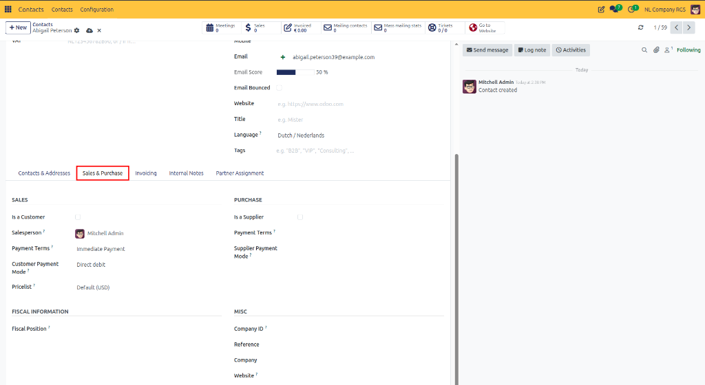

2. Under the **Sales** column:
   * Verify **Is a Customer** is checked if they purchase goods or services.
   * Select a dedicated internal **Salesperson**.
   * Choose customer **Payment Terms** (such as `Immediate Payment`, `15 Days`, or `30 Days`), **Payment Method**, default **Pricelist**, and **Delivery Method**.
3. Under the **Purchase** column:
   * Select **Is a Supplier** if you procure goods or services from this partner, and assign a responsible **Buyer**.
   * Set supplier **Payment Terms** and **Payment Method**.
4. Under **Fiscal Information** and **Misc**:
   * Assign a **Fiscal Position** if domestic, intra-community, or export tax mapping applies.
   * Optionally configure **Reference**, **Company ID** *(commercial registry/KvK/SIRET)*, **Company**, **Website** *(e-commerce scoping)*, and **Industry**.

> For detailed field definitions across each group, see [**Sales Section**](../settings-and-fields/01-contact-form-field-definitions.md#31-sales-section), [**Purchase Section**](../settings-and-fields/01-contact-form-field-definitions.md#32-purchase-section), [**Fiscal Information Section**](../settings-and-fields/01-contact-form-field-definitions.md#33-fiscal-information-section), and [**Miscellaneous Section**](../settings-and-fields/01-contact-form-field-definitions.md#34-miscellaneous-section).

#### 1.3.2 Configure Invoicing and Auto-Post Bill Rules
1. Select the **Invoicing** tab on the contact form.

   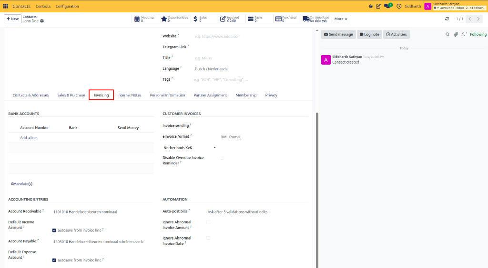

2. Under **Bank Accounts**:
   * Add partner bank records (**Account Number**, **Bank**, and **Send Money** authorization toggle) to enable direct payments and refunds.
3. Under **Customer Invoices** and **Accounting Entries**:
   * Set **Invoice sending** (`Download` or `by Email`), **eInvoice format** *(such as `EU Standard (Peppol Bis 3.0)`, `Netherlands (NLCIUS)`, or `France (FacturX)`)*, and **Peppol ID**.
   * Verify the **Account Receivable**, **Account Payable**, and **Fiscal Position** defaults.
4. Under **Automation**:
   * Set **Auto-post bills** to govern how incoming vendor bills from this partner are handled:
     * **Always**: Automatically validates and posts bills as soon as they are registered.
     * **Ask after 3 validations without edits**: Prompts to automate bill posting after three consecutive bills without manual modifications.
     * **Never**: Mandates manual confirmation for every bill received from this supplier.

> For detailed descriptions of every invoicing sub-section, see [**Bank Accounts Sub-Table**](../settings-and-fields/01-contact-form-field-definitions.md#41-bank-accounts-sub-table), [**Customer Invoices Section**](../settings-and-fields/01-contact-form-field-definitions.md#42-customer-invoices-section), and [**Automation Section**](../settings-and-fields/01-contact-form-field-definitions.md#43-automation-section).

#### 1.3.3 Configure Internal Notes and Operational Alerts
To alert your sales team about special handling or block bad debtors:
1. Select the **Internal Notes** tab.

   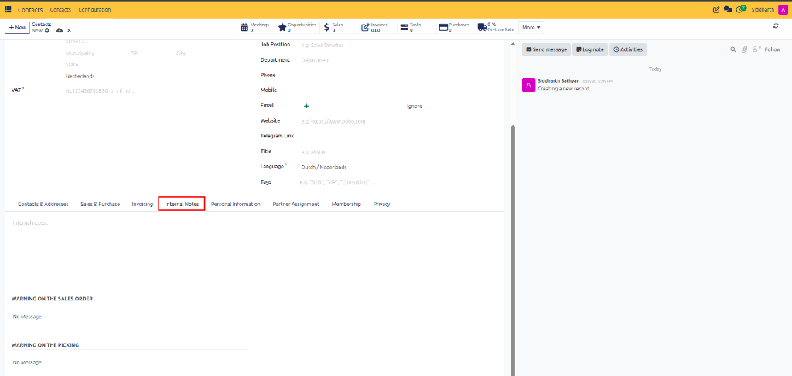

2. In the notes area, enter internal reminders or background information.
3. Under the **Warning on the Sales Order** or **Warning on the Picking** dropdown, select an action:
   * **No Message**: Standard operation without alerts.
   * **Warning**: Displays an informational popup reminder to the operator when this partner is selected, but permits them to proceed.
   * **Blocking Message**: Displays an error popup and completely halts transaction creation for this partner.
4. In the text area below, type the exact message the user should see.
5. Save the contact.

> For behavioral rules and popup dialog specifications of alert levels, see [**Internal Notes and Warnings Tab**](../settings-and-fields/01-contact-form-field-definitions.md#5-internal-notes-and-warnings-tab).

#### 1.3.4 Configure Personal Information, Geolocation, Membership, and Privacy (Optional)
Depending on your operational requirements, configure secondary partner profile tabs:

1. **Personal Information** *(Individual contacts)*:
   * Select the **Personal Information** tab to record private demographic details such as **Birthdate**.

   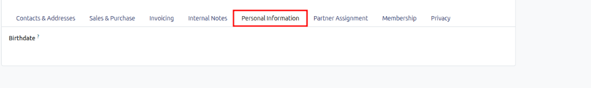

2. **Partner Assignment & Geolocation**:
   * Select the **Partner Assignment** tab.
   * Click **Compute based on address** to populate the **Geo Location** (**Latitude** and **Longitude**) coordinates for delivery dispatch and map routing.

   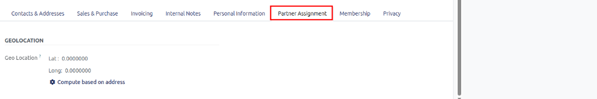

3. **Membership Subscriptions**:
   * For organizations, associations, or clubs, select the **Membership** tab to manage **Free Member** voting rights, **Membership Application Date**, **Membership Categories**, **Current Membership Status**, and historical **Membership Lines**.

   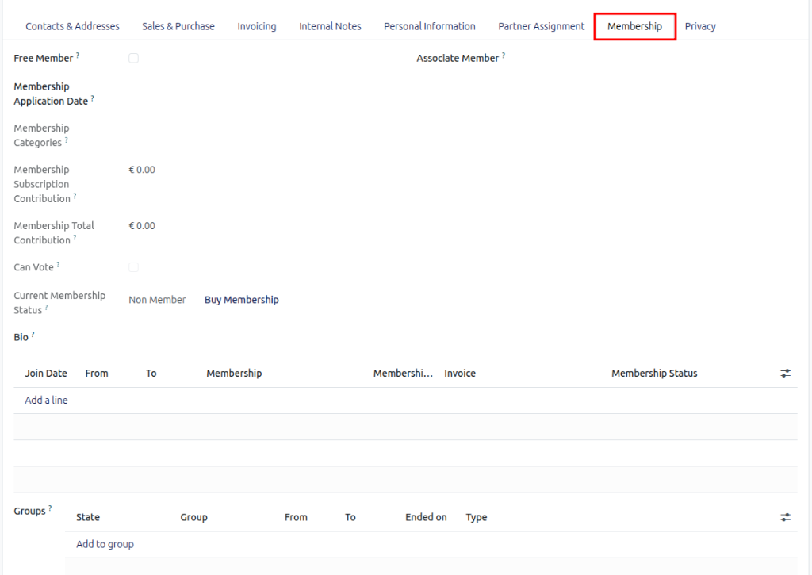

4. **Website Privacy Settings**:
   * Select the **Privacy** tab to govern how contact information is exposed on public websites or community portals—configuring **Website Privacy Level** and toggling **Show Email**, **Show Address**, **Show Phone**, and **Show Website**.

   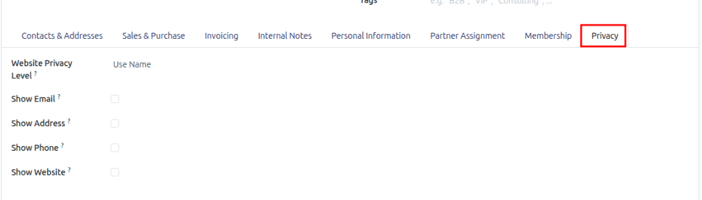

> For detailed parameter definitions across these tabs, see [**Personal Information Tab**](../settings-and-fields/01-contact-form-field-definitions.md#6-personal-information-tab), [**Partner Assignment Tab**](../settings-and-fields/01-contact-form-field-definitions.md#7-partner-assignment-tab), [**Membership Tab**](../settings-and-fields/01-contact-form-field-definitions.md#8-membership-tab), and [**Privacy Tab**](../settings-and-fields/01-contact-form-field-definitions.md#9-privacy-tab).

---

## 2. Edge Cases & Recovery Steps

* **Contact Linked to the Wrong Company**: Open the individual's record, click the **Company Name** field, click the **X** to remove the link, and select or type the correct company.
* **Employee Address Differs from Company**: By default, linked contacts inherit their parent company's address. To set a private home or branch address, open the employee record, edit the address fields directly, and save.
* **Deleted Address Recovery**: If an address line was accidentally removed, check the chatter audit log at the bottom right of the record or restore from the **Archived** filter if deactivated.

---

## Related Documentation

* [Overview & Create Your First Contact](../getting-started/01-create-your-first-contact.md)
* [Search, Filter, and Group Contacts](./02-search-filter-and-group-contacts.md)
* [Register and Authorize Partner Bank Accounts](./08-manage-partner-bank-accounts.md)
* [Contact Form Field Definitions](../settings-and-fields/01-contact-form-field-definitions.md)
